```
┌─ muxway-android ─┐
```

Android client for [muxway](https://github.com/notmarkopadjen/muxway):
your tmux panes on a phone, one per screen or side by side, and on a
Wear OS watch. Security first: a tmux pane is a shell.

> Works day to day: connect with a token or by scanning a code, list
> panes, open one or several, switch with tabs, size the host pane to the
> phone or read it at its own width with pinch zoom, type, send keys,
> click and scroll in programs that take the mouse, see which pane calls
> for attention and be told when one does; on a Wear OS watch, a face,
> complications, a tile, and a pane's tail with a few answers and the
> microphone on the wrist.

**Get it:** the [latest APKs](https://github.com/notmarkopadjen/muxway-android/releases/latest)
for the phone, the watch and the watch face, ready to side-load; see [Install](#install).

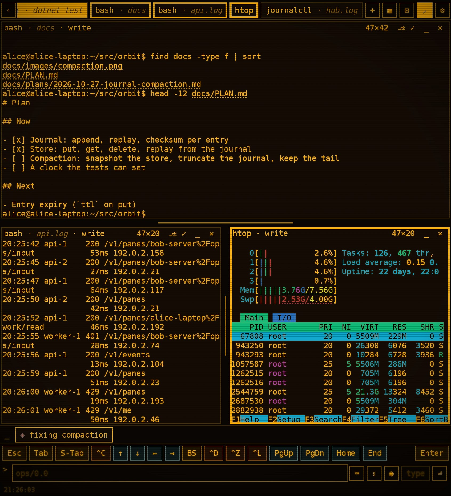

## Only here

What the phone and the watch add to reaching a terminal from a pocket:

<table>
<tr>
<td width="72" valign="top">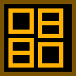</td>
<td><strong>Panes from several machines on one screen.</strong> Hold to pick up to
four panes from any mix of hosts and open them together: side by side
on an unfolded or landscape screen, stacked in portrait, each live and
typable, the focused one's tab lit. <code>+ pane</code> splits a window
and <code>+ session</code> starts one, where the host's agent allows it.</td>
</tr>
<tr>
<td valign="top"></td>
<td><strong>Your AI agent calls you.</strong> When the agent in a pane asks a question,
wants a permission, goes idle or finishes, the pane lights up in the
list, the phone buzzes, the watch face and its complications count the
waiting panes, and a tap lands on the pane behind the lock screen.
Claude Code is the agent tested so far.</td>
</tr>
<tr>
<td valign="top"></td>
<td><strong>A pane on the wrist.</strong> The watch shows a pane's tail through the
Claude Code lens, with the agent's answers as a reply menu, a row of
keys and the microphone; <em>phone</em> opens the same pane on the phone.
The watch may type only when the phone's owner allows it.</td>
</tr>
<tr>
<td valign="top"></td>
<td><strong>Voice input.</strong> Hold the microphone on the phone or the watch, speak,
and the words the hub's transcriber heard land on the input line for
you to read; nothing is sent until you say so.</td>
</tr>
<tr>
<td valign="top"></td>
<td><strong>Files both ways.</strong> Paste a screenshot into the line, pick files with
<code>⇪</code>, or share from any app into a pane: the file lands in the
host's inbox and its path on your line. A path a pane prints is a link; a
tap shows the image or the text over the pane, or hands the file to the
system.</td>
</tr>
<tr>
<td valign="top"></td>
<td><strong>Keys a phone keyboard lacks.</strong> A key bar with Esc, Tab, Ctrl-C and
the arrows, Claude Code's slash commands or a shell's recent lines in a
command row, any word on the screen completed, and the mouse for programs
that take it: a tap clicks, a drag scrolls. Every key goes through a
fixed grammar, never a raw escape sequence.</td>
</tr>
</table>

Besides: several hubs at once, each with its own token in the Android
Keystore and its panes in the one list; `+` after the tabs adds a pane,
new or existing, and `_` on a header parks a tile in a row above the
keys;
**fit** sizes the pane on the host to the phone, or pinch to read it at
the host's own width; amber by default, phosphor green, and paper for
daylight; a lens knows one agent's screen, and the Claude Code lens is
the one there is today.

## The screens

<table>
<tr>
<td align="center">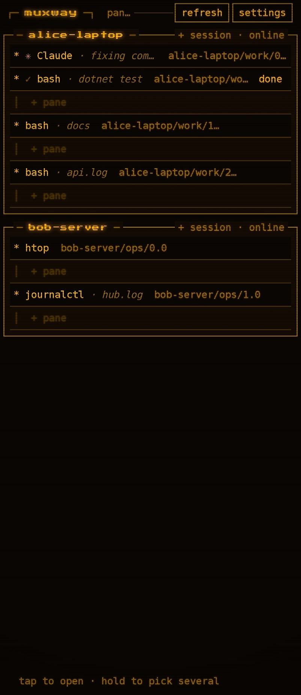<br><sub>the list, every host</sub></td>
<td align="center">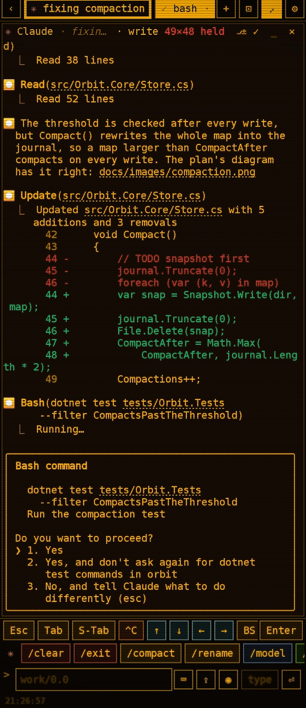<br><sub>Claude asks; the keys and its commands below</sub></td>
<td align="center">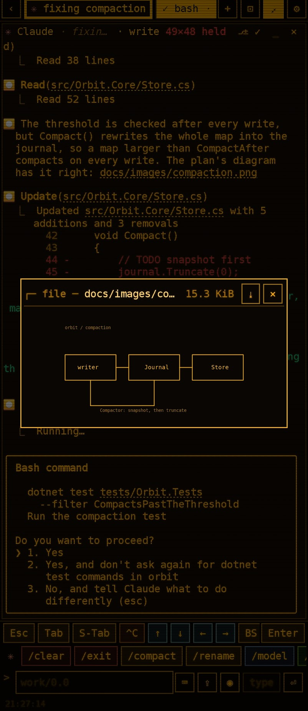<br><sub>a printed path tapped</sub></td>
</tr>
</table>

## On the wrist

<table>
<tr>
<td align="center">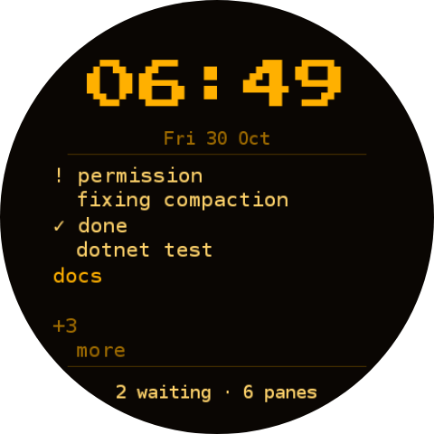<br><sub>the face</sub></td>
<td align="center">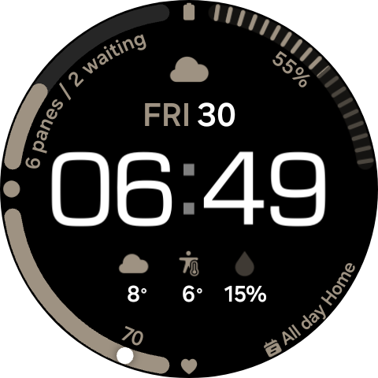<br><sub>or just a complication on any face</sub></td>
<td align="center">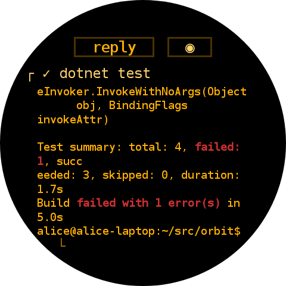<br><sub>a pane's tail</sub></td>
</tr>
<tr>
<td align="center">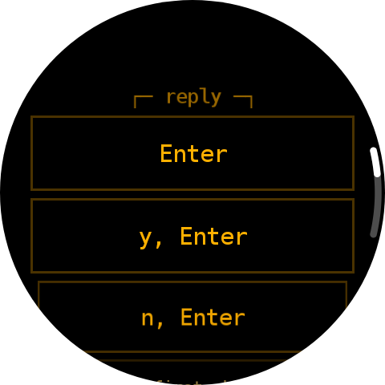<br><sub>reply</sub></td>
<td align="center">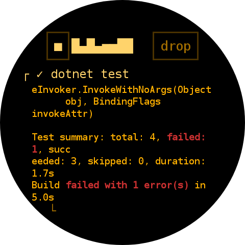<br><sub>speak</sub></td>
<td align="center">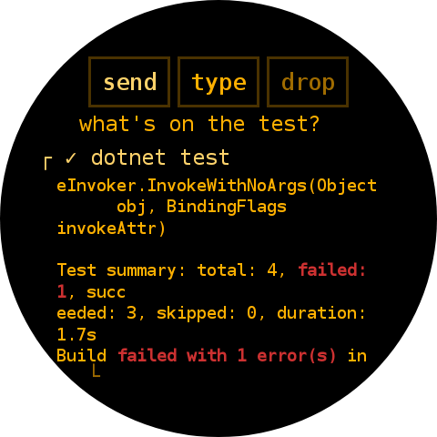<br><sub>then send, or type it first</sub></td>
</tr>
</table>

The features: [connect](docs/features/connect.md),
[panes](docs/features/panes.md), [pane view](docs/features/pane-view.md),
[lenses](docs/features/lenses.md),
[notifications](docs/features/notifications.md),
[attachments](docs/features/attachments.md),
[watch](docs/features/watch.md), [admin](docs/features/admin.md),
[look](docs/features/look.md). How it is built:
[docs/ARCHITECTURE.md](docs/ARCHITECTURE.md).

The other clients, and the hub: [muxway](https://github.com/notmarkopadjen/muxway)
(web client, protocol),
[muxway-glasses-even](https://github.com/notmarkopadjen/muxway-glasses-even),
[muxway-midp](https://github.com/notmarkopadjen/muxway-midp).

## Install

The latest build is on the repository's
[Releases page](https://github.com/notmarkopadjen/muxway-android/releases/latest)
as three APKs: app, wear and watchface. They are signed with a debug key,
so they install with `adb install` and by side-loading; building them
yourself is described below.

Build it yourself, Android 8.0 or newer:

```sh
./gradlew :app:assembleDebug      # app/build/outputs/apk/debug/app-debug.apk
adb install app/build/outputs/apk/debug/app-debug.apk
```

The build needs JDK 17 and an Android SDK with platform 35 (`sdk.dir` in
`local.properties`, or `ANDROID_HOME`).

For a Wear OS watch, build the watch app and the watch face too and install
them on the watch; all three APKs must carry the same signature:

```sh
./gradlew :wear:assembleDebug :watchface:assembleDebug
adb -s <watch> install wear/build/outputs/apk/debug/wear-debug.apk
adb -s <watch> install watchface/build/outputs/apk/debug/watchface-debug.apk
```

Then switch on **watch and notifications** in the phone app's settings,
and **watch may answer** if the watch is to send keys and spoken lines to a
pane.

## Connect

On the hub, make a token for the phone:

```sh
muxway hub token create --name phone --read 'alice-laptop/*' --write 'alice-laptop/@build'
```

In the app: hub URL (`https://hub.example.com`), paste the token, **save and
connect**. Or skip the typing and tap **scan code** in the app: the hub's
web admin page shows a QR code with every token it creates, and
`scripts/connect-qr.py https://hub.example.com` prints the same code in a
terminal when the token comes from the command above. The token goes into the Android Keystore
and is never shown again. Plain HTTP is accepted only for `localhost`, so
a hub without TLS is reached through `adb reverse` or an SSH tunnel.

## Tests

```sh
./gradlew test                            # unit tests
MUXWAY_CORE=../muxway scripts/e2e.sh      # the suite against a real hub and agent; MUXWAY_UI=0 skips the device run
```

See [docs/testing.md](docs/testing.md).

Contributors and AI agents: read [AGENTS.md](AGENTS.md) first.
Security issues: see [SECURITY.md](SECURITY.md).

[Apache License 2.0](LICENSE), like the rest of muxway.
