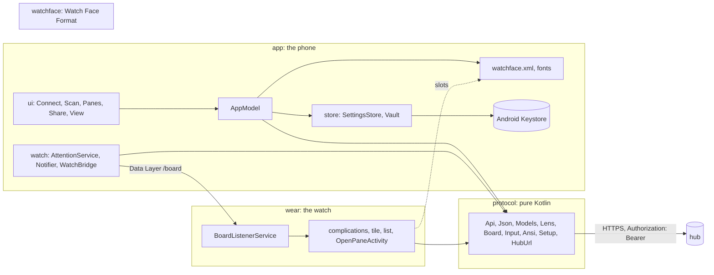
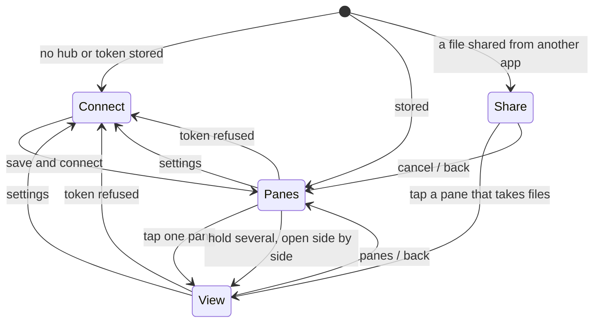
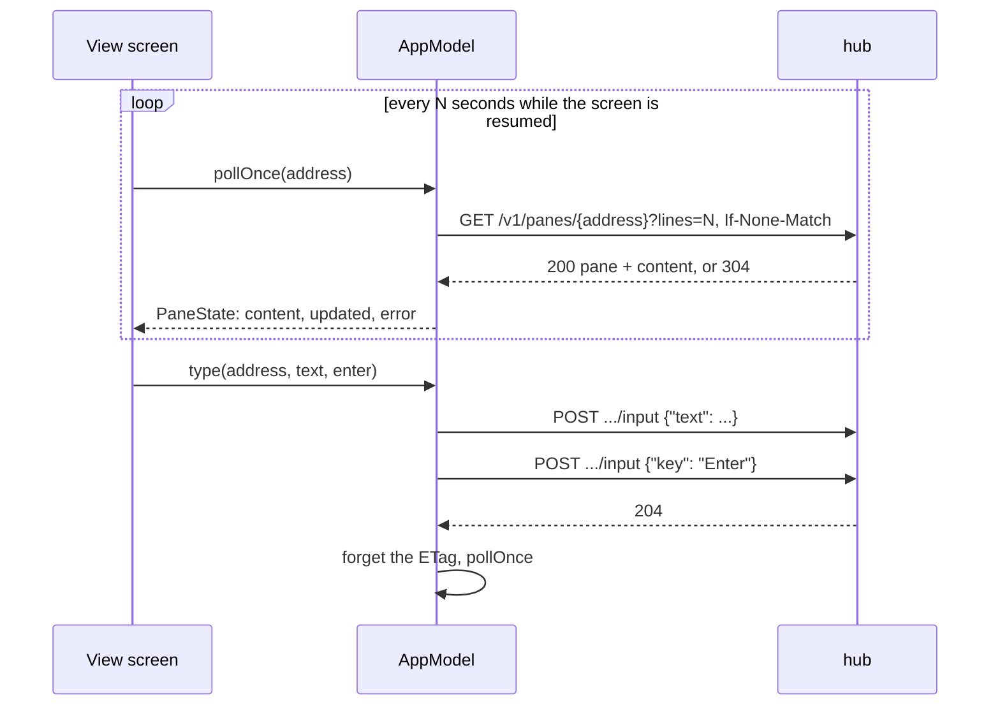
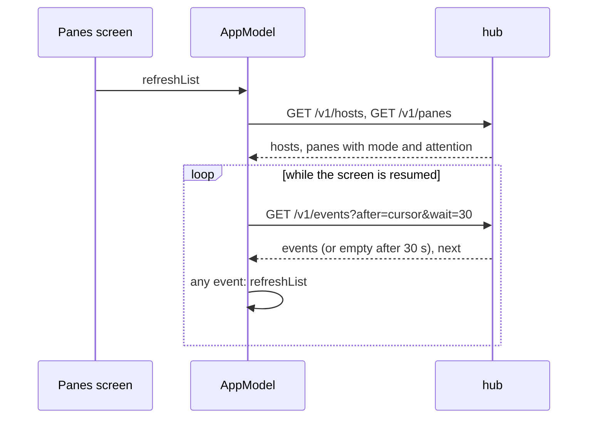
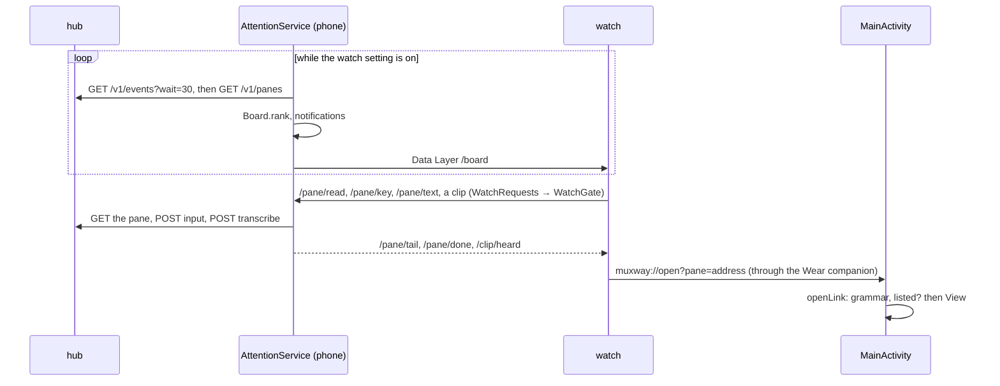

# Architecture

The Android client speaks [protocol v1](https://github.com/notmarkopadjen/muxway/blob/main/docs/protocol/v1.md)
of the muxway hub, JSON mode, and nothing else. Kotlin, Jetpack Compose,
minimum Android 8.0 (API 26). A Wear OS app and a watch face ship with it
from the same repository, because the Data Layer between a watch and a
phone connects only apps with the same package name and signing key.

## Modules

- **protocol** has no Android dependency. `Api` makes one blocking request
  per call with `HttpURLConnection`; `Json` reads the hub's answers
  defensively; `Input` filters what is typed; `Ansi` keeps colour and
  attribute sequences out of pane content and drops every other escape,
  then turns the text into styled rows; `HubUrl` decides which URLs are
  acceptable; `Lens` (one per AI coding agent, Claude Code's so far) and
  `Board` say what a pane is up to and rank the panes for a glance. The
  end-to-end suite runs this layer on the JVM against a real hub.
- **wear** and **watchface** are described in [features/watch.md](features/watch.md).
- **store** keeps settings in app-private preferences and the token in
  `Vault`: AES-256-GCM with a key generated inside the Keystore.
- **AppModel** is the one view model: which screen is open, the pane list,
  one `PaneState` per open pane, and the calls into `Api` on the IO
  dispatcher.
- **files** reads a content URI the keyboard, the picker or a share
  handed over into memory, under the inbox's cap, with the type checked
  against its list; see [features/attachments.md](features/attachments.md).
- **ui** is four Compose screens and a handful of widgets drawn as a
  terminal: monospace, box-drawing frames, square corners.

## Screens

See [features/connect.md](features/connect.md), [features/panes.md](features/panes.md),
[features/pane-view.md](features/pane-view.md) and
[features/attachments.md](features/attachments.md).

## Flows

### Reading and typing

### The pane list and notifications

### The watch

See [features/watch.md](features/watch.md) and [features/notifications.md](features/notifications.md).

## Protocol features used

Everything the app asks of a hub, as `protocol/.../Api.kt` sends it. The
core's `docs/protocol/v1.md` is the specification; this table is the
client's side of it.

| Feature | Request | Used by |
|---|---|---|
| hosts and panes | `GET /v1/hosts`, `GET /v1/panes`; a host's `sessions`, `close` and `keys` flags decide what the UI offers | pane list, watch service |
| reading a pane | `GET /v1/panes/{address}?lines=N&ansi=1` with `If-None-Match`; `304` when unchanged; colour kept, every other escape dropped | pane view, the watch's tail |
| typing | `POST /v1/panes/{address}/input` with `{"text"}` (control characters removed, 4096 bytes at most) | input bar, watch |
| keys | the same with `{"key"}`; the grammar (`C-`, `M-`, `S-` on any key, chords) where the host says `keys: 2`, the old names elsewhere | key row, keyboard, hardware keyboard, watch |
| mouse | the same with `{"mouse": {button, x, y}}`, only when the pane reports the mouse on; `count` (2 to 50, wheel buttons only) turns the wheel that many notches in one request, left out where the hub answered `bad_input` to it | taps, the notches of a drag |
| fit | `POST /v1/panes/{address}/resize` with `{cols, rows}`, `scope: window` and `zoom` for a pane alone, `{"fit": "auto"}` to give it back | tiles |
| split, new session, close | `POST /v1/windows/{host}/{session}/{window}/panes`, `POST /v1/hosts/{host}/sessions`, `POST /v1/panes/{address}/close`, where the host allows them | pane view, pane list |
| events | `GET /v1/events?after=cursor&wait=30&limit=50`, a long poll | pane list, watch service, the lens |
| transcription | `GET /v1/transcribe` (`204` or `404`) to know there is one, `POST /v1/transcribe` with `audio/wav` | microphone button, the watch's clip |
| files | `GET /v1/panes/{address}/files` (`204` or a refusal) to know the pane takes them, `POST` the same as `multipart/form-data` with one part `file` of a listed type, 8 MiB at most; the path answered lands on the input line | `⇪`, a paste into the line, a share from another app |
| admin | `GET /v1/me` for the grant, `GET /v1/admin/log?limit=200`, `GET /v1/admin/overview`, `DELETE /v1/admin/sessions/{id}` | the admin section of Settings |

Not used: `/v1/auth/*` (the token is pasted or scanned, never exchanged
for a cookie), `/v1/hosts/{host}/tree`,
`GET /v1/windows/...`, and the admin calls that mint or revoke tokens and
users.

## Security

- The token is stored only through `Vault`; the ciphertext is useless off
  the device. Backup and device transfer are off in the manifest.
- `Authorization: Bearer` on every request, never a URL parameter. No
  request, token or pane content is logged.
- HTTPS with the system trust store. The network security configuration
  allows cleartext only to `localhost` and `127.0.0.1`, and `HubUrl`
  refuses anything else before it is saved. A debug build alone also
  admits `10.0.2.2`, the emulator's route to the host it runs on, in both
  places.
- Bodies are read up to 2 MiB; JSON that does not fit the protocol is "The
  hub's answer made no sense", not a crash. Control characters and escape
  sequences are removed from everything shown; pane content keeps only
  SGR (colour and attribute) sequences, which are parsed as bounded
  integers and never interpreted beyond that.
- Typed text loses control characters and is capped at 4096 bytes; keys
  come from the protocol's fixed list. A read-only pane has no input bar.
- Redirects are not followed, so a proxy cannot send the token elsewhere.
- Dependencies: AndroidX core, activity, lifecycle, Compose BOM 2024.12.01,
  Kotlin coroutines, CameraX 1.4.1 and ZXing core 3.5.3 (both for scanning
  the connect code only), Play services wearable 18.2.0 (the Data Layer),
  all pinned in `app/build.gradle.kts`; the watch's are listed in
  [features/watch.md](features/watch.md). JSON is the platform's `org.json`.
