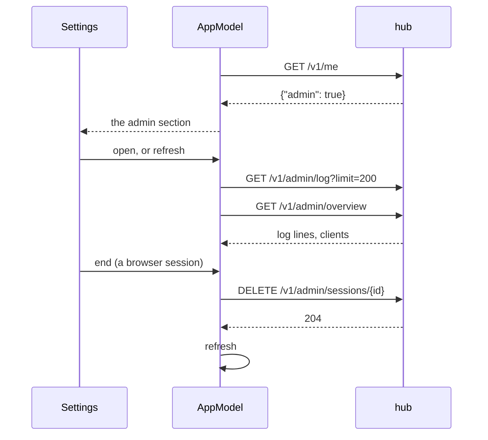

# The admin section

A token with the hub's **admin grant** (`muxway hub token create --admin`)
gets an **admin** section at the end of Settings. Any other token never
sees it: the app asks `/v1/me` once per connection and shows the section
only when the hub says `"admin": true`.



```
─ admin ─────────────────────────── [refresh] ─
log
23:43:05   signed in  addr=198.51.100.7 method=token token=0ddba4b5
23:43:07 ! admin refused  path=/v1/admin/overview principal=a23676b9
clients
web             alice@example.com  198.51.100.7 1m  [end]
muxway-android  phone              198.51.100.8 2s  token
tokens and address lists: on the web, or muxway hub token / access on the hub
```

- **log**: the hub's last 200 log lines, newest at the bottom; pull it
  down or tap **refresh** to load them again. Warnings are in the alert
  colour.
- **clients**: browser sessions and bearer clients with the token's name
  or the user's address, where they are and when they were last seen.
  **end** ends a browser session; a bearer client is ended by revoking its
  token on the web or with the CLI.

The phone has the read side only. Minting a token means typing grant
patterns, and a wrong address list shuts the owner out; both stay on the
web client's admin page and the hub's CLI (`docs/ui-guideline.md` §3 in
the core repository). The hub's side, the endpoints and the security
considerations are in the core's `docs/features/admin.md`.

## Security considerations

- The admin token is a key to the whole hub: the core docs advise a
  short-lived one (24 h unless `--ttl` says otherwise). It is kept in the
  Keystore like any other and never shown.
- What the section shows is the hub's log as the hub writes it: addresses,
  ids, results; never a token, a cookie or a pane's content. The app
  cleans every string of control characters before showing it.
- A session id is checked against `[A-Za-z0-9_-]{1,16}` before it goes
  into a path.
