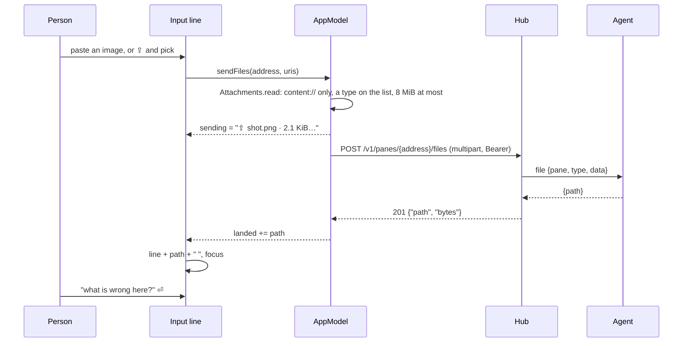

# Attachments: a file into a pane from the phone

An AI coding agent in a pane reads a screenshot or a file when its path
is in the prompt. Where the host's agent runs with an **inbox**
(`muxway agent run --inbox default`; see the core's
`docs/features/attachments.md`), the phone can hand the program in a
writable pane a file: the agent writes it on the host, and the file's
path lands on the input line for you to finish the sentence and send.

```
> what is wrong in /home/alice/.config/muxway/agent/inbox/20261025-102235-56fwge.png █
                                                        [⌨] [⇪] [◉] [type] [⏎]
```

Two ways in, both landing on the line of the focused pane:

- **Paste.** An image the keyboard inserts (Gboard's stickers, GIFs and
  the clipboard's screenshot), or a long-press *Paste* of a clip that
  holds a file. Text pastes as text, as before.
- **`⇪`**, right of `⌨`, opens the system picker; several files can be
  picked at once and go one after another.

While a file goes, the line reads `⇪ shot.png · 2.1 KiB…` in the
field's place, as it reads `⟳ hearing…` for the microphone. Then the
path is appended to whatever is on the line, with a space before it when
needed and one after, the line takes focus, and **nothing is sent**
until `⏎`. The types the inbox takes: PNG, JPEG, GIF and WebP images,
PDF, plain text, Markdown and JSON, 8 MiB each. The agent keeps a file
for a day.

`⇪` shows only when the pane is writable and the hub answered `204` to
`GET /v1/panes/{address}/files`, asked when the pane opens and kept for
a minute, as the browser does. On a host whose agent runs without
`--inbox` there is no `⇪`, and a paste with a file says
`No inbox on alice-laptop: its agent needs --inbox` in the status line
and pastes nothing.

Refusals land in the status line like a refused send, one per file:
`shot.svg: not a type the host takes`, `big.pdf: too large, 8 MiB at
most`, `x.png: cannot be read`, `x.png: read only`, `x.png: no inbox on
this host`, `x.png: the host's inbox is full`, `x.png: host offline`.
The hub takes one file every two seconds per token; a batch waits its
turn by itself (three tries, 2.1 s apart) before `one file every two
seconds` is reported.

## How it works



The input line is Compose's text field that takes content
(`BasicTextField(TextFieldState)` under `Modifier.contentReceiver`):
the keyboard's image insertion and a pasted clip reach a listener that
takes every item with a `content://` URI and leaves the rest to paste as
text. `Attachments.read` turns a URI into bytes in memory through the
`ContentResolver`, with the grant the sender gave; `Files` in the
protocol module holds the list of types, the cap, the progress label,
the path's landing on the line and the multipart body, built by hand:
one part named `file`, called `file` whatever the phone calls it, with
the file's type. `AppModel.sendFiles` runs one queue per pane: read,
check, upload, the path to the line, the next.

## Security considerations

- The hub's and the agent's checks stand in front of every file: the
  pane's write grant and write mark, the type sniffed against the bytes,
  8 MiB, one per two seconds, the inbox's caps; the agent names the file
  and writes it `0600` into one `0700` directory. This client repeats the
  type and size checks so a refused file costs no request, and sends
  nothing when the hub said the pane takes no files.
- Only `content://` URIs are opened, through the system resolver. A
  `file://` from a hostile share could name this app's own files; it is
  refused. The display name is shown in the status line only, printable
  and cut to sixty characters, and is **never sent**: the part's file
  name is always `file`, so no `../` or shell character from a name
  comes near a path on the host.
- The type sent is the resolver's, when it is one of the eight, else the
  one the name's extension names; anything else is refused before a
  request. The hub sniffs the bytes and refuses a mismatch.
- The path the hub answers is cleaned of control characters as
  everything shown is, and lands on a line the person reads before
  `⏎`. A file never types itself into the pane; a path on the line is
  what pasting the file into a local terminal would give.
- A file is held in memory from read to answer, 8 MiB at most, one at a
  time per pane, and dropped. Nothing is written to this app's storage
  and nothing is logged; the hub audits who put what type and size where.
- No new dependency and no new permission: the picker and the keyboard
  grant this app a read of the one file, for the one time.
