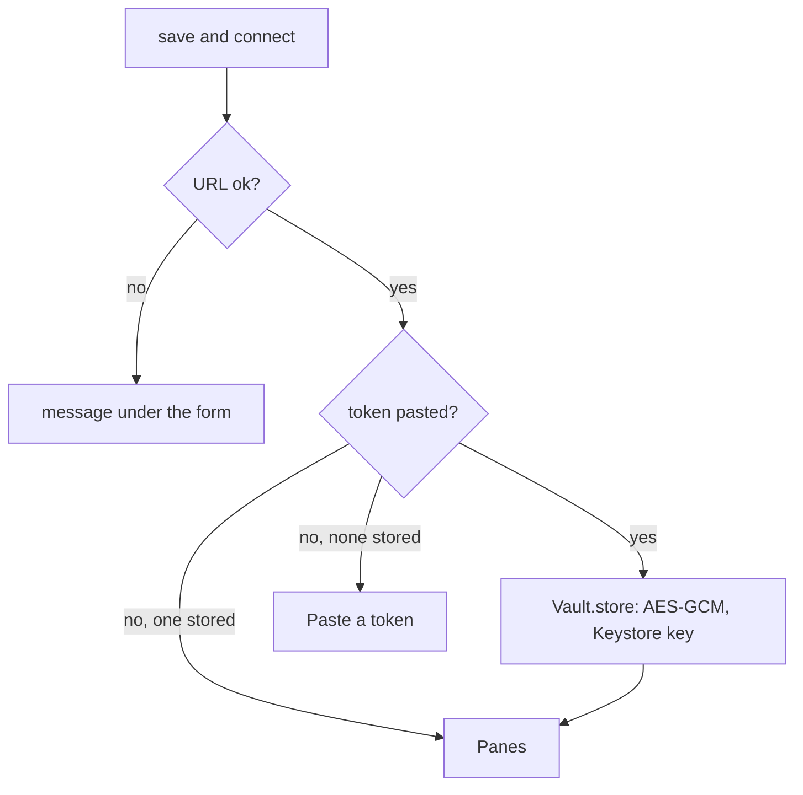
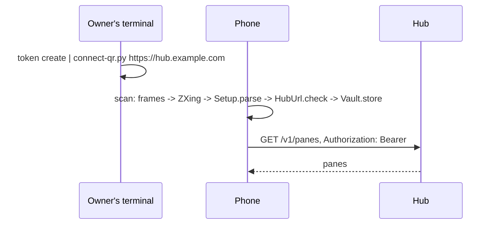

# Connecting

The Connect screen is the first thing the app shows until a hub URL and a
token are stored, and the Settings screen afterwards.

| Field | Meaning |
|---|---|
| hub | The hub's URL. `https://` is assumed when the scheme is missing. |
| token | Pasted once, then kept in the Keystore. The field is a password field and is empty after saving; the hint says `stored`. |
| every | Seconds between reads of an open pane, 1 to 60. |
| lines | Lines fetched per read, 10 to 2000. |
| text | Text size in sp, 6 to 24. |
| theme | `green` (phosphor on black), `amber`, `paper` (dark on light). |
| block screenshots | Sets `FLAG_SECURE` on the pane screen: no screenshots, no thumbnail in recents. Off by default. |
| assume a hardware keyboard | The input field takes focus without raising the on-screen keyboard; `⌨` in the pane view's top row brings it up. The input connection stays, so dictation keyboards keep working. Off by default. |
| effects | Glow, scanlines, vignette, power-on and pulses (see [look](look.md)). On by default. |
| reflow | With fit off, reflow long rows to the screen instead of scaling the pane's width. Off by default. |

**save and connect** checks the URL, stores the token when one was pasted,
and opens the pane list. **forget token** deletes the token from the device.
**scan code** opens the camera for a connect code (below), which fills in
hub and token and connects in one go.



## The connect code

Typing a token on a phone is error-prone, so the hub's owner can print it
as a QR code instead:

```sh
muxway hub token create --name phone --read 'alice-laptop/*' \
    | scripts/connect-qr.py https://hub.example.com
```

`scripts/connect-qr.py` needs only Python 3. It takes the token from
stdin (the first `mxt_…` word) or as a second argument, and draws the code
with block characters in explicit white on black, so it scans from any
terminal theme. The code holds

```
muxway://connect?hub=https://hub.example.com&token=mxt_…
```

with the values percent-encoded; unknown fields are ignored. Any client or
the hub itself may print the same payload.

In the app, **scan code** on the Connect screen asks for the camera
permission, shows the preview and decodes frames on the device (CameraX
and ZXing). The first connect code seen goes through exactly the checks a
typed URL and token go through, is stored, and the pane list opens. Other
codes show "That is not a muxway code" and scanning goes on.



## URL rules

- `https` is required.
- `http` is accepted only for `localhost`, `127.0.0.1`, `::1` and
  `10.0.2.2` (the emulator's route to its host). A hub without TLS on a
  development machine is reached with `adb reverse tcp:7600 tcp:7600` and
  `http://127.0.0.1:7600`.
- No user name, query or fragment in the URL.

## Security considerations

- The token can type into a shell. It is encrypted with a key that never
  leaves the Android Keystore and the ciphertext lives in app-private
  storage that is excluded from backup. Anyone who can unlock the phone and
  open the app can use it, so: a token per phone, scoped to the panes it
  needs, read-only unless typing is the point, revoked when the phone is
  lost.
- A refused token (`401`: wrong, expired or revoked) is final, so the app
  deletes it, comes back to this screen and says so. Nothing retries a
  refused token: every retry would count towards the hub's lockout of the
  phone's network (ten failures in ten minutes lock it for ten minutes,
  which the app reports as "Too many failed logins from this network").
- The token is never shown after saving, never logged, never part of an
  error message.
- A connect code is the token: whoever photographs the terminal has it,
  as with the printed token. The script prints the code only. A scanned
  payload is untrusted input: only `muxway://connect?` is accepted,
  percent-decoding rejects broken escapes and invalid UTF-8, and hub and
  token pass the same rules as typed ones, so a code cannot point the app
  at a plain-`http` hub on the internet. The camera is used on the Scan
  screen only; frames are decoded in memory and dropped.
