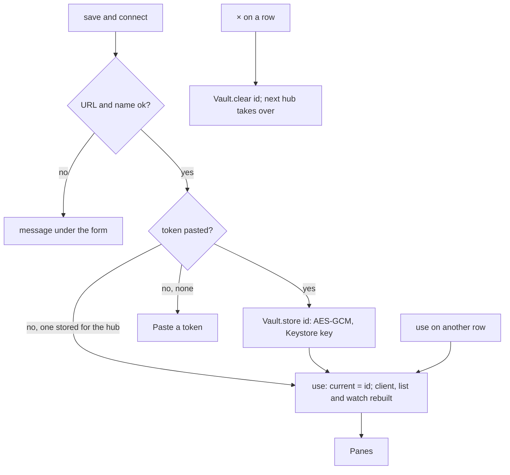
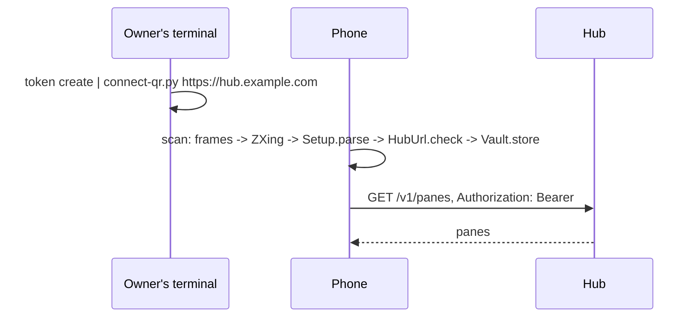

# Connecting

The Connect screen is the first thing the app shows until a hub and a
token are stored, and the Settings screen afterwards. It holds the
**hubs** the phone knows, the form that adds or changes one, and the
preferences. For an admin token, Settings ends with the
[admin section](admin.md).

## Several hubs

A hub gathers hosts; a person with a hub at home and one at work has two
addresses and two tokens. The app keeps a list of hubs, each with its own
token in the Keystore, and talks to **one at a time**: the `▸` marks it,
and with more than one hub the pane list's header says which (`panes ·
work`). The decision behind it, taken on 2026-10-24 for every client:
hubs stay separate. No list mixes two hubs' panes, no hub relays another,
and switching rebuilds the client, the pane list and the watch service
for the hub chosen. A single hub looks as it always did.

```
┌─ muxway ─┐  connect ──────────────── [panes]
─ hubs ─────────────────────────── + hub ─
▸ home   https://hub.example.com   [edit] [×]
  work   https://work.example.com  [use] [edit] [×]
hub home
name   [home                       ]
hub    [https://hub.example.com    ]
token  [stored · paste to replace  ]
[scan code]  or paste a token from the hub's owner
[save and connect]
```

| Field | Meaning |
|---|---|
| name | `a-z`, `0-9`, `-`, up to 32; from the host when left empty (`hub-example-com`). |
| hub | The hub's URL. `https://` is assumed when the scheme is missing. |
| token | Pasted once, then kept in the Keystore under the hub's own id. The field is a password field and is empty after saving; the hint says `stored`. |

**save and connect** checks the URL and the name, stores the token when
one was pasted, and switches to that hub: the pane list opens. **use**
switches to another hub with the token it has. **edit** puts a hub in
the form; **+ hub** empties it for a new one. **×** removes a hub and its
token; when it was the one in use, the next in the list takes over.
**scan code** opens the camera for a connect code (below), which adds the
hub it names with its token, or, for a hub already in the list, asks
whether the new token replaces the stored one.



An install from before the list keeps its one hub under a fixed id, and
the token stored before moves under that id the first time it is asked
for.

## Preferences

| Field | Meaning |
|---|---|
| every | Seconds between reads of an open pane, 1 to 60. |
| lines | Lines fetched per read, 10 to 2000. |
| text | Text size in sp, 6 to 24. |
| theme | `green` (phosphor on black), `amber`, `paper` (dark on light). |
| block screenshots | Sets `FLAG_SECURE` on the pane screen: no screenshots, no thumbnail in recents. Off by default. |
| assume a hardware keyboard | The input field takes focus without raising the on-screen keyboard; `abc` in the pane view's top row brings it up. The input connection stays, so dictation keyboards keep working. Off by default. |
| effects | Glow, scanlines, vignette, power-on and pulses (see [look](look.md)). On by default. |
| reflow | With fit off, reflow long rows to the screen instead of scaling the pane's width. Off by default. |
| watch and notifications | Follow the panes of the hub in use in the background: a notification when one waits, the board to a paired watch (see [notifications](notifications.md) and [the watch](watch.md)). Off by default. |
| notification text | Send what a pane said to the notification shade and the watch, not only its kind and name. Off by default. |

**save settings** keeps them and returns to the panes.

## The connect code

Typing a token on a phone is error-prone, so the hub's owner can print it
as a QR code instead:

```sh
muxway hub token create --name phone --read 'alice-laptop/*' \
    | scripts/connect-qr.py https://hub.example.com
```

`scripts/connect-qr.py` needs only Python 3. It takes the token from
stdin (the first `mxt_…` word) or as a second argument, and draws the code
with block characters in explicit white on black, so it scans from any
terminal theme. The code holds

```
muxway://connect?hub=https://hub.example.com&token=mxt_…
```

with the values percent-encoded; unknown fields are ignored. Any client or
the hub itself may print the same payload.

In the app, **scan code** on the Connect screen asks for the camera
permission, shows the preview and decodes frames on the device (CameraX
and ZXing). The first connect code seen goes through exactly the checks a
typed URL and token go through, is stored as a new hub named from its
host (or as the token of the hub already listed under that URL), and the
pane list opens. When that hub has a token already, the screen asks:
**replace it** stores the scanned one, **keep it** switches to the hub
with the one it has. Other codes show "That is not a muxway code" and
scanning goes on.



## URL rules

- `https` is required.
- `http` is accepted only for `localhost`, `127.0.0.1`, `::1` and
  `10.0.2.2` (the emulator's route to its host). A hub without TLS on a
  development machine is reached with `adb reverse tcp:7600 tcp:7600` and
  `http://127.0.0.1:7600`.
- No user name, query or fragment in the URL.

## Security considerations

- A token can type into a shell. Each hub's token is encrypted with a key
  that never leaves the Android Keystore and the ciphertext lives in
  app-private storage that is excluded from backup, one entry per hub id;
  removing a hub deletes its entry. The list of hubs itself holds names
  and URLs only, each URL checked by the same rules as a typed one when it
  is read back. Anyone who can unlock the phone and
  open the app can use it, so: a token per phone, scoped to the panes it
  needs, read-only unless typing is the point, revoked when the phone is
  lost.
- A refused token (`401`: wrong, expired or revoked) is final, so the app
  deletes that hub's token, keeps the hub in the list, comes back to this
  screen and says so. Nothing retries a
  refused token: every retry would count towards the hub's lockout of the
  phone's network (ten failures in ten minutes lock it for ten minutes,
  which the app reports as "Too many failed logins from this network").
- The token is never shown after saving, never logged, never part of an
  error message.
- A connect code is the token: whoever photographs the terminal has it,
  as with the printed token. The script prints the code only. A scanned
  payload is untrusted input: only `muxway://connect?` is accepted,
  percent-decoding rejects broken escapes and invalid UTF-8, and hub and
  token pass the same rules as typed ones, so a code cannot point the app
  at a plain-`http` hub on the internet. A code never replaces a stored
  token on its own: for a hub already listed the person is asked first. The camera is used on the Scan
  screen only; frames are decoded in memory and dropped.
