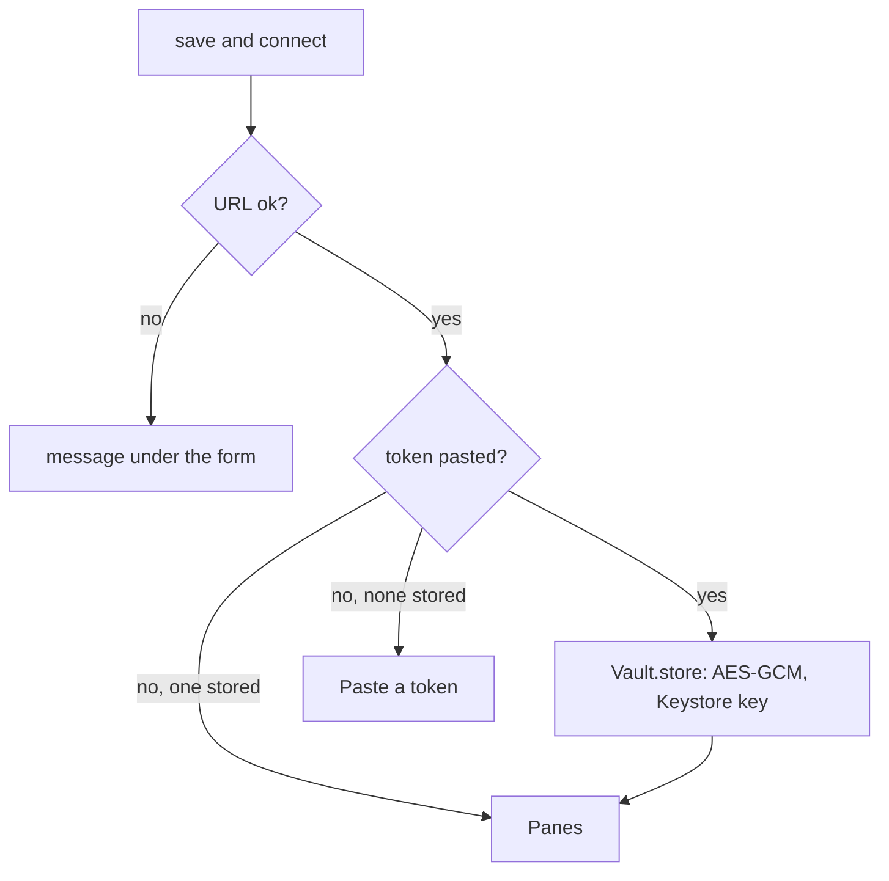

# Connecting

The Connect screen is the first thing the app shows until a hub URL and a
token are stored, and the Settings screen afterwards.

| Field | Meaning |
|---|---|
| hub | The hub's URL. `https://` is assumed when the scheme is missing. |
| token | Pasted once, then kept in the Keystore. The field is a password field and is empty after saving; the hint says `stored`. |
| every | Seconds between reads of an open pane, 1 to 60. |
| lines | Lines fetched per read, 10 to 2000. |
| text | Text size in sp, 6 to 24. |
| theme | `green` (phosphor on black), `amber`, `paper` (dark on light). |
| block screenshots | Sets `FLAG_SECURE` on the pane screen: no screenshots, no thumbnail in recents. Off by default. |

**save and connect** checks the URL, stores the token when one was pasted,
and opens the pane list. **forget token** deletes the token from the device.

## URL rules

- `https` is required.
- `http` is accepted only for `localhost`, `127.0.0.1`, `::1` and
  `10.0.2.2` (the emulator's route to its host). A hub without TLS on a
  development machine is reached with `adb reverse tcp:7600 tcp:7600` and
  `http://127.0.0.1:7600`.
- No user name, query or fragment in the URL.

## Security considerations

- The token can type into a shell. It is encrypted with a key that never
  leaves the Android Keystore and the ciphertext lives in app-private
  storage that is excluded from backup. Anyone who can unlock the phone and
  open the app can use it, so: a token per phone, scoped to the panes it
  needs, read-only unless typing is the point, revoked when the phone is
  lost.
- A refused token (`401`) sends the app back to this screen; the message
  says "Token refused" and nothing more.
- The token is never shown after saving, never logged, never part of an
  error message.
