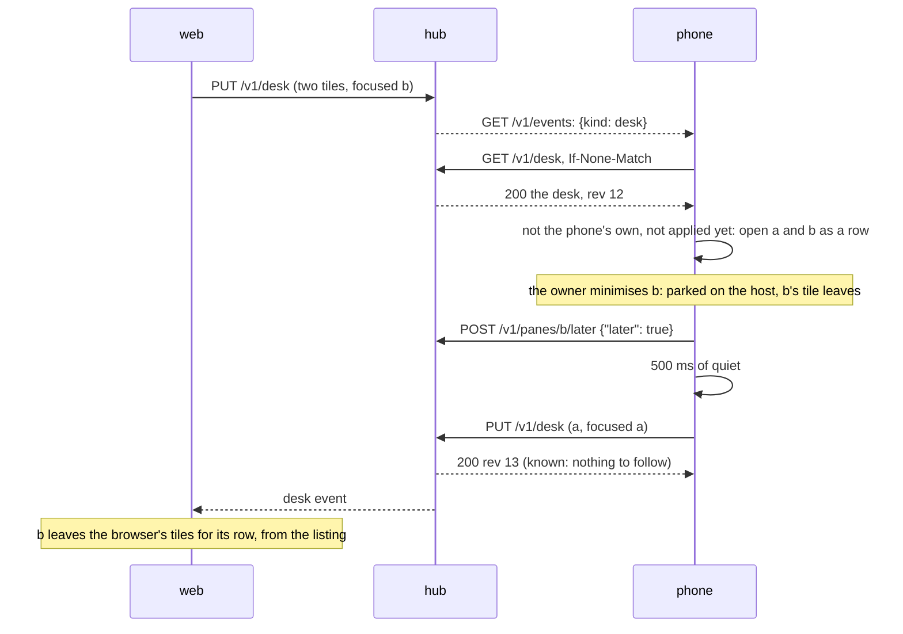

# The desk: one view, every client

Close the browser and pick up the phone, and the panes you had open are
there, laid out as you left them. The **desk** is the hub's record of
the view: which panes are open as tiles, the focused one, the
arrangement and the tab order, or the window the window view shows
(`GET` and `PUT /v1/desk`,
the `desk` event; the core's `docs/features/desk.md` and
`docs/protocol/v1.md`). Every client writes it as you change the view
and opens it when it starts; a client running follows the others within
a second.

```
┌─ muxway · panes ─────── [⚑ 2] [refresh] [settings] ─┐
▤ desk · 2 panes · row · by web
── alice-laptop ───────────────────────── + session ──
* work/0.0     Claude · review
* work/0.1     Codex · fix
```

## What the phone does

- **Reads** each hub's desk with its listing (every 15 s and on every
  event) and at once on the hub's `desk` event, with the `ETag`, so an
  unchanged desk costs a few bytes.
- **Shows** it as the `▤ desk` row at the top of the hub's panes on the
  list: `desk · 2 panes · row · by web`, `desk · the window
  alice-laptop/work/0`, `desk · the list` (a `list` desk: nothing open,
  as the last tile minimised with no other pane awake leaves it; dim, it
  opens nothing), or `desk · empty`, dim, while it holds nothing. The
  minimised row is not the desk's: it is the panes parked for
  [later](notifications.md#later), which the listing carries. A hub older than desks (its read answers `404`) has no row.
- **Opens** it: a tap on the row opens the desk's tiles in its
  arrangement (a preset, or the tree and shares of a custom one) with
  the focused tile; a window desk opens the
  window's panes as tiles, four at most, in the window's order, with
  the desk's focused pane focused, since the phone has no window view.
  An app started on the list after being closed in a view opens the
  first hub's desk that holds panes by itself; a desk holding nothing
  leaves it on the list, which is then the place to come back to.
- **Writes** it: half a second after the last change of the tiles, the
  focus, the arrangement or a split's shares, the view goes to the
  focused tile's hub as that hub's desk: its panes on the hub, the
  focused one, the arrangement with its tree and shares (only while
  every tile is on the hub, since a tree over another hub's panes would
  name leaves the hub cannot check). A `minimised` list a hub older than
  2026-11-11 answers is left alone, and none is written. Nothing is
  written while the view is what the hub has,
  or what it opened from, so opening a desk never writes it back; a
  read-only token (no writable pane, or a `read_only` refusal) writes
  nothing. The phone's strip has no owner's order, so no `order` is
  written and none applied.
- **Follows**: the hub's desk, when another client changed it (its
  `rev` is at least the phone's own last write's, and it is not what the
  phone wrote or applied), is applied within a second: the same tiles
  take the arrangement and the shares; other tiles
  open in their arrangement, the focus staying where it is. The focus is
  the desk's on opening only, so typing on the browser never moves the
  phone's focus.



`Desk` and `Desks` in the protocol module hold the desk and its rules
(`body`, `same`, `words`, the tree's shape); `Json.desk` reads one
defensively and `Json.deskBody` writes one; `AppModel` keeps each
connection's desk, writes and opens it; `ViewScreen` builds the view's
desk and follows the hub's (`docs/plans/2026-11-07-desk.md`).

## Security considerations

- The desk names panes, never content or input. Reading it reveals
  which panes the owner has open, filtered by the hub to what the reader
  may read anyway. Writing it moves other clients' views: the hub takes
  a write from a write grant only, checks every address against the
  writer's read grants (`not_yours`), caps the body at 8 KiB and the
  rate at a burst of five then one a second per principal, and audits
  the view and the count, never the panes' names.
- The phone reads a desk defensively, field by field: addresses by the
  protocol's grammar and bounded in number (four tiles, sixty-four in
  the order), the focus among the panes, the arrangement from the six,
  the tree's shape, leaves and keys checked and dropped whole when odd
  (the preset stands in), weights in range or none, `by` cleaned and
  bounded. Addresses are matched against the phone's own keys and never
  typed, sent as input or used as paths.
- A hostile client with a write grant can make the phone open any pane
  the phone's token may read, which the phone could open anyway, and
  nothing else. A hub used by several people with write grants shares
  one desk: they move each other's views. Give guests read-only tokens.
- Nothing new is logged on the phone; `last_place` in the preferences
  says `view` or `list` and nothing more.
