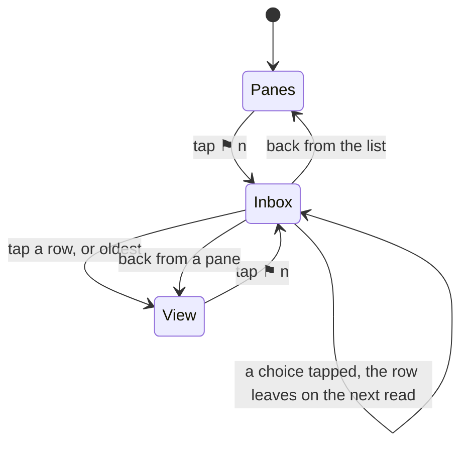

# The inbox: everything that waits for you, across hosts and hubs

A pane that needs its owner carries `attention` in the listing: a
question, a permission, idle or done (see
[notifications](notifications.md)). With a few agents on a few machines
the question is not "does this pane wait" but "what waits, and which
first". The inbox is that list, the browser's inbox window as a sheet.

```
┌─ muxway ─┐ panes ──────────────── [⚑ 2] [refresh] [settings]

┌─ inbox ─ 2 waiting ───────────────────────────────── [×] ┐
│ ⚑ oldest                                                  │
│ ─────────────────────────────────────────────────────────│
│ ? ⬡ Codex · deploy        alice-laptop/work/1.0      3m  │
│   question: deploy to staging?            [yes] [no]     │
│ ─────────────────────────────────────────────────────────│
│ ✓ ✳ Claude · tests        bob-desktop/work/0.0      12s  │
│   done: finished                                         │
└───────────────────────────────────────────────────────────┘
```

- **The count.** While anything waits, `⚑ n` sits in the header of the
  pane list and of the pane view, before *refresh* and `⚙`. It counts the
  panes with attention in the listings the app already holds, for every
  hub, so it costs no request of its own; it is gone when nothing waits.
  A tap opens the sheet.
- **The sheet.** One row per waiting pane, oldest first: the lens's glyph,
  the pane's name with its agent's mark, its place
  `host/session/window.pane`, how long it has waited (`12s`, `3m`, `2h`,
  `1d`), then the kind and what the pane said, and a question's choices
  as buttons (see
  [notifications](notifications.md#questions-with-fixed-answers)). A tap
  on a row opens the pane; **⚑ oldest** at the top opens the first row,
  the browser's `o`. Back or `×` closes. Empty, it says *nothing waits
  for you*.
- **What it reads.** While open, the sheet asks every hub's
  `GET /v1/inbox` every five seconds and merges the answers oldest first,
  so a question answered elsewhere leaves within seconds; until the first
  answer it shows the listings held in memory. A hub that does not answer
  keeps its last rows.



The host's *file* inbox, where `⇪` puts a file for the pane's program, is
another thing with the same name; see [attachments](attachments.md).

## Security considerations

- The inbox shows exactly what the token's read grants show in
  `GET /v1/panes`, sorted; each hub is asked with its own token, as every
  listing is, and a pane the token may not read is neither listed nor
  counted.
- Answering a choice from a row is a write with the rules of
  [answers](notifications.md#questions-with-fixed-answers): the hub and
  the host check the grant and the choice, the button only offers it.
- The sheet's reads fall under the hub's per-principal rate limit like
  any listing; one request per hub every five seconds, only while the
  sheet is open.
