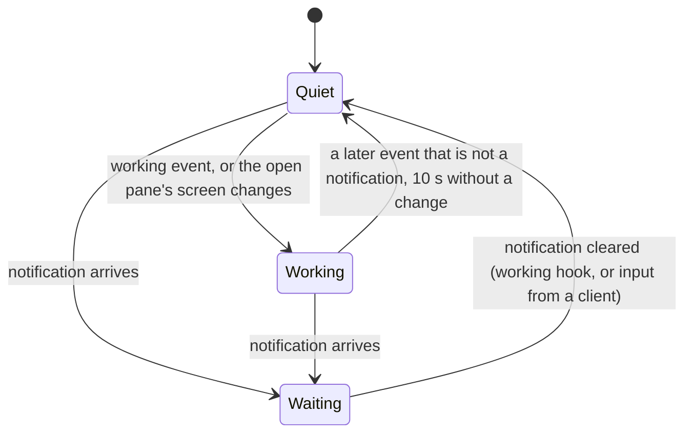

# Lenses

A lens knows one program, an AI coding agent that runs in tmux, and tells
the rest of the app what its pane is up to. The first, and so far only,
lens is for Claude Code, the one agent tested; another agent needs a lens
for its screen and its own hooks on the host calling `muxway notify`. A
lens is one object in the protocol package, pure Kotlin, unit-tested;
nothing else in the app knows what it looks for.

## The Claude Code lens

A pane is Claude Code's when its command is `claude` or its title starts
with Claude's mark `✳` (Claude sets the title to the mark and the session's
name). The lens answers one of three states:

| State | When | Glyph |
|---|---|---|
| waiting for you | the listing carries a notification: `permission`, `question`, `idle`, `done` | `!` `?` `z` `✓`, the theme's ink inverted |
| working | the last event the hub sent for the pane was `working` (Claude's hook on a submitted prompt), or the app is reading the pane and its screen changed in the last 10 s by itself | `⟳`, dim |
| quiet | anything else | nothing |

A change this client caused is not the program working: the first read of
a pane fills its screen, and what a pane prints within three seconds of
this app typing into it, sizing it or giving it back is this app's own
doing. The hub's recent events seed the states when the app connects, so
a pane that was already working says so before the next event arrives.

The glyph sits before the pane's name in the tab strip, in the pane's
header with the word (`! permission`, `⟳ working`), and in the pane list.
The name is the title without the mark, so a tab reads `⟳ build server`
rather than `✳ build server`. Panes without a lens show notifications
the same way and never show "working".

Tabs and headers are painted with the state: the theme's ink, inverted, while
the pane waits for you, dim while it works, plain when quiet. Selection
is a border, never a colour, so the state shows even on the pane you are
looking at.

Why not the listing's `activity`: it is tmux's window activity, shared by
every pane of the window, so with four Claude panes in one window it
marked all four as working whenever one printed. The event feed is per
pane. It needs the hooks from `muxway hooks claude-code` on the host,
which also feed the long poll that re-lists the panes at once; without
hooks only the open pane's own screen changes count.

## Security

The lens reads three fields the app has already filtered (title, command,
notification kind) and one number. A pane can at most make itself look
like Claude Code or look busy; it cannot make the app do anything. The
command row (`pane-view.md`) asks the lens whether to show Claude's
commands; a pane that looks like Claude's gets that row, and a tap on it
sends a fixed slash command, nothing else.
