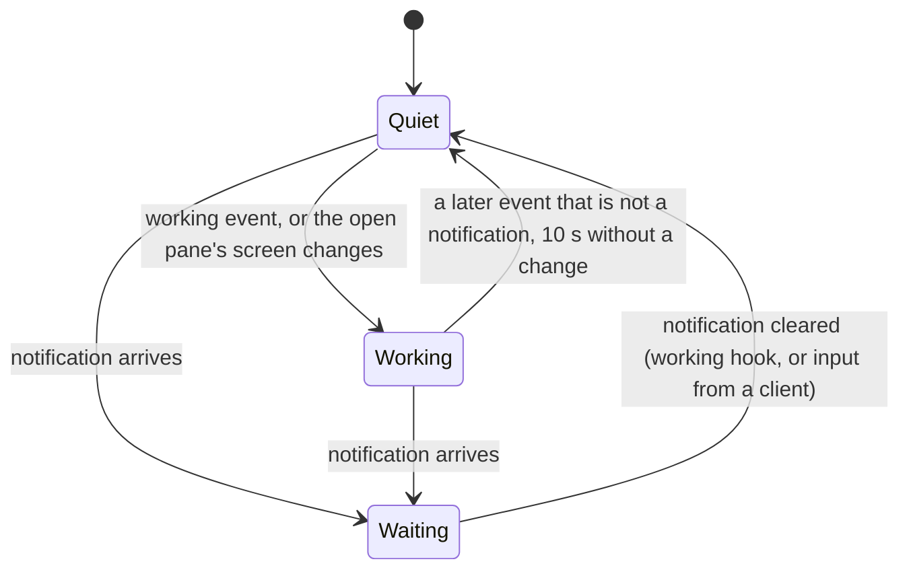

# Lenses

A lens knows one program, an AI coding agent that runs in tmux, and tells
the rest of the app what its pane is up to. The lens names every harness
the other clients name and paints them with the same three states; the
one that also reshapes a screen is Claude Code's, the agent tested daily.
A lens is one object in the protocol package, pure Kotlin, unit-tested;
nothing else in the app knows what it looks for.

## Every harness, named

A pane is Claude Code's when its command is `claude` or its title starts
with one of Claude's sparks (`✳ ✶ ✻ ✽ ✢`; Claude leads its title with one
and follows it with what it is on). The other AI CLIs are known by their
command, or by their name in the title when they run under an
interpreter (`node`, `bun`, `deno`, `python`, `python3`, `uv`), the
browser's table:

| Agent | command | in the title | mark |
|---|---|---|---|
| Claude | `claude`, or a spark leading the title | | a spark, twelve rays |
| Codex | `codex` | | a hexagon with a dot at its heart |
| Gemini | `gemini` | `gemini` | |
| Antigravity | `agy` | `antigravity` | a chevron lifted off its ground line |
| OpenCode | `opencode` | | |
| Copilot | `copilot` | `copilot` | |
| aider, goose, Amp, Cursor | `aider`, `goose`, `amp`, `cursor-agent` | | |

The marks are drawn with strokes, not typed, so they are the same in every
font, in the web's colours (Claude's orange, Codex's green, Antigravity's
blue); the name beside them says who, the mark only decorates. An agent is
named with the status it writes into its title after a dot (`Claude ·
fixing the build`, `Antigravity · notes`); a tab shows the status alone.
The state below applies to every named agent; a pane without one shows a
notification the same way and never shows *working*.

## The states

The lens answers one of three states:

| State | When | Glyph |
|---|---|---|
| waiting for you | the listing carries a notification: `permission`, `question`, `idle`, `done`; except an `idle` one on an agent's pane whose screen moved in the last 10 s, which is the agent's own background work and counts as working | `!` `?` `z` `✓`, the theme's ink inverted and pulsing; a waiting tile also glows in the ink, a shadow outside its box that moves no neighbour |
| working | the last event the hub sent for the pane was `working` (the agent's hook on a submitted prompt, or the host's watcher), or the app is reading the pane and its screen changed in the last 10 s by itself | a turning ring, drawn, not typed, so it is the same in every font; still with effects off; dim |
| quiet | anything else | nothing |

A change this client caused is not the program working: the first read of
a pane fills its screen, and what a pane prints within three seconds of
this app typing into it, sizing it or giving it back is this app's own
doing. The hub's recent events seed the states when the app connects, so
a pane that was already working says so before the next event arrives.

The glyph sits before the pane's name in the tab strip, in the pane's
header with the word (`! permission`, `⟳ working`), and in the pane list.
A pane is named as the guideline says (`Lens.describe`): an agent by its
name, with its mark before it where it has one and the status it writes
into the title (Claude's codename) after a dot, in italics and dimmer:
`✳ Claude · fixing the build`; a tab shows the status alone. Any other
pane is its command, then the title when that adds something: `vim ·
notes.md`, `bash`.

Tabs and headers are painted with the state: the theme's ink, inverted, while
the pane waits for you, dim while it works, plain when quiet. Selection
is a border, never a colour, so the state shows even on the pane you are
looking at.

Why not the listing's `activity`: it is tmux's window activity, shared by
every pane of the window, so with four Claude panes in one window it
marked all four as working whenever one printed. The event feed is per
pane. It needs the harness's hooks on the host (`muxway hooks <harness>`), or
the host's watcher for a harness without them, which also feed the long
poll that re-lists the panes at once; without either only the open pane's
own screen changes count.

## Security

The lens reads three fields the app has already filtered (title, command,
notification kind) and one number. A pane can at most make itself look
like an agent or look busy; it cannot make the app do anything. The
command row (`pane-view.md`) asks the lens whose commands to show; a pane
that looks like Claude's, Codex's or Antigravity's gets that row, and a
tap on it sends a fixed slash command, nothing else.
