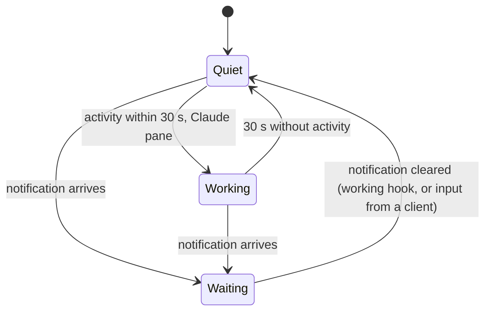

# Lenses

A lens knows one program and tells the rest of the app what its pane is up
to. The first, and so far only, lens is for Claude Code. It is one object in
the protocol package, pure Kotlin, unit-tested; nothing else in the app
knows what it looks for.

## The Claude Code lens

A pane is Claude Code's when its command is `claude` or its title starts
with Claude's mark `✳` (Claude sets the title to the mark and the session's
name). From the listing alone the lens answers one of three states:

| State | When | Glyph |
|---|---|---|
| waiting for you | the pane carries a notification: `permission`, `question`, `idle`, `done` | `!` `?` `z` `✓` in the attention colour |
| working | no notification, and the pane was active within the last 30 s | `⟳`, dim |
| quiet | anything else | nothing |

The glyph sits before the pane's name in the tab strip, in the pane's
header with the word (`! permission`, `⟳ working`), and in the pane list.
An open tab and a focused header are inverted; when that pane waits for
you the inversion is in the attention colour, so the state shows even
while you are looking at it.
The name is the title without the mark, so a tab reads `┤ ⟳ build server ├`
rather than `┤ ✳ build server ├`. Panes that are not Claude's show
notifications the same way and never show "working".

"Working" needs no hooks: Claude redraws its spinner while it thinks, and
the hub reports the pane's last activity. "Waiting" needs the hooks from
`muxway hooks claude-code` on the host, which also feed the event long
poll that re-lists the panes at once.

## Security

The lens reads three fields the app has already filtered (title, command,
notification kind) and one number. A pane can at most make itself look
like Claude Code or look busy; it cannot make the app do anything.
