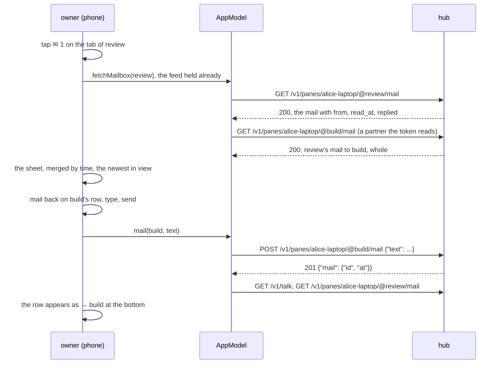

# Mail: a pane's mail in full, and the messages between panes

A pane's process can hold mail: a message left for it by another pane or
by its owner, held on the host and never typed (see the core's
[mail](https://github.com/notmarkopadjen/muxway/blob/main/docs/features/mail.md)).
The phone draws `✉ n` after a pane's name while its process has unread
mail; this page is about reading it. Parity with the core's web client
(`docs/ui-guideline.md` §1.6 *messages*, *the mail window*, *mail the
open pane*).

## The mail sheet

```
┌─ mail ─ review ──────────────────────────────────── [×] ┐
│ ← build · 3m · reviewer                 read · replied   │
│     run the tests on the branch and tell me what fails   │
│ → build · 2m · reply                            unread   │
│     tests green, two warnings in the log                 │
│ ← you · 12s · alice                  unread  [mail back] │
│     ok, go ahead                                         │
├──────────────────────────────────────────────────────────┤
│ ✉ mail to [review ▾]                                     │
│   [a message for its process; nothing is typed       ]   │
│   nothing is typed; the count stands until …    [send]   │
└──────────────────────────────────────────────────────────┘
```

- **Opening it.** The `✉ n` on a tab, on a tile's header or on a list
  row is a tap target of its own: the envelope opens the sheet, the
  rest of the name keeps what it did (the tab focuses, the header's
  name opens the name sheet, the row opens the pane). *✉ mail* in the
  pane menu (a tab or a header held still, see [the pane
  view](pane-view.md)) opens it for any pane, with the line focused;
  a mail row in the messages sheet opens it with that mail framed.
- **The rows**, merged by time, oldest at the top, the newest in view:
  `←` every mail in the pane's mailbox (`GET /v1/panes/{address}/mail`):
  the sender's name, or *you* for a client that is not a pane, the time,
  the token's name, `unread` until the process read it and `read`
  after, `replied` when the pane answered; the whole text under it.
  `→` every mail the pane sent, from the talk feed (`GET /v1/talk`):
  the recipient, and the whole text where the token reads the
  recipient's mailbox (one read per partner while the sheet is open),
  else the feed's first 200 characters marked *cut*. The owner's own
  mail to the panes of that conversation is listed too, as `you (name)`.
  Mail is text: nothing in it is markup, no link is made of anything.
- **The line.** `✉ mail to [target ▾]` names the pane; the picker lists
  it and the partners the rows name, a pane the token may not write dim
  with `read-only`. *mail back* on a received mail aims the line at the
  sender. Enter or *send* posts `{"text"}` to the target's mailbox with
  no origin: the owner is not a pane, so the process reads it as *from
  you* and answers with `muxway client mail`. The hub's refusal shows
  under the line. Nothing is typed into any pane.
- **Reading takes nothing.** The sheet shows what the process has not
  read as `unread` and leaves it so; the `✉ n` stands until the process
  reads. Marking mail read, or deleting it, is the process's own.
- While open the sheet asks the pane's mailbox, its partners' and the
  hub's feed every five seconds. A pane the token may not read, or a
  host without mail, says *this pane holds no mail you may read*.



## The messages sheet

`✉` beside `⚑ n` in the header of the pane list and of the pane view
opens it, while any hub has entries; `✉ n` counts the entries not
looked at yet, and opening the sheet clears the count (the mark of the
newest entry seen is kept per hub, in the app's preferences, so it
survives a restart).

```
┌─ messages ─ 3 ────────────────────────────────────── [×] ┐
│ ✉ build → review              3m · reviewer         [⇆]  │
│   run the tests on the branch and tell me what fails     │
│ ⇄ review → build              2m · reviewer         [⇆]  │
│   key: Enter                                             │
│ ✉ you → review               12s · alice            [⇆]  │
│   ok, go ahead                                           │
└──────────────────────────────────────────────────────────┘
```

- The rows are every hub's talk feed (`GET /v1/talk`, the last hundred
  entries of each) as one list, oldest at the top, the newest in view;
  two lines a row: `✉` for a mail or `⇄` for a typed write, who → whom
  by the panes' names (as their tabs show them; a pane that moved is
  found by its id, a pane not listed by its address), the time and the
  token; then the excerpt, two lines at most, a key or an answer with
  its kind before it.
- A tap on a mail row opens the mail sheet of the pane the mail went
  to, with that mail framed. A tap on a typed row, and `⇆` on every row,
  lays the two panes side by side (the one pane when a client wrote to
  it), each woken if it was parked.
- The feed comes with every listing, so the count is as live as the
  list; the sheet asks again every five seconds while open. No message
  is a notification.

```mermaid
stateDiagram-v2
    [*] --> closed
    closed --> mail: ✉ n on a tab, a header, a row; mail in the pane menu
    closed --> messages: ✉ beside ⚑ n
    messages --> mail: a tap on a mail row (that mail framed)
    messages --> view: a tap on a typed row, ⇆ on any row
    mail --> mail: mail back (the target changes), send (the row appears)
    mail --> closed: ×, back
    messages --> closed: ×, back
```



## Security considerations

- **What is shown.** The sheet shows mail text to whoever may read the
  pane, which `GET /v1/panes/{address}/mail` allows already; a partner's
  mailbox is read only where the partner is in the token's own listing,
  else the feed's excerpt stands, which the hub gives only where the
  token reads both panes. A mail from an origin the token may not read
  comes without its origin, as the hub sends it. Nothing reaches the
  phone that it could not get today.
- **Sending** needs the write grant on the target and the target marked
  for writing, checked by the hub as for an answer; the picker offers a
  pane the token may not write dim, and the hub's `403` shows as the
  refusal under the line if a stale listing let one through. The body
  is `{"text"}` alone: the owner is no pane, so a mail from the phone
  carries no origin and cannot be answered over the socket.
- **Hostile text.** Mail is written by agents. It is drawn as text,
  never as markup, with no link detection; control characters but
  newline and tab are removed when the answer is read, tabs are made
  spaces, a mail is cut at 4000 characters and an excerpt at 200, a
  name at 64, and no more than 200 mails or 100 entries are kept. What
  is typed goes through the same filter as the input line, 4000
  characters at most.
- **Nothing is logged** on the phone; the hub and the agent audit a
  mail's length and id, never its text. Nothing of any mail is stored:
  the only mark kept is the sequence number of the newest feed entry
  looked at, per hub.
