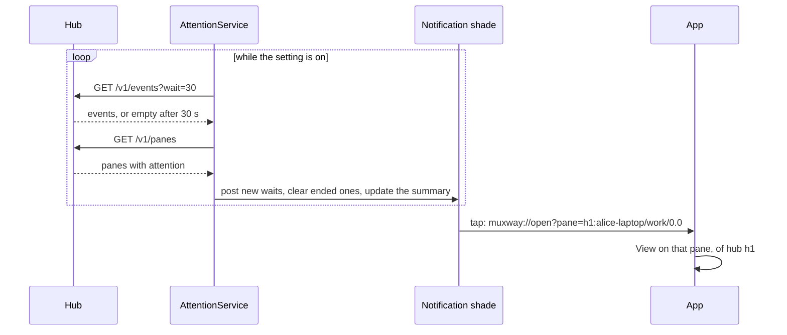
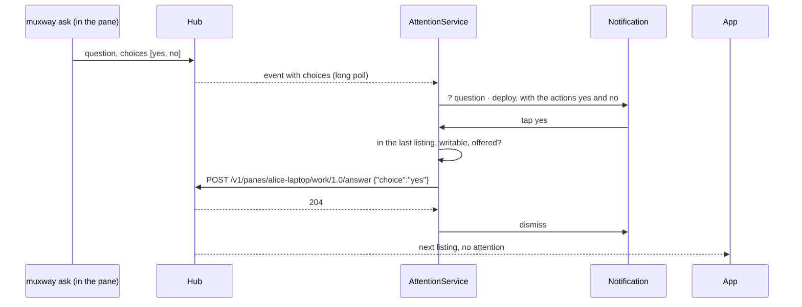

# Notifications on the phone

With the **watch and notifications** setting on, the app follows the panes
of every hub it has a token for while it is closed and tells you when one waits: a question, a permission,
idle or done. The AI coding agent in the pane tells the hub through its
hooks (Claude Code, Codex, Gemini, Antigravity, Copilot, OpenCode), or
the host's watcher reads its screen, as the core's
[notifications](https://github.com/notmarkopadjen/muxway/blob/main/docs/features/notifications.md)
describe; the app only shows what the hub reports. A question asked with
fixed answers carries its choices, and the phone answers it from the
shade, the tile, the [inbox](inbox.md) or the wrist.

```
┌─ muxway ────────────────────────────┐
│ ? question                     14:07 │
│ deploy · deploy to staging?          │
│ [yes]  [no]                          │
└──────────────────────────────────────┘
┌─ muxway ────────────────────────────┐
│ muxway · 2 waiting · 5 panes         │
│ [stop following]                     │
└──────────────────────────────────────┘
```

- One notification per pane that waits, in the channel **a pane waits for
  you**: the glyph and kind as title, the pane's name as text and, with the
  **notification text** setting on, what the pane said. It appears again
  when the kind or time changes and clears when the pane stops waiting. A
  tap opens that pane in the app through `muxway://open?pane=<address>`,
  behind the lock screen, so unlocking lands on it. A question with fixed
  answers carries them as actions, up to three (with more, the inbox has
  them all), only for a pane this phone may write to; a tap sends the
  choice from the service and the notification goes; a refusal takes its
  place for a few seconds.
- One ongoing notification, **following panes**, carries the service:
  how many wait, how many panes, or that there is no connection. Its
  action **stop following** switches the setting off, and so the watch
  shows `paused` until it is switched on again.
- Wear OS bridges these to a watch without the muxway watch app; with it,
  the [watch](watch.md) shows the board instead.



The service starts when the setting is switched on, when the app opens
with it on, and after a reboot. One long poll runs per hub; the board
and the notifications are the union of what every hub says. It stops
with the setting, when every token is forgotten, and when the last hub
refuses its token (a refusal, as in the app, forgets that hub's token;
the summary says so, and the other hubs go on). The link a notification
carries names the pane by its key, `<hub id>:<address>`; a bare address
means the first hub. While the app is open it runs its
own poll as well; two held requests cost the hub nothing it minds.

Android 13 and later ask for permission to post notifications when the
setting is switched on.

## Questions with fixed answers

A process in a pane can ask its owner something with `muxway ask --text
"deploy to staging?" --choice yes --choice no` on the host and wait for
the pick (the core's
[notifications](https://github.com/notmarkopadjen/muxway/blob/main/docs/features/notifications.md#questions-with-fixed-answers)).
The question reaches the phone as a `question` whose `attention` and
event carry `choices`; the app reads them only when they fit what the hub
itself allows (two to eight, each 1 to 40 printable characters without
`|`) and shows them as buttons wherever the pane's state shows: on the
tile's header after the word, in the inbox row, on the notification, and
first in the watch's reply menu. A tap sends `POST
/v1/panes/{address}/answer {"choice": …}` with the choice exactly as the
listing carried it: nothing is typed into the pane, the answer goes to
the asking process, and the attention goes with it, so the pane is
listed again at once. The buttons are dim on a read-only pane and while
an answer is on its way; `409 no_question` reads *nothing waits there
any more*, `400` *the hub refused the request*.



## Security considerations

- The service uses the app's `Api` and the token from the Keystore vault,
  and logs nothing: no text, no address, no token.
- An answer is a write with the rules of input: the hub checks the write
  grant and the pane's mark, the host checks the choice against the list
  it gave. The app offers a button only on a writable pane and sends the
  choice as the hub listed it, never edited. The notification's action
  names the pane and the choice in an explicit intent to this app's own
  service, which re-reads both against its last listing before anything
  leaves the phone; another app cannot turn it into a write.
- Choices from the hub are capped and filtered on parse, so a hostile hub
  cannot draw a button of arbitrary length or control characters; a list
  that does not fit is dropped and the question shows without buttons.
- Notification text is off by default: the lock screen is readable by
  others. Kind and pane name are the hub's, already filtered to printable
  text.
- The tap action is the app's own link, validated like any other; see
  [the watch](watch.md#security-considerations).
