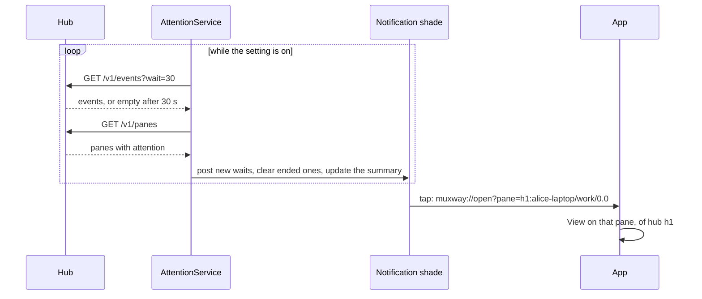

# Notifications on the phone

With the **watch and notifications** setting on, the app follows the panes
of every hub it has a token for while it is closed and tells you when one waits: a question, a permission,
idle or done. The AI coding agent in the pane (Claude Code is the one
tested) tells the hub through its hooks, as the core's
[notifications](https://github.com/notmarkopadjen/muxway/blob/main/docs/features/notifications.md)
describe; the app only shows what the hub reports.

```
┌─ muxway ────────────────────────────┐
│ ? question                     14:07 │
│ deploy                               │
└──────────────────────────────────────┘
┌─ muxway ────────────────────────────┐
│ muxway · 2 waiting · 5 panes         │
│ [stop following]                     │
└──────────────────────────────────────┘
```

- One notification per pane that waits, in the channel **a pane waits for
  you**: the glyph and kind as title, the pane's name as text and, with the
  **notification text** setting on, what the pane said. It appears again
  when the kind or time changes and clears when the pane stops waiting. A
  tap opens that pane in the app through `muxway://open?pane=<address>`,
  behind the lock screen, so unlocking lands on it.
- One ongoing notification, **following panes**, carries the service:
  how many wait, how many panes, or that there is no connection. Its
  action **stop following** switches the setting off, and so the watch
  shows `paused` until it is switched on again.
- Wear OS bridges these to a watch without the muxway watch app; with it,
  the [watch](watch.md) shows the board instead.



The service starts when the setting is switched on, when the app opens
with it on, and after a reboot. One long poll runs per hub; the board
and the notifications are the union of what every hub says. It stops
with the setting, when every token is forgotten, and when the last hub
refuses its token (a refusal, as in the app, forgets that hub's token;
the summary says so, and the other hubs go on). The link a notification
carries names the pane by its key, `<hub id>:<address>`; a bare address
means the first hub. While the app is open it runs its
own poll as well; two held requests cost the hub nothing it minds.

Android 13 and later ask for permission to post notifications when the
setting is switched on.

## Security considerations

- The service uses the app's `Api` and the token from the Keystore vault,
  and logs nothing: no text, no address, no token.
- Notification text is off by default: the lock screen is readable by
  others. Kind and pane name are the hub's, already filtered to printable
  text.
- The tap action is the app's own link, validated like any other; see
  [the watch](watch.md#security-considerations).
