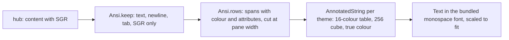

# The pane view

One or more panes on one screen, tabs above to switch, one input bar for the
focused pane.

```
[‹] [ ⟳ build ][ ! review ][ logs ]           ⤢ ⌨ ⚙
┌──────────────────────────────────────────────────┐
│ build · claude · write              ⟳ working 96×28│
│ $ make test                                       │
│ ok                                                │
│ $ █                                               │
└──────────────────────────────────────────────────┘
[Esc] [Tab][S-Tab][^C][↑][↓][←][→][BS] …   [Enter]
> ______________________________ [type] [send]
 12:00:01
```

## Layout

- `‹` at the top left goes back to the pane list.
- The **tab strip** lists every pane the token may read, in listing order,
  by name: the title the program set (Claude Code's is the session's name)
  or `session/window.pane`. Each tab is **painted with its state** from
  the [Claude lens](lenses.md): the attention colour when the pane waits
  for you (`!` `?` `z` `✓`, pulsing), dim when it works (`⟳`), plain when
  quiet. Selection never changes the colour: the open pane has a thick
  border and its name in bold. Tapping another tab switches to that pane.
  The strip scrolls when the tabs do not fit and keeps the focused one in
  view, with several panes open as well.
- The **controls** sit at the right end of the same row: `▦` (with
  several panes) the next arrangement, `⤢` fit on or off, `⌨` the on-screen keyboard (only with the hardware keyboard
  setting), `⚙` settings.
- A **swipe** left or right across the page moves to the next or previous
  pane in the strip.
- One pane fills the screen. Several panes start **side by side in
  landscape** and **stacked in portrait**, each with an equal share; `▦`
  cycles the arrangement like tmux's next-layout: row, column, main pane
  with the others beside it, grid (from three panes), back to automatic.
  The bar between two panes drags to resize them; no pane goes under
  fifteen percent. The arrangement is the phone's own and never reaches
  the host. Each header is painted like its tab, with the pane's name, command and mode,
  the lens's word (`! permission`, `⟳ working`) and, with fit on, the
  size; the focused one has the thick border and bold name.
- The line under the input shows the time of the last successful read, or
  the error.

## The body

The hub sends the pane's last `lines` rows with tmux's colour sequences
(`ansi=1`). The client keeps only SGR sequences, drops every other escape
and control character, and renders rows of styled spans:



- **Fit.** With **fit** on (the first button in the key row, on by
  default for a single pane you may write to), the pane on the host is
  sized to the columns and rows that fit the tile at the **text** setting,
  the way a terminal tells tmux its size: `POST .../resize`, debounced,
  once per distinct size, and `fit: auto` when you leave the view or turn
  it off, which gives the window back to tmux. The header shows the size.
  The person at the host sees the change, as with any terminal that
  attaches. Side-by-side views start with fit off.
- **Width.** With fit off, rows are shown at the pane's own width, as tmux
  shows them, and the font is sized so that width fits the tile, never
  larger than the **text** setting. A 96-column pane on a phone comes out
  small but intact, a 194-column one half that size; full-screen programs
  keep their layout. tmux sizes a window to its smallest attached
  terminal and fills the rest with dots, which is what a phone sees
  without fit.
- **Zoom.** Pinch zooms between half and four times the fitted size; when
  the text is wider than the tile it scrolls sideways.
- **Reflow.** The **reflow** setting applies when fit is off: rows reflow
  to the columns that fit at the current size instead of the pane being
  scaled; pinch then changes the margins. For shells and logs; a
  full-screen program's layout breaks under it, so it is off by default.
- **Colour.** The 16 base colours come from the theme (darker variants on
  paper), 16–255 are xterm's cube and grey ramp, true colour is passed
  through. Bold, dim, italic, underline and inverse are drawn.
- **Font.** DejaVu Sans Mono is bundled (`THIRD_PARTY.md`) so box drawing,
  block and symbol glyphs line up. Glyphs it lacks fall back to the system
  fonts; wide characters and emoji may push a row out of line.
- **Scrolling.** The body is a list of rows, newest at the bottom; a
  one-finger drag or a wheel scrolls back through the `lines` the hub
  sent (the pane's scrollback), and new output keeps the bottom in view
  until you scroll up. A full-screen program on the alternate screen
  (Claude Code is one) has no scrollback to fetch, so when the rows fit
  the tile a vertical drag **pages the program instead**: every third of
  the tile's height sends `PageUp` or `PageDown`, one key per answered
  request. Claude Code scrolls its transcript on those keys; so do most
  pagers and editors. The list underneath takes no drags then, and never
  the system's stretch effect, so the drag reaches the pager and a
  sideways swipe reaches the page.

## Reading

Every open pane is read on its own loop while the screen is resumed:
`GET /v1/panes/{address}?lines=N&ansi=1` with `If-None-Match`, every
`every` seconds (Settings). An unchanged pane answers `304` and costs a few
bytes. Leaving the screen or the app stops the loops. The event long poll
and a re-list every 15 s run on every screen once connected, so tabs and
the list stay current.

## Typing

The bar at the bottom types into the focused pane, when the listing says
it is writable:

- the key row sends one named key at once: `Esc` pinned at the left,
  `Enter` pinned at the right, and between them, scrolling: `Tab`,
  `S-Tab`, `^C`, arrows, `BS`, `^D`, `^Z`, `^L`, `PgUp`, `PgDn`, `Home`,
  `End`;
- with **assume a hardware keyboard** on, the text line takes focus
  without raising the on-screen keyboard, so a physical keyboard or a
  dictation keyboard types straight in; `⌨` in the top row raises it when
  wanted. The input connection stays up either way, which is what a
  dictation app needs;
- hardware keys reaching the screen (keyboard, D-pad, a glasses touchpad
  mapped to D-pad) send the matching named key: arrows, page up and down,
  home, end, tab, escape, enter, backspace. While the text field has focus
  it keeps its own keys.
- **type** sends the text as typed, without `Enter`;
- **send**, or the keyboard's send action, sends the text and then
  `Enter`.

After anything is sent the pane is read again at once. A read-only pane
shows `read-only` instead of the bar, and no gesture or hardware key sends
anything to it.

## Security considerations

- Text loses control characters before it leaves, the keyboard cannot
  insert them, and the app refuses to send anything over 4096 bytes. Keys,
  whether tapped, swiped or pressed on hardware, come from the protocol's
  list; nothing else can be sent. A swipe sends one key per answered
  request, so it cannot flood the hub.
- No input bar on a pane the hub marked read-only. If a listing lied, the
  hub refuses the write with `403` and the status row says "Read only".
- Pane content is text, never interpreted beyond colours and attributes:
  only `ESC [ <digits ; :> m` survives, with parameters read as bounded
  integers; titles, hyperlinks, cursor movement, DCS and everything else
  is dropped before the text reaches the screen. Bodies are capped at
  2 MiB and parsing is linear.
- With **block screenshots** on, the system refuses screenshots and
  recents thumbnails of this screen.
- A resize is a write: it is only sent for a pane the listing marks
  writable, within the protocol's bounds, once per size with a debounce,
  and the hub enforces the grant, the mark and its one-per-second limit.
