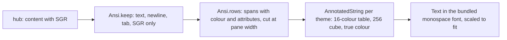

# The pane view

One or more panes on one screen, tabs above to switch, one input bar for the
focused pane.

```
┤ work/0.0 ├ │ work/0.1 │ │ logs ! │
┤ work/0.0 · bash · write ├
$ make test
ok
$ █
──────────────────────────────────────────────
[scroll][Enter][Tab][S-Tab][Esc][^C][↑][↓] …
> ______________________________ [type] [send]
[panes]            12:00:01           [settings]
```

## Layout

- The **tab strip** lists every pane the token may read, in listing order,
  by name: the title the program set (Claude Code's is the session's name)
  or `session/window.pane`. A glyph before the name says what the
  [Claude lens](lenses.md) sees: `⟳` working, `!` `?` `z` `✓` waiting for
  you. Open panes are inverted, the focused one is marked `┤ ├`. Tapping
  a closed pane swaps it into the focused tile; tapping an open one
  focuses it.
- One pane fills the screen. Several panes sit **side by side in
  landscape** and **stacked in portrait**, each with an equal share. The
  header of the focused pane is inverted; tapping a pane focuses it.
- Each header shows the pane's name, command and mode, then the lens's
  glyph and word (`! permission`, `⟳ working`) when there is one.
- The status row shows the time of the last successful read, or the
  error.

## The body

The hub sends the pane's last `lines` rows with tmux's colour sequences
(`ansi=1`). The client keeps only SGR sequences, drops every other escape
and control character, and renders rows of styled spans:



- **Width.** Rows are shown at the pane's own width, as tmux shows them,
  and the font is sized so that width fits the tile, never larger than the
  **text** setting. A 96-column pane on a phone comes out small but
  intact, a 194-column one half that size; full-screen programs keep
  their layout. The pane's size is tmux's and shared with every terminal
  attached to it; the protocol has no way to resize it from a client.
- **Zoom.** Pinch zooms between half and four times the fitted size; when
  the text is wider than the tile it scrolls sideways.
- **Wrap.** The **wrap** toggle in the key row reflows rows to the columns
  that fit at the current size instead: the text setting rules, pinch
  changes the margins, nothing scrolls sideways. For shells and logs; a
  full-screen program's layout breaks under it, so it is off by default.
- **Colour.** The 16 base colours come from the theme (darker variants on
  paper), 16–255 are xterm's cube and grey ramp, true colour is passed
  through. Bold, dim, italic, underline and inverse are drawn.
- **Font.** DejaVu Sans Mono is bundled (`THIRD_PARTY.md`) so box drawing,
  block and symbol glyphs line up. Glyphs it lacks fall back to the system
  fonts; wide characters and emoji may push a row out of line.
- **Scrolling.** A one-finger drag or a wheel scrolls the fetched history,
  newest row at the bottom until you scroll up.

## Reading

Every open pane is read on its own loop while the screen is resumed:
`GET /v1/panes/{address}?lines=N&ansi=1` with `If-None-Match`, every
`every` seconds (Settings). An unchanged pane answers `304` and costs a few
bytes. Leaving the screen or the app stops the loops. The event long poll
and a re-list every 15 s run on every screen once connected, so tabs and
the list stay current.

## Typing

The bar at the bottom types into the focused pane, when the listing says
it is writable:

- the key row sends one named key at once: `Enter`, `Tab`, `S-Tab`,
  `Esc`, `^C`, arrows, `BS`, `^D`, `^Z`, `^L`, `PgUp`, `PgDn`, `Home`,
  `End`;
- **scroll** toggles swipe keys: with it on, a row of vertical movement on
  the focused pane sends `Up` or `Down` and two columns of horizontal
  movement `Left` or `Right`, the way a terminal turns wheel scrolling
  into arrows for full-screen programs. Local scrolling is off meanwhile.
- hardware keys reaching the screen (keyboard, D-pad, a glasses touchpad
  mapped to D-pad) send the matching named key: arrows, page up and down,
  home, end, tab, escape, enter, backspace. While the text field has focus
  it keeps its own keys.
- **type** sends the text as typed, without `Enter`;
- **send**, or the keyboard's send action, sends the text and then
  `Enter`.

After anything is sent the pane is read again at once. A read-only pane
shows `read-only` instead of the bar, and no gesture or hardware key sends
anything to it.

## Security considerations

- Text loses control characters before it leaves, the keyboard cannot
  insert them, and the app refuses to send anything over 4096 bytes. Keys,
  whether tapped, swiped or pressed on hardware, come from the protocol's
  list; nothing else can be sent. A swipe sends one key per answered
  request, so it cannot flood the hub.
- No input bar on a pane the hub marked read-only. If a listing lied, the
  hub refuses the write with `403` and the status row says "Read only".
- Pane content is text, never interpreted beyond colours and attributes:
  only `ESC [ <digits ; :> m` survives, with parameters read as bounded
  integers; titles, hyperlinks, cursor movement, DCS and everything else
  is dropped before the text reaches the screen. Bodies are capped at
  2 MiB and parsing is linear.
- With **block screenshots** on, the system refuses screenshots and
  recents thumbnails of this screen.
