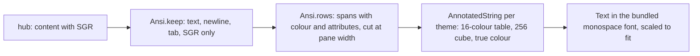

# The pane view

One or more panes on one screen, tabs above to switch, one input bar for the
focused pane.

```
[‹] [ ⟳ build ][ ! review ][ logs ]           ⤢ abc ⚙
┌──────────────────────────────────────────────────┐
│ build · claude · write              ⟳ working 96×28│
│ $ make test                                       │
│ ok                                                │
│ $ █                                               │
└──────────────────────────────────────────────────┘
[Esc] [Tab][S-Tab][^C][↑][↓][←][→][BS] …   [Enter]
> ______________________________ [⌨] [⇪] [◉] [type] [⏎]
 12:00:01
```

## Layout

- `‹` at the top left goes back to the pane list.
- The **tab strip** lists every pane the token may read, in listing order,
  by name: the title the program set (Claude Code's is the session's name)
  or `session/window.pane`. Each tab is **painted with its state** from
  the [Claude lens](lenses.md): the attention colour when the pane waits
  for you (`!` `?` `z` `✓`, pulsing), dim when it works (`⟳`), plain when
  quiet. Selection never changes the colour: the open pane has a thick
  border and its name in bold. Tapping another tab switches to that pane.
  The strip scrolls when the tabs do not fit and keeps the focused one in
  view, with several panes open as well.
- The **controls** sit at the right end of the same row: `▦` (with
  several panes) the next arrangement, `⤢` fit on or off, `abc` the on-screen keyboard (only with the hardware keyboard
  setting), `⚙` settings.
- A **swipe** left or right across the page moves to the next or previous
  pane in the strip, coming round at either end as `]` and `[` do in the
  browser.
- One pane fills the screen. Several panes start **side by side in
  landscape** and **stacked in portrait**, each with an equal share; `▦`
  cycles the arrangements that make sense for the count: two panes have
  a row and a column; three add a main pane on the left with the others
  stacked beside it, and a main pane on top with the others in a row
  below; four add a two-by-two grid. The bar between two panes drags to
  resize them; no pane goes under fifteen percent. Long-press a pane's
  header and drop it on another tile to swap the two. The arrangement is
  the phone's own and never reaches the host. Each header is painted like its tab, with the pane's name, command and mode,
  the lens's word (`! permission`, `⟳ working`) and, with fit on, the
  size; the focused one has the thick border and bold name.
- The line under the input shows the time of the last successful read, or
  the error.

## The body

The hub sends the pane's last `lines` rows with tmux's colour sequences
(`ansi=1`). The client keeps only SGR sequences, drops every other escape
and control character, and renders rows of styled spans:



- **Fit.** With **fit** on (`⤢` in the top row, on by default for every
  pane you may write to, one or several), the pane on the host is sized to the
  columns and rows that fit the tile at the **text** setting, the way a
  terminal tells tmux its size: `POST .../resize`, debounced, once per
  distinct size, and `fit: auto` when you leave the view or turn it off,
  which gives the window back to tmux. The header shows the size. The
  person at the host sees the change, as with any terminal that attaches.
  While the on-screen keyboard is
  up the tile is half its height, so the host keeps its size until the
  keyboard goes. If another terminal sizes the window meanwhile, the
  phone sends its size once more after twenty seconds and then leaves it,
  because two clients fitting one tmux window can only fight: the header
  shows the host's size in the alert colour with "held". Tapping `⤢`
  while it is on sends the size again at once, and holding it turns fit
  off. A pane shorter than the tile sits at the bottom with empty rows
  above; nothing can make 27 host rows fill 44. Tiles that are panes of
  one tmux window share one fit, because two fits on one row can only
  undo each other: the focused tile's pane fits (or the first of them,
  when the focus is in another window) and the others say "held", keep
  fit off and are scaled to their tile; the focus moving to another tile
  of the window moves the fit there, releasing the previous pane.
  A pane **alone in the view** sizes its whole window instead
  (`"scope": "window"`), with the pane zoomed over its siblings
  (`"zoom": true`, tmux's own zoom) when the window holds any, so no
  neighbour is squeezed to make room for the phone's screen. A pane that
  **gives way to another** in the view keeps the size it was given and is
  not sized again when it comes back at that size; every pane the view
  sized is given back when the view is left.
- **Width.** With fit off, rows are shown at the pane's own width, as tmux
  shows them, and the font is sized so that width fits the tile, never
  larger than the **text** setting. A 96-column pane on a phone comes out
  small but intact, a 194-column one half that size; full-screen programs
  keep their layout. tmux sizes a window to its smallest attached
  terminal and fills the rest with dots, which is what a phone sees
  without fit.
- **Zoom.** Pinch zooms between half and four times the fitted size; when
  the text is wider than the tile it scrolls sideways.
- **Reflow.** The **reflow** setting applies when fit is off: rows reflow
  to the columns that fit at the current size instead of the pane being
  scaled; pinch then changes the margins. For shells and logs; a
  full-screen program's layout breaks under it, so it is off by default.
- **Colour.** The 16 base colours come from the theme (darker variants on
  paper), 16–255 are xterm's cube and grey ramp, true colour is passed
  through. Bold, dim, italic, underline and inverse are drawn.
- **Font.** DejaVu Sans Mono is bundled (`THIRD_PARTY.md`) so box drawing,
  block and symbol glyphs line up. Glyphs it lacks fall back to the system
  fonts; wide characters and emoji may push a row out of line.
- **Tap.** A tap on the content is a left click at that cell on the
  host, for a program that asked its terminal for the mouse (Claude
  Code's menus, for one). The hub needs the mouse addition to the
  protocol (`docs/plans/2026-10-24-mouse-input.md`); an older hub
  answers "This hub has no mouse support yet", a pane whose program has
  no mouse mode "No mouse in this pane" (from the listing's `mouse` flag
  when the hub sends one, so nothing is sent at all), and nothing is
  typed either way.
- **Links.** A web address in a row, `http` or `https` and nothing else,
  is underlined and opens with a tap through the system's handler, in
  the browser; the punctuation after it stays text, a bracket it opened
  stays in, and an address wrapped onto a second row opens up to the
  row's end. A tap on a link is not a tap on the pane: nothing goes to
  the host, mouse mode or not.
- **Scrolling.** The body is a list of rows, newest at the bottom; a
  one-finger drag or a wheel scrolls back through the `lines` the hub
  sent (the pane's scrollback), and new output keeps the bottom in view
  until you scroll up. A full-screen program on the alternate screen
  (Claude Code is one) has no scrollback to fetch, so when the rows fit
  the tile a vertical drag **scrolls the program instead**: a wheel
  notch per row of movement when the program has the mouse (the hub's
  mouse addition and the listing's `mouse` flag), else a `PageUp` or
  `PageDown` per third of the tile's height; one request at a time.
  Claude Code scrolls its transcript on both. The list underneath takes no drags then, and never
  the system's stretch effect, so the drag reaches the pager and a
  sideways swipe reaches the page.

## Reading

Every open pane is read on its own loop while the screen is resumed:
`GET /v1/panes/{address}?lines=N&ansi=1` with `If-None-Match`, every
`every` seconds (Settings). An unchanged pane answers `304` and costs a few
bytes. Leaving the screen or the app stops the loops. The event long poll
and a re-list every 15 s run on every screen once connected, so tabs and
the list stay current.

## Typing

The bar at the bottom types into the focused pane, when the listing says
it is writable:

- the key row sends one named key at once: `Esc` pinned at the left,
  `Enter` pinned at the right, and between them, scrolling: `Tab`,
  `S-Tab`, `^C`, arrows, `BS`, `^D`, `^Z`, `^L`, `PgUp`, `PgDn`, `Home`,
  `End`;
- with **assume a hardware keyboard** on, the text line takes focus
  without raising the on-screen keyboard, so a physical keyboard or a
  dictation keyboard types straight in; `abc` in the top row raises it when
  wanted. The input connection stays up either way, which is what a
  dictation app needs;
- hardware keys reaching the screen (keyboard, D-pad, a glasses touchpad
  mapped to D-pad) send the matching named key: arrows, page up and down,
  home, end, tab, escape, enter, backspace. While the text field has focus
  it keeps its own keys, and two are the line's: `Enter` sends,
  `Shift+Enter` starts a new line.
- the **text line** wraps and grows upward to six rows, then scrolls
  inside. A text with several lines reaches the pane as one paste,
  between the bracketed-paste marks when the program asked for them, so
  Claude Code takes it as one message and bash as one block it shows
  before `Enter` runs it. Completion of the first word is on the web
  client for now (#12).
- right of the line, in this order: `⌨` the keyboard, `⇪` files
  (where the host has an inbox), `◉` the microphone (where the hub has
  a transcriber), **type**, and `⏎`;
- **type** sends the text as typed, without `Enter`;
- **`⏎`** (send), the keyboard's send action, or a hardware `Enter` sends the
  text and then `Enter`;
- the **keyboard**: `⌨` opens the web client's board over the bottom of
  the pane view, for the focused pane: F1 to F24 (F13 and up go as
  Shift+F1 to F12), the main block with its shifted legends, latching
  Shift, Ctrl and Alt (a double tap locks one), Caps and Num Lock, the
  navigation keys, the keypad and a column of command keys (*Attn* `^C`,
  *Clr* `^L`, *EOF*, *Susp*, *Kill*, *Word*, *Home*, *End*, *Rev*,
  *Back*). A tap sends at once, as text or as a key of the protocol's
  grammar; Ctrl or Alt with `;` is dimmed, and on a host whose agent does
  not list `keys: 2` so are the keys only the grammar has. The board
  scrolls sideways on a narrow screen; `_` folds it, `×` or back closes
  it. A read-only pane has no keyboard. The board and its rules are
  `Keyboard` in the protocol module, tested on the JVM, and the core
  repository's `docs/features/keyboard.md` describes them;
- the **microphone**: when the hub has a transcriber (asked once, with
  the first listing after connecting) a `◉` button sits between the text
  line and *type*, in every state, so a press and its release are one
  gesture. The first press asks for the microphone permission. **Held**,
  it records until the finger lifts; **tapped**, it records and the next
  tap stops, as the browser's button and `v` do. While
  recording, a level meter in block characters and the seconds take the
  line's place; the button becomes `■`, and it, a tap on the meter, or sixty seconds stops the clip,
  which goes to the hub as a 16 kHz mono WAV, and the words it heard land
  on the line, after a space when something was typed, with the line
  focused: nothing is sent until *send*. *cancel* or back drops the clip.
  A hub without a transcriber shows no button. Refusals show in the
  status line like a refused send: `Microphone refused`, `No microphone`,
  `Too short`, `One clip every five seconds`, `Transcriber unavailable`;
- **files**: where the host's agent has an inbox (`GET
  /v1/panes/{address}/files` is `204`, asked when the pane opens and
  kept for a minute) a `⇪` button sits right of `⌨`: it opens the
  system picker, and a file goes to the host's inbox and its path lands
  on the line with a space after it, focused, unsent. An image the
  keyboard inserts or a clip with a file pasted into the line goes the
  same way. While a file goes the line reads `⇪ shot.png · 2.1 KiB…`.
  Refusals land in the status line, one per file, with the file's name:
  `not a type the host takes`, `too large, 8 MiB at most`, the hub's
  code in words. See [attachments.md](attachments.md);
- **completion**: while the first word on the line is being typed, and
  nothing follows it, a row above the line offers what the program takes
  — Claude Code's slash commands, or a shell's starters and the lines
  sent to a shell from this phone — eight at most, marked `⇥`. A tap
  takes one onto the line with a space after it, ready for the rest; the
  row goes when the word is finished or nothing matches any more.
  Nothing a pane printed and nothing the hub said is ever offered
  (`Complete` in the protocol module, the browser's rules);
- the **command row**, between the key row and the text line, is for the
  program in the pane and scrolls sideways. Claude Code's pane (the lens
  decides) gets `/clear`, `/compact`, `/rename`, `/model`, `/resume`,
  `/usage`, `/context`, `/help` behind Claude's mark; a shell gets
  `exit`, `htop`, `claude`, `claude -c`, `codex`, `gemini`, `git status`,
  `ls`, `clear` behind `$`, then after a bar the last eight lines sent
  to a shell from this phone, newest first. A tap sends the command and
  `Enter` as *send* does; `/rename` puts `/rename ` on the text line and
  focuses it. Any other program has no row.

After anything is sent the pane is read again at once. A read-only pane
shows `read-only` instead of the bar, and no gesture or hardware key sends
anything to it.

A Wear OS watch shows a pane's tail with a few of these answers, through
the phone; see [watch.md](watch.md), *The pane screen*.

A pane that **exits on its host** is read no more: the tile leaves the
view by itself when the hub answers `404 not_found`, and with no tiles
left the pane list shows.

## Closing a pane

Where the host's agent runs with `--allow-close` and the pane is
writable, a tile's header has `×`. Tapping it asks on the header,
`close the pane on alice-laptop? y n`; `y` closes the pane on the host,
ending what runs in it, and the tile leaves (the list shows when it was
the last); `n` keeps it. Elsewhere there is no `×`. See the core's
`docs/features/new-panes.md` (Closing a pane).

## Security considerations

- Text loses control characters before it leaves, the newline excepted:
  it is the one the hub admits, and the agent delivers a text with one
  through a tmux buffer, never a shell, with the paste marks written by
  tmux. The keyboard cannot insert the others, and the app refuses to
  send anything over 4096 bytes. Keys,
  whether tapped, swiped or pressed on hardware, come from the protocol's
  list; nothing else can be sent. A swipe sends one key per answered
  request, so it cannot flood the hub.
- No input bar on a pane the hub marked read-only. If a listing lied, the
  hub refuses the write with `403` and the status row says "Read only".
- A spoken clip goes to the hub only, with the bearer token, and the hub's
  checks stand in front of the transcriber: the write grant, the WAV
  header, the size, one clip per five seconds. The clip lives in memory
  until the hub has answered and is dropped; nothing is stored or logged.
  The microphone is open only between the taps, with the permission the
  system asked for at the first one, and `RECORD_AUDIO` is used for
  nothing else. The transcript is cleaned as typed text is and shown on
  the line before anything is sent, so a hostile transcriber gets words
  on a line you read, nothing more.
- A file goes to the hub only, with the bearer token, and the hub's
  checks stand in front of the host's inbox: the write grant and mark,
  the type sniffed, 8 MiB, one per two seconds. This client sends only
  a type on the list and a file under the cap, never the file's own
  name, and types nothing: the path lands on the line for you to send.
  See [attachments.md](attachments.md).
- The command row sends what you could type: a fixed string from the
  app's own list, or a line you sent before, and `Enter`. Nothing from
  a pane, a title or the hub reaches the list; a pane dressed as Claude
  Code or a shell only chooses which row shows. The recent lines live in
  the app's private preferences, with the settings; a line that looks
  like it carries a credential (`token`, `password`, `secret`,
  `Authorization`, an API key, a `mxt_` prefix, or an upper-case
  `NAME=value` assignment) is never kept there.
- Pane content is text, never interpreted beyond colours and attributes:
  only `ESC [ <digits ; :> m` survives, with parameters read as bounded
  integers; titles, hyperlinks, cursor movement, DCS and everything else
  is dropped before the text reaches the screen. Bodies are capped at
  2 MiB and parsing is linear.
- With **block screenshots** on, the system refuses screenshots and
  recents thumbnails of this screen.
- A link's target is pane content, so it is untrusted: only `http://`
  and `https://` runs become links, `javascript:`, `intent:`, `file:`
  and every other scheme stay text, and the address goes to the system's
  view intent as the string that was printed, never to the app itself. A
  tap on a link sends nothing to the host, so a program cannot use one to
  provoke a click at a cell. A pane can print a misleading address, as
  any terminal can; the browser shows where it went.
- A tap sends only a button name and a cell inside the pane; the hub
  checks the grant, the mark and the ranges, and the agent sends nothing
  to a program that has not enabled the mouse.
- A resize is a write: it is only sent for a pane the listing marks
  writable, within the protocol's bounds, once per size with a debounce,
  and the hub enforces the grant, the mark and its one-per-second limit.
