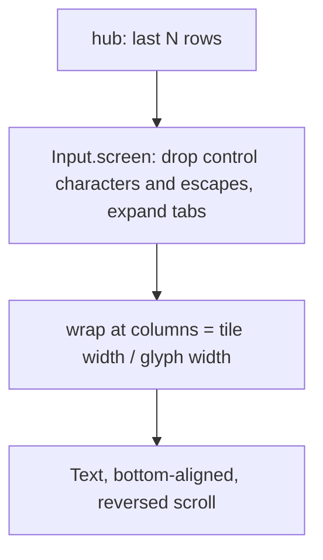

# The pane view

One or more panes on one screen, with one input bar for the focused pane.

```
┤ work/0.0 · bash · write ├
$ make test
ok
$ █
──────────────────────────────────────────────
[Enter][Tab][Esc][^C][↑][↓][←][→][BS][^D] …
> ______________________________ [type] [send]
[panes]            12:00:01           [settings]
```

## Layout

- One pane fills the screen. Several panes sit **side by side in
  landscape** and **stacked in portrait**, each with an equal share. The
  header of the focused pane is inverted; tapping a pane focuses it.
- Each header shows the pane's label, command and mode, and `! <kind>`
  when a notification is pending.
- The body is the pane's last `lines` rows in monospace, bottom-aligned,
  hard-wrapped at the columns the tile fits. Nothing scrolls sideways.
  Scrolling up reveals earlier rows; new content keeps the newest row in
  view until the user scrolls up.
- The status row shows the time of the last successful read, or the
  error.



## Reading

Every open pane is read on its own loop while the screen is resumed:
`GET /v1/panes/{address}?lines=N` with `If-None-Match`, every `every`
seconds (Settings). An unchanged pane answers `304` and costs a few bytes.
Leaving the screen or the app stops the loops.

## Typing

The bar at the bottom types into the focused pane, when the listing says
it is writable:

- the key row sends one named key at once: `Enter`, `Tab`, `Esc`, `^C`,
  arrows, `BS`, `^D`, `^Z`, `^L`, `PgUp`, `PgDn`, `Home`, `End`;
- **type** sends the text as typed, without `Enter`;
- **send**, or the keyboard's send action, sends the text and then
  `Enter`.

After anything is sent the pane is read again at once. A read-only pane
shows `read-only` instead of the bar.

## Security considerations

- Text loses control characters before it leaves, the keyboard cannot
  insert them, and the app refuses to send anything over 4096 bytes. Keys
  come from the protocol's list; nothing else can be sent.
- No input bar on a pane the hub marked read-only. If a listing lied, the
  hub refuses the write with `403` and the status row says "Read only".
- Pane content is text, never interpreted; escape sequences are removed
  before it is shown. Bodies are capped at 2 MiB.
- With **block screenshots** on, the system refuses screenshots and
  recents thumbnails of this screen.
