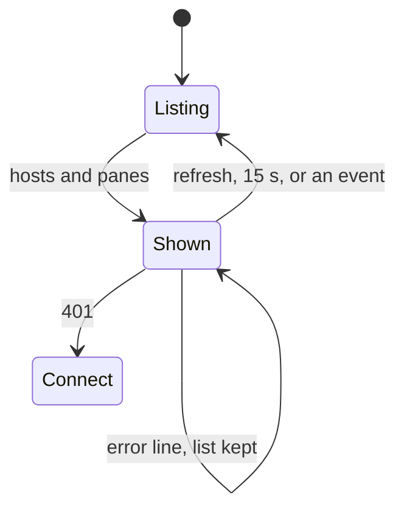

# The pane list

Every pane the token may read, from `GET /v1/panes`, grouped by host.

```
┌─ muxway · panes ───────────── [refresh] [settings] ─┐
── alice-laptop ───────────────────────── + session ──
* build        node          ! permission
* work/0.0     bash
│  + pane
  work/1.0     tail
── bob-desktop ──────────────────────────── offline ──
  tap to open · hold to pick several
```

- A row is the pane's name (the title its program set, else the alias or
  `session/window.pane`), then its place and command. `*` marks a pane
  this token may write.
- A pane with a pending notification shows `! <kind>` in the attention
  colour: `question`, `permission`, `idle` or `done`, see the core's
  [notifications](https://github.com/notmarkopadjen/muxway/blob/main/docs/features/notifications.md).
  A Claude Code pane that is busy shows `⟳ working` (see [lenses](lenses.md)).
- Hosts from `GET /v1/hosts` that are online with nothing exposed, and
  hosts that are offline, are listed after the panes.
- **tap** opens one pane. **hold** selects a pane; with a selection, taps
  add or remove panes. A bar appears right under the list, **clear** at
  its left and **open N side by side** at its right, which opens them
  together, up to four.
- Under the panes of a window where one of them is writable, a dim
  `│  + pane` row: a tap asks the hub for one more pane in that window
  (`POST /v1/windows/{host}/{session}/{window}/panes`, beside the pane
  when it is wide, below it when tall) and opens the new pane.
- `+ session` on the host's edge, for a host whose agent starts sessions
  (`"sessions": true` in `GET /v1/hosts`): a small dialog asks for a name
  (`[a-z0-9_-]{1,32}`); **start** or Enter asks the hub
  (`POST /v1/hosts/{host}/sessions`) and opens the session's first pane,
  **cancel** or back drops it. A refusal (`exists`, `read only`) shows in
  the dialog; a refused split in the list's error line. See the core's
  [new panes and sessions](https://github.com/notmarkopadjen/muxway/blob/main/docs/features/new-panes.md).

## Refreshing

The list is read when the screen opens, every 15 seconds while it is
shown, and on **refresh**. While the screen is shown the app also holds a
long poll on `GET /v1/events?wait=30`; any event re-reads the list at
once, so a new notification appears within a second.



## Security considerations

- The list is what the hub says this token may see; the app adds nothing
  and hides nothing.
- Names, commands, titles and notification texts from the hub are shown as
  text with control characters removed. They are never interpreted.
- Addresses from the list are percent-encoded when they go back into a
  request path.
- A new pane or session is a shell started on the host. The app sends a
  direction or a name it checked against the protocol's pattern, nothing
  else; the hub's write grant and the agent's flag decide, and the hub's
  answer, not the tap, is what the app acts on. The rows show where the
  listing says a pane is writable or the host starts sessions; a token
  without the grant gets `read only` back.
