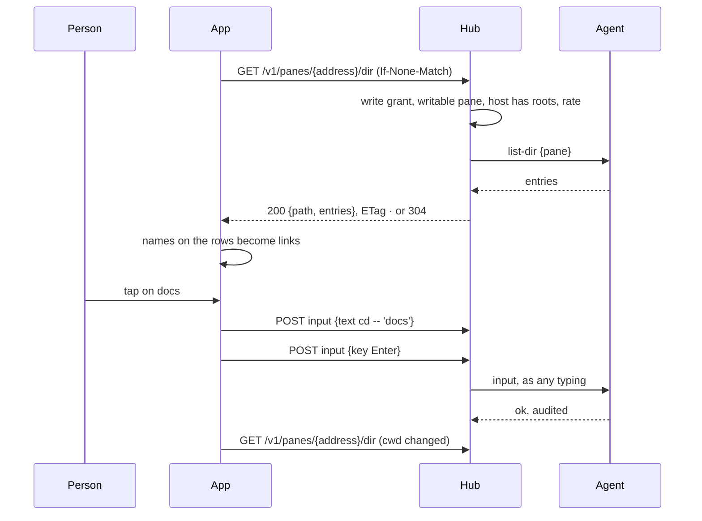
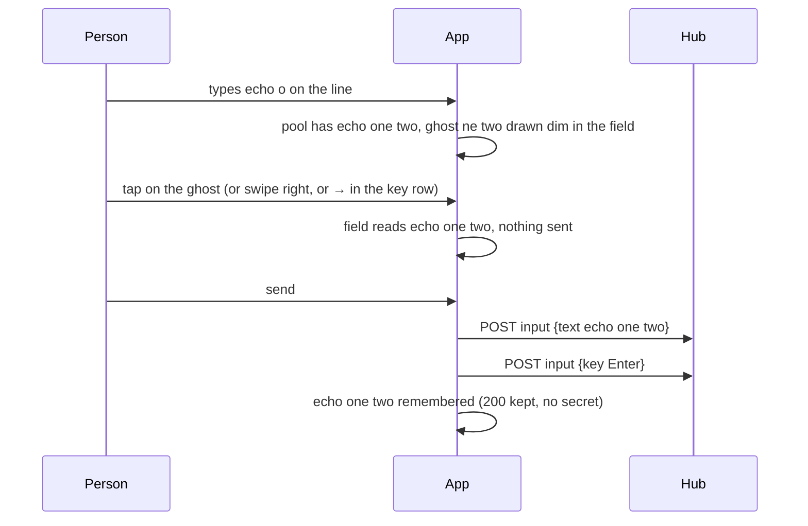

# Shell helper: the names a shell pane prints are links

A shell pane is read with the eyes and driven with keys. On the web the
names a listing prints can be clicked since the core's shell helper; on
the phone they can be tapped. In a writable shell pane on a host whose
owner named preview roots, every name of an entry of the pane's current
directory that appears on the screen, after `ls`, `tree`, `git status`,
`find`, in a program's output or in prose, is a link. A tap on a
directory enters it; a tap on a file opens it the way the person set:
the [file sheet](pane-view.md), `cat`, or their own command.

## Using it

The host's agent runs with `--preview <dir>`: the same roots, the same
rules as the file sheet. Nothing is listed without them, and a reader
sees nothing either: whoever may type into the pane may see what `ls`
would show them.

| on | a tap | a long press | the status line says |
|---|---|---|---|
| a directory | types `cd -- 'name'` and Enter | puts `'name' ` on the input line, nothing sent | `cd name` |
| a file, *a file opens with: preview* | the file sheet, nothing typed | the same | |
| a file, *a file opens with: cat* | types `cat -- 'name'` and Enter | the same | `cat name` |
| a file, *a file opens with: command* | types the command with `{}` replaced by `'name'` (or the name after it), and Enter | the same | the command with the name |

The long press is the web's Shift+click: the quoted name lands on the
line with a space after it, for a `cp` or `mv` in progress, where a
long press elsewhere on the pane copies the block it is in.

Nothing is underlined: a listing is all names, and a screen of
underlines reads badly on a phone. A name the host lists as neither a
directory nor a file (a socket, a device) stays text, as does every
word the host did not list. Nothing links while the pane runs something
other than a shell: a tap in `vim` or an AI agent must not type `cd`.
The pane's shell is known by its program (`bash`, `zsh`, `fish`, `sh`,
`dash`, `ash`, `ksh`, `tcsh`, `csh`); its directory is what tmux
reports for it, which the hub carries as `cwd` on the pane for its
writers.

The settings are on the Settings screen: *names* on or off, and *a file
opens with*, one of preview, cat and command, with a field for the
command when that is picked (`vim {}`, `less {}`, `bat {}`; `{}` stands
for the quoted name, and without it the name follows the command).

## How it works

The app sees cells. It cannot tell `docs` the directory from `docs`
the word, so it asks the host: `GET /v1/panes/{address}/dir` lists the
pane's own directory, by name and kind (`dir`, `file`, `other`), for a
writer on a host whose agent says `dir`. A tile showing a shell pane
that carries `cwd` asks every two seconds when focused and five
otherwise, with the `ETag`, so an unchanged listing is a round trip and
no body, and again at once when `cwd` changes; a directory the host
will not list (`404`) is not asked again for a minute.

On the screen, a run of a row equal to a listed name, set off by the
row's edge, blank space, a bar, a quote or a bracket, with the mark
`ls -F` adds or a sentence's punctuation after it allowed, is a link
where no other link is: a web address, an inbox file and a path with a
slash come first (`protocol/.../Names.kt`, the web's `names.ts`). A tap
on one is not a tap on the pane: the line is typed as one text and one
Enter through the ordinary input call.

## The ghost word

While a shell pane is typed into, on the input line or direct with a
hardware keyboard, the rest of what the app thinks is being typed is
drawn dim after the text: a line this phone sent before, a command the
screen shows was typed at a prompt, one of the command row's starters,
or, after a command that takes a file (`cd`, `cat`, `ls`, `vim` and
their kind), a name of the pane's directory, a directory with its
slash. On the line the ghost sits inside the field after the text; a
tap on it, a swipe right across the field or `→` in the key row takes
it into the field, and so does a hardware keyboard's `Right` with the
caret at the end of the text, `Ctrl+Right` its first word; `⏎` sends
the text as typed, never the ghost. The completion row
above the line stays as it is.

With direct typing the ghost is drawn in the pane after the cursor.
The app does not know where the shell's prompt ends, so it keeps a
shadow of the line from the keys it sent: text appends, Backspace
takes a character, Enter and the keys that clear the line (`C-c`,
`C-u`) start it afresh, and a key it cannot follow (history, Tab, a
move, `C-r`) makes it unknown until the next line. A ghost shows only
where the screen's cursor row ends with the shadow, so the screen
confirms what was typed; without a shadow the app takes the longest
suffix of the row that starts a word and that some known line starts
with, two characters at least. `Right` takes it whole, `Ctrl+Right` its
first word, both sent as ordinary text; any other key goes to the pane
and the ghost follows the screen. Nothing shows while text stands right
of the cursor, while the pane runs anything but a shell, or while the
setting *suggest* is off, which is the switch for a host shell that
draws its own (fish, zsh-autosuggestions).

The sent lines are the command row's store, grown to two hundred (the
row shows the first eight): a line that looks like it carries a secret
(a credential word, a muxway token, an upper-case assignment, a
database client with `-p`, `-u user:password`) is never kept, nor
offered from the screen, and **forget** on the Settings screen empties
the store; removing a hub empties it too. Nothing from the hub or
another pane is ever suggested (`protocol/.../Suggest.kt`, the web's
`suggest.ts`).

## Security considerations

- **What an attacker gains.** A stolen write token lists directories
  under the roots. It could already list them by typing `ls` into the
  shell, so the call adds no reach to a writer; a reader has no `cwd`
  and is refused; without roots nothing is served. `cwd` reaches
  writers only, is compared and never shown or typed.
- **A tap types into a shell.** The text is built by the app from a
  name the host listed, never from screen text: a run of the screen is
  a link only where it equals a listed name, so a program in the pane
  cannot invent one. It can print a real name to lure a tap; the tap
  then does the person's own action on that real entry, which is what
  they would have typed. The name is single-quoted with `'` escaped,
  `--` precedes it, names with control characters are never listed and
  dropped by the parser besides, and the command template is the
  person's own. Only a shell pane links, by its program.
- **Input that crosses a boundary.** The listing's names are host
  data: matched and shown as text, never as markup, 2000 at most, 255
  bytes each; the resolved path is kept for nothing but the listing.
- **Logs.** Nothing on the phone. The hub and the agent audit the
  request and the tap's input as ordinary lines: who, when, which pane,
  how many bytes, never a name.
- **The ghost sends nothing until taken.** It is a drawing of the
  app's, from this phone's own sent lines, the pane's screen and the
  listing; a copy of the screen, a `cat -v` on the host and the
  text-mode read see nothing. Taking it sends ordinary text through the
  same call, grant and audit. The store keeps no line that looks like a
  secret, offers none from the screen either, and is emptied by
  *forget* and by removing a hub.
- **Dependencies.** None new.
