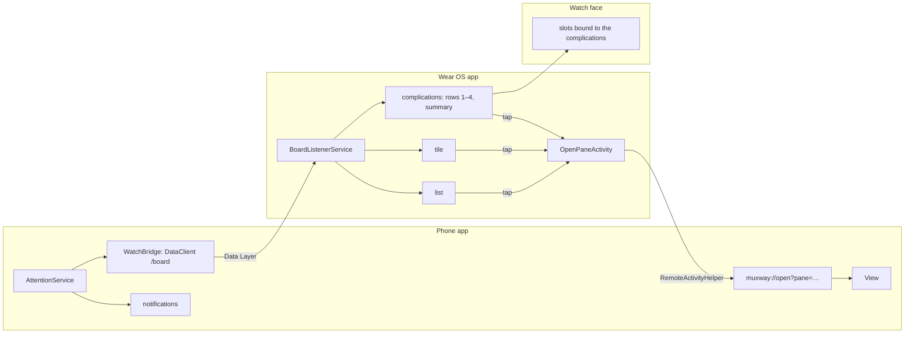
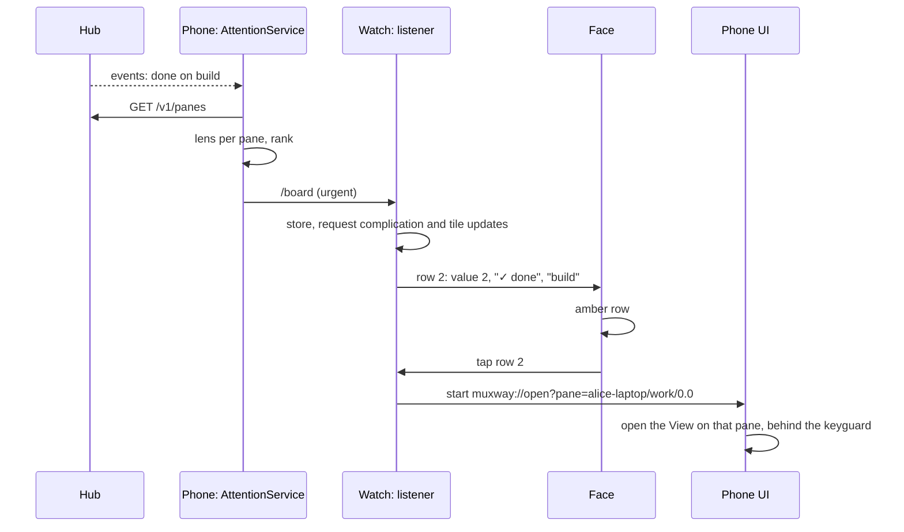
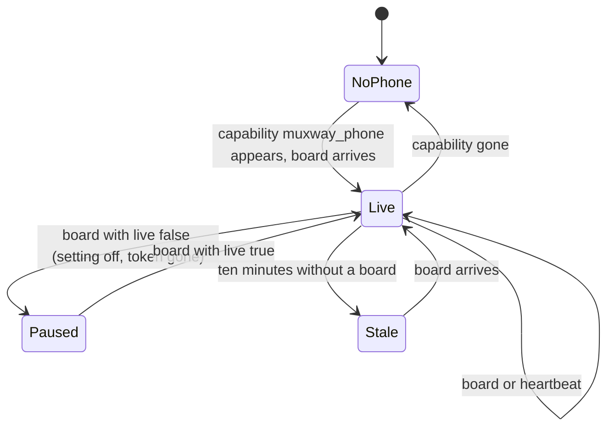

# The watch

A Galaxy Watch, or any Wear OS watch, shows which panes wait for their
owner: on the muxway watch face, in a complication on any other face, in
a tile and in a small list. A tap on a pane makes the phone app open that
pane, behind the lock screen, so unlocking the phone lands on it.

```
          ┌───────────────┐
          │    14:07      │   pixel digits
          │  fri 24 oct   │   dim
          ├───────────────┤
          │ ? question    │   row 1: attention colour, the pane that has
          │   deploy      │          waited longest
          │ ✓ done        │   row 2
          │   build       │
          │ ⟳ working     │   row 3: dim
          │   tests       │
          │ +2            │   row 4: more panes than rows
          ├───────────────┤
          │ 2 waiting · 5 panes │
          └───────────────┘
```

## How it works

The phone is the sensor, the watch is the display. The watch holds no
token and opens no network connection; everything it knows arrives from
the phone app over the Wear OS Data Layer, which connects only apps that
share a package name and a signing key.



With the **watch and notifications** setting on, the phone app runs a
foreground service that holds the hub's events long poll, lists the panes
after every answer, and computes the **board**: every pane with its lens
state, ranked. Panes that wait come first, the one that has waited longest
on top; then working panes; then quiet ones. Each row carries the pane's
address, its name, the state, the notification's kind and time and, only
when the **notification text** setting is on, the notification's text. The
board also says when it was computed and whether the service is running.

The board goes to the watch as one JSON document on the Data Layer path
`/board`. It is sent when the rows change and otherwise every five minutes
as a heartbeat, so the watch can tell a quiet day from a dead link.



### On the watch

- **Complications**, five of them: `pane 1` to `pane 4` are the board's
  rows, `waiting` is the summary. Each supports `RANGED_VALUE` (the value
  is how to colour the line: 0 dim, 1 ink, 2 attention; the text is
  `? question`, the title the pane's name), `SHORT_TEXT` (`?2` for the
  summary: the top glyph and how many wait) and `LONG_TEXT`. They update
  when the board arrives, never on a timer. A row without a pane shows
  `·`; the last row shows `+N` when there are more panes than rows.
- **The tile** lists six rows and the summary; each row is a tap.
- **The app** lists every pane with glyph, name, kind and, when sent, the
  text; the summary is its last line. It opens from the launcher or from
  the summary complication.
- **A tap** on a row starts `OpenPaneActivity`, which finds the phone by
  the capability `muxway_phone` the phone app announces, asks the Wear OS
  companion to start `muxway://open?pane=<address>` on it, says `opened on
  the phone` or `no phone`, and closes.

When no phone is reachable, when the phone's service stopped (`live` is
false) or when the board is older than ten minutes, every line turns dim
and the summary says `no phone`, `paused` or `stale`. A board that stops
updating must never look current.



### The watch face

`watchface/` is a Watch Face Format 1 face: XML and fonts, no code, in its
own APK (the format forbids code). The time is set in the pixel font, the
date under it; four row slots and a summary slot are complication slots
that default to the muxway complications. The face colours each row by
the complication's value with a `Condition`, so it needs no code and any
other complication put in a slot still renders. Three colour options,
green, amber and paper, match the phone app. In ambient mode everything
dims to about a third. Tapping a row is the complication's tap action; the
time has none.

Any other face shows the same information through its own slots: pick a
`muxway · pane N` or `muxway · waiting` complication.

## Install

Build and install both watch APKs on the watch (over Wi-Fi debugging or
with the Galaxy Watch's ADB), the phone app on the phone, all three
signed with the same key:

```sh
./gradlew :app:assembleDebug :wear:assembleDebug :watchface:assembleDebug
adb -s <phone> install app/build/outputs/apk/debug/app-debug.apk
adb -s <watch> install wear/build/outputs/apk/debug/wear-debug.apk
adb -s <watch> install watchface/build/outputs/apk/debug/watchface-debug.apk
```

On the phone, in settings, switch on **watch and notifications** and allow
notifications. On the watch, pick the muxway face, or add a muxway
complication to yours, or add the tile.

## Settings

| Setting | Default | Effect |
|---|---|---|
| watch and notifications | off | the background service: notifications on the phone, the board to the watch |
| notification text | off | the notification's text travels to the shade and the watch; kind and pane name always do |

## Security considerations

- The watch holds no secret. It receives pane names, states, kinds, times
  and, when the owner allows it, the notification text. A lost watch gives
  an attacker what a glance at its face gives. The board is app-private on
  both ends; the Data Layer binds same-signature apps only.
- Nothing on the watch can type. The only action is to start the phone
  app's link, which navigates to a pane the phone already lists.
- `muxway://open?pane=<address>` can be fired by anything on the phone. The
  address must match the protocol's grammar (`host/session/window.pane` or
  `host/@alias`, with the protocol's character sets and lengths) and name a
  pane in the current listing, else nothing happens. The link can set
  nothing else: not the hub, not the token. The activity is not shown over
  the keyguard.
- The board is read defensively on the watch: a broken document is an
  empty board, rows are capped at 64, strings at 200 characters with
  control characters removed, addresses that do not fit the grammar are
  dropped.
- Notification text is off by default because a lock screen and a wrist
  are readable by bystanders.
- The foreground service uses the same `Api` and the same token from the
  Keystore as the app; it logs nothing. Its type is `specialUse`, with the
  reason in the manifest: it holds one long poll for a paired device,
  which fits no other type (`dataSync` is stopped after six hours a day on
  Android 15; `connectedDevice` wants a Bluetooth or network permission the
  app has no other use for).
- New dependencies, all from Google and pinned: `play-services-wearable`
  18.2.0, `watchface-complications-data-source-ktx` 1.2.1, `tiles` 1.4.1
  and `protolayout` 1.2.1, Wear `compose-material` and `compose-foundation`
  1.4.0, `wear-remote-interactions` 1.1.0, `concurrent-futures-ktx` 1.2.0.
