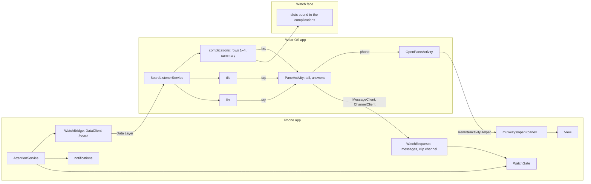
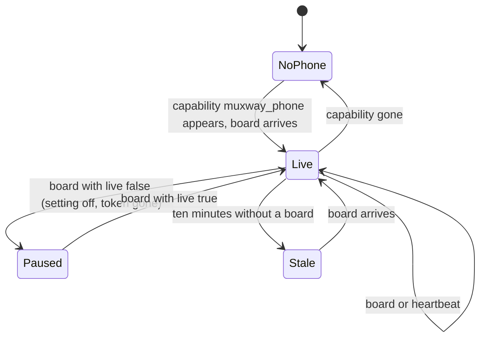
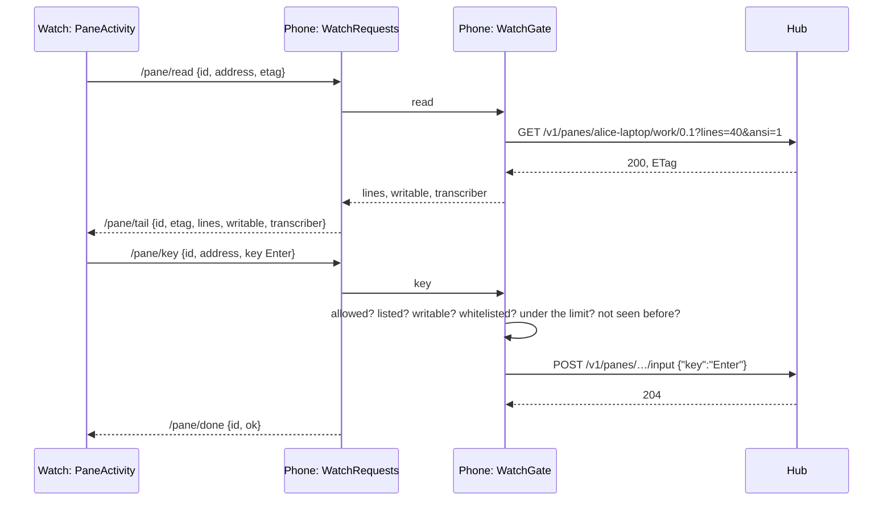
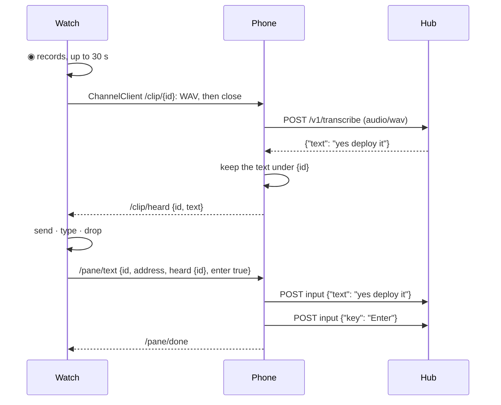

# The watch

A Galaxy Watch, or any Wear OS watch, shows which panes wait for their
owner: on the muxway watch face, in a complication on any other face, in
a tile and in a small list. A tap on a pane opens it on the watch: the
tail of its screen in colour, with Claude Code's chrome hidden, the
microphone and a *reply* menu at the top, a row of keys at the bottom,
and *phone*, which makes the phone app open that pane behind the lock
screen, so unlocking the phone lands on it.

```
          ┌───────────────┐
          │    14:07      │   pixel digits
          │  fri 24 oct   │   dim
          ├───────────────┤
          │ ? question    │   row 1: attention colour, the pane that has
          │   deploy      │          waited longest
          │ ✓ done        │   row 2
          │   build       │
          │ ⟳ working     │   row 3: dim
          │   tests       │
          │ +2            │   row 4: more panes than rows
          ├───────────────┤
          │ 2 waiting · 5 panes │
          └───────────────┘
```

## How it works

The phone is the sensor, the watch is the display. The watch holds no
token and opens no network connection; everything it knows arrives from
the phone app over the Wear OS Data Layer, which connects only apps that
share a package name and a signing key.



With the **watch and notifications** setting on, the phone app runs a
foreground service that holds the hub's events long poll, lists the panes
after every answer, and computes the **board**: every pane with its lens
state, ranked. Panes that wait come first, the one that has waited longest
on top; then working panes; then quiet ones. Each row carries the pane's
address, its name, the state, the notification's kind and time and, only
when the **notification text** setting is on, the notification's text. The
board also says when it was computed and whether the service is running.

The board goes to the watch as one JSON document on the Data Layer path
`/board`. It is sent when the rows change and otherwise every five minutes
as a heartbeat, so the watch can tell a quiet day from a dead link.


### On the watch

- **Complications**, five of them: `pane 1` to `pane 4` are the board's
  rows, `waiting` is the summary. Each supports `RANGED_VALUE` (the value
  is how to colour the line: 0 dim, 1 ink, 2 attention; the text is
  `? question`, the title the pane's name), `SHORT_TEXT` (`?2` for the
  summary: the top glyph and how many wait, `⟳2` when none waits and two
  work, `·` when nothing is doing anything) and `LONG_TEXT`. The
  **summary's** ranged value is not a colour but a proportion: the panes
  that wait or work, out of all of them, so one working pane of two fills
  half a ring and a quiet day leaves it empty. A ring cannot say which
  state it is showing, and the rows above it already do. They update
  when the board arrives, never on a timer. A row without a pane shows
  `·`; the last row shows `+N` when there are more panes than rows.
- **The tile** lists six rows and the summary; each row is a tap.
- **The app** lists every pane with glyph, name, kind and, when sent, the
  text; the summary is its last line. It opens from the launcher or from
  the summary complication.
- **A tap** on a row, anywhere, opens the pane screen below. Its *phone*
  key starts `OpenPaneActivity`, which finds the phone by the capability
  `muxway_phone` the phone app announces, asks the Wear OS companion to
  start `muxway://open?pane=<address>` on it, says `opened on the phone`
  or `no phone`, and closes.

**The summary** names the strongest state the panes are in, so it never
says less than is true: `2 waiting` (with `1 working · 5 panes` beside
it when some also work), else `2 working`, else `all quiet`, else `no
panes`. The phone's ongoing notification says the same in its own words.

When no phone is reachable, when the phone's service stopped (`live` is
false) or when the board is older than ten minutes, every line turns dim
and the summary says `no phone`, `paused` or `stale`. A board that stops
updating must never look current.



### The pane screen

```
    [reply]  [◉]           the reply menu and the microphone, in the middle
┌ ? deploy                 the pane's name, painted with its state
  ● I will run make test   the tail: the last 40 lines, in colour,
  Do you want to proceed?  wrapped to the screen, newest at the bottom,
  ❯ 1. Yes                 a drag or the bezel scrolls up; Claude Code's
    2. No                  rules, box and footer are hidden by the lens
  ❯ 3. No, and tell me     nothing sits under the tail but the note, so
└ sent                     the screen is the pane's
```

**The shape of the glass.** A round watch is a circle, and a band across
it is only as wide as the chord at whichever of its edges lies farther
from the middle. `Round.inset` says how far each band must come in
(`r − √(r² − d²)`); the screen asks it for every band it draws — the top
row, the title, the tail and the note — so nothing is cut by the edge. A
square watch keeps its corners and the same four bands.

**Two buttons, and the tail.** *reply* and `◉` sit side by side in the
middle of the top band: wide to the finger, low in height, so the tail
keeps the screen. The band sits a little below the top of the glass,
where the chord is wide enough for both, and its inset is capped so the
row always keeps 150 dp: a button squeezed to nothing measures its label
at nothing and draws an empty box, which is how the microphone went
missing on a 240 dp watch. Nothing sits under the tail but the note line:
a row of keys there cost two bands of a round screen and said nothing the
reply menu does not. On a read-only pane the top band says `read-only`
and offers *phone* alone.

The watch still holds no token and opens no connection. The screen asks
the phone for the tail every two seconds while it shows, and the phone's
service, which holds the hub's `Api`, reads `GET /v1/panes/{address}`
(40 lines, with the colour sequences and nothing else of the escape
codes) and answers only when the hub's ETag changed. The header is the
pane's lens state from the board the watch already has.

**The Claude Code lens.** On a pane whose program is `claude` the tail
is shaped as the feature-phone and glasses clients shape it: the two
rules, the footer, the right-aligned notices and the summary of the last
turn are hidden, the blank rows Claude fills a tall terminal with are
dropped, and the input box is pinned under the transcript, dimmed, only
when someone typed into it. The lens (`ClaudeLens` in the protocol
module, the same rules as the other clients' `ClaudeCode`) works on the
plain rows and names the rows to keep by index, so the watch draws them
with their colours: the phone's sixteen-colour table, xterm's cube and
greys, true colour, bold, italic, underline, inverse and dim. Any other
program is drawn whole.

**Reply.** *reply* opens a list, centred on the row it is on, so the
first and the last answer can be brought to the middle of the glass,
where they are whole and can be tapped; the bezel and the crown turn it
as well as the finger, and an indicator at the right edge says how much
more there is. Each row is a box at least 44 dp tall. The same list and
the same scrolling serve the pane list the watch app opens with. First
what Claude offers on the screen:
its numbered choices (`❯ 1. Yes` … `3. No`, read from the last rows of
the tail, the one marked `❯` first), each sent as its digit alone, which
is how Claude Code takes it. Then the common answers, the same as on the
glasses: `Enter`, `y, Enter`, `n, Enter`, `1` `2` `3` when no choices
were read, `Esc`, `Ctrl-C`, `Tab`, `Shift-Tab`, `Up`, `Down`. Last,
*type…* opens the watch's own input method through Wear OS remote input
(the keyboard, handwriting or voice as the watch offers); the line comes
back as a draft under the top row with *send* (the line, then Enter),
*type* (the line alone) and *drop*. Last of all, *phone* leaves the watch
and opens the pane on the phone.

`Enter` takes the default or says yes to Claude Code, `Esc` refuses or
cancels, `y` and `n` answer a shell's prompts, `Ctrl-C` stops a command.
Each is one message to the phone; the phone checks it and sends it to the
hub; the result flashes under the tail: `sent`, or `not allowed: phone
setting` (**watch may answer** is off), `refused` (not a key or pane the
watch may name), `read-only`, `no connection`, `paused`.

`◉` is there when the hub has a transcriber and the pane is writable. The
first press asks for the microphone. The watch records 16 kHz mono, shows
the meter and the seconds as the phone does, and stops at `■`, at *drop*
or at thirty seconds. The clip streams to the phone on a channel; the
phone posts it to `POST /v1/transcribe` and sends back the text it heard,
which the screen shows as a draft with *send* (the text, then Enter),
*type* (the text alone) and *drop*. Nothing reaches the pane until *send*
or *type*, and even then the watch does not send the text: it names the
clip, and the phone types what it heard under that name, once. Refusals
flash: `too
short`, `one clip every five seconds`, `transcriber unavailable`, `no
microphone`, `microphone refused`, `clip lost on the way` (the phone did
not get the whole WAV: it reads as many bytes as the RIFF header
declares, so a channel whose end never comes cannot hang it).





The messages are JSON documents on the Data Layer `MessageClient`, one
path each (`/pane/read`, `/pane/key`, `/pane/text` to the phone;
`/pane/tail`, `/pane/done`, `/clip/heard` back), capped at 64 KiB and read
defensively on both ends: a broken document is ignored, strings are
cleaned of control characters and capped, an address must fit the
protocol's grammar, lines are capped at 60 of 400 characters. Each
request carries an id its answer repeats; an answer to a request the
screen no longer waits for is dropped. The clip goes on a `ChannelClient`
channel named `/clip/<id>`, capped at 1 MiB on the phone.

`WatchGate`, in the protocol module and tested on the JVM, is the phone's
side: it holds the rate limit (one write a second, ten a minute), the
ids already answered (a repeat answers the same without writing again)
and the texts heard. `WatchRequests` is the Wear OS listener service that
hands messages to the gate while `AttentionService` runs; with the
service stopped every answer is `paused`.

### The watch face

`watchface/` is a Watch Face Format 1 face: XML and fonts, no code, in its
own APK (the format forbids code). The time is set in the pixel font, the
date under it; four row slots and a summary slot are complication slots
that default to the muxway complications. The face colours each row by
the complication's value with a `Condition`, so it needs no code and any
other complication put in a slot still renders. Three colour options,
amber (the default), green and paper, match the phone app, except that a waiting row is
painted in the attention hue rather than inverted as the phone draws it:
the face is always on and a complication is drawn by whatever face holds
it (see `look.md`). In ambient mode everything dims to about a third. Tapping a row is the complication's tap action; the
time has none.

Any other face shows the same information through its own slots: pick a
`muxway · pane N` or `muxway · waiting` complication.

## Install

Build and install both watch APKs on the watch (over Wi-Fi debugging or
with the Galaxy Watch's ADB), the phone app on the phone, all three
signed with the same key:

```sh
./gradlew :app:assembleDebug :wear:assembleDebug :watchface:assembleDebug
adb -s <phone> install app/build/outputs/apk/debug/app-debug.apk
adb -s <watch> install wear/build/outputs/apk/debug/wear-debug.apk
adb -s <watch> install watchface/build/outputs/apk/debug/watchface-debug.apk
```

On the phone, in settings, switch on **watch and notifications** and allow
notifications; switch on **watch may answer** too if the watch is to send
keys and spoken lines. On the watch, pick the muxway face, or add a muxway
complication to yours, or add the tile. The first `◉` asks for the
watch's microphone.

## Settings

| Setting | Default | Effect |
|---|---|---|
| watch and notifications | off | the background service: notifications on the phone, the board of every hub's panes to the watch |
| notification text | off | the notification's text travels to the shade and the watch; kind and pane name always do |
| watch may answer | off | the watch may send `Enter`, `Esc`, `y`, `n`, `^C` and a spoken line to a writable pane through the phone, phone locked or not; off, the pane screen shows the tail and *phone* only |

## Security considerations

- The watch holds no secret. It receives pane names, states, kinds, times
  and, when the owner allows it, the notification text. A lost watch gives
  an attacker what a glance at its face gives. The board is app-private on
  both ends; the Data Layer binds same-signature apps only.
- **Rows carry keys.** A row names its pane by the phone's key, `<hub
  id>:<address>`; the watch passes it back as it is, and the phone's gate
  sends the request to that pane's hub. The watch never learns a hub's
  address or token.
- **The watch can type, and only when allowed.** Decided by the owner
  for the pane screen, and widened on 2026-10-25 to a line typed on the
  watch: an unlocked watch (on the wrist, or with its PIN) can send seven
  keys, digits, letters, a line from its own keyboard and the text the
  hub's transcriber heard into a writable pane while the phone stays
  locked in a pocket, as the phone's principal, audit-logged on the host
  as the phone's writes. That is what an unlocked phone gives too. What a
  lost, unlocked watch does not give: the token, the hub's address, any
  key outside the whitelist, any pane the phone does not list, and
  nothing at all while **watch may answer** is off, which it is by
  default. The phone checks every request (address against the grammar
  and the current listing, key against the whitelist, `writable` on the
  pane, the rate limit, a repeated id) and cleans a text as it cleans its
  own (`Input.typed`, 4096 bytes); a transcript is typed once, by the
  clip's id, never as words from the watch. A hub field naming the device
  behind a write would let the audit tell the watch from the phone; that
  would be a core change and is not part of this.
- The Claude lens and the choice reader run over rows already cleaned
  and capped. A crafted screen can hide its own last rows (the rows
  after its last rule, an empty box, blank and right-aligned rows above
  the rule and one summary row) and offer digits one to nine labelled
  with its own words, cut to sixty characters; it cannot hide a row of
  the transcript or make the watch send anything but a digit.
- The tail is plain text from a pane the token may read, held in the
  pane screen's memory only, never in preferences, a complication or the
  tile, gone when the screen closes. Wear OS has no screenshot block;
  the phone's **block screenshots** setting does not reach the watch.
- The clip is kept in memory for the request on both ends and dropped;
  the phone logs nothing about it; the hub's audit line records bytes and
  seconds, never the text. `RECORD_AUDIO` is asked at the first `◉`, and
  the microphone closes the moment the clip stops.
- The messages between watch and phone are read defensively on both ends
  (a broken document is ignored, strings cleaned and capped, lines capped,
  the clip capped at 1 MiB before the hub sees it). The Data Layer
  connects apps of one package name and one signing key: no other app on
  the watch reaches `WatchRequests`, no other app on the phone can answer
  the watch.
- `muxway://open?pane=<address>` can be fired by anything on the phone. The
  address must match the protocol's grammar (`host/session/window.pane` or
  `host/@alias`, with the protocol's character sets and lengths) and name a
  pane in the current listing, else nothing happens. The link can set
  nothing else: not the hub, not the token. The activity is not shown over
  the keyguard.
- The board is read defensively on the watch: a broken document is an
  empty board, rows are capped at 64, strings at 200 characters with
  control characters removed, addresses that do not fit the grammar are
  dropped.
- Notification text is off by default because a lock screen and a wrist
  are readable by bystanders.
- The foreground service uses the same `Api` and the same token from the
  Keystore as the app; it logs nothing. Its type is `specialUse`, with the
  reason in the manifest: it holds one long poll for a paired device,
  which fits no other type (`dataSync` is stopped after six hours a day on
  Android 15; `connectedDevice` wants a Bluetooth or network permission the
  app has no other use for).
- New dependencies, all from Google and pinned: `play-services-wearable`
  18.2.0, `watchface-complications-data-source-ktx` 1.2.1, `tiles` 1.4.1
  and `protolayout` 1.2.1, Wear `compose-material` and `compose-foundation`
  1.4.0, `wear-remote-interactions` 1.1.0, `concurrent-futures-ktx` 1.2.0.
