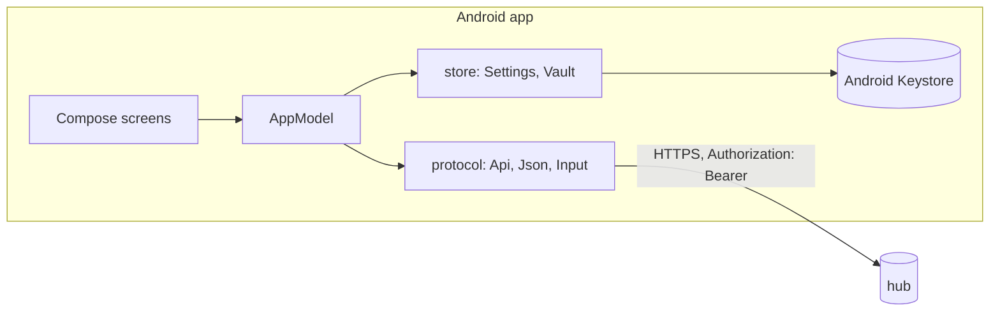
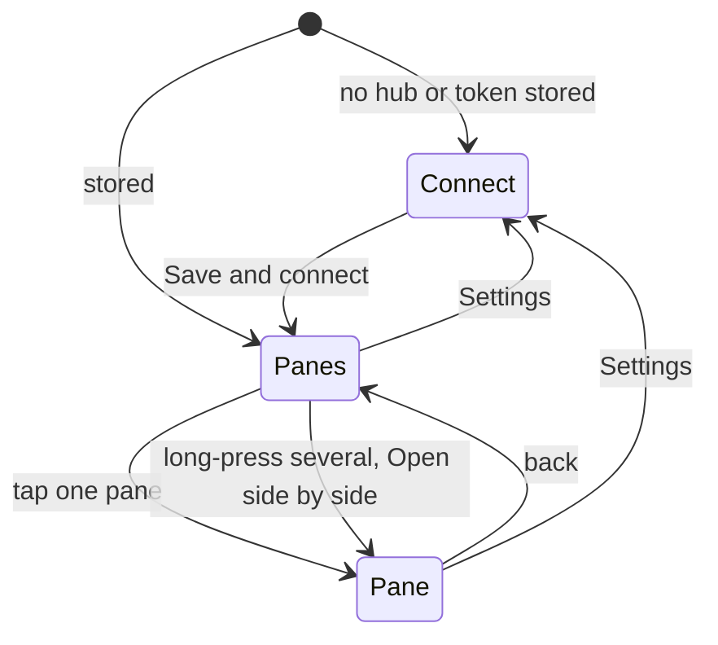

# Feature: the first Android client

> Status: implemented 2026-10-23. The owner's hands-on tests followed; what
> they found is in the plans after this one, from a usable pane view on.

## 1. Goal

A muxway client for Android phones and tablets: connect to a hub with a
token, see every pane the token may read, open one pane full screen or
several side by side, read it as it changes, type into it and send the
protocol's named keys. Panes that call for attention (a Claude Code
question or permission prompt) are marked in the list.

Out of scope for this first version: system notifications while the app is
in the background, more than one hub, colour (`ansi=1`), a hardware
keyboard mapped to tmux keys, QR-code setup, lenses like the Java ME
client's Claude Code view.

## 2. Design

Kotlin and Jetpack Compose, minimum Android 8.0 (API 26, the first with a
hardware-backed Keystore everywhere). One activity, three screens, and a
protocol layer that has no Android dependency so it can be tested on the
JVM against a real hub.

**Screens**

- **Connect**: hub URL, token (password field, never shown again once
  saved), refresh interval, lines to fetch, text size, theme (green,
  amber, paper), block screenshots. The token is saved in the Keystore
  vault; the rest in plain preferences. HTTPS is required; plain HTTP is
  accepted only for loopback and the emulator's host alias.
- **Panes**: `GET /v1/panes`, grouped by host, then `session/window.pane`
  (alias when it has one), the command and the title. `*` marks a pane the
  token may write. A pending notification shows its kind, `! permission`,
  in the attention colour. Offline hosts from `GET /v1/hosts` are listed
  at the end. The screen refreshes on pull, and holds a long poll on
  `GET /v1/events` while it is open so a new notification re-lists at once.
  Long-press selects panes; **Open side by side** opens the selection
  (up to four).
- **Pane**: one tile per open pane, side by side in landscape, stacked in
  portrait. Each tile shows its address, command and mode in a header,
  and the pane's last lines in monospace, bottom-aligned and hard-wrapped
  at the columns the tile fits (the hub's rows are kept whole, nothing
  scrolls sideways). Tiles refresh every N seconds with `If-None-Match`,
  so an unchanged pane costs a `304`. Tapping a tile focuses it; the
  bottom bar types into the focused tile: a text field, **Type** (text
  only), **Send** (text, then `Enter`), and a row of the protocol's keys.
  A read-only pane shows `read-only` instead of the bar.
- **Look**: phosphor green on black by default, amber and a light "paper"
  variant; monospace everywhere, box-drawing frames and rules, sharp
  corners, no elevation, dense rows.

**Protocol layer.** `HttpURLConnection`, one request per call on the IO
dispatcher. JSON mode. Accepts 200, 204 and 304; other statuses become an
`ApiException` with the hub's error code and a short message. Bodies are
read up to 2 MiB and the rest dropped; the token never appears in a URL,
a log line or an exception. Content for display loses every control
character except newline, and tabs become spaces.

## 3. Protocol and API changes

None. The app uses `GET /v1/hosts`, `GET /v1/panes`,
`GET /v1/panes/{address}`, `POST /v1/panes/{address}/input` and
`GET /v1/events`, protocol v1, JSON.

## 4. Security analysis

- **The phone holds a token that can type into a shell.** It is encrypted
  with an AES-256-GCM key that lives in the Android Keystore and never
  leaves it; the ciphertext sits in app-private preferences. Backup is
  off, so it is not copied to a cloud account. A lost phone still means:
  revoke the token on the hub.
- **Transport**: HTTPS with the system trust store. The network security
  configuration forbids cleartext except to loopback and `10.0.2.2` (the
  emulator's route to its host, where the test hub listens). The app
  checks the same rule before saving a URL.
- **Authentication header**: `Authorization: Bearer`; Android does not
  rewrite it. Tokens never go in URLs.
- **Untrusted content**: pane text and names from the hub are shown as
  text, never interpreted; control characters are removed, bodies capped.
  Pane names and addresses from the listing are percent-encoded when they
  go back into a path.
- **Typing**: the app sends only what the user typed, with control
  characters removed and at most 4096 bytes, or a key from a fixed list.
  Nothing is sent to a pane the listing marked read-only; the hub refuses
  anyway if a listing lied.
- **On screen**: the token field is a password field and is empty after
  saving. The pane screen can set `FLAG_SECURE` (no screenshots, no
  recents thumbnail); off by default so the owner can take screenshots
  while testing, a decision to revisit.
- **Logging**: the app logs nothing about requests. Errors shown to the
  user carry the hub's code, never the token or pane content.
- **Dependencies**: AndroidX core, activity, lifecycle and Compose (BOM
  2024.12.01), Kotlin coroutines; all pinned. JSON is parsed with the
  platform's `org.json`. No HTTP library, no analytics, no crash
  reporting.

## 5. Privacy check

Docs, strings and tests use `hub.example.com`, `alice-laptop`, `work`
and synthetic content. Test runs record logs under `test-runs/`, which is
ignored by git.

## 6. Test plan

The protocol layer runs on the JVM, so the end-to-end suite drives it
against a real hub, agent and tmux server built from the core repository
(`MUXWAY_CORE`, default `../muxway`), through a small recording proxy
that can also misbehave on purpose. UI tests need an emulator; the suite
runs them when `adb` sees a device, and otherwise builds them and records
them as skipped.

| # | Test | Kind | Expected |
|---|------|------|----------|
| 1 | Wrong or revoked token | e2e-security | 401 `unauthorized`; the message has no token |
| 2 | Token never in a URL, only in `Authorization: Bearer` | e2e-security | every proxied request |
| 3 | Read-only token: `mode` is read, input answered 403 `read_only` | e2e-security | as stated |
| 4 | Control characters in typed text are removed; unknown keys refused before sending | unit | as stated |
| 5 | Hostile server: 10 MiB body, not JSON, control characters in content | e2e-security | capped, clean error, clean text, no crash |
| 6 | Plain HTTP to a non-loopback host refused when saving | unit | refused |
| 7 | Token round-trips through the Keystore vault | UI (device) | stored, read back, cleared |
| 8 | List panes, read a pane | e2e | `work/0.0` writable, content has the prompt |
| 9 | Type `echo hi`, `Enter` | e2e | `hi` in tmux |
| 10 | `C-c` stops `sleep 100` | e2e | the pane's command is the shell again |
| 11 | Unchanged pane | e2e | 304 on the second read |
| 12 | `muxway notify` in the pane | e2e | event arrives on the long poll, listing carries `attention` |
| 13 | Host offline | e2e | 503 `host_offline` mapped to "Host offline" |
| 14 | No secret in any log of the run | e2e-security | not found |
| 15 | Connect, list, open, type, side by side | UI (device) | screenshots per step |

## 7. Documentation

- `README.md`: what it is, how to install and connect.
- `docs/ARCHITECTURE.md`: layers, screens, flows.
- `docs/features/connect.md`, `docs/features/panes.md`,
  `docs/features/pane-view.md`.
- `docs/testing.md`: the Android specifics.

## 8. Implementation steps

1. Gradle project, pinned toolchain, manifest, network security config.
2. Protocol layer: URL rules, Api, JSON models, input filter.
3. Store: settings, Keystore vault.
4. Theme and the three screens.
5. JVM end-to-end suite with the hub harness and recording proxy,
   `scripts/e2e.sh`.
6. UI smoke test, docs, README.

## Decisions

- 2026-10-23: the owner asked for a first version with basic features to
  test by hand; the plan was written and followed in the same session.
  Screenshot blocking defaults to off until the owner decides otherwise.

## Review

Done against the plan, the security rules and the privacy rules.

Deviations:

- **Escape sequences are removed whole.** The plan said control characters;
  dropping only `ESC` left `[31m` on screen, so `Input` now skips CSI, OSC
  and other escape sequences entirely, for display and for typed text.
- **The JDK's own HTTP server is not on the unit-test classpath** (tests
  compile against the Android stubs), so the tests use a small socket-based
  server of their own, which also lets the relay answer with bytes that are
  not UTF-8.
- **Assertion messages never quote the token**: a failing test writes its
  message into `results.xml`, which the run keeps.
- **The pane body uses reversed scrolling** so new rows stay in view without
  the app scrolling for the user.
- Test 7 (the Keystore round trip) is covered by the UI test, which stores
  the token before launching the activity and checks the list loads and the
  token is never on screen.

Not done here: the UI test (15) and the Keystore test (7) need a device,
and the machine this was built on has no emulator. Both compile; the suite
records them as skipped until a device is attached.

## Test run

Local run, `test-runs/20261023-212521-ab4b69a` on this machine: 37 tests,
0 failed, 0 skipped. 13 end-to-end against the hub built from core
`fbaca48` (6 security, 6 feature, the secret search over 37 logs), 24 unit.
UI tests skipped: no device. CI skips the suite until it can read the core
repository.
