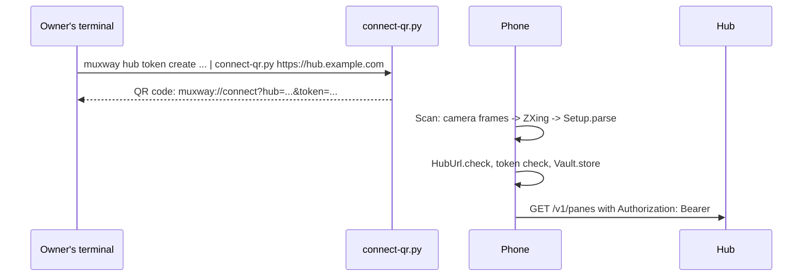

# Feature: the connect code

> Setting up a phone means typing a 47-character token. A QR code on the
> hub owner's terminal and a scan in the app replace that.

## 1. Goal

Connect a phone without retyping or pasting the token: the hub's owner
prints a code in the terminal, the app scans it and connects. Out of scope:
printing the code from the hub binary itself (that belongs to the core
repository; this repository ships a dependency-free script and documents
the payload so the core can adopt it), and reading codes from images.

## 2. Design

**Payload**: `muxway://connect?hub=<url>&token=<token>`, values
percent-encoded (the URL keeps `:` and `/`). Unknown fields are ignored so
the format can grow.

**Script** `scripts/connect-qr.py`: Python 3, standard library only. Reads
the token from stdin (the first `mxt_…` word, so the `token create` output
pipes straight in) or the second argument, encodes a byte-mode QR code at
error correction level M (versions 1 to 10, so up to about 200 bytes), and
draws it with half-block characters in explicit white on black so it scans
from any terminal theme. `--text` prints the payload, `--modules` the
matrix for tests.

**App**: a `Scan` screen reached from Connect ("scan code"). It asks for
the camera permission when opened, shows the preview through CameraX, and
decodes frames' luminance plane with ZXing on a worker thread. The first
decoded text goes to `AppModel.connectWithCode`: `Setup.parse` → the same
`save` as the form (URL rules, token rules, Keystore) → the pane list. A
text that is not a connect code shows "That is not a muxway code" and
scanning continues.

## 3. Protocol and API changes

None on the hub. The payload format is documented in
`docs/features/connect.md` for the core to print natively one day.

## 4. Security analysis

- **The code is the token.** Anyone who photographs the terminal has it,
  exactly as with the printed token; the script prints the code only,
  never the token text, and the quiet zone is the only decoration.
- **Scanned input is untrusted.** Only `muxway://connect?` payloads are
  accepted; percent-decoding rejects broken escapes and invalid UTF-8;
  hub and token must be printable; and both then pass the same checks as
  typed values (`HubUrl.check`: https or loopback, no user info or query;
  token ≤ 200 printable characters). A code cannot point the app at an
  `http` hub on the internet.
- **Camera.** Permission is requested only on the Scan screen. Frames are
  analysed in memory and released; nothing is stored or sent. The
  permission is declared without making the camera a hardware requirement.
- **Dependencies.** CameraX 1.4.1 (AndroidX, four artifacts) and ZXing
  core 3.5.3 (pure Java, widely used, no network), pinned. ZXing is also a
  test dependency so the JVM suite reads the script's codes back.
- Nothing new is logged.

## 5. Privacy check

Fixtures use `hub.example.com` and a made-up token; the docs the same.

## 6. Test plan

| # | Test | Kind | Expected |
|---|------|------|----------|
| 1 | Hostile payloads: other scheme, upper-case scheme, missing or empty fields, control characters raw or encoded, broken escapes, invalid UTF-8, 2000 characters | unit | `Setup.parse` returns null |
| 2 | Scanned code with an `http` hub on the internet or a bad token | unit | `HubUrl.check` and the token rule refuse it (the same path as the form; covered by `HubUrlTest` and `SetupTest`) |
| 3 | Code drawn by the script | unit | contains no `mxt_`; block characters only |
| 4 | Script matrix read back with ZXing | unit | decodes to the payload; `Setup.parse` gives hub and token |
| 5 | Long hub URL, token from stdin among other lines | unit | still decodes |
| 6 | Scan on a device | UI | needs a device; `scan` screenshot |

## 7. Documentation

`docs/features/connect.md` (code format, script, scan flow),
`docs/ARCHITECTURE.md` (dependencies), `README.md`.

## 8. Implementation steps

1. Script with `--text` and `--modules`.
2. `Setup.parse` with tests; ZXing read-back test.
3. Dependencies, permission, Scan screen, model wiring, Connect button.
4. Docs, run, build, hand over.

---

## Review (after implementation)

- [x] Diff matches the plan, deviations explained here
- [x] Security rules (AGENTS.md section 2) hold
- [x] Privacy check passed: `scripts/prepush-check.sh` clean and diff read
- [x] Docs and diagrams updated

Deviations:

- The analyzer also tries the inverted frame, so a code shown as light
  modules on a dark screen (a terminal theme the script's colours could
  not override) still scans.
- Test 2 runs through `HubUrl.check` and `Setup.parse` directly; the
  `save` path needs Android and is exercised by hand on the device.
- No UI test step for scanning: the test device has no code to look at.
- The debug APK grows by about 3.5 MB (CameraX); the release build with
  shrinking stays small.

## Test run

Local run `test-runs/20261023-233525-64dcdb4`: **passed**, 54 tests (15 end-to-end with the secret search, 39 unit including the script's codes read back with ZXing). The UI test was skipped for lack of a device.
