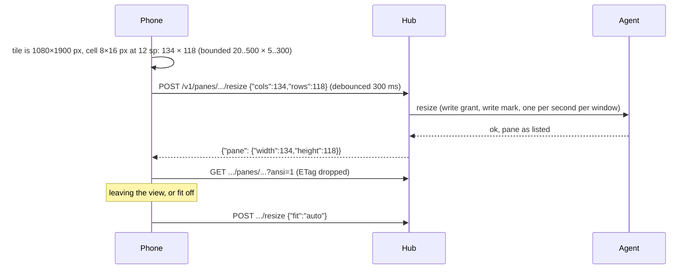

# Feature: fit, a hardware keyboard, and the web client's look

> After the third hands-on test, with the core's resize endpoint deployed.

## 1. Goal

1. **Fit.** The pane on the host follows the phone's tile, as a terminal
   would and as the web client's fit does: `POST /v1/panes/{address}/resize`
   with the columns and rows that fit at the text setting, released with
   `fit: auto` when the view is left. On by default for a single writable
   pane; off for side-by-side views. This answers the "stars" the owner
   saw: tmux sizes a window to its smallest attached terminal and fills
   the rest, so the phone's pane showed the laptop's size with filler.
2. **Hardware keyboard.** A setting, "assume a hardware keyboard": the
   input field takes focus without raising the on-screen keyboard; a
   `kbd` button in the key row brings it up when wanted.
3. **Look.** The web client's tokens and chrome: its colours (phosphor
   green `#39ff14` on `#050806`, amber, paper), its pixel font for the
   brand and panel titles, text glow, scanlines and a vignette, box-drawn
   panels with the title on the edge, a power-on animation, a pulse on
   marks that wait. An "effects" setting turns the glow, overlays and
   motion off.

## 2. Design

- `Api.resize(address, cols, rows)` and `Api.release(address)`; bounds
  checked before sending. `AppModel.fit` debounces 300 ms, sends once per
  distinct size, retries after `429 rate_limited` up to three times, then
  reads the pane again. `AppModel.release` sends `fit: auto` once if the
  app ever sized the pane. The tile measures its cells from the glyph
  advance at the text setting, calls `fit` whenever the size changes
  (rotation, keyboard, pinch), and releases on dispose.
- With fit on, the font is the text setting times the zoom and rows are
  cut at the visible columns; wrap is moot and its button is disabled.
- The soft keyboard is held back with `InterceptPlatformTextInput`: with
  the setting on, the field's input session never starts until `kbd`
  turns it on; hardware keys still reach the field. The state resets to
  the setting when the view opens.
- `Palette` gains `faint`, `accent`, `glow`, `scan` and `vignette`, taken
  from `web/src/styles/tokens.css`. Glow is a text shadow; scanlines and
  the vignette are drawn over the root with a repeating gradient and a
  radial one; the power-on is a 900 ms vertical scale from a line; the
  pulse is an infinite alpha transition. All of it is off under the
  effects setting. The pixel font is Press Start 2P (OFL, bundled).

## 3. Protocol and API changes

None: the resize endpoint is the core's, as published on 2026-10-24.

## 4. Security analysis

- A resize is a write on the host and the hub enforces that; the app
  sends one only for a pane listed as writable, within the protocol's
  bounds, at most one per distinct size and with a 300 ms debounce, so a
  rotation storm cannot flood the hub. The release is sent once.
- A fitted pane changes what the person at the host sees. That is the
  point and the web client's default too; the toggle is in the key row
  and the header shows the size while it is on.
- The keyboard interceptor only decides whether an input session starts;
  text still passes `Input.printable`.
- The look is CSS-like drawing; no new dependency beyond a font file.

## 5. Privacy check

Fixtures use `alice-laptop`; the docs use placeholders.

## 6. Test plan

| # | Test | Kind | Expected |
|---|------|------|----------|
| 1 | Resize on a read-only pane | e2e-security | `403 read_only`, width unchanged |
| 2 | Resize body and release body, bounds refused locally | unit | `{"cols","rows"}`, `{"fit":"auto"}`, `IllegalArgumentException` |
| 3 | Resize to 40×12 on a real pane, long line reflows at 40, release restores | e2e | tmux reports 40 then the old width |
| 4 | Fit, keyboard and look on a device | UI | needs a device |

## 7. Documentation

`docs/features/pane-view.md` (fit), `docs/features/connect.md`
(settings), a new `docs/features/look.md`, `THIRD_PARTY.md`.

## 8. Implementation steps

1. Protocol and tests. 2. Model fit state. 3. Settings. 4. Theme and
widgets. 5. Screens. 6. Docs, run, build, hand over.

---

## Review (after implementation)

- [x] Diff matches the plan
- [x] Security rules hold
- [x] Privacy check: `scripts/prepush-check.sh` clean
- [x] Docs updated

## Test run

Local run `test-runs/20261024-080357-c517461`: **passed**, 62 tests (17 end-to-end with the resize security test, the fit round trip and the secret search, 45 unit). The UI test was skipped for lack of a device.
