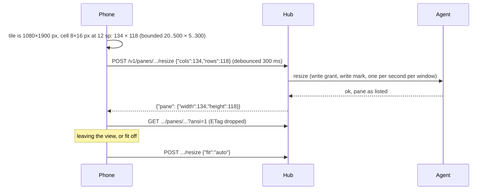

# Feature: fit, a hardware keyboard, and the web client's look

> Status: approved 2026-10-24, implemented the same day in six rounds.

> After the third hands-on test, with the core's resize endpoint deployed.

## 1. Goal

1. **Fit.** The pane on the host follows the phone's tile, as a terminal
   would and as the web client's fit does: `POST /v1/panes/{address}/resize`
   with the columns and rows that fit at the text setting, released with
   `fit: auto` when the view is left. On by default for a single writable
   pane; off for side-by-side views. This answers the "stars" the owner
   saw: tmux sizes a window to its smallest attached terminal and fills
   the rest, so the phone's pane showed the laptop's size with filler.
2. **Hardware keyboard.** A setting, "assume a hardware keyboard": the
   input field takes focus without raising the on-screen keyboard; a
   `kbd` button in the key row brings it up when wanted.
3. **Look.** The web client's tokens and chrome: its colours (phosphor
   green `#39ff14` on `#050806`, amber, paper), its pixel font for the
   brand and panel titles, text glow, scanlines and a vignette, box-drawn
   panels with the title on the edge, a power-on animation, a pulse on
   marks that wait. An "effects" setting turns the glow, overlays and
   motion off.

## 2. Design

- `Api.resize(address, cols, rows)` and `Api.release(address)`; bounds
  checked before sending. `AppModel.fit` debounces 300 ms, sends once per
  distinct size, retries after `429 rate_limited` up to three times, then
  reads the pane again. `AppModel.release` sends `fit: auto` once if the
  app ever sized the pane. The tile measures its cells from the glyph
  advance at the text setting, calls `fit` whenever the size changes
  (rotation, keyboard, pinch), and releases on dispose.
- With fit on, the font is the text setting times the zoom and rows are
  cut at the visible columns; wrap is moot and its button is disabled.
- The soft keyboard is held back with `InterceptPlatformTextInput`: with
  the setting on, the field's input session never starts until `kbd`
  turns it on; hardware keys still reach the field. The state resets to
  the setting when the view opens.
- `Palette` gains `faint`, `accent`, `glow`, `scan` and `vignette`, taken
  from `web/src/styles/tokens.css`. Glow is a text shadow; scanlines and
  the vignette are drawn over the root with a repeating gradient and a
  radial one; the power-on is a 900 ms vertical scale from a line; the
  pulse is an infinite alpha transition. All of it is off under the
  effects setting. The pixel font is Press Start 2P (OFL, bundled).

## 3. Protocol and API changes

None: the resize endpoint is the core's, as published on 2026-10-24.

## 4. Security analysis

- A resize is a write on the host and the hub enforces that; the app
  sends one only for a pane listed as writable, within the protocol's
  bounds, at most one per distinct size and with a 300 ms debounce, so a
  rotation storm cannot flood the hub. The release is sent once.
- A fitted pane changes what the person at the host sees. That is the
  point and the web client's default too; the toggle is in the key row
  and the header shows the size while it is on.
- The keyboard interceptor only decides whether an input session starts;
  text still passes `Input.printable`.
- The look is CSS-like drawing; no new dependency beyond a font file.

## 5. Privacy check

Fixtures use `alice-laptop`; the docs use placeholders.

## 6. Test plan

| # | Test | Kind | Expected |
|---|------|------|----------|
| 1 | Resize on a read-only pane | e2e-security | `403 read_only`, width unchanged |
| 2 | Resize body and release body, bounds refused locally | unit | `{"cols","rows"}`, `{"fit":"auto"}`, `IllegalArgumentException` |
| 3 | Resize to 40×12 on a real pane, long line reflows at 40, release restores | e2e | tmux reports 40 then the old width |
| 4 | Fit, keyboard and look on a device | UI | needs a device |

## 7. Documentation

`docs/features/pane-view.md` (fit), `docs/features/connect.md`
(settings), a new `docs/features/look.md`, `THIRD_PARTY.md`.

## 8. Implementation steps

1. Protocol and tests. 2. Model fit state. 3. Settings. 4. Theme and
widgets. 5. Screens. 6. Docs, run, build, hand over.

---

## Review (after implementation)

- [x] Diff matches the plan
- [x] Security rules hold
- [x] Privacy check: `scripts/prepush-check.sh` clean
- [x] Docs updated

Round two, after the device test (0.5.1):

- A dictation keyboard stopped working: holding the input session back
  left it no input connection. The session now always starts; with the
  setting on, the on-screen keyboard is sent down as the field gains
  focus and `⌨` raises it. Deviation from the plan's interceptor.
- Amber painted waiting panes green: the amber palette's attention colour
  was the green one. It is the amber accent now; no other colour in the
  UI is hard-coded outside the palette.
- Tabs and headers are painted by state and selected by border, as the
  owner asked; the controls (`≡ ⤢ ⌨ ⚙`) moved into the tab row; the
  bottom row holds only the time. A swipe across the page moves to the
  neighbouring pane.
- The body is a reversed lazy list of rows, one `Text` per row, in place
  of one `Text` under two scroll modifiers: plainer, cheaper, and the
  scrollback reachable by a drag. The swipe-to-arrows toggle is gone, and
  "wrap" became the reflow setting.
- `Esc` and `Enter` are pinned at the ends of the key row.

Round three (0.5.2):

- The lens no longer reads the listing's `activity`: it is tmux's window
  activity, the same for every pane of the window, so all four Claude
  panes read "working" together. Working now comes from the hub's event
  feed (`working` is an event kind) and from the open pane's own screen
  changing; the model keeps the last event kind per pane.
- Claude Code runs on the alternate screen, so the hub has no scrollback
  to send and a local drag had nothing to show. When the rows fit the
  tile, a drag pages the program with `PageUp`/`PageDown` (verified on a
  real Claude pane through tmux); the key row's page keys do the same.
- `‹` back at the top left replaces the `≡` on the right; with several
  panes open the tab strip gives way to a count.
- The selection bar sits under the pane picked last, clear at the left.

Round four (0.5.3): the drags were being eaten. A lazy list on Android
consumes vertical drags for its stretch effect even with nothing to
scroll, so the paging drag never arrived; and the paging handler took
every direction, which stopped the page swipe. The list now scrolls only
when it has more rows than fit, without overscroll, and paging reads
vertical drags alone. Tabs stay with several panes open; the selection
bar follows the list. Several panes gained `▦`, cycling row, column, main
and grid like tmux's next-layout, and draggable bars between tiles; the
arrangement is local to the phone.

Round five (0.6.0): the arrangements are per count (two: row, column;
three: plus main-left and main-top; four: plus grid), a header dragged
onto another tile swaps the panes, and a tap is a click (see
`2026-10-24-mouse-input.md`).

Round six (0.6.1): on the phone the host pane had been resized by
another client's window fit (20 rows under a 44-row tile) and the phone,
having sent 96×44 once, never sent it again. Fit re-sends when the
listing's size drifts from the last request and that request is older
than twenty seconds, at once on a tap of `⤢`, and holds still while the
on-screen keyboard is up (it had been resizing the host pane to 23 rows
on every keyboard). The listing's `mouse` flag, from the core's mouse
addition, refuses a tap locally.

Round seven (0.6.2): the owner's browser fits the same tmux window to
its own size, so the phone's size never held and the pane sat in the
lower part of the tile. Fit now retries once on drift and then shows
"held" in the header rather than fighting; a tap on `⤢` sends again. A
drag on a pane whose program has the mouse sends wheel notches per row
(the core's mouse addition), far smoother than page keys.

## Test run

Round six: local run `test-runs/20261024-103852-a023f82`: **passed**, 75 tests; the two mouse tests ran against a hub built from the core checkout, which carries mouse input now.

Round four: local run `test-runs/20261024-085305-22b4dfa`: **passed**, 62 tests.

Round three: local run `test-runs/20261024-084345-aa1886f`: **passed**, 62 tests.

Round two: local run `test-runs/20261024-082247-55615a6`: **passed**, 62 tests.

Round one: local run `test-runs/20261024-080357-c517461`: **passed**, 62 tests (17 end-to-end with the resize security test, the fit round trip and the secret search, 45 unit). The UI test was skipped for lack of a device.
