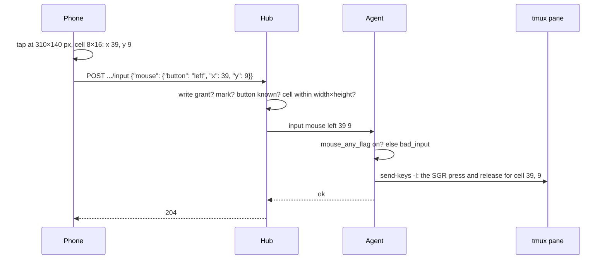

# Feature: touch is a click (mouse input)

> Status: approved 2026-10-24, implemented the same day; the hub's side landed in the core afterwards.

> The owner wants to tap an option Claude Code shows and have it chosen.
> Claude Code has mouse reporting on; the protocol has no mouse input.
> This plan specifies the addition for the core and implements the
> client side here, which works as soon as a hub carries it.

## 1. Goal

A tap on a pane's content becomes a mouse click at that cell on the
host, for programs that asked their terminal for the mouse. Out of scope:
drags and selection, right and middle buttons in the UI (the protocol
has them), and wheel scrolling in the UI for now (the protocol has it; the
app keeps paging with PageUp/PageDown until wheel proves smoother).

## 2. Design

### Protocol addition (for the core repository)

`POST /v1/panes/{address}/input`, a third body shape:

```json
{"mouse": {"button": "left", "x": 12, "y": 3}}
```

- `button`: `left`, `middle`, `right`, `wheelup`, `wheeldown`.
- `x`, `y`: the cell, 1-based, 1 ≤ x ≤ pane width, 1 ≤ y ≤ pane height.
- A button click is a press and a release; a wheel entry is one notch.
- Needs the write grant and the write mark, like text and keys.
- The agent first checks that the program in the pane has mouse reporting
  on (tmux's `#{mouse_any_flag}` for the pane); if not it answers
  `bad_input`, so the bytes are never typed as text into a program that
  does not understand them. Then it writes the xterm SGR sequence to the
  pane (`tmux send-keys -l`): `ESC [ < b ; x ; y M` and, for a button,
  `ESC [ < b ; x ; y m`, with `b` 0 left, 1 middle, 2 right, 64 wheel up,
  65 wheel down.
- Audited as `op=input mouse=<button>`; rate limited with the other input.
- Errors: `400 bad_input` (unknown button, cell outside the pane, no
  mouse mode in the pane), `403 read_only`, `404`, `429`, `503`.
- A hub without this addition answers `400 bad_json` (unknown field),
  which is how a client tells the two apart. Compatible v1 addition.



### Client

- `Api.mouse(address, button, x, y)`; `Json.mouse` builds the body. The
  app checks the ranges before sending.
- A tap on the pane body, when the pane is writable, becomes a left click
  at the cell under the finger: column from the glyph advance, row from
  the row height, counted from the top of the content when the content
  is shorter than the tile (the rows sit at the bottom). Taps outside the
  content do nothing.
- `bad_json` on a mouse body is shown as "This hub has no mouse support
  yet"; `bad_input` as "No mouse in this pane".

## 3. Protocol and API changes

The addition above; none until the core has it.

## 4. Security analysis

- The client can only produce a click at a cell inside the pane; the hub
  checks the ranges, the grant and the mark; the agent refuses panes
  without mouse mode so no stray bytes become typed text.
- Mouse events are a narrow interface like keys: five buttons, two
  numbers. No raw sequences from the client.

## 5. Privacy check

Fixtures use `alice-laptop`.

## 6. Test plan

| # | Test | Kind | Expected |
|---|------|------|----------|
| 1 | Mouse on a pane whose program has no mouse mode | e2e-security | `bad_input`, nothing typed (skipped on a hub without mouse) |
| 2 | Mouse on a read-only pane | e2e-security | `read_only` (skipped likewise) |
| 3 | Body shape and local range checks | unit | `{"mouse":{...}}`; out of range refused locally |
| 4 | Click reaches `cat -v` after it enabled mouse reporting | e2e | the pane shows `^[[<0;5;3M` (skipped likewise) |
| 5 | Tap on a device | UI | needs a device |

## 7. Documentation

`docs/features/pane-view.md`; the core's `docs/protocol/v1.md` once it
lands there.

## 8. Implementation steps

1. Spec here. 2. `Api.mouse`, tests. 3. Tap in the tile. 4. Docs, run,
hand over; the core picks the spec up.

---

## Review (after implementation)

- [x] Diff matches the plan
- [x] Security rules hold: ranges checked twice, mouse mode checked on the host
- [x] Privacy check: `scripts/prepush-check.sh` clean
- [x] Docs updated

## Test run

Local run `test-runs/20261024-090725-19d1345`: **passed**, 65 tests, the two mouse end-to-end tests skipped because the core has no mouse input yet; they run as soon as it does.
