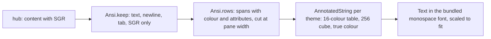
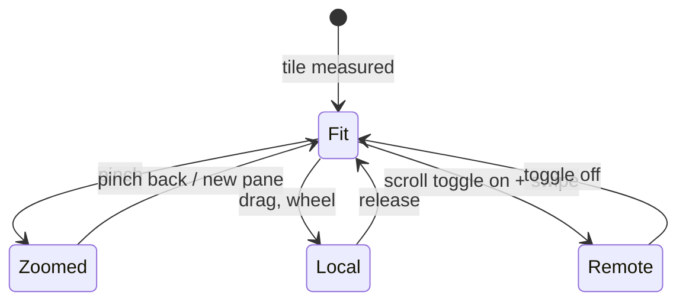

# Feature: a usable pane view

> Status: approved 2026-10-23, implemented the same day.

> Second round after the first hands-on test. The owner wants to use the
> app daily, so this round makes the pane view fit real panes: wide
> full-screen programs, colour, glyphs, scrolling, and switching panes.

## 1. Goal

The first build showed a 96-column pane hard-wrapped to a 40-column phone,
which turns any full-screen program (an editor, an AI CLI's interface) into
a jumble. Colour was stripped, and the system monospace font lacks many of
the glyphs such programs draw with. This round:

1. shows a pane at its own width, scaled to fit the tile, with pinch zoom;
2. renders colours and attributes, and bundles a font that has the box
   drawing, block and symbol glyphs terminals use;
3. scrolls: touch and wheel scroll the fetched history, a **scroll**
   toggle sends arrow keys for swipes, and hardware arrows, page keys and
   the like go to the pane;
4. adds a tab strip above the panes to switch without going back to the
   list;
5. adds the protocol's new `BTab` key (Shift-Tab).

Out of scope: wide (East Asian) characters and emoji keep the system's
fallback and may misalign a row; a hardware keyboard's printable keys still
go through the text field; no mouse reporting to the pane (the protocol has
no such input).

## 2. Design

### Rendering

`GET /v1/panes/{address}?lines=N&ansi=1` keeps tmux's colour escapes in the
content. A new pure-Kotlin `Ansi` object (protocol package, unit-tested)
does two things:

- `keep(s)`: the sanitiser that replaces `Input.screen` for pane content.
  Keeps printable text, newlines, expanded tabs, and **only** SGR
  sequences (`ESC [ … m`). Every other escape sequence, every other
  control character, DEL and C1 are dropped.
- `rows(s, cols)`: parses the kept text into rows of spans, each span a
  run of text with foreground, background (−1 for the default, else an
  index 0–255 or a 24-bit value tagged as true colour), bold, dim,
  italic, underline, inverse. Rows longer than `cols` are cut like tmux
  would show them; the style carries over the cut.

The 16 base colours come from the theme (`Palette.ansi`), so the paper
theme gets darker variants that stay readable on the light background.
Colours 16–255 are the xterm cube and grey ramp, computed. Bold is drawn
bold; dim blends the ink towards the background; inverse swaps.

### Fitting

A tile measures its width, takes the pane's own `width` from the listing
(falling back to the longest row) and picks the font size at which that
many columns fit: `min(textSp, fit)`. Pinch zooms between 0.5× and 4× of
that; when the text is wider than the tile it scrolls sideways. The
`text` setting therefore becomes the largest size the pane is shown at.

### Font

DejaVu Sans Mono (Bitstream Vera licence, permissive, see
`THIRD_PARTY.md`) is bundled as a font resource and used for pane content
and chrome. Bold is synthesised. Characters it lacks fall back to the
system fonts as before.

### Scrolling and keys

- A one-finger drag or a mouse wheel scrolls the local history, newest
  row anchored at the bottom as before.
- A **scroll** toggle in the key row turns swipes on the pane into keys:
  every row-height of vertical movement sends `Up` or `Down`, every
  column-width of horizontal movement `Left` or `Right`. A key is only
  sent when the previous one has been answered, so the rate stays well
  under the hub's limit.
- Hardware keys reaching the screen (D-pad, keyboard, a glasses
  touchpad mapped to D-pad) send the matching named key: arrows, page
  up/down, home, end, tab, escape, enter, backspace. The text field keeps
  its own keys while it has focus.

### Tabs

A strip above the tiles lists every pane the token may read, in listing
order, each as `┤ label ├` with `!` when attention is pending. The open
panes are inverted. Tapping a closed one replaces the focused tile's pane
with it; tapping an open one focuses it. The event long poll and the
periodic re-list move from the list screen to the app root, so tabs and
the list stay current on every screen.

## 3. Protocol and API changes

None. The client now sends `ansi=1` on pane reads and `BTab` as a key,
both part of protocol v1 as published.

## 4. Security analysis

- **Escape sequences**: the only sequences interpreted are SGR with
  numeric parameters; parameters are parsed as bounded integers, unknown
  codes are ignored, and everything else (OSC including hyperlinks, DCS,
  other CSI, C0, C1) is dropped before the text reaches the screen.
  Nothing from the pane can move the cursor, set titles, open links or
  paste. Bodies stay capped at 2 MiB; parsing is linear in the input.
- **Keys**: gestures and hardware keys only ever produce names from the
  protocol's list, through the same `Api.key` path that refuses anything
  else. The scroll toggle sends one key per answered request, so a swipe
  cannot flood the hub. Nothing is sent to a read-only pane.
- **Grants**: the owner decided to expose every pane of his work
  session with write and to issue the phone a token that may write to
  all of them (`alice-laptop/*`). That widens what a stolen phone could do; the
  mitigations stay the token's 90-day life, revocation on the hub and the
  Keystore. Recorded here as his decision.
- **Font**: a static asset from a Debian package, no code. Licence text
  committed.
- No new dependency. Nothing new is logged.

## 5. Privacy check

Fixtures use `alice-laptop`, `work/0.0` and synthetic colour text. Docs
use placeholders. The owner's host, token and pane content stay out of the
repository; `scripts/prepush-check.sh` runs before the push.

## 6. Test plan

| # | Test | Kind | Expected |
|---|------|------|----------|
| 1 | Content with OSC title, hyperlink, cursor moves, C0, C1, DEL, truncated CSI | unit | `Ansi.keep` leaves text, newlines and SGR only |
| 2 | Hostile relay answers (big, garbage, html, control) | e2e-security | capped or refused as before; control fixture keeps `\e[31m` and drops BEL, NUL, CR |
| 3 | Control characters typed | e2e-security | unchanged: never reach the pane |
| 4 | Gesture key names | unit | every name the gesture and hardware mapping can produce passes `Input.isKey` |
| 5 | SGR parsing: 16 colours, bright, 256, true colour, bold, dim, inverse, reset, partial reset | unit | spans carry the right attributes |
| 6 | Row cut at pane width | unit | a styled row cut in two keeps the style on the second piece |
| 7 | Pane read query | unit | `lines=N&ansi=1`, `If-None-Match` as before |
| 8 | Coloured output from a real pane | e2e | `printf` of a green word reaches the client as a green span |
| 9 | Shift-Tab | e2e | `BTab` sent to a pane running `cat` shows `^[[Z` |
| 10 | Tabs, zoom, scroll toggle on a device | UI | `04-tabs`, `05-zoom` screenshots; needs a device, skipped here |
| 11 | Secret search over the run | check | no token in any log |

## 7. Documentation

- `docs/features/pane-view.md`: rendering, fitting, colour, scroll, tabs,
  keys.
- `docs/ARCHITECTURE.md`: the `Ansi` stage.
- `README.md`: feature list; `THIRD_PARTY.md`: the font licence.

## 8. Implementation steps

1. `Ansi` with tests; `Input` gets `BTab`.
2. `Api.read` with `ansi=1`; `Json.read` through `Ansi.keep`; tests.
3. Bundled font, theme colour tables, licence file.
4. Pane tile: styled rows, fit, pinch, sideways scroll.
5. Scroll toggle, hardware keys.
6. Tab strip; event follower at the app root.
7. e2e: colour and Shift-Tab tests; UI test steps.
8. Docs, run, build, hand over.

---

## Review (after implementation)

- [x] Diff matches the plan, deviations explained here
- [x] Security rules (AGENTS.md section 2) hold
- [x] Privacy check passed: `scripts/prepush-check.sh` clean and diff read
- [x] Docs and diagrams updated

Deviations:

- The suite's first run after the change replayed the previous result,
  because Gradle saw no changed input: the run directory and binary came
  in through the environment only. They are declared task inputs now, so
  every run under `scripts/e2e.sh` really runs (step 7).
- A row that ends in a newline does not produce an empty trailing row,
  matching how the body was shown before (`trimEnd('\n')`).
- The text field keeps hardware keys while it has focus, as planned; the
  tile's tap hands focus back to the screen so arrows reach the pane again.
- The owner's token was reissued with write on every pane of the session
  and the narrow one revoked; the whole session is exposed with write.
- The on-device UI test gained the tab and scroll steps but still has no
  device to run on here; it compiles.
- The app version is 0.2.0 (code 2) so the phone sees an update.

## Test run

Local run `test-runs/20261023-231828-eeb4fa2`: **passed**, 48 tests (15 end-to-end including two security fixtures reworked for colour, the colour and Shift-Tab flows, and the secret search), core at the commit in its `environment.txt`. The UI test was skipped for lack of a device.
