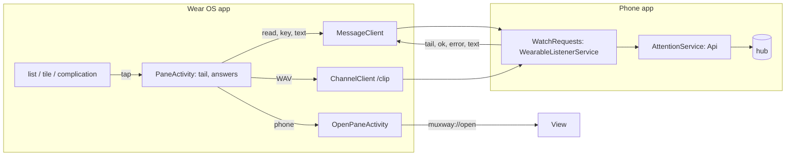
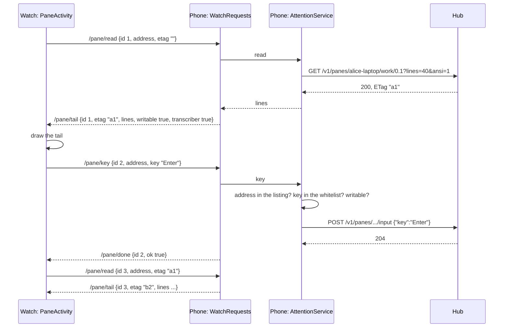
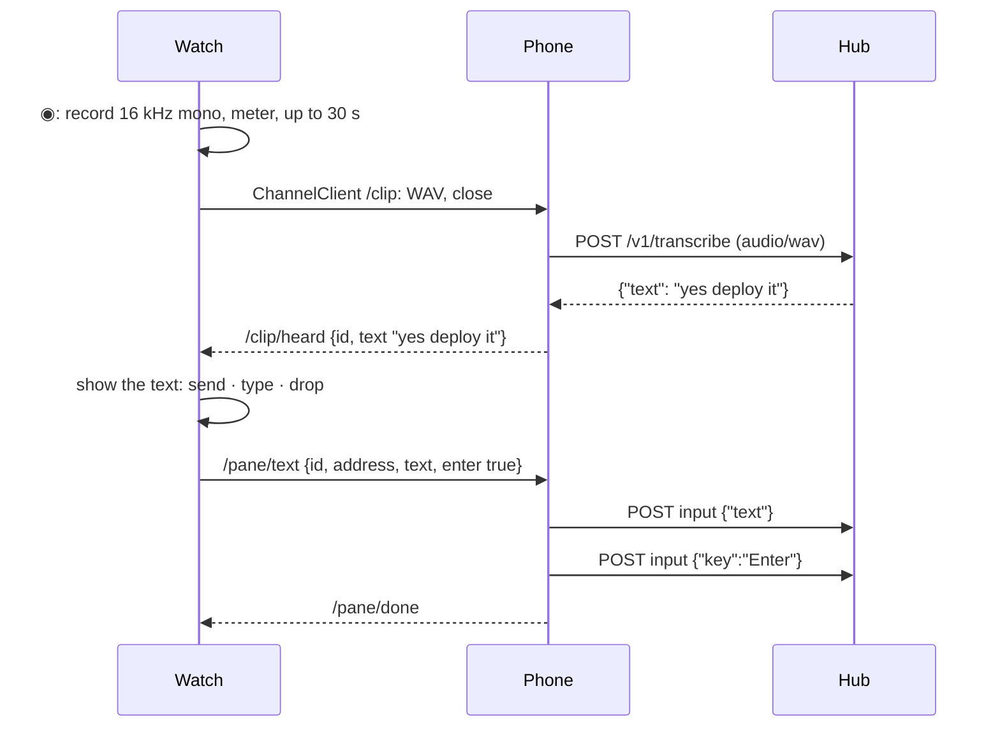

# Feature: a pane on the watch

> Status: approved 2026-10-24, implemented 2026-10-25, revision 2 the same day.

> The watch shows which panes wait. The owner wants the next step on the
> wrist: see what the pane says, answer the simple way (a key, a spoken
> line) and, when that is not enough, continue on the phone. This is the
> first write path from the watch, which the first watch plan left out on
> purpose, so section 4 asks for an explicit decision.

## 1. Goal

A tap on a pane on the watch opens that pane on the watch: the tail of its
screen, a row of answers, and a way to the phone. The answers are the
ones a wrist can give: `Enter` (take the default, say yes to Claude), `Esc`
(refuse, cancel), `y` and `n` for a shell's prompts, `^C`, and a spoken
line transcribed by the hub, shown on the watch and sent only when the
owner says so. *phone* hands the pane to the phone app as today.

Out of scope: a keyboard on the watch, the mouse, scrolling the program
(only the hub's history), colours and attributes (the tail is plain text),
several panes at once, a watch that talks to the hub itself, and any
change to the face's XML (its taps are the complications' and follow §2,
*Taps*).

## 2. Design

The watch still holds no token and opens no connection. Everything goes
through the phone app's `AttentionService`, which already holds the hub's
`Api` with the token: the watch asks, the phone does, the phone answers.
Three paths on the Wear OS `MessageClient`, one on the `ChannelClient` for
audio, all app-private and bound to the same signing key like the board.



### The pane screen on the watch

```
┌ ? deploy ───────────┐   header: glyph, name, attention colour
│ $ make deploy        │
│ Deploy to prod?      │   the tail: last lines, plain text, soft-wrapped
│ (y/N) _              │   at the screen's columns, newest at the bottom,
│                      │   crown or drag scrolls up through what was sent
├──────────────────────┤
│ [Enter] [Esc] [y] [n]│   answers, one row, scrolls sideways
│ [^C]  [◉ speak] [phone]
└──────────────────────┘
```

- `PaneActivity`, Compose for Wear OS, monospace, the green palette like
  the rest of the watch app. Opened with an address by the list; the tile
  and the complications keep their tap (see *Taps* below).
- While open it asks the phone for the tail every two seconds (the
  guideline's rate for a pane that is not focused; the wrist does not
  need one second) and stops when it goes to the background. The tail is
  the last 40 lines of `GET /v1/panes/{address}` with colour stripped by
  `Ansi.plain`, sent only when the hub's ETag changed, so a quiet pane
  costs one small message per request and nothing on the Data Layer.
- The header shows the pane's lens state from the board the watch already
  has, so it needs nothing extra.
- A tap on an answer key sends it; the key flashes, and the next tail
  shows the result. A read-only pane shows the tail, *phone*, and the
  line `read-only` in place of the answers.
- `◉ speak` asks for `RECORD_AUDIO` the first time, records with the same
  `Recorder` (moved to the protocol module's Android-free part is not
  possible, so the class is copied into `wear`, 50 lines) at 16 kHz
  mono, shows the meter and the seconds as the phone does, and stops at
  a tap, a wrist-down, or **thirty** seconds (half the phone's cap: a
  watch has less memory and the wrist is a short-sentence device). The
  WAV goes to the phone over a channel; the phone posts it to
  `POST /v1/transcribe` and answers the text. The watch shows the text
  with *send* (text, then Enter), *type* (text alone) and *drop*. Nothing
  reaches the pane until *send* or *type*. Without a transcriber on the
  hub (the phone says so in every tail answer) the button is not there.
- `phone` is today's `OpenPaneActivity`.
- Errors are one line under the answers for two seconds: `no phone`,
  `paused` (the phone's service is off), `refused` (the setting below is
  off), `read-only`, `no connection`, `too short`, `one clip every five
  seconds`, `transcriber unavailable`.

### Taps

Today every tap on the watch (list, tile, complication, face) opens the
pane on the phone. **Decided by the owner (2026-10-24):** every tap on a
pane, on the face, in a complication, in the tile and in the list, opens
the pane screen on the watch; *phone* on that screen goes on to the phone.
The summary's tap keeps opening the list. `OpenPaneActivity` stays as the
target of *phone* alone.

### Messages

All on the Data Layer `MessageClient`, path per request, body a UTF-8
JSON document, capped at 64 KiB on both ends, read defensively (a broken
document is ignored, strings are cleaned and capped like the board's).
Each request carries an `id` the answer repeats, so a late answer to a
closed screen is dropped.

| Path | From | Body | Answer path, body |
|---|---|---|---|
| `/pane/read` | watch | `{"id", "address", "etag"}` | `/pane/tail`: `{"id", "address", "etag", "lines": [...], "writable", "transcriber"}`; `lines` absent when the ETag matched |
| `/pane/key` | watch | `{"id", "address", "key"}` | `/pane/done`: `{"id", "ok": true}` or `{"id", "error": "read_only"}` |
| `/pane/text` | watch | `{"id", "address", "text", "enter": true}` | `/pane/done` |
| `/clip` (channel) | watch | WAV bytes, 45 B to 1 MiB, then the channel closes | `/pane/text` is **not** sent by the phone: the phone answers `/clip/heard`: `{"id", "text"}` or `{"id", "error"}`, the watch shows it, the owner sends |

`WatchRequests`, a `WearableListenerService` in the phone app registered
for these paths, hands each to the running `AttentionService` (which owns
the `Api`); when the service is not running it answers `paused` and does
nothing else. The protocol module gets `Wire.kt`: the parse and build
functions for these documents, pure Kotlin, tested on the JVM, used by
both ends.





### Settings

On the phone, under *watch and notifications*:

| Setting | Default | Effect |
|---|---|---|
| watch may answer | **off** | the watch can send keys and text to a pane through the phone; off, the watch shows the tail and *phone* only |

The tail needs no setting of its own beyond *watch and notifications*: it
shows what the face already summarises, and what *notification text*
would have sent anyway. **Decided by the owner (2026-10-24):** the tail is
not behind *notification text*; it is on a screen the owner opened, not
on the face or the lock screen.

### Modules and versions

`protocol`: `Wire.kt` and tests. `app`: `WatchRequests`, the handler in
`AttentionService`, the setting, 0.8.0 (21). `wear`: `PaneActivity`,
`Recorder`, the channel sender, `RECORD_AUDIO`, 0.8.0 (21). `watchface`:
unchanged; the tap is the complication's. The dependency list grows by nothing: `MessageClient`
and `ChannelClient` are in `play-services-wearable` already.

## 3. Protocol and API changes

None to the hub protocol. The pane screen uses `GET /v1/panes/{address}`
(`lines=40`, `ansi=1`), `POST /v1/panes/{address}/input` with `key` or
`text`, `GET` and `POST /v1/transcribe`, all as published. The messages
between watch and phone are internal to this repository, documented in
`docs/features/watch.md`.

The core's `docs/ui-guideline.md` §3 (Android only) gets a row: *the
watch's pane screen: the tail and a row of answers, through the phone*,
with the reason (the wrist has no keyboard; the phone holds the token),
and §1.6 a row *answer from the watch* (Android: tap a key on the pane
screen; Web: —). Done in the core repository first, as §4 there says.

## 4. Security analysis

**The decision.** Until now nothing on the watch could type. With this
feature a watch that is unlocked (on the wrist, or with its PIN) can send
a fixed set of keys and transcribed text into any writable pane the
phone's token reaches, while the phone stays locked in a pocket. What an
attacker with the watch gains: the keys above and spoken text in panes
the owner can write to, as the phone's principal, audit-logged on the
host as the phone's writes. What they do not gain: the token, the hub's
address, raw escape sequences, any key outside the whitelist, any pane
the listing does not show, or anything while *watch may answer* is off.

The mitigations, all in the plan:

- *watch may answer* is a phone-side setting, **off by default**, under a
  heading that says what it allows. The owner turns it on knowing the
  wrist can then type.
- The watch cannot choose what to send beyond six keys and the text the
  hub's transcriber heard; the phone checks every request: the address
  against the grammar and the **current listing**, the key against the
  whitelist (`Enter`, `Escape`, `C-c`, and `y`/`n` go as *text*, not
  keys, so they too pass `Input.typed`), the text through `Input.typed`
  and the 4096-byte cap, `writable` on the pane. A failed check is
  answered `refused` and nothing is sent.
- Rate limit on the phone: at most one write per second and ten per
  minute from the watch, counted on the phone; over it, `refused`. The
  hub's own limits stand behind that.
- The phone never forwards text the watch typed itself: there is no
  `/pane/text` from a keyboard, only from a transcript the phone made
  from a clip and handed back, and even then the body is validated
  again on its way in (the message channel is the trust boundary, the
  watch app is not trusted to have been the one that sent it).
- The clip is kept in memory for the request on both ends and dropped;
  the phone logs nothing about it; the hub's audit line records bytes
  and seconds as today.
- The tail: plain text from a pane the token may read, held in the
  watch activity's memory only, never in preferences, never in a
  complication or tile, gone when the screen closes. No screenshot block
  exists on Wear OS; the owner's *block screenshots* setting does not
  reach the watch, and the feature page says so.
- Replay: every request carries an id; the phone treats a repeated id
  within a minute as a duplicate and answers the first result without
  writing again.
- Input crossing boundaries: the watch's JSON (parsed defensively on the
  phone, 64 KiB cap, unknown fields ignored), the phone's tail JSON
  (same on the watch, lines capped at 60 and 400 characters each,
  control characters removed), the WAV (size-checked by the phone before
  the hub sees it; the hub validates the format).
- The Data Layer connects apps of one package name and one signing key.
  A different app on the watch cannot reach `WatchRequests`; a different
  app on the phone cannot answer the watch.
- `RECORD_AUDIO` on the watch is asked on the first `◉`, and the
  microphone is closed the moment the clip stops; a cancelled or failed
  clip is dropped without leaving the watch.
- Not addressed, named here: an attacker with the owner's unlocked watch
  and the setting on can say "yes" to a permission prompt. That is the
  feature. A future hub field naming the device behind a write (`via`)
  would let the audit tell the watch from the phone; it is not needed
  for this plan and would be a core change.

New dependencies: none.

## 5. Privacy check

Fixtures use `alice-laptop/work/0.1`, `deploy`, `hub.example.com`; the
preview tail is `$ make deploy` / `Deploy to prod? (y/N)`. No real
machine, host or transcript in code, tests, docs or screenshots. The
pre-push check runs before every push.

## 6. Test plan

| # | Test | Kind | Expected |
|---|------|------|----------|
| 1 | a `/pane/key` with a key outside the whitelist, a raw escape, a 10 KB name, an address not in the listing, a read-only pane | unit (security) | `refused`, nothing posted |
| 2 | `/pane/text` with control characters, 5 000 bytes, a newline flood, an empty text | unit (security) | cleaned or refused as `Input.typed` says, cap held |
| 3 | writes with *watch may answer* off | unit (security) | `refused`, nothing posted |
| 4 | eleven writes in a minute, two in a second | unit (security) | the extra ones `refused` |
| 5 | the same request id twice | unit (security) | one write, the same answer twice |
| 6 | a hostile tail on the watch side: wrong types, 10 000 lines, 1 MB line, control characters, a 2 MB document | unit (security) | capped or ignored, nothing thrown |
| 7 | the tail answer and the done answer never carry the token, the hub URL or the ETag of another pane | unit (security) | absent |
| 8 | a clip over 1 MiB, under 45 bytes, not a WAV | unit (security) | dropped on the phone, `too short` / `refused` |
| 9 | `Wire` round trips: read, tail, key, text, done, heard | unit | equal |
| 10 | a tail from a 40-line pane with colour, wrapped at 28 columns | unit | plain, wrapped, newest last |
| 11 | f18: against the test hub, `Enter` through the phone-side handler reaches a pane that waits on a question; the next tail shows the answer | e2e | passes |
| 12 | f19: a clip through the handler to a test hub with the fake transcriber; the text comes back; `send` types it and Enter | e2e | passes |
| 13 | the pane screen on a watch emulator: tail, answer, transcript | UI | screenshots `watch-pane-tail`, `watch-pane-answer`, `watch-pane-heard`; skipped without an emulator, said so in the run |

## 7. Documentation

- `docs/features/watch.md`: the pane screen, the messages, the settings,
  the taps, the security section (the decision and the mitigations), the
  install line for `RECORD_AUDIO`.
- `docs/features/pane-view.md`: a line pointing at the watch's screen.
- `docs/ARCHITECTURE.md`: the request path through the phone.
- core `docs/ui-guideline.md`: §1.6 and §3 rows, before the code.
- `README.md`: one sentence.

## 8. Implementation steps

1. Core: the guideline rows. Commit there.
2. `protocol`: `Wire.kt` with parse and build, caps and cleaning; tests
   1, 2, 6, 7, 9, 10.
3. `app`: the *watch may answer* setting; `WatchRequests` listener; the
   handler in `AttentionService` with the listing check, whitelist, rate
   limit, duplicate ids; tests 3, 4, 5, 8; e2e f18.
4. `app`: the clip channel and transcribe; e2e f19.
5. `wear`: `PaneActivity` with the tail and the answers; the list opens
   it; `phone` on it.
6. `wear`: `Recorder`, the channel sender, the transcript screen,
   `RECORD_AUDIO`.
7. The taps: complications, tile and list open the pane screen.
8. Docs, versions 0.8.0 (21), run, record, review.

## Revision 2: the Claude lens, a reply menu, typing on the watch

Asked by the owner on 2026-10-25 after the first try on a Galaxy Watch.

### Design

- **Two keys at the top**, `◉` (the microphone) and *reply*. The rest
  (`Enter` `Esc` `y` `n` `^C` *phone*) stays in a row under the tail.
- **The Claude Code lens on the watch.** When the pane's program is
  `claude`, the tail is shaped as the feature-phone and glasses clients
  shape it (their `ClaudeCode` lens, ported to the protocol module as
  `ClaudeLens`): the two rules, the footer, the notices and the summary
  of the last turn are hidden, the input box is pinned under the
  transcript only when someone typed into it, the blank rows Claude
  fills a tall terminal with are dropped. Unlike those clients the watch
  keeps the colours: the tail now carries the SGR sequences the hub
  sends, the lens works on the plain rows and names the rows to keep by
  index, and the watch draws the kept rows with their spans in the
  phone's sixteen-colour table.
- **The reply menu.** *reply* opens a list: first what Claude offers on
  the screen (its numbered choices, `❯ 1. Yes` … `3. No`, read from the
  tail; the one marked `❯` first), then the common answers as the
  glasses have them (`Enter`, `y, Enter`, `n, Enter`, `1` `2` `3` when
  no choices were read, `Esc`, `Ctrl-C`, `Tab`, `Shift-Tab`, `Up`,
  `Down`), then *type…*, which opens the watch's own input method
  (keyboard, handwriting or voice as the watch offers) through Wear OS
  remote input. A typed line shows with *send*, *type* and *drop* like
  a transcript. A numbered choice is sent as its digit alone, which is
  how Claude Code takes it.
- `Wire.Tail` gains `command`; `Wire.KEYS` gains `Tab`, `BTab`, `Up`,
  `Down`; `Wire.Text` carries any text.

### Security: the owner's decision

The first plan let the watch type only `y`, `n` and what the hub's
transcriber heard. **Decided by the owner on 2026-10-25:** the watch may
also send a line typed on the watch itself, and the digits and keys
above. The phone still requires *watch may answer* (off by default), the
pane in the listing and writable, the rate limit, the id check, and
cleans the text as it cleans its own (`Input.typed`, 4096 bytes). What
changes for an attacker with the owner's unlocked watch and the setting
on: they can type a line into a writable pane, as they could on the
owner's unlocked phone. The transcript path is unchanged: a heard text
is typed once, by its id. The Claude lens runs over rows already cleaned
and capped and can only hide rows at the bottom, as on the other
clients; the choices it reads are digits one to nine, labelled by the
screen's own words, cleaned and cut.

### Tests added

| # | Test | Kind | Expected |
|---|------|------|----------|
| 14 | a typed text with control characters, 5 000 bytes, empty | unit (security) | cleaned and cut, empty refused, nothing posted |
| 15 | the lens on a crafted screen: a thousand rules, a 400-column rule, a footer after a fake rule | unit (security) | hides only rows after the last rule and the empty box; never a transcript row |
| 16 | the lens on Claude's screen: transcript, pinned box, empty box, a shell | unit | as the glasses' tests say |
| 17 | choices read from `❯ 1. Yes` … `3. No`; none from a shell | unit | three, the marked one first |
| 18 | the tail keeps SGR and drops every other sequence | unit (security) | as `Ansi.keep` |

---

## Review (after implementation)

- [x] Diff matches the plan, with these deviations:
  - A transcript is typed once: the gate forgets a heard text the moment
    a `/pane/text` naming it is sent, so a second request under a new id
    is refused. Stricter than the plan, and tested.
  - The hub's `bad_input` and `not_found` on a key or text answer
    `refused`; on a clip, `too short` and `transcriber unavailable`. The
    plan listed the words without saying which error maps where.
  - The watch gives the transcriber a hundred seconds, then says
    `transcriber unavailable` and lets go, so a lost answer cannot leave
    the screen listening forever.
  - The watch app is not minified in debug and the recorder is a copy of
    the phone's (the `app` module cannot be a dependency of `wear`),
    with a thirty-second cap in place of sixty.
  - After the first try on a Galaxy Watch (0.8.0): the answers moved to
    the top of the screen, the microphone first, because the bottom row
    needed a scroll on a round screen; `not allowed` and `clip lost` got
    words of their own, since both had said `refused`; the phone reads a
    clip by the length in its RIFF header rather than to end-of-stream.
    0.8.1 (23).
  - The UI test (13) is not written: no watch emulator on this bench, and
    an untested UI test is worse than none. First thing to add when one
    is attached.
  - Versions: the app had moved to 0.7.9 (21) under another feature while
    this one was built, so both app and watch app are 0.8.0 (22). The face
    is unchanged.
- [x] Security rules hold: the watch still holds no token and makes no
  request of its own; every write goes through `WatchGate` on the phone
  (listing, writable, whitelist, the owner's setting off by default, one
  a second and ten a minute, a repeated id answers without writing); the
  text typed is a transcript the phone made or `y`/`n`; the tail is
  memory only on the watch; the clip is capped before the hub and never
  logged; the messages are read defensively on both ends.
- [x] Privacy check: `scripts/prepush-check.sh` clean; fixtures are
  `alice-laptop/work/0.1`, `deploy`, `hub.example.com`; the e2e tests type
  `Deploy to prod?` and `heard-on-the-wrist` into the throwaway tmux.
- [x] Docs updated: features/watch.md (the pane screen, the messages, the
  setting, the security decision), features/notifications.md,
  features/pane-view.md, ARCHITECTURE.md, README.md; the core's
  ui-guideline.md §1.6 and §3 rows (commit 65c26d4 there).

To verify on a watch, which this bench has none of: that the pane screen
opens from the face, the tile and the list; that the tail reads at 9 sp
on a round screen; that the channel delivers the clip and the transcript
comes back; that `phone` still lands the phone on the pane.

## Test run

First run `test-runs/20261025-000250-2a66a36`, recorded as
[issue #22](https://github.com/notmarkopadjen/muxway-android/issues/22):
**passed**, 128 tests, 0 failed, 0 skipped; UI suite skipped on purpose
(no device). Final run `test-runs/20261025-000509-8e1ad1f`, recorded as
[issue #23](https://github.com/notmarkopadjen/muxway-android/issues/23):
**passed**, 128 tests, 0 failed, 0 skipped. After the first try on the
watch, `test-runs/20261025-001814-c4f0d6d`, recorded as
[issue #24](https://github.com/notmarkopadjen/muxway-android/issues/24):
**passed**, 128 tests, 0 failed, 0 skipped.
Revision 2 (the Claude lens, the reply menu, typing on the watch),
`test-runs/20261025-003745-4715f4f`, recorded as
[issue #25](https://github.com/notmarkopadjen/muxway-android/issues/25):
**passed**, 134 tests, 0 failed, 0 skipped.
