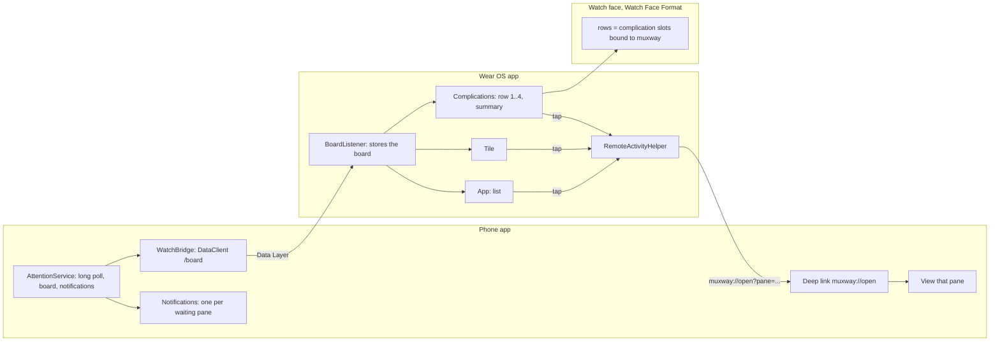
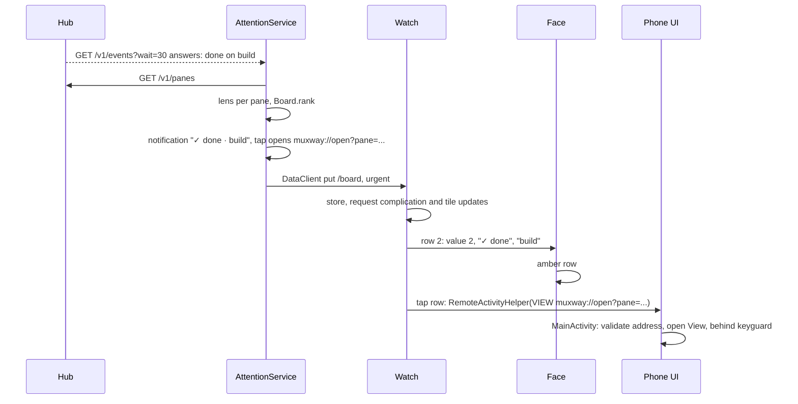

# Feature: the watch

> The owner wants to see on a Galaxy Watch which agent finished or asks,
> and tap it so the phone app is already on that pane when the phone is
> unlocked. This plan covers the phone side (notifications, a background
> watch, the deep link), the Wear OS app (complications, tile, list) and
> the watch face, and the module split they need.

## 1. Goal

A glance at the wrist tells which panes wait for their owner: a question,
a permission, idle, done. The watch face shows it always; any other face
can show it through muxway's complication; a tile and a small app list
every pane. A tap on a pane makes the phone app open that pane, behind the
lock screen, so unlocking lands on it.

Out of scope: typing or sending keys from the watch (the first write path
without a phone unlock needs its own decision), pane content on the watch,
a watch that talks to the hub itself (LTE watches without the phone), and
anything on Tizen watches.

## 2. Design

The phone is the sensor, the watch is the display. The watch holds no
token and opens no connection. The phone app, which already long-polls
`GET /v1/events` while open, gets a foreground service that keeps that
poll running, computes the lens state of every pane and pushes a compact
**board** to the watch through the Wear OS Data Layer. The same service
posts one notification per pane that waits, so a phone without a watch,
or a watch with no muxway app, is told too (Wear OS bridges them).



### Modules

```
settings.gradle.kts   include(":protocol", ":app", ":wear", ":watchface")
protocol/             pure Kotlin: Api, Json, Models, Lens, Board, Setup, HubUrl, Ansi, Input; JVM tests
app/                  the phone app (unchanged id app.muxway.android)
wear/                 Wear OS app, same id and signing key, minSdk 30
watchface/            Watch Face Format 1, no code, id app.muxway.android.watchface, minSdk 33
```

The Data Layer connects only apps with the same package name and signing
key, and Play ships a Wear app under the phone app's listing: this is why
the watch lives in this repository and not in one of its own. The face is
a separate APK because Watch Face Format forbids code in it.

### The board

`Board` (protocol module) is what any glanceable client shows. It ranks
panes: waiting first (by the notification's time, oldest first, since the
oldest has waited longest), then working, then quiet, then offline hosts
are not shown. Each row carries `address`, `name` (the lens name),
`state` (0 quiet, 1 working, 2 waiting), `kind`, `at` and, when the
setting allows, `text`. The board carries `at` (when it was computed),
`live` (false when the service stopped on purpose) and `waiting` (count).
Serialised as one JSON string, read defensively on the watch like the hub's
JSON is on the phone.



### Phone

- `AttentionService`, a foreground service of type `specialUse` (holding
  one long poll for a paired device fits no other type; `dataSync` is
  stopped after six hours a day on Android 15, `connectedDevice` wants a
  Bluetooth or network permission the app has no other use for). Started
  when the **watch and notifications** setting is on: at app start, after
  boot, and when the setting is switched on. Its ongoing notification is
  the summary (`2 waiting · 5 panes`); it stops with the setting.
- It runs the same `followEvents` loop as the UI, through a shared
  `Attention` collaborator the UI uses too when it is open, so one poll
  runs at a time.
- Per-pane notifications in channel `attention`: title `? question`, text
  the pane name and, when the **notification text** setting is on, the
  notification's text. Tap: the deep link. They clear when the pane's
  attention clears. Android 13+ asks for `POST_NOTIFICATIONS` when the
  setting is switched on.
- `WatchBridge`: `DataClient.putDataItem("/board")` with the JSON and a
  `live` flag; `setUrgent`. It also announces the capability `muxway_phone`
  so the watch knows when a phone with the app is reachable.
- Deep link: `MainActivity` gets an exported intent filter for
  `muxway://open?pane=<address>` (VIEW, BROWSABLE, DEFAULT) and
  `launchMode="singleTask"`. The address must match the protocol's address
  grammar and be a pane in the current listing, else it is ignored. Nothing
  else can be set through the link. The activity is not shown over the
  keyguard: it is started behind it, so unlocking reveals it.

### Watch

- `BoardListenerService : WearableListenerService` for `/board` and for
  the `muxway_phone` capability. It stores the board in app-private
  preferences, then asks every muxway complication and the tile to update.
- Complication data sources: `RowComplication1..4` (one class, four
  services, each bound to one row) and `SummaryComplication`. Types:
  `RANGED_VALUE` (value = state, 0..2, text `? question`, title the name),
  `SHORT_TEXT` (glyph and name), `LONG_TEXT` (glyph, kind, name). The tap
  action opens the pane on the phone through `OpenPaneActivity`. A row
  without a pane shows `·`; row 4 shows `+N` when more panes than rows.
  With no phone reachable, or a board whose `live` is false or older than
  ten minutes: dim text, title `no phone` / `paused`, value 0.
- `BoardTile`: the board as lines, each tappable, with the summary and
  the phone link at the bottom.
- `BoardActivity` (Compose for Wear OS): the full list, tap opens on the
  phone; `OpenPaneActivity` is the tap target for complications and the
  face: it fires `RemoteActivityHelper.startRemoteActivity` to the phone
  node and finishes, showing `opened on phone` or `no phone` briefly.
- Everything is drawn monospace, black background, the three palettes.

### Watch face

Watch Face Format version 1: `res/raw/watchface.xml`. Time in the pixel
font, date dim, four row slots (each a `RANGED_VALUE` slot defaulting to
the matching muxway row complication), a summary slot at the bottom.
Conditions on the slot's value pick the colour: 2 attention, 1 dim, 0 ink.
Ambient variant: thin strokes, a third of the brightness. Flavors: green,
amber, paper. Tap on a row is the complication's tap action; the time
has no tap.

## 3. Protocol and API changes

None to the hub protocol. The watch's board format is internal to this
repository (phone and watch ship together) and documented in
[features/watch.md](../features/watch.md). The deep link
`muxway://open?pane=<address>` is a public entry point of the phone app.

## 4. Security analysis

- The watch holds no secret: it receives pane names, states, kinds, times
  and optionally the notification text. A lost watch gives an attacker what
  a glance at it gives. Data items are app-private on both ends and the
  Data Layer binds same-signature apps only.
- The deep link can be fired by anything on the phone. It only selects a
  pane the app already lists; the address is checked against the grammar
  `host/session/window.pane` or `host/@alias` with the protocol's character
  set and length cap, and the token or hub URL can never be set through it.
  The activity never shows over the keyguard.
- Notification text is a setting, off by default: the lock screen and the
  wrist are readable by bystanders. Kind and pane name always show; they
  are already filtered printable text from the hub.
- The foreground service runs the same `Api` with the same token; the token
  stays in the Keystore vault. Logs: none beyond Android's; the service
  never logs text, token or addresses.
- Input crossing a boundary: the board JSON from the phone, read
  defensively on the watch (missing fields are defaults, wrong types are an
  empty board), rows capped at 64, strings capped at 200 characters and
  stripped of control characters.
- No write path from the watch. `OpenPaneActivity` only starts a phone
  activity that navigates.
- New dependencies, all Google-published and pinned: `play-services-wearable`
  (Data Layer), `watchface-complications-data-source-ktx`, `tiles` and
  `protolayout`, `compose-material` for Wear, `wear-remote-interactions`.

## 5. Privacy check

Addresses, hosts and names in code, tests, docs and fixtures are
`alice-laptop`, `work`, `build`, `hub.example.com`. The face's preview is
drawn from the fixture board. No screenshot of a real device.

## 6. Test plan

| # | Test | Kind | Expected |
|---|------|------|----------|
| 1 | a hostile board (wrong types, control characters, 10 000 rows, 1 MB names) read on the watch side | unit (security) | empty or capped board, nothing thrown |
| 2 | deep link with a token-looking query, a path, control characters, an unknown address | unit (security) | nothing opens, nothing stored |
| 3 | the board never carries the token or hub URL | unit (security) | serialised board has neither |
| 4 | ranking: waiting oldest first, then working, then quiet; four rows and `+N` | unit | as specified |
| 5 | stale: `live` false or `at` older than ten minutes | unit | stale |
| 6 | board JSON round trip | unit | equal |
| 7 | f17: after `muxway notify question`, the board built from the real hub's listing ranks that pane first with kind question; after Enter it is quiet | e2e | passes against the core |
| 8 | UI: notification posted and cleared, deep link opens the pane | UI (device) | screenshots, skipped without a device |
| 9 | Watch Face Format validation of `watchface.xml` | check | validator passes |

## 7. Documentation

- `docs/features/watch.md`: the board, phone side, watch side, face,
  install, security.
- `docs/features/notifications.md`: phone notifications and the
  background setting.
- `docs/ARCHITECTURE.md`: modules and the watch flow.
- `README.md`: install the Wear app and the face.
- `docs/testing.md`: the protocol module's tests and the face validation.

## 8. Implementation steps

1. `protocol` module: move the package, its unit tests and the end-to-end
   suite's dependency; `scripts/e2e.sh` runs both modules' tests.
2. `Board` in protocol with tests; the e2e test f17.
3. Phone: settings, `Attention` collaborator, `AttentionService`,
   notifications, `WatchBridge`, boot receiver.
4. Phone: deep link and `openPane`.
5. `wear` module: listener, complications, `OpenPaneActivity`, tile, list.
6. `watchface` module, validated.
7. Docs, run, record.

---

## Review (after implementation)

- [x] Diff matches the plan, with these deviations:
  - The service and the open app each hold their own events poll rather
    than sharing one collaborator: simpler, and two held requests are
    nothing to the hub. Documented in notifications.md.
  - The watch app draws in green only; the three palettes are on the face,
    where they are chosen in the face editor (Watch Face Format 1 has no
    flavors, so `ColorConfiguration` does it).
  - The face's rows take `RANGED_VALUE`, `SHORT_TEXT` and `LONG_TEXT`, so
    a third-party complication in a slot still renders.
  - A face in format 1 cannot launch an app from a tap of its own; taps go
    through the complication's tap action, which is what the mockup
    described anyway.
  - UI test 8 (notification posted and cleared, deep link opens the pane)
    is not written: there is no device here to run it against, and an
    untested UI test is worse than none. It is the first thing to add when
    a device is on the bench.
- [x] Security rules hold: no token or network on the watch; the link is
  checked against the address grammar and the listing and sets nothing;
  the board is read defensively; notification text is off by default;
  nothing from the watch can type.
- [x] Privacy check: `scripts/prepush-check.sh` clean; fixtures are
  `alice-laptop`, `work`, `build`, `deploy`.
- [x] Docs updated: features/watch.md, features/notifications.md,
  features/connect.md, ARCHITECTURE.md, testing.md, README.md.

To verify on a watch, which this bench has none of: that the face finds the
bundled fonts by resource name (else the time falls back to the system
font), that the Wear companion starts the phone's link from the
complication tap, and that the row slots pick up the muxway complications
by default.

## Test run

Local run `test-runs/20261024-110011-2a44d23`, recorded as
[issue #1](https://github.com/notmarkopadjen/muxway-android/issues/1): **passed**,
81 tests, 0 failed, 0 skipped; UI suite skipped on purpose (no device), the
face validated against Watch Face Format 1.
