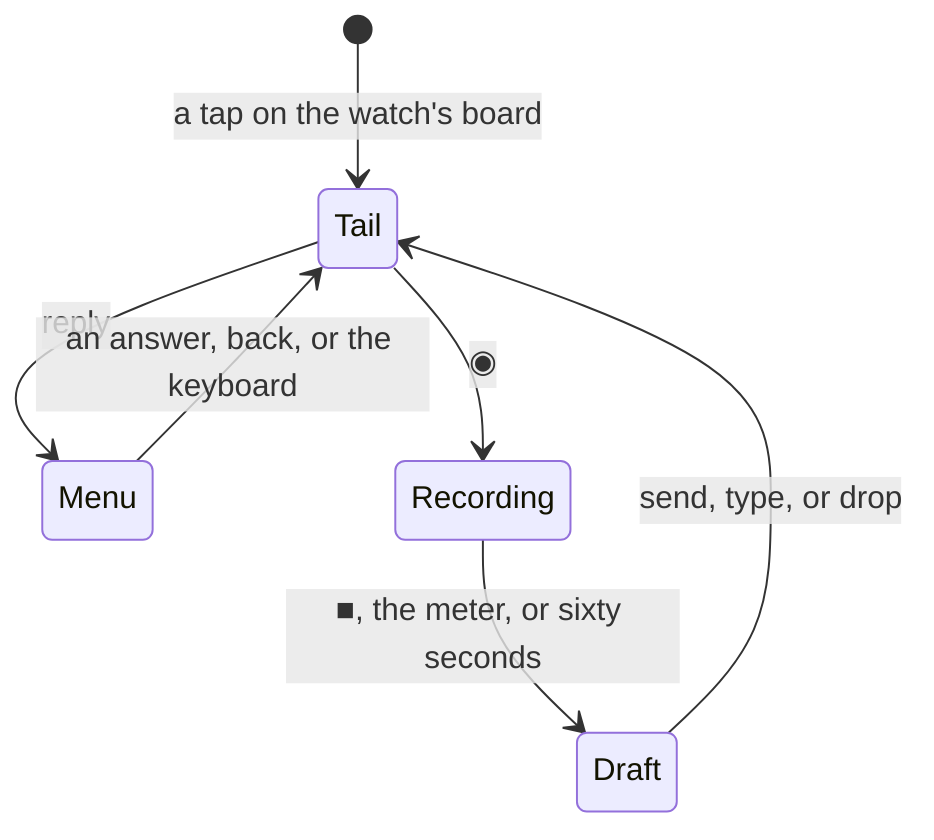

# Feature: a round watch screen, and what the browser gained since yesterday

> Status: approved by the owner on 2026-10-25 as written, in full. Asked
> for as: the reply menu's options cannot all be clicked on a round
> watch, and the Android app is behind the web client — compare the two
> and implement on Android everything applicable.

## 1. Goal

Two things.

**The watch is round.** The pane screen and the reply menu are laid out
for a square screen: fixed paddings, a key row along the bottom edge and
a list that runs to the full width. On a round watch the glass cuts the
corners, so `Enter` shows as `ter`, the last key is off the screen, the
first and last lines of the pane's tail lose their ends, and the reply
menu's rows at the top and bottom of the arc are clipped and hard to hit.
The owner cannot reach every answer. The screen must be laid out from the
shape of the glass, and every answer must be reachable.

**The browser moved on.** Between 2026-10-24 and today the web client
gained a number of things this client has not. §2.1 compares the two,
feature by feature, and says which belong here.

Out of scope: attachments (muxway-android#11 — the browser has a plan for
them, not an implementation); the window view, boards and the selector
(web only by the guideline); closing a pane on its host and the theme's
attention colour, which the core session is implementing in this
repository as step 6 of the core plan `2026-10-25-one-pane-view.md` and
landed in c79898e while this plan was being written.

## 2. Design

### 2.1 The compare: the browser against this client

Read from `docs/ui-guideline.md` in the core, `docs/features/web-client.md`,
and every core commit since 2026-10-24.

| # | What the browser does | Here | Verdict |
|---|---|---|---|
| 1 | `×` in a header closes the pane on its host, asking `y` / `n`, where the agent runs with `--allow-close`; elsewhere it closes the tile | done here in c79898e, by the session that did the core side | nothing to do but test it: c79898e has had no Android run, so it goes into this one's |
| 2 | A tile whose pane exited (`404`) leaves the tiles by itself | the tile stays and shows `Not found` for ever | **take**: the tile leaves, the last one goes back to the list |
| 3 | `]` and `[` come round at either end of the strip | the swipe stops at the ends (`coerceIn`) | **take** |
| 4 | `v` or `◉` held records until released; tapped, it toggles | tap only | **take** |
| 5 | Completion above the input line while the first word is typed (muxway-android#12) | nothing | **take**: tap to accept, there being no `Tab` |
| 6 | A pane alone in the view fits its *window* with the pane zoomed, and a pane left for another keeps its size (muxway-android#19) | fits the pane only; a pane left is released | **take** |
| 7 | The lens: a change this client caused does not count as *working*; the hub's recent events seed it (muxway-android#2) | every pane shows `⟳ working` for ten seconds after it is opened, and after each line typed | **take**: the seeding is already right (the first `/v1/events` has no cursor, so the hub sends the recent ones); the self-caused changes are not |
| 8 | Attention is the theme's own ink, drawn inverted; no amber in the green theme | already so: `attention = ink` in all three palettes, and a waiting tab is drawn inverted | nothing to do |
| 9 | A `Stop` with background work left running reports *working*, not *done* | — | nothing to do: the agent decides, the client only shows what the hub says |
| 10 | The admin page: log, tokens, clients, address lists | the read-and-end section in Settings | by the guideline, the rest is web only |
| 11 | Zoom (`z`, `⊡`), the window view (`w`), boards (`b`), the selector (`p`), help (`?`), hubs as links | — | web only by the guideline |
| 12 | Attachments | — | out of scope: the browser has not got them either |

One more thing, found on the way and not a parity item: the microphone
crash fixed on branch `mic-focus` (bd0fb88) is still not on `main`, and
items 4 and 5 both touch the focus it fixes. It goes in first.

### 2.2 A screen laid out from the glass

A round watch is a circle of the screen's width. A band of the screen
between two heights is as wide as the circle's chord at whichever of its
edges lies farther from the middle:

```
      ╭───────────╮        inset = r − √(r² − d²)
    ╭─┤  top row  ├─╮      d    = the band edge farthest from the middle
   │  ╰───────────╯  │     r    = half the screen
   │ ┌─────────────┐ │
   │ │  the tail   │ │     the middle band is nearly the full width
   │ └─────────────┘ │
    ╰─┤ keys  ├─╯          the bottom band is much narrower
      ╰───────╯
```

`wear/Round.kt` holds that one function, with unit tests. The pane
screen and the reply menu ask it for the inset of each band they draw,
and the bands follow from the heights the screen already uses: the top
row, the title line, the tail, the note line, the keys. On a square
screen (`!isScreenRound`) the inset is nothing and the layout is what it
is today.

With the bottom band so narrow, the key row stops being one scrolling
row on a round screen: the keys wrap into two centred rows, each inset by
its own band, so every key is on the glass and reachable without
scrolling — the owner's complaint, in the small. `phone` keeps the last
place.

```
   ╭─────────────────╮
   │   ◉    reply    │   top row, inset by its band
   │ ┌ ⟳ build       │
   │ the pane's tail │   inset by the tail's band
   │ └ sent          │
   │ Enter Esc  y  n │   keys, row 1
   │    ^C  phone    │   keys, row 2, inset more
   ╰─────────────────╯
```

### 2.3 A reply menu that can be answered

The menu keeps its rows — Claude's own choices first, then the common
answers, then the watch's keyboard — and gains what a round screen needs:

- the list centres the row it is on (`autoCentering`), so the first and
  the last answer can be brought to the middle of the glass, where they
  are whole and hit-able;
- the bezel and the crown scroll it (`rotaryScrollable`), not only the
  finger;
- a position indicator at the right edge says how much more there is;
- each row is a bordered box at least 44 dp tall, its label centred and
  inset by the arc, to two lines.



### 2.4 The pane view here, item by item

- **A pane that exited** (item 2): a read answering `not_found` takes the
  tile out of the view; the last tile leaves the view for the list. The
  pane's state is dropped with it, so nothing keeps reading an address
  the host no longer has.
- **Round the ends** (item 3): the swipe and the strip wrap, as `]` and
  `[` do.
- **Held to talk** (item 4): a press on `◉` starts the clip and a release
  after a quarter second stops it and sends it to be heard; a shorter
  press is the tap that is there now, and stops on the next tap, on `■`,
  or on the meter. Nothing else about the clip changes — it still lands
  on the line, to be read before it is sent.
- **Completion** (item 5): `protocol/Complete.kt`, the same rules as the
  browser's `term/complete.ts` (first word only, the caret at its end,
  Claude's slash commands or a shell's starters and the lines sent
  before, eight at most, nothing from the pane or the hub ever), with
  unit tests beside the browser's. A row of them sits above the input
  line while the word is being typed; a tap takes one and leaves the
  caret after it; the row goes on `Esc`, on a space, or when nothing
  matches. The key row keeps its place below.
- **The window fit** (item 6): a pane alone in the view asks for its
  window's size with the pane zoomed, as tmux's own zoom does, so no
  neighbour is squeezed; `Api.resize` gains the `scope` and `zoom` the
  protocol has had since 2026-10-24. A pane left for another keeps the
  size it was given and is not asked again when it comes back at that
  size; everything is released when the view is left, as now.
- **The lens** (item 7): the first read of a pane, and a change within
  two seconds of this client's own input, resize or release, do not count
  as a change for the lens. `PaneState` gains the moment of the last
  own-action; `Lens.status` is untouched.

## 3. Protocol and API changes

None. Every endpoint used is in `docs/protocol/v1.md` already:

- `POST /v1/panes/{address}/resize` with `{"cols", "rows", "scope":
  "window", "zoom": true}` — in the protocol since 2026-10-24, used by
  the browser, new for this client.
- `GET /v1/panes/{address}` answering `404 not_found` for a pane that
  exited — already answered, newly acted upon.

The pinned protocol version does not move.

## 4. Security analysis

- **The watch** gains no new power. It still holds no token, opens no
  connection, and every request still goes through the phone's gate
  (`WatchGate`), which checks the pane against the listing and the key
  against the whitelist, and the phone-side setting that allows writes at
  all. The round layout is drawing only. The reply menu's rows are built
  from Claude's own choices as the lens reads them, exactly as today, and
  each one sends either a digit as text or a whitelisted key name —
  nothing from a pane's content is ever sent as a key.
- **Completion** lists only constants compiled into the client and the
  lines this client has sent to a shell before (already kept for the
  command row, already shown there). Nothing from a pane's content, a
  pane's title or the hub is ever offered, so a hostile pane cannot put a
  command under the owner's thumb. A completion is text on the line, not
  a send: `Enter` is still the owner's.
- **The window fit** resizes a window the token may write to; the hub
  keeps its floor of twenty columns and five rows per pane and its one
  resize per second, and the zoom is tmux's own. A read-only pane cannot
  fit, as now.
- **Closing a tile** on `404` is local: it stops reading an address and
  sends nothing.
- **Logs**: nothing new is logged. The clip, the draft and the tail stay
  in memory on the watch and are never written down.
- **No new dependencies.** `rotaryScrollable`, `AutoCenteringParams`,
  `PositionIndicator` and `Scaffold` are in the Wear Compose 1.4.0
  libraries the module already has.

## 5. Privacy check

Fixtures and screenshots use `alice-laptop`, `bob-desktop`,
`alice@example.com` and `hub.example.com`; the watch screenshots in the
docs are drawn as box diagrams, not taken from the owner's watch. The
two screenshots the owner sent are read in the session and not committed.
`scripts/prepush-check.sh` runs before the push.

## 6. Test plan

| # | Test | Kind | Expected |
|---|------|------|----------|
| 1 | A reply menu row whose label is a pane's own text, 200 characters of it, with newlines and escapes | unit (WatchGate, ClaudeLens) | the label is cut to two lines, the answer sent is a digit or a whitelisted key; nothing else reaches the gate |
| 2 | A completion pool built from a pane whose title and content carry `rm -rf /` and `mxt_…` | unit (Complete) | neither appears; the pool is the constants and this client's own sent lines |
| 3 | Completion with the caret inside the word, after a space, on a read-only pane, on a program with no row | unit | nothing offered |
| 4 | A window fit on a read-only pane, and one asking for 2 columns | unit / e2e | refused before it is sent; the hub's floor holds |
| 5 | `Round.inset` at the middle, at the edges, with a band outside the screen, on a square screen | unit | the chord, zero, clamped, zero |
| 6 | Completion: first word, a pick, the text and caret after it | unit | as `complete.ts` |
| 7 | The lens: first read, own input, own resize, then a change the host made | unit (new LensWorkTest) | quiet, quiet, quiet, working |
| 8 | A pane read answering `not_found` with two tiles open, then with one | e2e (TinyServer) | the tile leaves; the view leaves for the list |
| 9 | The strip's ends: a swipe past the last pane and before the first | UI (FlowTest) | the first and the last pane |
| 10 | `◉` held for a second, and tapped | UI | held records and stops on release; tapped records and stops on the next tap |
| 11 | The watch's pane screen and reply menu on a round screen and a square one | UI (new WearFlowTest) | nothing clipped; every answer reachable; screenshots `watch-round-tail`, `watch-round-menu`, `watch-square-tail` |
| 12 | The whole suite on the test hub | e2e | `scripts/e2e.sh` green, run recorded |

Tests 1 to 7 are JVM unit tests and run here. Tests 8 to 12 want a
device: this machine has no KVM, so they are compiled here and run on the
owner's phone and watch, and the run says so.

## 7. Documentation

- Core `docs/ui-guideline.md`: §1.4 input (completion is no longer web
  only), §1.6 (take a completion: Android tap; speak: Android held or
  tapped; close the pane: Android too), §3 (the watch's pane screen on a
  round screen), and the `muxway-android#19` note once the window fit is
  here. One commit, that file alone, since the core session is working in
  that repository.
- Here: `docs/features/watch.md` (the round layout and the menu),
  `docs/features/pane-view.md` (completion, the window fit, a pane that
  exits, the ends of the strip, the microphone held), `README.md` if the
  feature list moves.
- This plan: the review and the run recorded at the bottom.

## 8. Implementation steps

1. `mic-focus` (bd0fb88) onto `main`, keeping `main`'s version.
2. The watch: `Round.kt` with its tests, the pane screen's bands, the two
   key rows, the reply menu centred with the rotary and the indicator.
3. The pane view's small ones: the ends come round, a pane that exited
   leaves, `◉` held.
4. The lens: this client's own changes stop counting.
5. Completion: `Complete.kt`, its tests, the row above the line.
6. The window fit: `scope` and `zoom` in `Api.resize`, a pane alone
   fitting its window zoomed, a pane left keeping its size.
7. Docs, the version bump to 0.9.2 (26) in **both** modules — c79898e
   bumped the phone's and left the watch's at 0.9.0 (24) — the run, the
   record, the push (c79898e's untested close goes out with it).

Each step builds and passes the JVM suites on its own.

---

## Review (after implementation)

- [x] Diff matches the plan, deviations explained here
- [x] Security rules (AGENTS.md section 2) hold
- [x] Privacy check passed: `scripts/prepush-check.sh` clean and diff read
- [x] Docs and diagrams updated

Deviations, all of them additions the plan did not foresee:

1. **The watch's own pane list** got the same treatment as the reply
   menu (centred rows, the bezel, an indicator, the arc's inset). It has
   the same ailment and the owner taps panes there to open them.
2. **The summary said "all quiet" while panes worked.** The owner
   reported it mid-implementation: every summary counted only the panes
   that wait, so two working Claude panes read as quiet. `Board.working`
   now exists, and the watch's summary, its small slot and the phone's
   ongoing notification name the strongest state: *N waiting* (with the
   working count beside it), else *N working*, else *all quiet*. Panes
   are counted in the singular too.
3. **Three end-to-end tests** cover what c79898e brought in untested
   (closing a pane, with and without the agent's flag, and for a
   read-only token) and the new window fit against a real hub.
4. **Issue #26** was opened for the one difference the compare in §2.1
   missed: tiles that are every pane of one window fit the window *as
   one, laid out as the tiles*. This client has the other half of that
   rule (one fit per window, the rest *held*) but does not send a tmux
   layout string, which wants a layout builder and a checksum. The
   guideline's §1.4 now names #26 instead of #19 there.
5. The plan said the attention colour needed nothing here, which held:
   c79898e had already brought the phone's palettes in line. The watch
   app keeps amber for a waiting row, because its face and complications
   colour by a value and cannot invert; a working row is dim and a quiet
   one ink, so three states stay apart. Worth a decision by the owner.

## A second pass on the watch, asked for after the first build

The owner tried 0.9.2 on the watch and asked for three things, done in
7ac38a5 as 0.9.3 (27):

1. **The ring lied.** The summary complication's ranged value was the
   colour hint, 0 to 2, so a face that draws a gauge drew nonsense: one
   working pane of two read as empty, and the owner's face showed it
   full. It is a proportion now — the panes that wait or work, out of all
   of them — so one working of two is half a ring, and a quiet day is an
   empty one. This face's summary line is drawn the one way, since a ring
   cannot say which state it is showing and the four rows above it do.
2. **The keys under the tail are gone.** They took two bands of a round
   screen, where the circle is narrowest, and said nothing the reply menu
   does not. The menu gains *phone*, the one thing only they had; a
   read-only pane, which has no menu, offers *phone* in the top band.
3. **The two buttons are in the middle**, *reply* first and the
   microphone second, both a size a thumb can find.

Found on the way: `scripts/validate-face.sh` had never validated
anything. The format version it parsed from the manifest came out empty
(`grep -o '[0-9]*$'` on a line ending in a quote matches nothing), the
validator answered usage instead of checking, and it exits 0 whatever it
thinks — so every run since the face was added recorded a face check that
did not run. It parses the version properly now and treats anything but
`PASSED` as a failure. The face passes for real against format version 1.

### A third pass: the buttons, and why the microphone vanished

0.9.4 (28), `2bd2e13`. The owner's next look showed the two buttons too
tall and the microphone's box empty. One cause under both: a watch
reports about **240 dp**, not the 450 px of its screen, so buttons at
15 sp stood 37 dp tall and the pair of them all but filled the chord of
the top band — which sits where the glass is narrow. The microphone,
measured last in the row, was left with no room: its label took no width
and painted nothing, while its border drew as usual. The glyph was never
the problem; `◉` is in the bundled font with a real outline, and it drew
at 12 sp in 0.9.2.

- The buttons keep 12 sp and lose their height (a dp above and below,
  14 dp either side): low and wide, about half what they were.
- The top band sits lower, where the chord is wider, and its inset is
  capped so the row always keeps 150 dp on any watch.

The lesson for this screen: a band of a round layout must be checked
against the dp the device reports, not the pixels of its screenshot.

## Test run

[Run 20261025-105506-2bd2e13](https://github.com/notmarkopadjen/muxway-android/issues/29):
**passed**, 153 tests, 0 failed, at `2bd2e13`, the buttons and the
microphone.

[Run 20261025-103630-7ac38a5](https://github.com/notmarkopadjen/muxway-android/issues/28):
**passed**, 153 tests, 0 failed, at `7ac38a5`, the watch's second pass
and the face check that now runs.

[Run 20261025-100907-05d3779](https://github.com/notmarkopadjen/muxway-android/issues/27):
**passed**, 152 tests, 0 failed, at `05d3779`, against a hub built from
the core's `origin/main` (715d737). No secret in any of the 85 logs.

The UI suite (`FlowTest`) compiled but did not run: this machine has no
KVM, so `adb devices` lists none. The watch's round layout, the reply
menu, the microphone held, the completion row and the `×` that closes a
pane are to be tried on the owner's phone and watch; 0.9.2 (26) went to
them for that.
