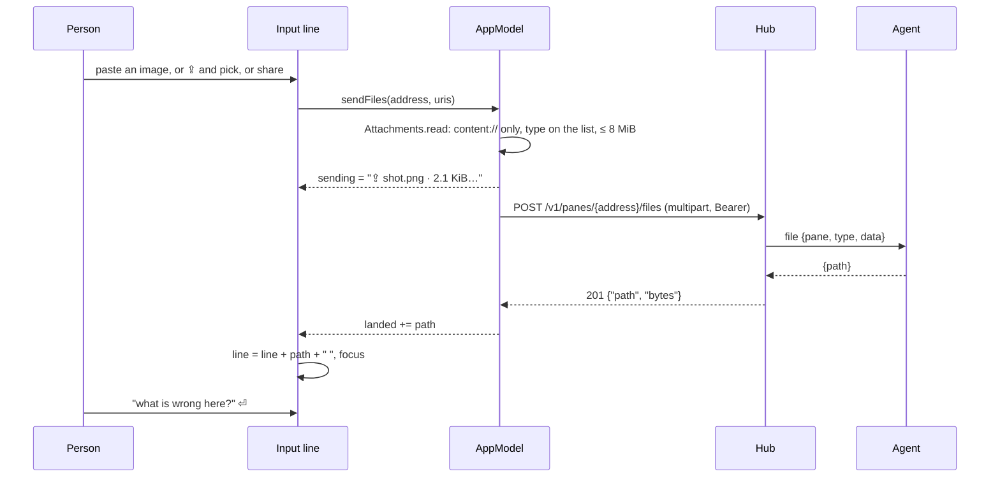
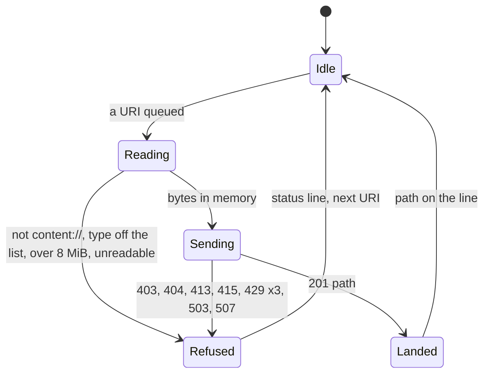

# Feature: attachments, a file into a pane from the phone

> Status: written and implemented 2026-10-26 on the owner's ask, "make
> paste work on the Android client as well", after the browser got it
> (core plan `2026-10-24-attachments.md`, muxway-android#11). The diff is
> the owner's to review.

## 1. Goal

An AI coding agent in a pane reads a screenshot or a file when its path
is in the prompt. The browser can hand a pane a file since 2026-10-25:
the host's agent writes it into an inbox and the client puts the path on
the input line. The phone could not, and a phone is where screenshots
are. Three ways in, each landing the path on the line of the focused
pane, unsent:

1. **Paste**: an image from the keyboard (Gboard's GIF and sticker
   insertion, a screenshot in the clipboard) or a long-press paste.
2. **Pick**: `⇪` beside the microphone opens the system picker, several
   files at once.
3. **Share**: a file shared from any app opens a chooser of the panes
   that take files; the pane opens with the path on the line.

Out of scope: the watch; a file from the host to the phone; a shared
text without a file (the chooser says so and sends nothing); drag and
drop between apps in split screen (the field takes it, it is not tested
and not promised).

## 2. Design

### 2.1 The protocol layer, `Files` and two calls

`protocol/.../Files.kt` holds what the browser's `queries.ts` does: the
allow-list of types keyed by extension, the 8 MiB cap, the choice of a
type from the resolver's MIME or the name's extension, the size for a
toast, the progress label `⇪ name · size…`, the path appended to a line
with a space after it, and the multipart body built by hand: one part
named `file`, the file name always `file`, the part's `Content-Type` the
file's type. The client's own name for the file goes in no request.

`Api` gains `takesFiles(address)` (`GET …/files`: 204 is true, any
refusal false, no connection throws so it is asked again) and
`sendFile(address, bytes, type)` (`POST …/files`, 201 `{path, bytes}`;
the path is cleaned of control characters as everything shown is).
Sixty seconds for the upload: the hub holds the request while the
agent writes.

### 2.2 The app

- **The input line** moves to the text field that takes content
  (`BasicTextField(TextFieldState)` with `Modifier.contentReceiver`).
  Only that field receives the keyboard's image insertion and a pasted
  clip with a `content://` item; the field the rest of the app uses does
  not, and it stays as it is. Everything the line did stays: six rows,
  the send action, hardware Enter and Shift+Enter, the completion row,
  the command row, the transcript landing after a space, control
  characters dropped as they are typed.
- **The receiver** takes every item of a clip whose URI is `content://`
  and leaves the rest, so text pastes as before. Taken items go to the
  model as files for the pane; on a host without an inbox the line
  says `No inbox on alice-laptop: its agent needs --inbox` and nothing
  is pasted, as the browser's toast does.
- **`⇪`** sits right of `⌨` (the guideline's order: `⌨` `⇪` `◉` `⏎`),
  only when the pane is writable and the hub answered 204 for it. The
  answer is asked once per pane and kept for sixty seconds, as the
  browser's query is. It opens `OpenMultipleDocuments` for the eight
  types.
- **`Attachments.read`** (app) turns a content URI into bytes in memory:
  the display name (for the status line only, cleaned and cut), the
  resolver's type or the name's extension against the allow-list, the
  bytes read through the `ContentResolver` up to the cap plus one, so a
  file over 8 MiB is refused before any request. Only `content://` is
  opened: a `file://` from a hostile share could name this app's own
  files.
- **`AppModel.sendFiles(address, uris)`** queues the URIs on the pane's
  state and runs one worker per pane: read, check, upload, path to the
  pane's `landed` list, the next. The progress label is on
  `PaneState.sending`; the line shows it in the field's place, as it
  shows `⟳ hearing…`. A refusal lands in the status line, per file,
  with the hub's code in words or the local reason. `429 rate_limited`
  (one file every two seconds per principal) is retried after 2.1 s, up
  to three times, so a batch of three goes through on its own.
- **The line** watches `landed`: each path is appended with a space
  after it, the field takes focus, nothing is sent.
- **Share**: `ACTION_SEND` and `ACTION_SEND_MULTIPLE` for the eight
  types on `MainActivity`. The activity hands the streams to
  `AppModel.share`, which opens the **share screen**: the writable panes
  by host, each probed (`takesFiles`), the ones that take files
  tappable with `⇪`, the others dim with `no inbox` or `read only`. A
  tap queues the files on that pane and opens it; the paths land as
  above. Back drops the share. A share with no file (a text) says so.

## 3. Protocol and API changes

None. The app uses `GET` and `POST /v1/panes/{address}/files` as
`docs/protocol/v1.md` in the core specifies them, protocol v1,
compatible. `docs/ARCHITECTURE.md` lists them among the features used.

## 4. Security analysis

- **What an attacker gains**: bytes written on the host, in one
  directory the owner opened on purpose, under names the agent chooses.
  Nothing is run; the person types the path. The hub's and agent's
  checks stand in front of every upload (write grant, writable mark,
  type sniffed, 8 MiB, one per two seconds, the inbox's caps); this
  client repeats the type and size checks so a refused file costs no
  request.
- **Grant**: the pane's write grant and the write mark, as for typing.
  `⇪` shows only after a 204; a read-only pane has no line at all.
- **Input across the boundary**: a content URI from the keyboard, the
  picker or another app. Only `content://` is opened, through the
  system resolver, with the grant the sender gave; the display name is
  shown in the status line only (printable, 60 characters) and never
  sent; the type is decided from the resolver's answer or the name's
  extension against the allow-list, never trusted beyond that (the hub
  sniffs). The hub's path answer is cleaned of control characters and
  shown on a line the person reads before sending. A path cannot type
  itself.
- **Memory**: a file is held in memory from read to answer, 8 MiB at
  most, one at a time per pane, then dropped. Nothing is written to
  this app's storage.
- **Logged**: nothing. The hub audits who put what type and size where.
- **Dependencies**: none new. The multipart body is built by hand;
  the field is Compose foundation's, already pinned.
- **Share target**: `MainActivity` is exported already (the launcher and
  `muxway://open`); the new filters admit `SEND` and `SEND_MULTIPLE`
  for the eight types. A hostile app can start a share; the person
  chooses the pane, and nothing happens until they do.

## 5. Privacy check

Placeholders only: `alice-laptop`, synthetic bytes (a 2×2 PNG), no real
path, host or person. Screenshots: none taken; the device is not here.

## 6. Test plan

| # | Test | Kind | Expected |
|---|------|------|----------|
| 1 | a read-only token: `takesFiles` is false and `sendFile` is `403 read_only`; no file in the inbox | e2e-security | refused, inbox empty |
| 2 | a read-only pane with a writing token: `read_only` | e2e-security | refused |
| 3 | an agent without `--inbox`: `takesFiles` false (404), `sendFile` `not_found`, no inbox directory | e2e-security | refused |
| 4 | bytes that are not what the type says (`image/png` over text): `415 unsupported`, nothing written | e2e-security | refused |
| 5 | a second file at once: `429 rate_limited`; after 2.1 s it goes | e2e-security | refused, then 201 |
| 6 | a PNG lands: 201, the path under the agent's inbox, the bytes equal, mode 0600, `Files.onLine` gives `… <path> ` | e2e | passes |
| 7 | `Files.type`: the eight types by MIME and by extension, case-insensitive; `svg`, `html`, `sh`, `exe`, no extension, `text/plain` with a `.sh` name are refused | unit | as listed |
| 8 | `Files.multipart`: the body shape, the boundary in the header, `filename="file"`, the type in the part, the bytes intact, the name nowhere | unit | as listed |
| 9 | `Files.onLine`: empty, with text, with a trailing space; `Files.size` | unit | as listed |
| 10 | `Api.sendFile` posts to `/v1/panes/{address}/files` with the bearer token and reads the path; a path with control characters is cleaned; over 8 MiB or a type off the list is refused before any request; `takesFiles` is true on 204 and false on 403/404 | unit | as listed |
| 11 | paste from Gboard, a long-press paste of a screenshot, `⇪` with three files, a share from Photos, a share of a text, a host without an inbox | by hand on a device | the paths on the line, the notices in the status line |

Security tests first in `E2ETest` (`s14…`); the feature test `f24…`.
No instrumented test is added: the suite has no device here, and the
flows are driven by the keyboard and other apps, which `FlowTest`
cannot stand in for.

## 7. Documentation

- `docs/features/attachments.md` (new): what, how, security.
- `docs/features/pane-view.md`: the icons' order, `⇪`, the status line's
  file refusals.
- `README.md`: a line in *What it does*.
- `docs/ARCHITECTURE.md`: the files endpoints among the features used,
  the share intent.
- `docs/testing.md`: `Files` in the unit list.
- The core's `docs/ui-guideline.md` row for files lists Android as
  `⇪` and share; paste belongs there too. That is the core's to change.

## 8. Implementation steps

1. This plan.
2. `Files`, `Api.takesFiles` and `sendFile`, `Json.sent`, the error
   words; unit tests.
3. The input line on the content-taking field; `⇪` and the picker;
   `Attachments.read`; `AppModel.sendFiles`, the inbox cache, the
   progress and the paths on the line; feature page, pane-view, README,
   architecture.
4. Share: the manifest, `MainActivity`, `AppModel.share`, the share
   screen; the docs' share sections.
5. The harness's `--inbox`, the end-to-end tests, testing.md, the
   version.

---

## Review (after implementation)

- [x] Diff matches the plan. Deviations: none.
- [x] Security rules (AGENTS.md section 2) hold: the write grant and the
      mark are the hub's; this client sends nothing to a pane by itself,
      opens `content://` only, caps at 8 MiB before the request, logs
      nothing, adds no dependency.
- [x] Privacy check: `scripts/prepush-check.sh` clean, diff read.
- [x] Docs and diagrams updated.

## Test run

Recorded with `scripts/record-run.sh` from the run directory of the
final `MUXWAY_UI=0 MUXWAY_CORE=../muxway scripts/e2e.sh`; the issue is
linked from the commit that made it. Paste, pick and share on a device
are not in the run (test 11): no device was at hand.
