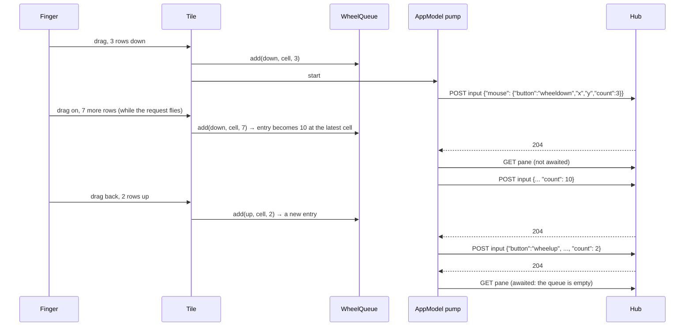
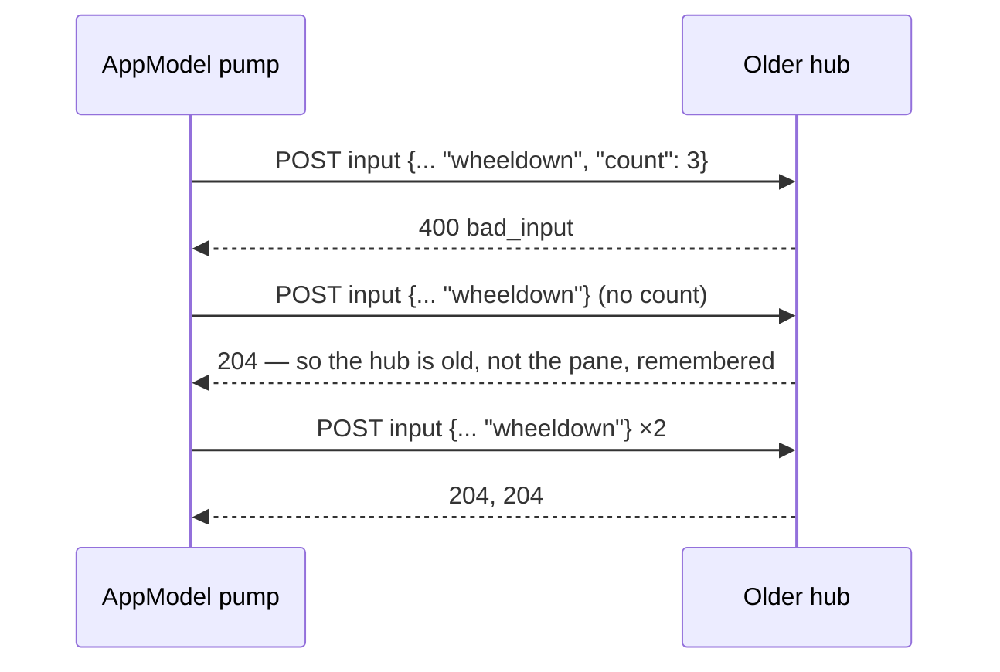

# Feature: a drag scrolls a program in a few requests (wheel count)

> Status: written and implemented 2026-10-26 on the owner's report that
> scrolling Claude Code's pane on the phone is very slow. The core gained
> the `count` field on the mouse input the same day; this is the client's
> side of it. The diff is the owner's to review.

## 1. Goal

A vertical drag over a full-screen program that has the mouse (Claude
Code's transcript) is today one `wheelup` or `wheeldown` request per row
of travel, each a round trip through the hub to the host, and the pane
is busy while one flies, so a long drag crawls and most of the hand's
movement is thrown away. With the protocol's `count` a request turns the
wheel up to 50 notches, so a drag becomes a few requests and the program
keeps up with the hand.

Out of scope: the browser's side (done in the core), the watch (it has
no pane body to drag), and local scrolling of the rows the hub sent,
which the list already does on its own without the network and is left
as it is.

## 2. Design

- `Api.mouse` takes a `count`, 1 by default; `Json.mouse` writes the
  field only when it is above one, so a request without a count is the
  body an older hub knows. `count` is 1 to 50 and goes with the wheel
  buttons only; the client refuses anything else before sending, as the
  hub does.
- `WheelQueue` (protocol module, pure Kotlin) gathers notches while a
  request is in flight: the rows of the drag since the last request go
  into the pending entry when they turn the same way, up to 50; the
  other direction starts a new entry; an entry carries the cell of the
  finger's last position; past four entries the rest is dropped, which
  beats scrolling on after the hand has stopped.
- `Wheel.deliver` sends one entry: a counted request where the hub
  takes one. A hub from before the field answers `400 bad_input` to a
  count; then the entry's notches go one by one, as before, and the
  model remembers for the rest of the session that this hub takes no
  count. A `bad_input` to a single notch is the pane's (no mouse mode)
  and is shown as before.
- `AppModel.wheel(address, up, x, y, count)` adds to the pane's queue
  and starts a pump when none runs: one request in flight at a time,
  the pane marked busy while it drains, a read of the pane after each
  request (not awaited while more is pending) so the screen follows,
  and a last read when the queue is empty.
- The tile's drag handler turns the travel since the last request into
  whole rows at once, `model.wheel(..., rows)`, and keeps the remainder.
  `PageUp`/`PageDown` for a program without the mouse stay as they are.



Fallback on a hub from before the field:



## 3. Protocol and API changes

None here; the client uses the core's addition, a compatible v1 change
(`docs/protocol/v1.md`, the `mouse` bullet): `count`, 1 to 50, with
`wheelup` and `wheeldown` only, absent meaning one.

```json
{"mouse": {"button": "wheeldown", "x": 12, "y": 3, "count": 10}}
```

## 4. Security analysis

- No change to grants: a counted wheel needs the write grant and the
  write mark like a single notch, and the agent still refuses a pane
  whose program has no mouse mode, so nothing is typed as text.
- The cap: the client sends at most 50 notches per request and holds
  at most four entries, so a drag cannot queue unbounded work on the
  host; the hub enforces the same 50 and answers `bad_input` beyond it
  or with a click button. The client refuses both locally too.
- The fallback sends only the body an older hub already accepts.
- Rate limits are the hub's, unchanged; fewer requests per drag means
  a drag trips them less.
- Audit on the host is unchanged (`op=input mouse=wheeldown`); nothing
  new is logged on the phone.
- No new dependency.

## 5. Privacy check

Fixtures use `alice-laptop` and the throwaway tmux server; no real
host, person or secret in code, docs or tests.

## 6. Test plan

| # | Test | Kind | Expected |
|---|------|------|----------|
| 1 | The hub refuses `count` with a click button and above 50 | e2e-security | `400 bad_input`, nothing typed |
| 2 | `Api.mouse` refuses count 0, 51 and a count with `left` locally | unit | `IllegalArgumentException`, nothing sent |
| 3 | Body: `count` written only above one | unit | `{"mouse":{"button":"wheeldown","x":5,"y":3,"count":10}}`; absent for 1 |
| 4 | `WheelQueue`: same direction merges to 50, the other starts an entry, the cell is the last one, four entries at most | unit | as said |
| 5 | `Wheel.deliver` on an older hub: `bad_input` to a count, then one by one; a single notch's `bad_input` is thrown | unit | three requests, false back; the error through |
| 6 | A counted wheel reaches `cat -v` after it enabled mouse reporting | e2e | the pane shows three `^[[<65;5;3M` |
| 7 | Drag on a device | UI | needs a device |

## 7. Documentation

`docs/features/pane-view.md` (Scrolling), `docs/ARCHITECTURE.md` (the
mouse row).

## 8. Implementation steps

1. Plan here. 2. `Input`, `Json`, `Api`, `WheelQueue`, `Wheel`, tests.
3. The pump in `AppModel`, the drag in the tile. 4. Docs, the
end-to-end tests, the run.

---

## Review (after implementation)

- [x] Diff matches the plan
- [x] Security rules hold: the cap twice, grants untouched, nothing new logged
- [x] Privacy check: `scripts/prepush-check.sh` clean, diff read
- [x] Docs updated

## Test run

Local run `test-runs/20261026-105243-41e53f8`, recorded as
[muxway-android#33](https://github.com/notmarkopadjen/muxway-android/issues/33):
**passed**, 181 tests, 0 failed, 0 skipped, against a hub built from
the core at `975d6ef`. Test 1 is `s04d`, test 6 `f16b`; the UI test
waits for a device.
