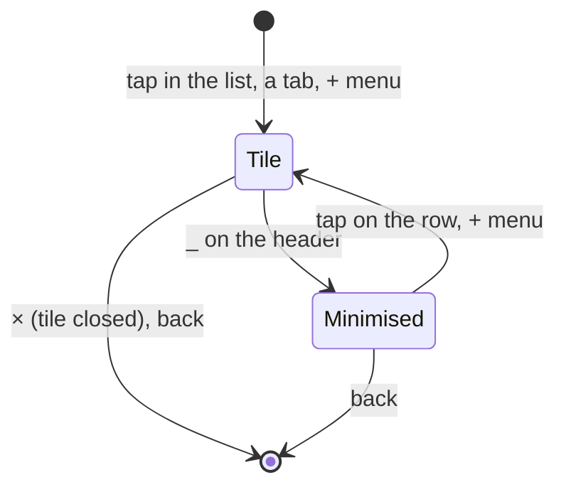

# Feature: the add menu and the minimised row

> The owner asked on 2026-10-27, from the demo hub: "I don't see a plus
> next to headers at all. I want a plus sign to offer adding a new pane or
> an existing one. `×` should have `_` next to it to minimise panes, which
> then switch from the top header to a footer right above the input. On
> Android and web both."

## 1. Goal

Two things the pane view lacks, in both clients:

1. **Add from the view.** The web has `+` after the tabs with *split
   here* and *new session*; Android has nothing, only `+ pane` in the
   list. Both get one `+` after the last tab whose menu offers, in this
   order: a new pane (beside the focused one, on its host), a new session
   (where the host starts them), a rule, the panes minimised below, a
   rule, every other readable pane grouped by host and session. A pane
   picked becomes one more tile; at four tiles the menu says so and the
   pick swaps the focused tile instead, as a tab does today.
2. **Minimise.** `_` beside `×` on a tile's header takes the tile out of
   the arrangement and puts its tab in a **minimised row** right above
   the input, painted like a tab and still reading (every two seconds,
   like an open tile that is not focused), so its state and glyph keep
   moving. A tap on it brings the tile back; its tab leaves the top strip
   while it is below. The last tile cannot be minimised: its `_` is off.

Out of scope: minimised panes surviving a reload or a restart (they are
part of the view's arrangement, which is forgotten with it today, on
both clients); the watch; any new endpoint.

## 2. Design

A pane open in the view is in one of three places. Nothing of this
reaches the host: the arrangement is the client's own.



The view's state grows by one list, `minimised: [address]`, beside the
open addresses, the focus, the layout and the weights. A pane is in at
most one of the two lists. `n` tiles means the open list without the
minimised; the arrangement options and the fit rules follow the open
list, as now. Reads: the minimised pane is read like an unfocused tile.

```
┌─ muxway ─┐ [⟳ build][! review] [+]      [▦][⤢][⚙]
┌ ⟳ build · claude · write     ⟳ working  96×28  _ × ┐
│ …                                                  │
└────────────────────────────────────────────────────┘
[? deploy][logs]                       ← minimised row
> ______________________________  [⇪][◉][⏎]
```

The `+` menu, built from the listing the client has (no request):

```
+ pane         beside build on alice-laptop
+ session      on alice-laptop
──────────────
? deploy       alice-laptop/work/0.1      minimised
──────────────
alice-laptop · work
  logs         work/1.0
bob-server · ops
  htop         ops/0.0
  hub.log      ops/1.0
```

Entries the token or host do not allow are dimmed with the reason (`read
only`, `no sessions here`), as the web menu dims them today. The focused
pane and the open tiles are not listed. With four tiles the heading
reads `four open: a pick replaces build`.

```mermaid
sequenceDiagram
    participant U as you
    participant V as pane view
    participant H as hub
    U->>V: + → "+ pane"
    V->>H: POST /v1/windows/{host}/{session}/{window}/panes
    H-->>V: the new pane's address
    V->>V: one more tile, focused
    U->>V: + → an existing pane
    V->>V: one more tile from the listing, focused; no request
    U->>V: _ on a header
    V->>V: tile out, tab into the minimised row; reads go on
```

Web: `AddMenu.tsx` grows the two lists under its two entries, from
`usePanes()`; `Pane.tsx` keeps `minimised` next to `addresses`, the tile
header gets `_` before `×`, and a `MinimisedRow` sits between the tiles
and `InputPanel`. Android: `ViewScreen.kt` keeps `minimised` in the
view's saved state, `Tabs` gets the `+` button after the last tab with a
`DropdownMenu`, `PaneTile`'s header gets `_` before `×`, and a row of
tabs above the input shows the minimised panes. The menu's rows come
from one pure function in the protocol module, `AddMenu.rows(panes,
hosts, me, open, minimised, focused)`, unit-tested on the JVM; the web
has the same shape in `term/addmenu.ts`.

## 3. Protocol and API changes

None. The new pane and the new session use the endpoints the list uses
today; an existing pane is opened from the listing already held.

## 4. Security analysis

- An attacker gains nothing new: no endpoint, no grant, no input to the
  host. The menu lists only panes the hub already listed for the token,
  and the split goes through the hub's own check of the write grant.
- Pane names and titles in the menu are the listing's, already filtered
  by the client's text rules; they are drawn, never interpreted.
- Nothing is logged by the client; the hub logs the split as it does.
- No new dependency on either client.

## 5. Privacy check

Fixtures use `alice-laptop`, `bob-server`, `work`, `ops`. Screenshots
come from the UI run and from the demo hub, whose data is synthetic.

## 6. Test plan

| # | Test | Kind | Expected |
|---|------|------|----------|
| 1 | A read-only token opens the menu | UI, web spec | `+ pane` dimmed `read only`; the other panes still listed |
| 2 | A host without `sessions` | unit | no `+ session` row for it |
| 3 | Menu rows: open and focused panes left out, minimised first, the rest grouped by host and session in listing order | unit (JVM, vitest) | as the sketch |
| 4 | `+` → `+ pane` | UI, web spec | one more tile, focused, the hub asked once |
| 5 | `+` → a pane of the other host | UI, web spec | one more tile, no request; screenshot |
| 6 | Four tiles, `+` → a pane | unit, web spec | the focused tile swapped, count stays four |
| 7 | `_` on a header | UI, web spec | tile gone, tab in the minimised row, gone from the strip; screenshot |
| 8 | Tap the minimised tab | UI, web spec | tile back, row empty, strip has the tab again |
| 9 | `_` on the last tile | unit | disabled |
| 10 | A minimised pane's state changes (notify) | e2e | its tab in the row repaints with the glyph |

## 7. Documentation

Guideline §1.4 (header row, header, a new *minimised row* element) and
§1.6 (three rows: add a pane from the view, minimise, restore) first;
core `web-client.md` (Tiles), `new-panes.md`; here `pane-view.md`.

## 8. Implementation steps

1. Guideline rows and sketch.
2. `AddMenu.rows` in the protocol module and `term/addmenu.ts`, with
   their unit tests.
3. Android: `+` after the tabs, the menu, `_` and the minimised row.
4. Web: the menu's two lists, `_`, the minimised row.
5. Tests, docs, version bump on both sides, one commit each naming the
   other.

## Decision

The owner answered on 2026-10-27: "I mean all the hubs on all servers.
Go and implement all of that." Approved as written; every hub's panes in
one list is its own plan, `2026-10-27-every-hub.md`, and the add menu
lists panes of every hub the way that plan describes.

---

## Review (after implementation)

- [x] Diff matches the plan. Deviations: none in behaviour. The menu's
  rows are `AddMenu.rows` in the protocol module, as planned; the view
  keeps the minimised keys in its saved state and drops any that leave
  the view. A pane picked while four tiles are on screen takes the
  focused tile's place through `AppModel.addPane`; a new pane or session
  from the menu lands as one more tile through the same path. The
  minimised row is read at the *every* setting, like the tiles.
- [x] Security: no new endpoint, no new input to a host; the menu draws
  names the listing already filtered.
- [x] Privacy check: placeholders only; the UI run's hub is the throwaway one.
- [x] Docs: `pane-view.md`, the guideline's §1.4 and §1.6.

## Test run

See the end of `2026-10-27-every-hub.md`; the two features were built,
tested and recorded together, in 0.12.0 (33).

