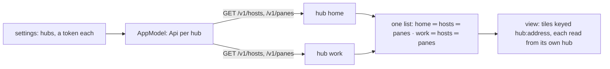
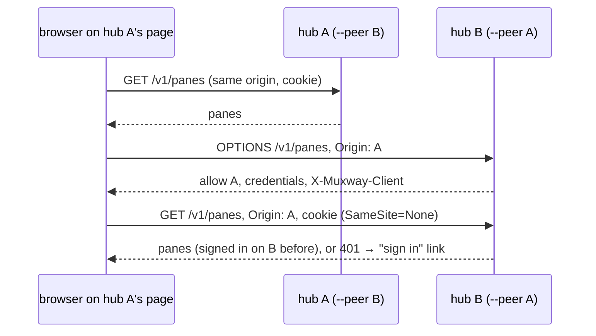

# Feature: every hub's panes in one list

> The owner, 2026-10-27: "I cannot see both server connections on
> Android. I mean all the hubs on all servers. Go and implement all of
> that." This reverses the decision of 2026-10-24 (hubs stay separate,
> one at a time) for both clients. The decision is the owner's, taken
> with the security consequences in section 4 in front of him.

## 1. Goal

A person with a hub at home and one at work sees the panes of both in
one list, opens them side by side, is told when any of them waits, and
on the web signs in on each hub once and then sees all of them on any
hub's page. Out of scope: a hub relaying another (no hub ever holds
another hub's credential); mixing two hubs' panes inside one host group.

## 2. Design

### Android

The app already keeps a hub list with a token per hub in the Keystore.
It stops choosing one: every hub with a token is **in use**. The model
holds one `Api` per hub, one listing per hub (hosts, panes, error, the
events cursor, the transcriber and admin answers, the wheel-count
answer), and the pane list draws them one under another, the hub's name
on a line above its hosts when there is more than one hub. A pane is
known by its **key**, `<hub id>:<address>`, everywhere the app told
panes apart by address before: the open tiles, the view states, the
events' last kinds, the inbox answers, the selection, the watch's rows,
the notification links (`muxway://open?hub=<id>&pane=<address>`; a link
without `hub` means the first hub, so older links and the watch keep
working). The address itself stays what the hub knows, so every request
goes to its own hub unchanged.

- **Events**: one long poll per hub, in parallel; any event re-lists
  that hub only.
- **The watch and notifications**: the service follows every hub with a
  token; the board is the union of their rows, ranked as before; a
  notification's link names the hub; the watch's requests carry the row's
  key and the gate routes each to its hub.
- **Settings**: the hubs list drops `use` and `▸`; a hub without a token
  reads `no token` with `edit`; `+ hub` as before. The admin section
  shows one block per hub whose token is admin, named by the hub.
- **A refused token** forgets that hub's token only; the others go on.
  The Connect screen is shown only when no hub has a token.
- **Rate limits** are per hub, untouched.

### Web

A browser holds a session cookie per origin, and the hub's cookie is
`SameSite=Strict`, so a page on hub A cannot call hub B today. The hub
gains a **peer** list: `muxway hub serve --peer https://work.example.com`
(repeatable). For a request whose `Origin` is a peer, the hub answers
the preflight and the request with `Access-Control-Allow-Origin: <that
origin>`, `Access-Control-Allow-Credentials: true` and the client header
among the allowed ones; with at least one peer the session cookie is set
`SameSite=None` (still `Secure`, `HttpOnly`). Without peers nothing
changes. The web's hubs box stays the list; the pane list asks every hub
in it with `credentials: 'include'`, shows a hub it is not signed in on
with a *sign in* link to that hub's page, and groups panes by hub as
§1.3 says. A pane of another hub is addressed as `<hub name>~<address>`
in routes and tile lists; every call for it goes to that hub's origin.

## 3. Protocol and API changes

Compatible. One hub flag, `--peer <origin>`; the CORS answer for a peer
origin gains `Access-Control-Allow-Credentials: true` and echoes the
origin; the session cookie's `SameSite` is `None` when peers are set.
Documented in the core's `docs/protocol/` (CORS section) and
`docs/features/sign-in.md`.

## 4. Security analysis

- **What changes on the hub**: a signed-in browser's cookie now travels
  with cross-site requests, but the hub only honours it together with the
  `X-Muxway-Client` header, which a browser can add cross-origin only
  after a preflight, and the hub answers that preflight for peer origins
  alone. A form post or an image from any other site carries no header
  and is refused as today (`41-cross-site.spec.ts` keeps proving it).
  The peer list is the owner's explicit decision, per hub, on the
  command line; an empty list is the old behaviour exactly.
- **What an attacker gains**: a peer hub's page that is compromised can
  act on this hub as the signed-in person. Peers are therefore hubs the
  same owner runs, and the docs say so.
- **Android**: nothing crosses a new boundary; each token is used only
  against its own hub, as before. A 401 from one hub forgets that token
  only. Keys are built by the app, never parsed from the network.
- **Logging**: unchanged; hub names are not secrets, tokens never appear.
- **No new dependencies.**

## 5. Privacy check

Fixtures use `home`/`work`, `hub.example.com`, `work.example.com`,
`alice-laptop`, `bob-server`. The demo hub's data is synthetic.

## 6. Test plan

| # | Test | Kind | Expected |
|---|------|------|----------|
| 1 | Credentialed request from a non-peer origin with the client header | e2e-security | preflight refused, no cookie honoured |
| 2 | Same from a peer origin | e2e-security | allowed, origin echoed, credentials true |
| 3 | Cookie attributes with and without `--peer` | e2e-security | `SameSite=None` only with peers |
| 4 | One hub's token refused | unit (model), UI | that hub's token forgotten, the other hub's panes still listed |
| 5 | Two hubs listed | UI, web spec | hub lines, hosts under each, open one of each side by side; screenshot |
| 6 | Events from hub B | e2e | hub B re-listed, hub A not asked |
| 7 | Notification from hub B | UI | the link opens the pane of hub B |
| 8 | Watch rows from two hubs | unit (Board), UI | ranked together, the reply goes to the right hub |
| 9 | A hub not signed in (web) | web spec | its line with *sign in*, nothing else broken |

## 7. Documentation

Guideline §1.3, §2, §3 (done first). Core: `web-client.md` (*Several
hubs* rewritten), `sign-in.md`, `docs/protocol/` CORS. Here: `connect.md`
(*Several hubs* rewritten), `notifications.md`, `watch.md`.

## 8. Implementation steps

1. Android model: Api per hub, keys, per-hub listing and events.
2. Android UI: list by hub, settings, admin per hub, links, watch.
3. Hub: `--peer`, CORS and cookie; security tests.
4. Web: per-hub queries, the list, routes, the add menu's hub level.
5. Docs; version bumps; one commit per repository naming the other.

---

## Review (after implementation)

- [x] Diff matches the plan. Deviations: links and watch rows carry the
  key in the `pane` field rather than a separate `hub` parameter, so a
  bare address still means the first hub and nothing else changes on the
  wire; `Keys` in the protocol module says what a key is and `Wire`,
  `Board` and the watch app accept keys where they took addresses. The
  watch's clip goes to the transcriber of the hub whose pane the watch
  read last. The service keeps one follow per hub and merges the boards.
  `settings.current` stays in the preferences for older installs and
  means nothing now.
- [x] Security: each token is used against its own hub only; a 401 from
  one hub forgets that token alone; keys are built by the app and never
  parsed from a hub's answer. The web side (peers) is in the core's plan
  of the same name.
- [x] Privacy check: `scripts/prepush-check.sh` clean, diff read.
- [x] Docs: `connect.md`, `panes.md`, `notifications.md`, `watch.md`,
  the guideline's §1.3, §2 and §3, the README.

## Test run

Protocol unit tests (keys, the add menu, the board and the gate with
keys) and the end-to-end suite on the JVM against a hub built from the
core at `0127ced`: **passed**, 197 tests, 0 failed, recorded as test-run issue #35. The UI run
(the add menu, minimise and restore, two hubs listed and opened side by
side, now in `FlowTest` with a second hub from `scripts/ui-tests.sh`)
needs a device and was skipped here; it runs on the next device run.

