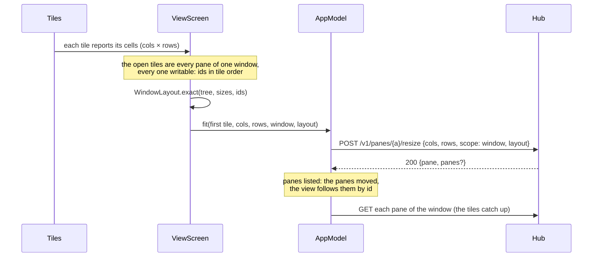

# Feature: one fit per window (#26), and the rest of the parity review

> Status: written and implemented 2026-10-29 on the owner's ask to solve
> #26 and everything else open in the parity review of this client
> against the core's `docs/ui-guideline.md`. The diff is the owner's to
> review.

## 1. Goal

Two things, both parity with the browser:

- **One fit per window** (#26). Tiles that are every pane of one tmux
  window fit the window as one, laid out as the tiles are, so each pane
  is its tile and none is *held*. Today the tiles of one window share
  one fit: the focused one leads and the rest say *held* and are scaled,
  so the host's panes do not follow the phone's arrangement.
- **The parity review's open rows.** Every row of the review marked
  partial or missing in the shared tables, and the partial gestures:
  naming (§1.1), the lens's idle rule, turning ring and waiting glow
  (§1.2), the list's host state, row order and a hub's trouble (§1.3),
  the add menu's cap and minimised entries, a tab held to open it
  beside, Claude's mark on tabs, `×` on every header, a held pane that
  keeps its size, refusals as passing notices, the key row's tints, the
  command row's tones and full lists, the mouse rule, dotted links, a
  PDF framed, the reading cadence, a swipe that moves between tiles.

Out of scope, and why:

- the changes window (git): the guideline's action table gives it no
  Android trigger, it needs two endpoints this client does not use yet
  and a tree and diff view of its own; it stays a feature of its own;
- the tiles following the host's layout the other way (the browser
  adopts the host's splits as a custom tree): the phone's arrangements
  are presets, and the guideline marks that half *web*;
- split-on-drop, laying a tile across, zoom, the window view, equal
  shares, direct typing: web by the guideline;
- *use* on the hubs list: since every hub with a token is in use at
  once there is nothing to choose; the guideline's row is updated.

## 2. Design

### One fit per window



- `WindowLayout` (protocol module, pure Kotlin): the tiles' tree
  (`Leaf(index)`, `Split(horizontal, children)`), tmux's checksum (a
  rotating 16-bit sum), `exact(tree, sizes, ids)`: each pane as many
  cells as its tile holds; a split side by side is as wide as its
  children plus a divider between each two and as tall as the shortest;
  stacked, as tall as its children plus the dividers and as wide as the
  narrowest; the window's size is the root's. `bottomLeaves(tree)` names
  the tiles whose height the input line's growth comes off. The
  browser's `web/src/term/tiles.ts` is the model.
- `Layout.tree(n)` (app): the arrangement as that tree, the same shape
  `Tiles` draws.
- `Api.resize(address, cols, rows, window, zoom, layout)` sends
  `layout` with the window scope only, at most 2048 bytes, pane ids
  `%n` only; it answers `Resized(pane, panes)`, `panes` filled when the
  host moved panes.
- `TileFit.oneWindow(open, panes, windowOf)`: the pane ids in tile
  order when the open tiles (two or more) are exactly the panes of one
  window and every one is writable; null otherwise, and then the held
  path stays as it is.
- `ViewScreen`: every tile reports its cells; with `oneWindow` the
  first tile's pane carries the window fit (`fit(... window = true,
  layout = exact)`), the tiles send nothing of their own, the input
  line's growth is counted only on the tiles along the bottom, and a
  header says *held* when the host's pane is not the size the layout
  gave it. Fit off releases every tile of the window.
- `AppModel.fit` takes the layout (part of the once-per-size key) and
  re-reads the window's other panes after; when the answer lists
  `panes`, the listing takes them and the view's keys follow the panes
  by id, the open state of each tile carried over.
- The arrangement is now remembered by the count of tiles, not by their
  addresses, so a move on the host (which renames panes) keeps the
  arrangement and the fit toggle.

### Naming (§1.1)

`Lens.describe(pane)`: Claude Code (command `claude`, or a title that
starts with one of its sparks `✳ ✶ ✻ ✽ ✢`) is named *Claude* with the
rest of the title as its status; anything else is its command, with the
title as status when it adds something. `Pane.name` is the name with
the status after `·`; `Pane.tab` is the status alone for Claude, else
the name; `Pane.place` is `host/session/window.pane`. Tabs, headers and
list rows draw the status in italics, dimmer; Claude's tabs carry its
mark in Claude's colour.

### The lens (§1.2)

- An `idle` notice on a Claude pane whose screen changed in the last ten
  seconds counts as working, not waiting (`Lens.status` takes the
  change flag it already has).
- The working glyph is drawn: a ring with a gap, turning once in 1.6 s
  with effects on, still with them off (`WorkingRing` in Compose).
- A waiting tile glows: a shadow in the ink around its border, pulsing
  with effects on, drawn outside the tile's box so nothing moves.

### The list (§1.3)

A host line says `online` when it has panes; a hub whose listing failed
shows the reason on its line and nothing under it (its panes are
dropped on any error); a row is `*`, glyph, name, place, word.

### The view (§1.4, §1.6)

- The add menu caps the view at four panes, tiles and minimised
  together; a minimised entry shows its place.
- A tab held opens its pane beside the focused one (the web's
  Shift+click); a swipe moves the focus between tiles, and with one tile
  to the strip's neighbour.
- `×` on every header: where the agent closes panes and the pane is
  writable it asks and closes the pane on the host; elsewhere it closes
  the tile.
- A held tile keeps its size (its fit pauses) instead of being released;
  the view releases all when it is left.
- Send and file refusals clear on their own after four seconds, like
  the browser's toasts.
- The key row tints its keys by group (editing, direction, control,
  function) and the command row by tone (danger, start, info, act):
  border and ground, never the ink; the tints are the web's tokens,
  mirrored in `Theme.kt`. Claude's row is the browser's 24 commands,
  the shell's its 28 starters.
- A tap is a click only on a pane whose program has the mouse; a
  vertical drag on such a pane always turns the wheel, whatever the
  rows; on any other pane a tap only focuses and a drag scrolls the
  client's history or pages a full-screen program.
- Links are underlined dotted (drawn under the row from the text's
  layout); a PDF is framed in the sheet (`PdfRenderer`, page by page).
- The focused tile reads at the *every* setting, the others at twice
  it, like the minimised row.

## 3. Protocol and API changes

None to the protocol; the client uses the core's `layout` field of the
resize (`docs/protocol/v1.md`), a compatible v1 addition:

```json
{"cols": 121, "rows": 39, "scope": "window",
 "layout": "1d6c,121x39,0,0{60x39,0,0,3,60x39,0,0[60x19,0,0,4,60x19,0,0,5]}"}
→ 200 {"pane": {...}, "panes": [{"address": "alice-laptop/work/0.0", "pane_id": "%4", ...}, ...]}
```

## 4. Security analysis

- The layout is built from the listing's pane ids and the tiles' own
  sizes; nothing from pane content goes into it. The client refuses to
  send a layout over 2048 bytes, without the window scope, or naming
  anything but `%n` ids; the hub and the agent check it again and
  refuse a layout that does not name exactly the window's panes.
- Moving panes needs the write grant on every pane of the window: the
  client sends the window fit only when every tile's pane is writable,
  so a read-only pane keeps the held path; the hub answers `403
  read_only` to a moving layout otherwise, and the client shows it.
- One resize per second per window stays the hub's limit; one window
  fit replaces two to four pane fits, so the limit is tripped less.
- Audit on the host is unchanged (`op=resize layout=true arrange=…`).
  Nothing new is logged on the phone; no secret in any notice.
- A PDF is rendered by the platform's `PdfRenderer` from bytes the hub
  served for a path the host allowed; the renderer runs in-process and
  takes nothing from the file but its pages. A broken file shows the
  download alone.
- No new dependency.

## 5. Privacy check

Fixtures use `alice-laptop`, `bob-server` and the throwaway tmux
server; no real host, person or secret in code, docs or tests.

## 6. Test plan

| # | Test | Kind | Expected |
|---|------|------|----------|
| 1 | A layout naming a pane not of the window, one over 2048 bytes, one without the window scope | e2e-security | `400 bad_input` from the hub; the client refuses the last two before sending |
| 2 | A moving layout from a token that may not write every pane of the window | e2e-security | `403 read_only`; the window unchanged |
| 3 | `Api.resize` refuses a layout without `window`, over 2048 bytes, or with an id that is not `%n` | unit | `IllegalArgumentException`, nothing sent |
| 4 | `WindowLayout`: checksum equals tmux's own on its strings; exact sizes for main-left, column and a stack scaled down; bottom leaves | unit | as the browser's tests say |
| 5 | `TileFit.oneWindow`: every pane of one window, in tile order; null with a pane missing, minimised, read-only or of another window | unit | as said |
| 6 | Two tiles of one window stacked fit it as one: tmux shows the stacked shape at the tiles' sizes; the order reversed moves the panes and the answer lists them | e2e | shape `[…]`, sizes exact, `panes` with new addresses |
| 7 | `Lens.describe`: Claude by command or spark, status after `·`, tab is the codename, command with title when it adds something | unit | as §1.1 |
| 8 | An idle notice on a moving Claude screen is working | unit | `WORKING` |
| 9 | Add menu: four open counting the minimised; a minimised entry carries its place | unit | heading at 3 + 1; place shown |
| 10 | Commands: Claude's 24, the shell's 28, each with a tone | unit | lists and tones |
| 11 | Two tiles of one window on a device: no *held*, both headers with their size; a tab held opens beside | UI | screenshots `one-window`, `beside`; needs a device |

## 7. Documentation

`docs/features/pane-view.md` (fit, header, add menu, key and command
rows, mouse, links, files, reading), `docs/features/panes.md` (list),
`docs/features/lenses.md` (idle, ring, glow), `docs/features/look.md`
(tints), `docs/ARCHITECTURE.md` (the fit row). In the core,
`docs/ui-guideline.md`: the fit row loses its *web* tag, the pick row
gains the tab held, the hubs row says every hub is in use.

## 8. Implementation steps

1. Plan here. 2. `WindowLayout`, `Api`, `Json`, `Resized`, tests.
3. `TileFit.oneWindow`, the window fit in the view and the model.
4. Naming, the lens, the list. 5. The add menu, the tab held, the swipe,
`×`, held keeps its size, notices. 6. Tints and tones, the mouse rule,
dotted links, the PDF, the reading cadence. 7. Docs, the guideline, the
end-to-end tests, the run.

---

## Review (after implementation)

- [x] Diff matches the plan. Deviations: a hub whose listing failed
  hides its panes in the list only; the model keeps its last listing so
  open tiles still know their window. The guideline's three rows (fit,
  pick, another hub) are edited in the core checkout but left for its
  owner to commit, as another session had the file open there.
- [x] Security rules hold: the layout is checked on the phone, the hub
  and the agent; a moving layout goes only with write on every pane;
  nothing new is logged; no new dependency.
- [x] Privacy check passed: `scripts/prepush-check.sh` clean (three
  commits, no leak, no deny-list hit), diff read.
- [x] Docs updated: the plan, `pane-view.md`, `panes.md`, `lenses.md`,
  `look.md`, `ARCHITECTURE.md`.

## Test run

Pending.
