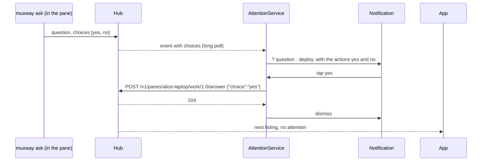
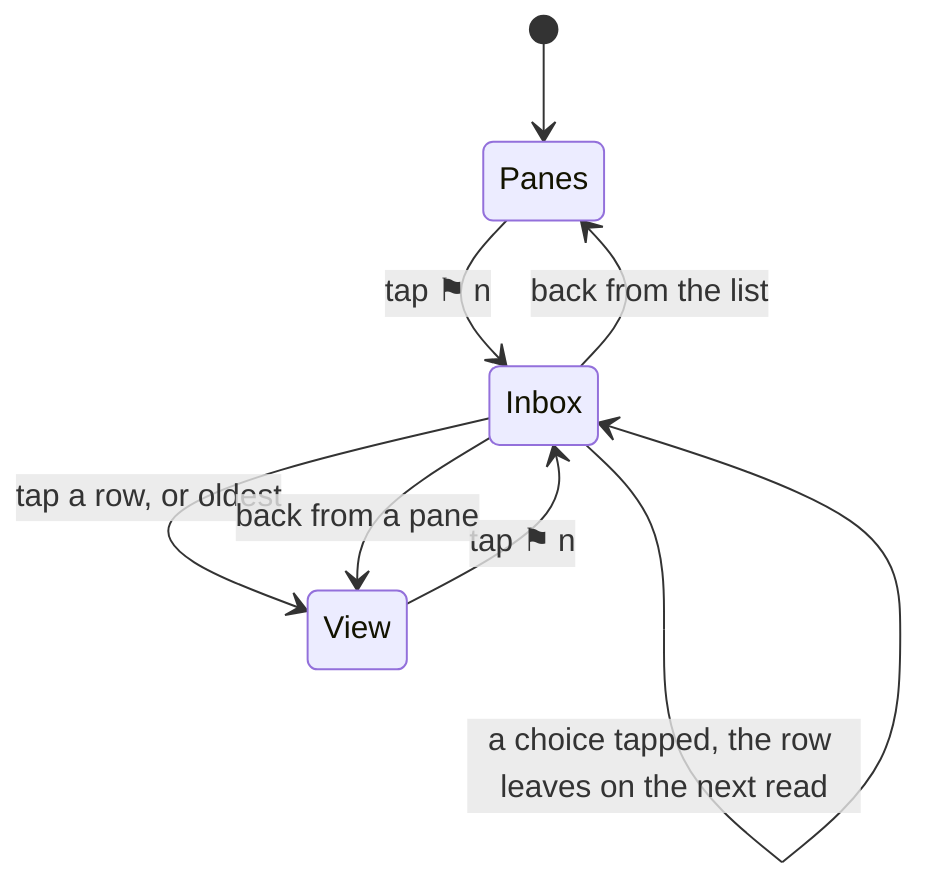

# Feature: agent orchestration on the phone and the wrist

> Status: draft, awaiting the owner's review. Follows the core's
> `docs/plans/2026-10-31-agent-orchestration.md` (muxway#181, merged as
> PR #183), whose plan left the native clients to their own repositories.

## 1. Goal

The core now names every AI harness in a pane, lets a process in a pane
ask its owner a question with fixed answers (`muxway ask`, answered with
`POST /v1/panes/{address}/answer`), and lists what waits across hosts in
one call (`GET /v1/inbox`). The web client has all of it. This app still
knows one harness (Claude, by its command or its spark), shows a
question's text but never its choices, and has no list of what waits
beyond one notification per pane. This plan brings the phone and the
watch level with the web, as `docs/ui-guideline.md` §1.1, §1.2 and §1.6
describe it:

- **every harness named and marked**: Codex, Gemini, Antigravity,
  OpenCode, Copilot, aider, goose, Amp and Cursor are recognised from the
  pane's command, or from its title under an interpreter, and named;
  Codex and Antigravity get the marks the web gives them (a hexagon, a
  lifted chevron) wherever Claude's spark shows; `working` applies to any
  named harness; a Codex or Antigravity pane gets its own slash command
  row and completions;
- **choices**: a question asked with fixed answers shows them as buttons
  on the tile's header, in the inbox row and on the system notification;
  a tap sends the choice to the asking process, nothing is typed; a
  read-only pane shows them disabled;
- **the inbox**: `⚑ n` in the header of the pane list and the pane view
  while anything waits; a tap opens the inbox sheet, every waiting pane on
  every hub, oldest first, with kind, text, how long and the choices; a
  tap on a row opens the pane; *oldest* at the top opens the oldest;
- **the watch**: the board carries a question's choices; the reply menu
  offers them first, and the phone answers through `/answer` after
  checking the choice against its listing, as it checks keys today.

Out of scope: lenses that reshape the screens of the other harnesses
(only the Claude Code lens trims chrome; the web has the same limit), a
hardware keyboard shortcut for the inbox (every key goes to the pane on
Android; the guideline's `I` and `o` stay web), answering from the watch
face (the face only counts), and `muxway client` or MCP on the phone.

## 2. Design

### Naming and marks

`Lens.describe` grows the web's table (`web/src/term/describe.ts`), the
same one:

| Agent | by command | by title under `node` `bun` `deno` `python` `python3` `uv` | mark |
|---|---|---|---|
| claude | `claude`, or a spark leading the title | | spark (today's) |
| codex | `codex` | | hexagon with a dot |
| gemini | `gemini` | `gemini` | |
| antigravity | `agy` | `antigravity` | lifted chevron |
| opencode | `opencode` | | |
| copilot | `copilot` | `copilot` | |
| aider, goose, amp, cursor | `aider` `goose` `amp` `cursor-agent` | | |

`Description(claude: Boolean, …)` becomes `Description(agent: Agent?,
name, status)`; `Lens.isClaude` stays as `agent == CLAUDE` for the lens
that trims Claude's screen. `status()` says *working* for any named
agent. The marks are drawn with strokes in a `Mark` composable, the web's
geometry on a 20-unit box (twelve rays; a hexagon point up with a centre
dot; a chevron over a ground line), in their colours from the web's
tokens: Claude `#d97757` (today's), Codex `#2fbf9a`, Antigravity
`#7aa2ff`. The text spark `✳` goes everywhere a mark is drawn: `PaneName`,
the tabs, the minimised row, the add menu, the tile header, the command
row's starters (`claude`, `codex`, `agy`) and the completion row.
`Commands.forPane` returns Codex's and Antigravity's rows for their panes
(the web's lists, `CODEX_COMMANDS`, `AGY_COMMANDS`, tones included) and
the completion pool follows.

### Choices

`Attention` and `Event` gain `choices: List<String>`: two to eight, each 1
to 40 printable characters without `|`, else the list is dropped (the
hub validates, the client does not trust). `Api.answer(address, choice)`
posts `{"choice": …}` after the same check. A `Choices` composable draws
the buttons, disabled when the pane is not writable or an answer is in
flight; a refusal is the passing notice every write uses (`no_question`
reads *nothing waits there any more*, `bad_input` *not one of the
choices*). They sit on the tile header after the kind and text, and in
the inbox row.

The system notification of a question with choices gets up to three
actions (the first three choices; more than that, the notification opens
the inbox). An action posts the answer from the service with the hub's
`Api` and dismisses the notification on `204`; a refusal shows a short
notification in its place. The action is offered only when the pane is
writable in the service's last listing.

### The inbox

`Api.inbox()` reads `GET /v1/inbox` (`{"inbox": [pane…], "count"}`,
each pane as `Json.pane` parses it) per hub. The header count needs no
new polling: `AppModel` already holds every hub's panes and re-lists on
every event, so `waiting()` is the panes with attention, sorted by
`attention.at`, and `⚑ n` is their count, drawn as a `Btn` in `Frame`'s
actions on the pane list and in the view's header row, absent when zero.
A tap sets `model.inbox = true`; `InboxSheet` is a `Dialog` on the
`ChangesSheet` pattern: a `Panel("inbox · n waiting")`, a `LaunchedEffect`
that reads `/v1/inbox` from every hub every 5 s while open and merges
them oldest first (the hub's list is the truth while the sheet is open;
the count from memory is only the badge), an *oldest* row at the top,
then one row per pane: `Mark`, `PaneName`, the place, `kind: text`, how
long (`12s`, `3m`, `2h`, `1d`, as the web's `ago`), and `Choices`. A tap
on a row opens `Screen.View(listOf(key))`; back or `×` closes. Empty: *nothing
waits for you*. The host's file inbox keeps its name in code (`files`);
this one is `InboxSheet` and *inbox* in the UI, as the core calls it.

### The watch

`Board.Row` gains `choices`; `Wire` carries it to the watch. The reply
menu (`PaneActivity.answers()`) lists the question's choices first, as
`» yes`, before Claude's scraped numbered choices and the keys. Picking
one sends `answer(address, choice)` over the wire; `WatchGate.answer`
checks the choice against the choices of that pane in the phone's latest
listing, rate-limits as `key()` does, and calls `api.answer`. The
`watchAnswer` setting gates it like every write from the wrist.

### Guideline rows

In the core's `docs/ui-guideline.md` §1.6 the Android column changes:
the inbox row from *— (follow-up)* to *`⚑ n` in the header of the list
and the view opens the inbox sheet; a tap on a row opens the pane*; open
the oldest to *the inbox sheet's first row, `oldest`*; answer a question
to *a button on the tile's header, in the inbox row, on the system
notification, in the watch's reply menu*. §1.1 and §1.2 already speak
for every client.

## 3. Protocol and API changes

None to the protocol. Newly used by this client, all v1 and compatible:
`attention.choices` and an event's `choices`; `GET /v1/inbox`; `POST
/v1/panes/{address}/answer`. `docs/ARCHITECTURE.md`'s "Protocol features
used" lists both. `ask` in `GET /v1/hosts` is read into `Host.ask`; a
host without it never shows choices (there are none to show).

## 4. Security analysis

- **Answers are writes** with the rules of input: the hub checks the
  write grant and the pane's mark, the agent checks the choice against
  the list it gave. The client disables the buttons for a read-only pane
  only as a courtesy; the hub's `403` is the rule. A choice is sent
  exactly as the listing carried it, never edited.
- **The notification action** runs in the foreground service with the
  hub's token from the Keystore, as the long poll does; the choice goes
  in the `PendingIntent` extras, which another app cannot forge into a
  write because the intent is explicit to this app's receiver and the
  service re-reads the choice against its own last listing before
  posting. The choice text is not written to the log; the audit is the
  hub's.
- **Choices from the hub** are capped and filtered on parse (count,
  length, printable, no `|`), so a hostile hub cannot draw a button of
  arbitrary length or control characters.
- **The inbox** shows the panes the token may read, as `/v1/panes` does;
  the sheet's reads are per hub with that hub's token, like every
  listing.
- **The watch** holds no token: the phone validates the choice against
  its listing and rate-limits it, as it does for keys; the `watchAnswer`
  setting stays the gate.
- No new dependency.

## 5. Privacy check

Tests and screenshots run against the throwaway hub with `alice-laptop`
and synthetic questions (*deploy to staging?*); no real pane text in any
fixture.

## 6. Test plan

| # | Test | Kind | Expected |
|---|------|------|----------|
| 1 | `Api.answer` with a read-only token, and on a read-only pane | e2e-security | `403`; `muxway ask` still waits |
| 2 | a choice not offered, nine choices and a 41-character choice from a lying relay | e2e-security | `400` from the hub; the parser drops the list, no buttons |
| 3 | an answer when nothing waits | e2e-security | `409`, the notice reads it |
| 4 | the inbox of a one-pane token | e2e-security | one row; another host's question not listed |
| 5 | `WatchGate.answer` with a choice the listing does not carry, and with `watchAnswer` off | unit | refused before any request |
| 6 | `muxway ask` answered through `Api.answer` | e2e | exit 0 with the choice; the attention is gone from the next listing |
| 7 | `/v1/inbox` across two hosts | e2e | oldest first, `count` |
| 8 | `Json` parses `choices` on attention and events; `Lens.describe` for every harness, with marks for Codex and Antigravity; `status` working for a Codex pane | unit | as the table says |
| 9 | `Commands.forPane` for `codex` and `agy`; completions from their lists | unit | the web's lists |
| 10 | `Board.rank` carries choices; the watch's reply menu lists them first | unit | rows and order |
| 11 | the tile header shows the choices and a tap answers; the inbox sheet opens from `⚑ n`, lists oldest first, a row opens the pane; a Codex pane shows its mark in the list and the strip | UI | screenshots `choices`, `inbox`, `codex-mark` |
| 12 | the notification of a question carries its actions; a tap answers and dismisses | UI | screenshot `notification-choices` |

## 7. Documentation

`docs/features/lenses.md` (every harness, the marks, working for all),
`docs/features/notifications.md` (choices, the actions), a new
`docs/features/inbox.md`, `docs/features/watch.md` (the choices in the
reply menu), `docs/ARCHITECTURE.md` (protocol features used), the README
(the screens table), and the core's `docs/ui-guideline.md` §1.6 rows.

## 8. Implementation steps

1. `Lens.describe` with the agent table and marks; `status` for every
   agent; `Mark` drawn with strokes; the spark replaced everywhere; unit
   tests.
2. `Commands` for Codex and Antigravity; completions.
3. `Attention.choices`, `Event.choices`, `Host.ask`, `Api.answer`; the
   `Choices` composable on the tile header.
4. `Api.inbox`, `waiting()`, `⚑ n`, `InboxSheet`.
5. Notification actions in `Notifier` and the service.
6. `Board.Row.choices`, the wire, the watch's reply menu, `WatchGate.answer`.
7. Docs and the guideline rows.
8. e2e and UI tests; the run; versions (app 0.14.0, wear 0.12.0); release.

---

## Review (after implementation)

- [ ] Diff matches the plan, deviations explained here
- [ ] Security rules (AGENTS.md section 2) hold
- [ ] Privacy check passed: `scripts/prepush-check.sh` clean and diff read
- [ ] Docs and diagrams updated

## Test run

Link to the recorded run: result, commit, logs, screenshots.
