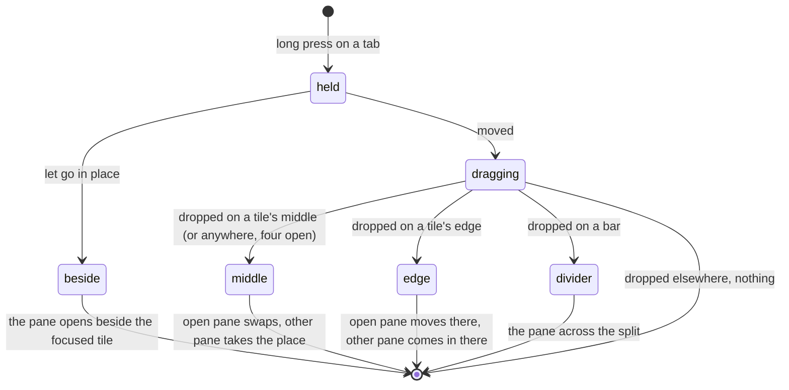

# Feature: a tab dropped on a tile lays its pane out

> Status: written and implemented 2026-11-02 on the owner's ask to solve
> [#51](https://github.com/notmarkopadjen/muxway-android/issues/51),
> parity with the core's PR 216 for the web client. The diff is the
> owner's to review in the pull request.

## 1. Goal

On the web a tab dragged from the strip down onto the view lays its
pane out as a dragged header does. The phone has the long-press header
drag and nothing for a tab: a tab held opens its pane beside the
focused one, and with one tile open there is no gesture that makes two
columns or two rows at all. Wanted, the same long press on a strip tab,
dropped onto a tile's middle, its edge or the bar:

- the tab of an open tile dropped on another tile's middle swaps the
  two, on its edge splits that tile's place with the pane on that side,
  on a divider lays it across, exactly as the header does;
- the tab of a pane not open dropped on a tile's middle takes that
  tile's place (as a tap on the tab takes the focused tile's), on an
  edge comes in as one more tile on that side with the others keeping
  their places, on a divider comes in across the split;
- with four panes open, tiles and minimised together as the add menu
  counts them, the whole tile is its middle and the pane takes its
  place; a divider refuses, as the web does;
- with one tile open this is how two columns or two rows are made:
  drop the tab on the right or the lower part of the screen.

From the same web change, the add menu cuts a long place after a name
with an ellipsis before the name is cut, and never scrolls sideways.

Out of scope: a tile's screen clipping a line wider than its box. The
phone already does it: with fit on the rows are cut at the tile's
columns and a wider glyph is clipped by the row; with fit off the pane
is scaled to the tile's width, and the only sideways scroll is the one
a pinch asks for, which stays. The watch has no tiles.

## 2. Design

The tab drag is the header drag: the same system drag and drop, the
same payload (the pane's key), the same targets. A tile is a drop
target with one tile open as well, since a tab makes the second one.

- **A tab held.** The tab is a drag source after a long press, as a
  header is. The hold that opens the pane beside stays: a tab held and
  let go without moving opens its pane beside, as before; a tab held
  and moved starts the drag, and its drop does the rest. The drag
  begins at the first movement after the long press, so the two are
  told apart without a second gesture.
- **A drop on a tile.** The tile's target reads the zone as it does
  for a header. The view then goes one of two ways by whether the
  dragged pane is a tile: a tile's pane takes the header's path
  (`drop`: swap or split, with the window's refusal where the tiles
  follow the host and may not move it); a pane not open takes the
  tile's place from its middle, or comes in beside from an edge. There
  is no refusal for a pane not open: the tiles are no longer every
  pane of one window once it is in.
- **A drop on a divider.** The bar's target reads the half as it does
  for a header; a pane not open comes in across the split.
- **Coming in.** The count of tiles is a new view, so the made tree
  travels as a closed tile's does: `kept.carried` holds the panes with
  the tree that has the new leaf where the drop put it, `kept.focusNext`
  the pane, and the effect that mounts the tiles picks both up.
- **The tree.** `Tiles.dropOn` and `Tiles.across` already place a leaf
  the tree lacks: the leaf's old place is nothing to close up, and the
  leaf goes where the drop says. Only tests are added.

The add menu's row keeps the name at its width and gives the place the
rest, cut with an ellipsis; a name wider than the menu is cut itself.

## 3. Protocol and API changes

None. The pane added fits itself through the resize the view already
sends, under the same grants.

## 4. Security analysis

- Nothing new reaches the hub: a drop changes the phone's arrangement
  and which panes the view holds; the pane added then fits itself
  through the resize it already uses, with the same token.
- The payload of the drag is the pane's key as the listing gave it,
  carried under a private type (`application/x-muxway-pane`), so a
  text dragged in from another window is never taken for a pane, and
  a tab dragged out is not text another app takes. A key that is not
  in the listing is dropped on the floor before it can name a view: a
  drop can at worst open a pane the token may already read.
- No input crosses a trust boundary; nothing is logged; no new
  dependency.

## 5. Privacy check

The UI test uses the harness's `alice-laptop` panes; screenshots are of
the test environment; no real host, person or content in code, docs or
tests. `scripts/prepush-check.sh` before the push.

## 6. Test plan

| # | Test | Kind | Expected |
|---|------|------|----------|
| 1 | a drop carries nothing to the hub but the pane's own fit, and a key the listing lacks, or a text under another type, never names a view: `bring` and `drop` check the key against the listing, the targets take only the app's own type | review of the diff | no new request, no view from foreign data |
| 2 | `TilesTest`: `dropOn` with a leaf the tree lacks, on a single leaf and in a row | unit | the new leaf beside the tile on the side asked, nothing else moved |
| 3 | `TilesTest`: `across` with a leaf the tree lacks | unit | the new leaf across the split, the split kept whole |
| 4 | `FlowTest`: one tile; the other hub's tab dragged onto the right part of the tile | UI (`tab-right`) | two tiles side by side, the dropped pane right |
| 5 | `FlowTest`: the second tile closed; the tab dragged onto the lower part | UI (`tab-below`) | two tiles stacked, the dropped pane below |
| 6 | `FlowTest`: the tab of the lower tile dragged onto the upper tile's middle | UI (`tab-swapped`) | the two swap, two tiles still |
| 7 | `FlowTest`: a tab held and let go opens its pane beside, as before | UI (existing `beside`) | two tiles |

The UI tests drive the system's drag through the instrumentation's
pointer injection, since the Compose test rule's touches never reach
the window manager; they run on a device, which this machine has none
of, so they wait for the owner's phone or the emulator.

## 7. Documentation

- `docs/features/pane-view.md`: the strip, the hold, the tree of
  splits, the add menu.
- The core's `docs/ui-guideline.md` §1.4 *strip* and *tiles* and §1.6
  *swap two tiles* and *lay a tile across*: the Android column, once
  PR 216 is in; a follow-up pull request there.

## 8. Implementation steps

1. `TilesTest`: a new leaf beside and across.
2. `ViewScreen`: the tab as a drag source; the tile a target with one
   tile too; `drop` and `lay` take a pane not open; `bring`.
3. The add menu's row.
4. `FlowTest`: the drags.
5. Docs; the version.
6. The e2e run, recorded.

---

## Review (after implementation)

- [x] Diff matches the plan. One thing the plan did not foresee: the
  drop targets of the tiles and the bars kept the first view's `drop`
  and `lay`, so a drop after the tiles had changed read the old tiles;
  they now read the latest, as does the tab's hold. A tile wears a
  `tile:` test tag for the UI test.
- [x] Security rules (AGENTS.md section 2) hold: nothing new reaches the
  hub; the drag's type is the app's own and a key not in the listing
  names no view.
- [x] Privacy check passed: `scripts/prepush-check.sh` clean (gitleaks
  and the deny-list) and diff read.
- [x] Docs updated: `pane-view.md`; the core's guideline rows in a
  pull request on top of its PR 216.

## Test run

Local run `test-runs/20261102-220038-ca7c2e3`, recorded as
[muxway-android#52](https://github.com/notmarkopadjen/muxway-android/issues/52):
**passed**, 237 tests, 0 failed, 0 skipped, against a hub built from
the core at `fc1a3ac`. Tests 2 and 3 are `TilesTest`; the UI tests (4
to 7) wait for a device.

