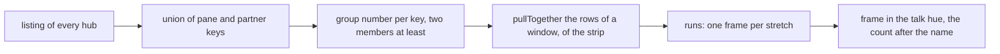
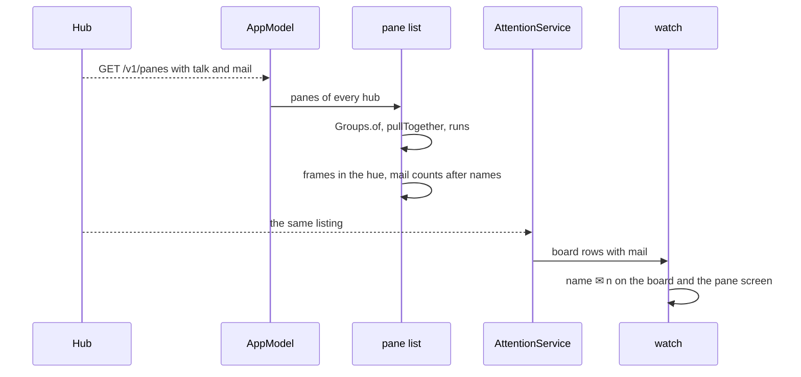

# Feature: talk groups and mail counts on the phone and the wrist

> Status: implemented on branch `talk-mail-parity` (issue #46). Follows the
> core's `docs/plans/2026-10-31-pane-talk.md` and `2026-11-01-mail.md`
> (PR notmarkopadjen/muxway#193), whose feature pages leave the native
> clients to their own repositories.

## 1. Goal

The core's listing now says two things about a pane that this app ignores:
`talk`, the panes it wrote or mailed to in the last ten minutes, and
`mail`, how much unread mail its process holds. The web draws the panes
that talk as one **group** in the talk hue, like a browser's tab group,
and `✉ n` after the name of a pane with unread mail. This plan draws the
same from the listing alone, as `docs/ui-guideline.md` §1.2, §1.4 and §1.5
say:

- **groups**: panes linked by `talk`, partners of partners included, form
  a group; the rows of a group in the pane list are kept together and
  framed as one in the talk hue; the tabs of a group on the strip sit side
  by side inside one frame; every open tile of a group wears one thin
  dimmed edge in the hue; no notification for any message;
- **mail counts**: `✉ n` after the name, in the hue, on the list row, the
  tab, the minimised tab, the tile header and the watch's board row while
  the pane's process has unread mail; on a painted tab or header the
  state's paint wins and the count takes the ink like every mark.

Out of scope, follow-ups in this repository when the owner asks for them:
the messages feed (`GET /v1/talk`), a messages page, mailing the open
pane (`POST /v1/panes/{address}/mail`), laying the partner beside the
focused tile, the chain on the header, the divider painted between two
grouped tiles, the `✉ n` count of messages not looked at in the header
row, and the watch face (its cells are too small for a count; the board
and the pane screen carry it).

## 2. Design

### The listing

`Pane` gains `talk: List<Talk>` (`address`, `paneId`, `at`, `way`) and
`mail: Mail?` (`unread`, `at`). `Json.pane` reads them defensively: a
partner whose address is not one the protocol spells, or whose `way` is
not `to`, `from` or `both`, is dropped; at most 64 partners are kept; a
`mail` with no unread count, or a count of zero, is null. Nothing is
shown that the hub did not say.

### Groups

`Groups` in the protocol module is the web's `groups.ts`: a union-find
over the panes of every hub, a partner's address joined with its pane's
hub id into the app's key (`Keys.make`), so two hubs never form one
group. A pane whose partners are all out of the listing forms no group.
Groups are numbered by their first member in the panes' order.
`Groups.pullTogether` puts the members of a group after its first member
in a row list, everything else keeping its place; `Groups.runs` cuts a
row list into stretches that share a group, one frame per stretch.

### Where it is drawn

- **The pane list.** Inside a host's panel the rows of one window are
  pulled together by group and drawn run by run: a run of a group is a
  column with a one-pixel border in the talk hue, a lone row is drawn
  as today. Windows and hosts keep their order, since a window's `+ pane`
  row belongs under its panes; a group that spans two hosts is a frame
  under each host.
- **The strip.** The tabs are pulled together by group; the lazy row's
  items are the runs, a run of a group a row inside one frame in the hue
  with air after it, a lone tab the tab itself. Scrolling to the focused
  tab finds the run that holds it.
- **The tiles.** A tile of a grouped pane that is not the focused one
  has its edge in the talk hue at 40 % instead of the faint ink; the
  focused tile keeps the thick ink border.
- **`✉ n`.** `PaneName` appends ` ✉ n` after the name (before the status)
  when the pane carries mail, in the colour its caller gives: the talk
  hue on plain ground, the painted surface's ink on a waiting or working
  tab or header, the background ink on a selected row. The add menu's
  rows and the inbox sheet call `PaneName` too and get it for free.
- **The watch.** `Row` gains `mail: Int`; `Board.rank` copies the unread
  count and `json` sends it when above zero, `parse` reads it within
  0 to 9999. The board's row and the pane screen's title append ` ✉ n`.
  The face does not.

### Guideline rows

In the core's `docs/ui-guideline.md` §1.4 the strip row's "(web; Android,
glasses and MIDP follow up)" after `✉ n` loses Android, and the header
row says the count is on Android too. The messages, mail and lay-beside
rows of §1.6 keep "— (follow-up)" for Android. That edit goes in the core
on its own branch.

## 3. Protocol and API changes

None to the protocol. Newly read by this client, v1 and compatible: the
listing's `talk` and `mail`. `docs/ARCHITECTURE.md`'s "Protocol features
used" names them. Nothing new is sent.

## 4. Security analysis

- **Nothing is written.** The feature reads two fields of a listing the
  token already receives and draws them. No request, grant or gesture
  is added.
- **The hub's `talk`** names only partners the token may read, by the
  hub's rule; the client draws a group only among panes present in its
  own listing, so a partner it cannot see is neither named nor hinted
  at (`Groups` drops a pane whose partners are all missing).
- **Hostile values** are bounded on parse: a partner's address must
  match the protocol's pattern, `way` one of three words, 64 partners at
  most, an unread count at least zero; on the watch `mail` is clamped to
  four digits so a row cannot grow past its line.
- **No content** travels: the listing carries counts and addresses, not
  mail text; nothing is logged.
- No new dependency.

## 5. Privacy check

Tests run against synthetic panes on `alice-laptop` and `bob-desktop`
with hub ids `a` and `b`; no real address, name or text in any fixture.
No screenshot is added by this change.

## 6. Test plan

| # | Test | Kind | Expected |
|---|------|------|----------|
| 1 | a `talk` partner with an address outside the protocol's pattern, a `way` the protocol does not name, 65 partners, a negative unread count | unit | the partner is dropped, the list is cut at 64, `mail` is null |
| 2 | a pane whose only partner is not in the listing | unit | no group |
| 3 | `Json.pane` reads `talk` and `mail`; absent fields are the empty list and null | unit | as the table says |
| 4 | three panes where A talks to B and B to C, on one hub; the same addresses on two hubs | unit | one group of three; two hubs never join |
| 5 | `Groups.pullTogether` keeps the first member's place and pulls the others after it; `runs` cuts a lone row apart | unit | the web's order |
| 6 | `Board.rank` carries the unread count, `json` round-trips it, `parse` clamps a count of a million | unit | the count, 9999 |
| 7 | two grouped panes framed on the list and the strip, `✉ 2` after a name | UI | screenshots `talk-group`, `mail-count`; a device run, owed |

## 7. Documentation

`docs/features/panes.md` (the frame and the count on a row),
`docs/features/pane-view.md` (the strip, the tiles, the header),
`docs/features/watch.md` (the row's count), `docs/ARCHITECTURE.md`
(protocol features used), `docs/testing.md` (the unit suite's names), the
README, and the core's `docs/ui-guideline.md` §1.4 cells.

## 8. Implementation steps

1. `Talk`, `Mail`, `Pane.talk`, `Pane.mail`, `Json.pane`; unit tests.
2. `Groups` with `of`, `pullTogether`, `runs`; unit tests.
3. The palette's `talk` colour; `PaneName`'s count; the list's runs.
4. The strip's runs; the tile's edge.
5. `Row.mail` through the board, the watch's row and pane screen; tests.
6. Docs; versions (app 0.15.0, wear 0.13.0).
