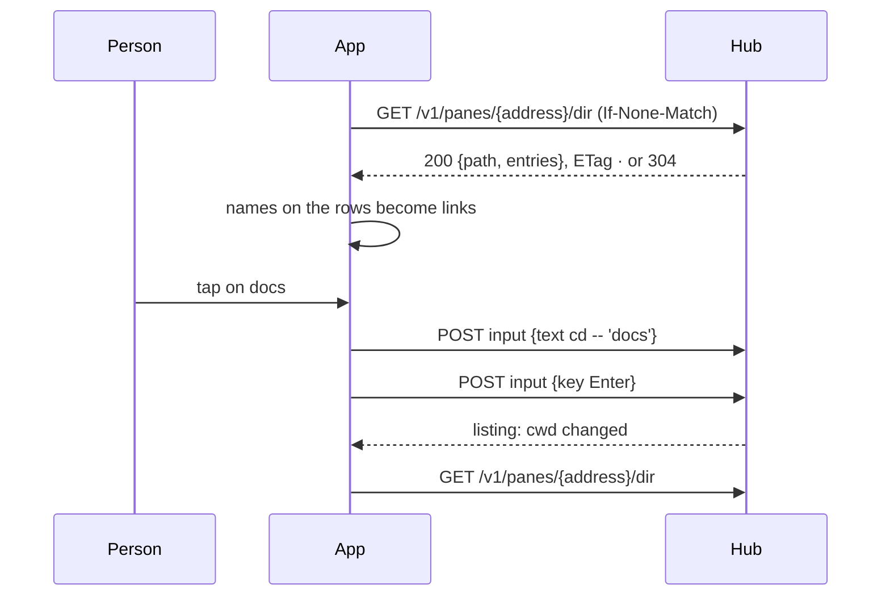

# Feature: the names of a shell pane's directory are links

> Status: written 2026-11-03 for
> [#57](https://github.com/notmarkopadjen/muxway-android/issues/57),
> parity with the core's shell helper, round one (core PR 218,
> `docs/features/shell-helper.md`), approved and implemented the same
> day. The diff is the owner's to review in the pull request.

## 1. Goal

In a writable shell pane on a host with preview roots, the names of the
pane's current directory that appear on the screen (after `ls`, `tree`,
`git status`, in prose) are links, as they are on the web since PR 218.
A tap on a directory enters it; a tap on a file opens it the way the
person set: the file sheet, `cat`, or their own command.

Out of scope: the ghost word while typing (round two, #58). A long
press on a name that puts the quoted name on the input line (the web's
Shift+click) is bound here, since the guideline's §1.6 rows came with
the core's PR 230 (*enter a directory*, *open a file*, *put a name on
the line*: tap, tap, long press) while this was built.

## 2. Design

The client sees cells and cannot tell `docs` the directory from `docs`
the word, so it asks the host, as the web does.

- **Protocol** (`protocol/`). `Host.dir` from the hosts listing;
  `Pane.cwd` from the pane listing (present only on a writer's shell
  pane under a root). `Api.dir(address, etag)` calls
  `GET /v1/panes/{address}/dir`, sends `If-None-Match`, and answers a
  `Listing(path, entries, truncated)` or null on `304`; `Json.listing`
  parses it, keeping only names without control characters, 2000 at
  most. A new `Names` object ports the web's `names.ts`: the index of
  a listing (directories and files only, never `.` or `..`; the names
  with a boundary character inside scanned on their own, longest
  first), the names found on one row (a run between the row's edge,
  blank space, a bar, a quote or a bracket, with `ls -F`'s mark or a
  sentence's punctuation after it allowed, none overlapping another),
  `shellQuote` (single quotes, `'` escaped), `lineFor` (the line a tap
  types, or none when the sheet opens the file) and `titleFor`.
- **Settings** (`store/Settings.kt`, `ui/ConnectScreen.kt`). *names*
  on or off (default on); *a file opens with*: preview, cat or command,
  with a field for the command when picked (`{}` stands for the quoted
  name; without it the name follows). Plain preferences, as the other
  settings; the command is the person's own and never a secret.
- **Model** (`AppModel`). A view holds the pane's `listing` and its
  ETag. While a tile shows a pane with `cwd` and the host says `dir`,
  the tile asks every two seconds when focused, five otherwise (the
  hub's bucket is two a second with a burst of five, shared with the
  preview), and at once when `cwd` changes; an unchanged listing is a
  `304` and no body. A `404` empties the listing and is not retried for
  a minute, as the changes count does; `rate_limited` is ignored;
  nothing is logged.
- **Tile** (`ui/ViewScreen.kt`). `styled` takes the name index and
  records, for each row, the names found where no other link is: a
  web address, an inbox file and a path with a slash come first. The
  phone has no pointer, so no underline is drawn (the web underlines
  under the pointer only; a listing is all names). A tap on a name is
  not a tap on the pane: a directory types `cd -- 'name'` and Enter
  through `model.type`, a file opens the sheet (`Shown(address, path =
  name)`, the preview resolves it from the pane's directory), or types
  `cat -- 'name'` or the command and Enter. Only while the pane's
  program is a shell (`Commands.isShell`), the pane carries `cwd` and
  the setting is on.

## 3. Protocol and API changes

None to the protocol: the client takes up `dir` in `GET /v1/hosts`,
`cwd` in `GET /v1/panes` and `GET /v1/panes/{address}/dir?path=…`
(path never sent: the pane's own directory), all in protocol v1 as the
core documents them. `docs/ARCHITECTURE.md` lists the endpoint.

## 4. Security analysis

- **What an attacker gains.** Nothing beyond the write token's reach: a
  writer could list the directory by typing `ls`. A reader has no
  `cwd` and the hub answers `403` to the listing; the app never asks
  without `cwd`.
- **Authentication and authorisation.** The bearer token as every
  call; the hub wants the write grant on a writable pane.
- **A tap types into a shell.** The text is built from a name the
  host listed, never from screen text: a run is a link only where it
  equals a listed name, so a program in the pane cannot invent one.
  The name is single-quoted with `'` escaped, `--` precedes it; names
  with control characters are dropped by the parser as well as by the
  agent; the command template is the person's own. Only a shell pane
  links, by its program, so a tap in `vim` or an agent never types
  `cd`.
- **Input that crosses a boundary.** The listing's names and `cwd`
  are host data: shown as text, never as markup, capped in count and
  length; `cwd` is only compared, never shown or typed.
- **Logs.** Nothing: the hub and agent audit the request and the tap's
  input as ordinary lines (who, when, pane, bytes), never a name.
- **Dependencies.** None new.

## 5. Privacy check

Fixtures use the throwaway roots of the test environment
(`alice-laptop`, synthetic files); docs name `docs`, `notes.md`; no
real host, path, person or secret anywhere. `scripts/prepush-check.sh`
before the push.

## 6. Test plan

| # | Test | Kind | Expected |
|---|------|------|----------|
| 1 | `s26`: a reader, and a writer on a read-only pane, asking `/dir` | e2e-security | `read_only`; no `cwd` in their listing |
| 2 | `s26`: the pane's directory outside the roots, the agent without roots | e2e-security | `404 not_found` once; `cwd` absent; the app asks nothing without `cwd` |
| 3 | `s26`: an entry with a control character in its name, a `.git` entry | e2e-security | not in the listing (agent); `Json.listing` drops one anyway |
| 4 | `NamesTest`: boundaries, `ls -F` marks, punctuation, names with spaces or brackets, overlap with a path, `.`/`..`, kind `other` | unit | the web's `names.test.ts` cases pass |
| 5 | `NamesTest`: `shellQuote`, `lineFor` and `titleFor` for the three settings and a `{}` template | unit | `cd -- 'a'\''b'`, the template filled |
| 6 | `JsonTest`: a listing with 2000+ entries, a hostile name | unit | capped, dropped |
| 7 | `f28`: a writer's shell pane under a root carries `cwd`; the listing names the files created; a second ask with the ETag is `304`; `cd` into a directory changes `cwd` | e2e | as said |
| 8 | `FlowTest`: `ls` in the work pane, a tap on a directory name | UI (`names`, `names-cd`) | the pane's prompt shows the new directory, nothing else typed |
| 9 | `FlowTest`: a tap on a file name with *preview* | UI (`names-file`) | the file sheet opens, nothing typed |

The UI steps wait for a device, as before.

## 7. Documentation

- New `docs/features/shell-helper.md` (the phone's page: what links,
  what a tap does, the settings, the sequence diagram, security).
- `docs/features/pane-view.md`: the links paragraph; `connect.md`: the
  two settings; `ARCHITECTURE.md`: the endpoint row.
- The core's `docs/ui-guideline.md` §1.6: rows *open a name* (web:
  click; Android: tap) and *put the quoted name on the line* (web:
  Shift+click; Android: long press), asked of the console session,
  since this session cannot push to the core.

## 8. Implementation steps

1. `Models`, `Json`, `Api`: `dir`, `cwd`, the listing; `JsonTest`.
2. `Names` with `NamesTest`.
3. `Settings` and the connect screen's two settings.
4. `AppModel`: the listing per view, asked while shown.
5. `ViewScreen`: names on the rows, the tap.
6. `E2ETest`: `s26`, `f28`; `FlowTest`: the steps.
7. Docs; the version 0.16.0 (44).
8. The e2e run, recorded; the pull request.

---

## Review (after implementation)

- [x] Diff matches the plan. Two additions: the long press on a name
  (the guideline's rows arrived with the core's PR 230 while this was
  built, so it is bound here, not in a follow-up), and the status line
  says what a tap typed (`cd docs`), as the web's link title does.
- [x] Security rules (AGENTS.md section 2) hold: the listing is asked
  only with `cwd`, the typed text is built from the host's names,
  quoted, nothing is logged.
- [x] Privacy check passed: `scripts/prepush-check.sh` clean and diff read
- [x] Docs updated: shell-helper (new), pane-view, connect, ARCHITECTURE.

## Test run

The full suite without the UI run, 270 tests, 0 failed, at `f4ab616`,
against the core at `a572019` (origin/main; the checkout's own branch
predates the listing, so the run names the worktree):
https://github.com/notmarkopadjen/muxway-android/issues/62
(`20261103-161202-f4ab616`). The UI step waits for a device.
