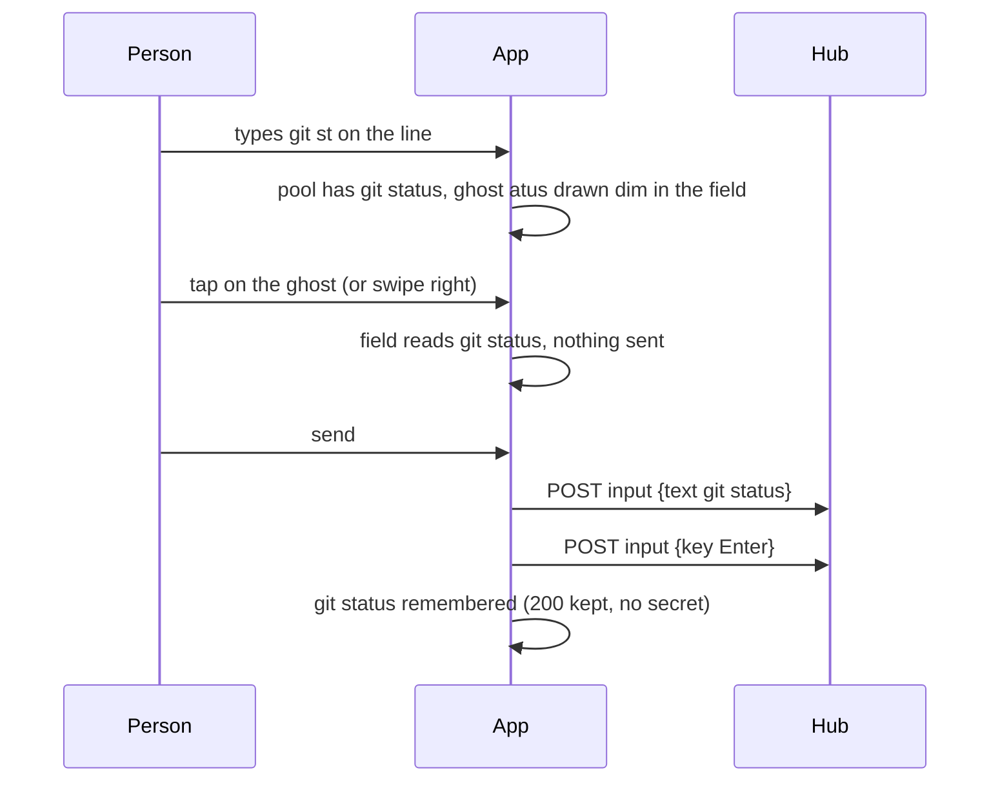

# Feature: the ghost word while typing into a shell pane

> Status: written 2026-11-03 for
> [#58](https://github.com/notmarkopadjen/muxway-android/issues/58),
> parity with the core's shell helper, round two (core PR 220,
> `docs/features/shell-helper.md`, "The ghost word"). Follows #57 and
> builds on its branch; approved and implemented the same day. The diff
> is the owner's to review in the pull request.

## 1. Goal

While a writable shell pane is typed into, the rest of a known line is
drawn dim after what was typed: a line this phone sent before, a command
the screen shows was typed at a prompt, a starter of the command row, or,
after a command that takes a file, a name of the pane's directory (a
directory with its slash). Taking it sends it as ordinary text; nothing
is sent until then, and send never sends a ghost.

On the phone the soft keyboard composes words into the input line, so
the ghost belongs in the line first; with the hardware keyboard setting
on and direct typing, it is drawn in the pane after the cursor, as the
web draws it.

Out of scope: a ghost for any program that is no shell; anything from
the hub or another pane.

## 2. Design

- **The pool** (`protocol/Commands.kt`, `store/Settings.kt`). The
  sent-lines store grows to 200 (`STORE_MAX`); the command row still
  shows the first eight. The same secret filter keeps a credential-like
  line out. A *forget* button on the connect screen empties the store,
  and so does removing a hub's token (signing out). The screen's prompt
  commands come from `Suggest.screenCommands`: a row that starts with a
  prompt sign after at most a short prompt, with something after it,
  newest first, no numbered choice, nothing that looks like a secret.
  The starters are `Commands.SHELL`. The names are #57's listing.
- **`Suggest`** (`protocol/`), a port of the web's `suggest.ts`:
  `nextShadow` (the shadow of the line from the bodies sent while
  typing direct: text appends, Backspace takes, Enter and `C-c` `C-u`
  start afresh, a key it cannot follow makes it unknown), `completion`
  (a pool line that goes on from the typed part, else after a file
  command a name of the directory that goes on from the last word, one
  character typed after `cd` `ls` `cat` `vim` and their kind, two
  elsewhere), `suggest` (the ghost for a cursor row: only where the row
  ends with the shadow and nothing stands right of the cursor; without
  a shadow the longest word-boundary suffix, two characters at least)
  and `firstWord` (what a word-accept takes).
- **The line** (`ui/ViewScreen.kt`, `ui/Widgets.kt`). While the field
  holds text and the focused pane is a writable shell, the ghost is
  `completion(text, pool, names)`, drawn dim after the text inside the
  field (the field's text layout gives the end of the last line; the
  ghost is a second text laid over it there, never part of the field's
  value). A tap on the ghost or a swipe right on the field puts it into
  the field, caret at the end; the keyboard's send key and `⏎` send the
  field as typed. The completion row above the line stays as it is.
- **Direct typing.** With the hardware keyboard setting on and the
  line not focused, the view keeps a shadow per pane from the bodies
  it sends (`nextShadow`), and the tile draws `suggest(row, cursorX,
  shadow, pool, names)` dim after the cursor on the cursor row.
  `Right` accepts it whole, `Ctrl+Right` a word, both sent as text;
  any other key goes to the pane and the ghost follows the screen.
- **Setting** *suggest*, on by default; off for a host shell that
  draws its own.

## 3. Protocol and API changes

None. The accepted ghost travels as ordinary text through the input
endpoint; the pool is the client's own.

## 4. Security analysis

- **What an attacker gains.** Nothing from the hub or the host: the
  ghost is a drawing from this phone's sent lines, the pane's own
  screen and the listing the writer may ask for anyway. A program in
  the pane can print a prompt line to have it offered, which is what
  the person would see typed there; accepting it is the person's act,
  sends through the same grant and audit, and never adds Enter.
- **Nothing sent until accepted.** The ghost is never in the field's
  value nor in the shadow; send sends the typed text alone.
- **The store.** A line that looks like a secret (a credential word, a
  muxway token prefix, an upper-case assignment, `-p`, `user:password`)
  is never kept nor offered from the screen; *forget* and signing out
  empty it; the store is app-private preferences, as today's eight.
- **Input that crosses a boundary.** The screen's rows are host data
  and are only matched, never executed; the pool is capped (200 sent,
  the screen's rows as read).
- **Logs.** Nothing: an accepted ghost is an ordinary input audit line.
- **Dependencies.** None new.

## 5. Privacy check

Fixtures type `git st` and `ls` in the throwaway shell; no real host,
path, person or secret. `scripts/prepush-check.sh` before the push.

## 6. Test plan

| # | Test | Kind | Expected |
|---|------|------|----------|
| 1 | `CommandsTest`: a line with a credential word, a token prefix, an assignment, `-p`, `user:password` offered to the store, and `screenCommands` on rows holding them | unit (security) | never kept, never offered |
| 2 | `f29`: `git st` typed and the ghost accepted, then sent | e2e | the pane shows `git st` only until the accept; `git status` ran after send; the hub's audit line carries bytes, no text |
| 3 | `SuggestTest`: the web's `suggest.test.ts` cases: shadow after text, Backspace, Enter, an unknown key; a confirmed row; the suffix without a shadow; a name after `cd` with its slash; nothing with text right of the cursor; `firstWord` | unit | pass |
| 4 | `CommandsTest`: the store keeps 200, newest first, each once; the row shows eight | unit | as said |
| 5 | `FlowTest`: `git st` on the line | UI (`ghost`) | `atus` dim after the text; a tap fills `git status`; send runs it |
| 6 | `FlowTest`: the setting off | UI (`ghost-off`) | no ghost |
| 7 | `FlowTest`: *forget* | UI (`forget`) | the command row's recent lines are gone |

The UI steps wait for a device.

## 7. Documentation

- `docs/features/shell-helper.md`: "The ghost word" for the phone.
- `docs/features/pane-view.md`: the input line; `connect.md`: *suggest*
  and *forget*.
- The core's `docs/ui-guideline.md` §1.6 *accept the suggestion*: the
  Android column (tap on the ghost, swipe right; `Right` and
  `Ctrl+Right` with a hardware keyboard), asked of the console session.

## 8. Implementation steps

1. `Commands`: the store of 200; `CommandsTest`.
2. `Suggest` with `SuggestTest`.
3. `Settings`: *suggest*; the connect screen's toggle and *forget*;
   signing out empties the store.
4. The line's ghost and its tap and swipe.
5. Direct typing's shadow and the ghost in the tile; `Right`.
6. `E2ETest` `f29`; `FlowTest` steps.
7. Docs; the version 0.17.0 (45).
8. The e2e run, recorded; the pull request on top of #57's branch.

---

## Review (after implementation)

- [x] Diff matches the plan. One deviation: signing out is read as
  removing a hub, which empties the store, since the phone has no other
  sign-out; the secret filter gained the web's two patterns (a database
  client's `-p`, `-u user:password`) that the plan listed and the store
  lacked.
- [x] Security rules (AGENTS.md section 2) hold: the ghost is never in
  the field's value nor the shadow, nothing is sent until taken, the
  store keeps no secret, nothing is logged.
- [x] Privacy check passed: `scripts/prepush-check.sh` clean and diff read
- [x] Docs updated: shell-helper, pane-view, connect.

## Test run

The full suite without the UI run, 281 tests, 0 failed, at `bca17b5`,
against the core at `a572019`:
https://github.com/notmarkopadjen/muxway-android/issues/64
(`20261103-162326-bca17b5`). The UI steps `ghost`, `ghost-taken`,
`forget` and `ghost-off` wait for a device.
