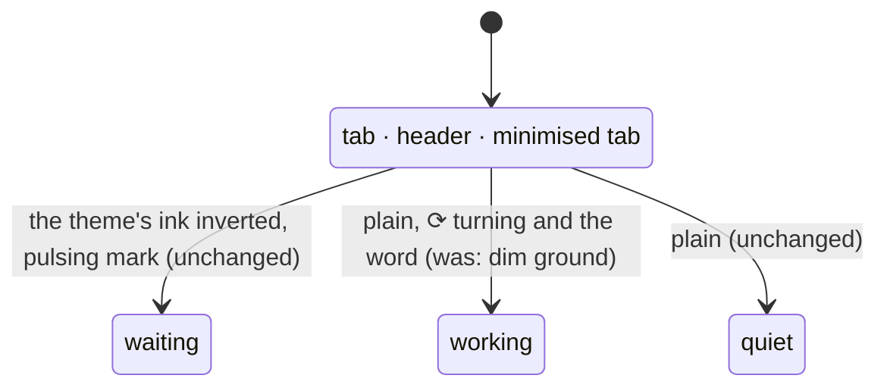

# Feature: a working pane is not painted dim

> Status: written 2026-11-03 for
> [#50](https://github.com/notmarkopadjen/muxway-android/issues/50),
> parity with the core's PR 210 (focus marks on the strip and the tile
> header, and a working pane unpainted). Waits for the owner's approval
> in the console before any code.

## 1. Goal

The owner decided on 2026-11-02 that the lens's **working** state is
plain: the turning ring (`⟳`) and the word carry it, and the dim paint on
the tab or header goes. **Waiting** keeps the inverted paint, pulsing.
The core's `docs/ui-guideline.md` §1.2 and §1.5 say so, the web does it
since PR 210, and this client still paints a working tab, header and
minimised tab with the dim ground and background letters.

Wanted: wherever the phone paints a working pane's tab, header or row
dim, draw it plain and keep the ring and the word.

Out of scope:

- the web's focus marks from the same PR (the accent bar under the
  focused tab and along the header's top, the other tabs at seven
  tenths): the guideline keeps them web-only, and the phone's focus is
  the thick border and the bold name;
- the watch: the guideline's §1.5 exception keeps *working* dim on the
  face, the complications and the watch app, so the three states stay
  apart where there is no inversion. `wear/` and `watchface/` are not
  touched.

## 2. Design

One function decides the paint of a tab, a minimised tab and a tile
header: `stateColours` in `ui/ViewScreen.kt`, which maps waiting to the
attention colour on the background, working to the dim on the background,
and quiet to the panel and the ink. Working joins quiet. Two helpers
beside it pick the dimmer ink and the mail count's colour for a painted
status and need the same change, so a working tab's place and status
stay the theme's dim and its `✉ n` stays in the talk hue, as a quiet
tab's do.

The pane list (`ui/PanesScreen.kt`) already draws a working row plain
with the ring and the word in the dim ink, and the share screen the
same; nothing changes there. The ring (`WorkingRing`) and the word
(`Lens.word`) are untouched and go on carrying the state.

## 3. Protocol and API changes

None: a paint change in the client. Nothing is asked of the hub.

## 4. Security analysis

- Nothing to gain: no input, no request, no stored data changes.
- No grant is involved.
- No input crosses a trust boundary.
- Nothing is logged.
- No new dependencies.

## 5. Privacy check

The plan, the diff, the docs and the test name no real host, person,
service or secret; the UI run uses the test hub's synthetic panes.
`scripts/prepush-check.sh` before the push.

## 6. Test plan

| # | Test | Kind | Expected |
|---|------|------|----------|
| 1 | the diff makes no request and touches no credential or log | review of the diff | paint only |
| 2 | `LensTest`: the states are still three and `glyph`/`word` for working are the ring and `working` | unit (existing) | green |
| 3 | `FlowTest`: a pane the test hub marks working, open in the view | UI (`working-plain`) | the tab and the header on the panel ground with the ink's letters, the ring and the word present; a waiting tab beside it still inverted |
| 4 | the full suite, `MUXWAY_UI=0`, recorded | e2e | green, run issue filed |

This machine has no device, so the UI step is written and waits for the
owner's phone or the emulator, as the tab-drop plan's did.

## 7. Documentation

- `docs/features/lenses.md`: the states table (*working*: no *dim*)
  and the paint paragraph.
- `docs/features/pane-view.md`: the strip's paint.
- `docs/features/look.md`: the states line, which keeps the watch
  exception.
- The core's guideline already says it; nothing to change there.

## 8. Implementation steps

1. `ViewScreen`: `stateColours`, `dimOf`, `mailOf` treat working as
   quiet; the `Tabs` comment.
2. Docs: lenses, pane-view, look.
3. `FlowTest`: the `working-plain` step.
4. The version: 0.15.2 (43).
5. The e2e run, recorded; the pull request.

---

## Review (after implementation)

- [ ] Diff matches the plan, deviations explained here
- [ ] Security rules (AGENTS.md section 2) hold
- [ ] Privacy check passed: `scripts/prepush-check.sh` clean and diff read
- [ ] Docs and diagrams updated

## Test run

Link to the recorded run: result, commit, logs, screenshots.
