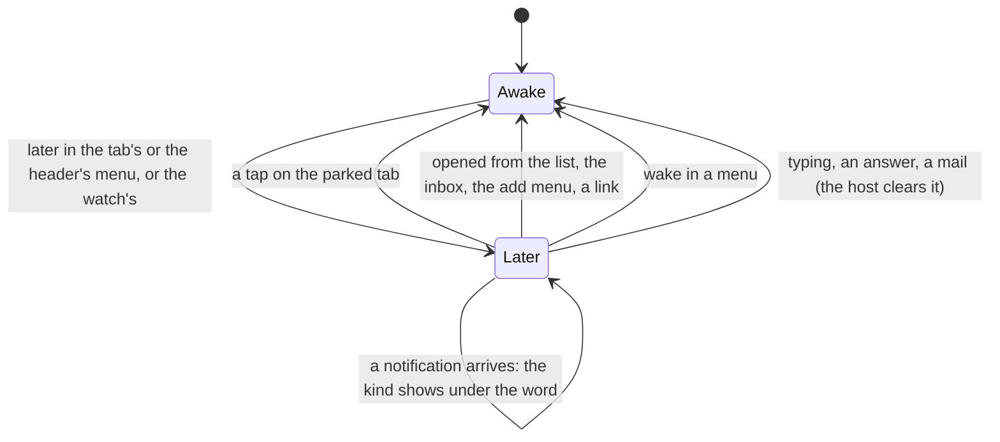

# Feature: later, a pane parked by its owner

> Status: written 2026-11-04 for
> [#70](https://github.com/notmarkopadjen/muxway-android/issues/70),
> parity with the core's PR 241 (`docs/plans/2026-11-03-later.md` there,
> merged 2026-11-03); implemented the same day. The diff is the owner's to
> review in the pull request.

## 1. Goal

Several agents on several hosts call at once, and some can wait. On the
web since PR 241 the owner parks such a pane for **later**: the host's
agent keeps the mark beside the attention, so every client sees it; the
pane stops calling, its tab goes to the end of the strip with `☾`, it
counts as done, and coming back to it wakes it. The phone does not read
the mark yet: a parked pane still pulses, glows, buzzes and sits first
in its inbox.

After this change, on the phone and the watch:

- the lens has a fourth state, **later**, that wins over waiting and
  working: `☾` and the word `later`, painted plain; where the header
  shows the state, what waits underneath follows dimmed
  (`☾ later · ! permission`);
- the strip puts the parked tabs after every other, in the order they
  would otherwise have, outside their group's frame; the pane list
  keeps the row in place with the mark and the word; the inbox lists
  them last, oldest parking first, counted with the rest;
- a tap on a parked tab focuses it **and wakes it**; opening a parked
  pane from the list, the inbox, the add menu or a link wakes it too;
  *oldest* skips parked panes;
- a tab or a tile's header **held still** opens a small menu with
  *later* or *wake* (dim with the reason on a read-only pane or a host
  without `later`); the tab's menu keeps *open beside* as its first
  row, which the hold alone did before;
- no notification, no buzz and no watch alert for a parked pane; the
  board counts it as a done one, the watch's row shows `☾`, and the
  watch's reply menu gets *later* / *wake*.

Out of scope: a reminder time; later on a window or a host; the web's
`d` and `☾` button (no keyboard, the header's hold is the phone's
button); the glasses and MIDP clients.

## 2. Design

### The state

`Pane` carries `later` and `laterAt` from the listing's `later` and
`later_at`; `Host.later` comes from `hosts[].later`. `Lens.Status` gains
`LATER`, which `Lens.status` answers first whenever the pane is parked;
`glyph` is `☾`, `word` is `later`. Everything that paints by state
(`stateColours`, the pulse, the glow, the ring) treats it as quiet: the
mark is the only sign. The tile header writes the mark and the word,
then the attention's glyph and kind underneath, dimmed, when there is
one; a question's choices stay hidden while the pane is parked, since
answering would wake it.



### Order

`Groups.strip` cuts the strip's rows as `runs` did and appends the
parked rows after the last run, one run each with no group, so a parked
tab never sits inside a frame and the group pull and the parked-last
order cannot fight. `Inbox.waiting` keeps the hub's own order: awake
panes with attention first, then parked ones, each by the attention's
time or, with none, the parking's; `Inbox.oldest` is the first awake
row, so *oldest* skips parked panes and is not offered when every row is
parked. The pane list mirrors tmux and leaves rows in place.

### Setting it

`Api.later(address, on)` posts `{"later": true|false}`;
`AppModel.later(key, on)` sends it, marks the pane in the listing held
here so the strip moves at once, then asks the hub's listing again; a
refusal goes to the send error line. `AppModel.wake(key)` sends the
wake for a parked, writable pane on a host with `later` and does
nothing otherwise; `openPane(key)` wakes and opens, and is what the list
row, the inbox row, *oldest*, the add menu, the selection bar and a
`muxway://open` link go through. In the strip, `show` wakes a parked
tab before focusing it, so the focused tab's second tap keeps opening
the name sheet only on an awake pane.

```mermaid
sequenceDiagram
    participant O as owner (phone)
    participant M as AppModel
    participant H as hub
    O->>O: hold the tab still, *later*
    O->>M: later(key, true)
    M->>H: POST /v1/panes/alice-laptop/work/1.0/later {"later": true}
    H-->>M: 204, or 403 read_only / 404 not_found
    M->>M: the pane is marked here; the strip moves it last
    M->>H: GET /v1/hosts, GET /v1/panes
    O->>O: a tap on the parked tab
    O->>M: wake(key)
    M->>H: POST .../later {"later": false}
```

### The menu

A tab held still used to open its pane beside; now it opens the **pane
menu** (`PaneMenu`, a popup under the tab): *open beside* first, then
*later* or *wake*. A tile's header held still opens the same menu with
*later* / *wake* alone; held and moved, both drag as before. The
*later* row is dim with `read only` on a pane the token cannot write
and `host without later` where `hosts[].later` is false, as the add
menu dims its rows.

### The watch

`Wire.Later` (`/pane/later`, `{"id", "address", "later"}`) goes through
`WatchGate.later`, a write like an answer: the pane in the listing,
writable, the owner's permission, the rate limit. The board's row
carries `later`; the watch's rows and the pane screen show `☾`, the
face and the complications count it as quiet, the reply menu's last
answer row is *later* or *wake*. The service posts no notification for
it, since only waiting rows are posted, and a parked pane's old
notification is cancelled with the next listing.

## 3. Protocol and API changes

None to the protocol: the app uses `POST /v1/panes/{address}/later`
with `{"later": true}` or `{"later": false}` as `docs/protocol/v1.md`
specifies it, reads `later` and `later_at` on every pane and `later` on
`hosts[]`, and reads an inbox entry without `attention` (a parked pane
with nothing pending). A hub or host older than the endpoint answers
`404 not_found`; the menu rows are dim where the host does not say
`later`. `docs/ARCHITECTURE.md` gets the row.

## 4. Security analysis

- **Abuse.** With a write grant: parking a pane so its owner's clients
  stop calling for it, which is less than typing into it, which the same
  grant allows; the hub and the agent check the grant and the writable
  mark, a reader gets `403`. With a read grant: one boolean more about a
  pane whose attention the token could read already.
- **Grant.** The write grant and a writable pane are the hub's to
  check; the phone offers the row only where `mode` is `write` and the
  host says `later`, and takes the hub's answer. The watch's request
  passes the gate's own checks (listed, writable, allowed, under the
  limit) before the hub sees it.
- **Input across the boundary.** One boolean, built by `Json.later`;
  nothing typed, nothing reaches the pane's process. `later_at` is read
  as a number and clamped at zero.
- **Logging.** Nothing new is logged on the phone. The hub and the
  agent audit the mark with the actor, the pane and the value.
- **Dependencies.** None added.

## 5. Privacy check

The plan, the diff, the docs and the tests name `alice-laptop`, `work`,
`bob-server`; the UI run uses the test hub's synthetic panes.
`scripts/prepush-check.sh` before the push.

## 6. Test plan

| # | Test | Kind | Expected |
|---|------|------|----------|
| 1 | `E2ETest s32`: park with a read token; raw `{"later":"yes"}`, `{"later":true,"text":"x"}` and `{}` with a write token | e2e-security | 403 `read_only`, 400 three times; the listing's `later` unchanged |
| 2 | `E2ETest s32b`: park a read-only pane with a write token | e2e-security | 403 `read_only` |
| 3 | `E2ETest z99` (existing) | e2e-security | no token in any log of the run |
| 4 | `E2ETest f33`: `hosts[].later` true; a notified pane parked: `later` and `later_at` in the listing, `Lens.status` later with `☾`, `Board.rank` quiet with the mark and no waiting count, the JSON round trip; a second pane with a question comes before it in `/v1/inbox` and in `Inbox.waiting`, `Inbox.oldest` is the awake one; a new notification leaves it parked; a wake through the gate, a park again, typing wakes it | e2e | as said |
| 5 | `LensTest`: later wins over a notification and working; the glyph and the word | unit | `☾`, `later` |
| 6 | `InboxTest`: parked rows last, by the attention's time or the parking's; `oldest` skips them | unit | as said |
| 7 | `GroupsTest`: `strip` keeps a parked member of a group out of its frame, after every other tab | unit | as said |
| 8 | `BoardTest`: a parked pane is quiet with `☾`, carries no text or choices, round-trips | unit | as said |
| 9 | `JsonTest`: `later`, `later_at`, `hosts[].later`, an inbox entry without `attention`, `Json.later` | unit | as said |
| 10 | `WireTest`, `WatchGateTest`: the later request round-trips; the gate refuses it on a read-only pane and sends `{"later":true}` for a writable one | unit | as said |
| 11 | `FlowTest`: a tab held opens the menu and *open beside* opens the pane beside (the old step, one tap more); the header held opens the menu, *later* parks the pane: the tab last with `☾`, the header `☾ later`, no glow; the tab tapped wakes it | UI (`pane-menu`, `later-tab`, `woken`) | assertions on the tabs' order and the header's text |
| 12 | the full suite, `MUXWAY_UI=0`, recorded | e2e | green, run issue filed |

This machine has no device, so the UI steps are written and wait for
the owner's phone or the emulator, as the last plans' did.

## 7. Documentation

- The core's `docs/ui-guideline.md` §1.6: the *pick several* row's
  Android column (a tab held opens its menu, *open beside* first) and
  the *park the pane for later* row's Android column (done, no longer a
  follow-up): a branch in the core checkout for the owner to push.
- `docs/features/notifications.md`: a section *Later*; `lenses.md`: the
  fourth state; `pane-view.md`: the strip, the header, the menu;
  `panes.md`: the row; `inbox.md`: the order, the count, *oldest*;
  `watch.md`: the row and the menu; `docs/ARCHITECTURE.md`: the row;
  the README's sentence.

## 8. Implementation steps

1. `protocol`: `Pane.later`/`laterAt`, `Host.later`, `Json`,
   `Api.later`, `Lens.Status.LATER`, `Groups.strip`, `Inbox` order and
   `oldest`, `Board` rows with `later`, `Wire.Later`, `WatchGate.later`;
   unit tests.
2. `app`: the painting, the header, the strip's order, the pane menu,
   `AppModel.later`/`wake`/`openPane`, the openers that wake; the
   service's gate dispatch.
3. `wear`: the menu row, the versions: app 0.19.0 (47), wear 0.14.0 (33).
4. Docs: the pages above, the guideline in the core.
5. `FlowTest`: the menu steps. `E2ETest`: s32, s32b, f33.
6. The e2e run, recorded; the pull request.

---

## Review (after implementation)

- [ ] Diff matches the plan, deviations explained here
- [ ] Security rules (AGENTS.md section 2) hold
- [ ] Privacy check passed: `scripts/prepush-check.sh` clean and diff read
- [ ] Docs and diagrams updated

## Test run

Link to the recorded run: result, commit, logs, screenshots.
