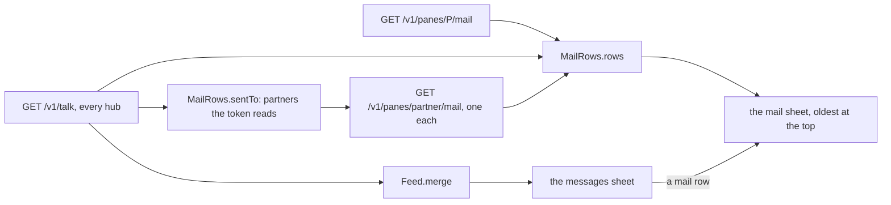
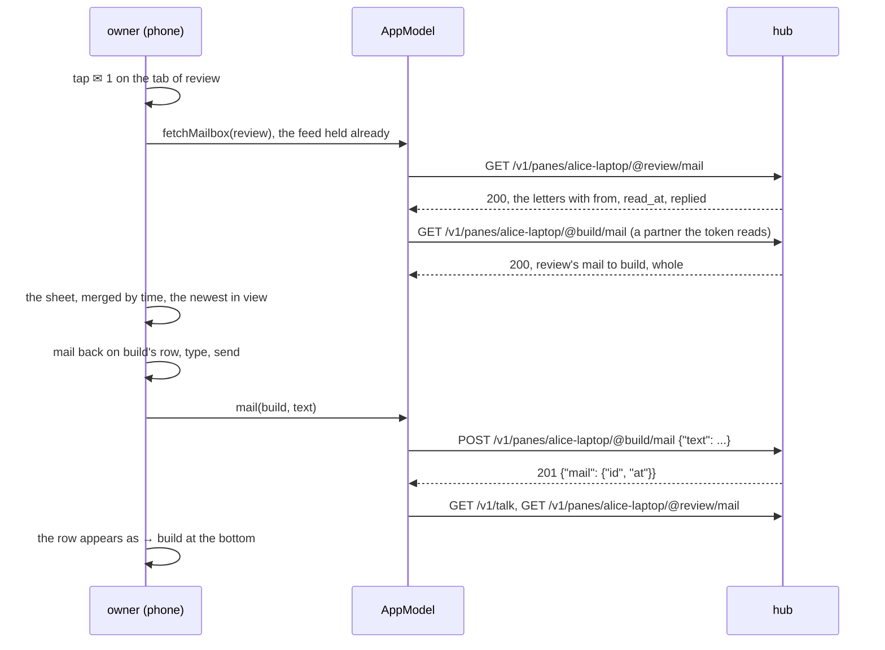

# Feature: the mail sheet, and a messages list one can read

> Status: written 2026-11-04 for
> [#69](https://github.com/notmarkopadjen/muxway-android/issues/69),
> parity with the core's PR 234 (`docs/plans/2026-11-03-mail-window.md`
> there, merged 2026-11-03); implemented the same day. The diff is the
> owner's to review in the pull request.

## 1. Goal

The phone draws `✉ n` after a pane's name while its process holds unread
mail, and that is all it knows of mail: the count cannot be opened, the
messages between panes cannot be read, and the owner cannot join in
without typing into a pane, which is the one thing mail exists to avoid.
On the web since PR 234 the envelope opens a **mail window** for the
pane, and the **messages window** lists what panes said to panes, each
row readable, a mail row opening the mail it names.

After this change, on the phone:

- `✉ n` on a tab, a tile header or a list row is a tap target that opens
  the **mail sheet** for that pane; so does *mail* in the pane menu (a
  tab or a header held still), for a pane with nothing unread;
- the mail sheet lists the pane's mail in full, merged by time, oldest
  at the top: `←` what came in (the sender's name, or *you* for a client
  that is not a pane, with the token's name; `unread` until the process
  read it, `read` after, `replied`), `→` what the pane sent (the
  recipient; the whole text where the token reads the recipient's
  mailbox, else the feed's first 200 characters marked *cut*), and the
  owner's own mail to the panes of that conversation; the mail asked for
  is framed, else the newest is in view; mail is text, never markup, and
  nothing in it is a link;
- a line at the bottom mails a pane: a picker names the target (the pane
  and its partners; a pane the token may not write is dim with
  `read-only`), *mail back* on a received mail aims it at the sender,
  Enter or *send* posts it with no `from`; nothing is typed into any
  pane, and reading here takes nothing from the process: the count
  stands until the process reads;
- `✉` beside `⚑ n` in the header of the list and the view opens the
  **messages sheet**: the talk feed of every hub, oldest at the top, two
  lines a row (the glyph, who → whom, the time and the token; then the
  excerpt wrapping, two lines at most); the count after the envelope is
  the entries not looked at yet, cleared when the sheet opens; a tap on
  a mail row opens that pane's mail sheet with the mail framed, a tap on
  a typed row lays the two panes side by side, and `⇆` at the right of
  every row does the side-by-side.

Out of scope: marking mail read from the phone (a mail is the process's);
deleting mail; a notification per mail (decided against in the core's
mail plan); the web's `L` (laying the pane beside the line's target is a
follow-up with the chain on the header); the watch, the glasses and MIDP
(their parity issues keep them read-only).

## 2. Design

### The protocol layer

`Letter` is one mail of a pane's mailbox as `GET /v1/panes/{address}/mail`
lists it: `id`, `at`, the actor's name, `from` (an `End`: host, address,
pane id, alias; null for a client that is not a pane or an origin the
token may not read), the text, `readAt` (0 until read), `replyTo`,
`replied`. `TalkEntry` is one entry of `GET /v1/talk`: `seq`, `at`, the
actor, `from` (null for a client), `to`, `kind`, `bytes`, the excerpt,
a mail's `id` and `replyTo`, and the app's hub id. `Json` reads both
defensively: an end whose address the protocol does not spell is
dropped (`from` becomes null, an entry without a valid `to` is left
out), texts keep newlines and tabs and lose every other control
character, a mail's text is cut at 4000 characters and the feed's at
200, names at 64, and no more than 200 letters or 100 entries are kept.
`Api.mailbox`, `Api.talk` and `Api.mail(address, text)` (`Input.typed`,
1 to 4000 characters) are the three calls.

`MailRows` is the web's `mailrows.ts`: `rows(self, box, feed, partnerBoxes)`
merges the mailbox and the feed into `MailRow`s (`dir` in or out, `who`,
`at`, `actor`, `text`, `cut`, `id`, `replyTo`, `unread`, `replied`,
`yours`), sorted by time then id; `partners(rows, self)` names the panes
the rows talk with, newest first; `sentTo(self, box, feed, listed)` names
the panes whose mailboxes give the whole texts of what went to them.
`Feed` is the messages list's model: `merge` of every hub's entries by
time, `nameOf(panes, address, paneId)` (the tab's name by the current
address or, after a move, by id; the address without its host when the
listing lacks it), `unseen(entries, seen)` and `seen(entries, seen)`,
the per-hub mark of the newest entry looked at.

### The model

`AppModel` asks every hub's `GET /v1/talk?limit=100` with each listing,
so the count in the header is live at the listing's pace, and every five
seconds while a sheet is open; `Conn.talk` holds the answer with the
hub's id on every entry, `talk` merges them. `talkSeen` is the per-hub
mark of the newest entry looked at, kept in the settings store so the
count survives a restart; `unseen` counts above it; opening the messages
sheet moves the mark. `fetchMailbox(key)` reads one pane's mailbox into
`mailboxes[key]`, a 404 (a pane the token may not read, a host without
mail) kept as the empty box with an error word; `mail(key, text, done)`
posts and asks the pane's hub to list again, a refusal to `mailError`.

### The mail sheet

`MailSheet(model, key, mailId, line)`: a dialog over the view or the
list, `mail · <name>` in its bar, the rows in a lazy column, the line
under them. While open it reads the pane's mailbox and the partners'
every five seconds, with the feed. A row is two lines: the way and the
name in the talk hue, the time and the actor dimmed, then at the right
`cut`, `unread` in the attention colour or `read` dimmed, `· replied`,
and *mail back* on a received mail from a pane (dim where the token
cannot write that pane); the text under it, wrapping. The row of the
mail asked for is framed in the ink; the list opens on it, else on the
newest. The line is `✉ mail to [target ▾]`, a popup that lists the pane
and the partners the rows name, each dim with `read-only` where the
token cannot write it; a field with the hint *a message for its process;
nothing is typed*; *send*; the hub's refusal in the attention colour.
Empty, the sheet says *no mail yet*, or *this pane holds no mail you may
read* after a 404.

### Where it opens from

| Opener | the pane | the mail in view | the line |
|---|---|---|---|
| `✉ n` on a tab, a tile header, a list row | that pane | the newest | targets it |
| a mail row in the messages sheet | the pane the mail went to | that mail, framed | targets it |
| *mail* in the pane menu | that pane | the newest | targets it, focused |

`PaneName` draws the count as a link inside the name's text when its
caller gives it something to do, so the tab's tap, the header's name tap
and the list row's tap stay what they were; the envelope alone opens the
sheet.

### The messages sheet

`MessagesSheet(model)`: `messages · n` in its bar, the merged feed in a
lazy column, oldest at the top and the newest in view. A row: `✉` for a
mail or `⇄` for a typed write in the talk hue, `who → whom` by the
panes' names, the time and the actor dimmed at the right, `⇆`; under it
the excerpt (`key: Enter`, `answer: yes` for the other kinds), two lines
at most, cut. A tap on a mail row closes the sheet and opens the mail
sheet of the pane the mail went to with the mail framed; a tap on any
other row, and `⇆` on every row, opens the two panes side by side (the
one pane when a client wrote it). Empty, it says *no pane talked to
another lately*. `MessagesCount` in the headers is `✉` while any hub
has entries and `✉ n` while n of them are newer than the mark; a tap
opens the sheet and moves the mark.

```mermaid
stateDiagram-v2
    [*] --> closed
    closed --> mail: ✉ n on a tab, a header, a row; mail in the pane menu
    closed --> messages: ✉ beside ⚑ n
    messages --> mail: a tap on a mail row (that mail framed)
    messages --> view: a tap on a typed row, ⇆ on any row
    mail --> mail: mail back (the target changes), send (the row appears)
    mail --> closed: ×, back
    messages --> closed: ×, back
```

## 3. Protocol and API changes

None to the protocol. Newly used by this client, v1 and compatible:
`GET /v1/panes/{address}/mail` (read grant), `GET /v1/talk` and
`POST /v1/panes/{address}/mail` with `{"text"}` alone (write grant, the
pane marked for writing; no `from`: the owner is not a pane). A hub or a
host older than mail answers `404 not_found` to the mailbox, which the
sheet shows as a pane holding no mail one may read, and lists no `✉ n`,
so nothing opens by itself. `docs/ARCHITECTURE.md` gets the rows.

## 4. Security analysis

- **Abuse.** The sheet shows mail text to whoever may read the pane,
  which the mailbox endpoint allows already; the sent side shows a
  partner's mailbox only where the token reads the partner (it is in the
  listing), else the feed's excerpt, which the hub gives only where the
  token reads both panes. No text reaches the phone that it could not get
  today. Sending needs the write grant on the target and the target
  marked for writing, checked by the hub as for an answer; the picker
  offers a pane the token may not write dim, and the hub's `403` is shown
  as *refused* if a stale listing let one through.
- **Input across the boundary.** Mail text is hostile by definition (an
  agent wrote it): it is drawn as text by Compose, never as markup, with
  no link detection and no OSC 8 handling; control characters but
  newline and tab are removed on parse; lengths are capped. Names come
  from the listing through the lens, as everywhere. The typed text goes
  through `Input.typed` and the 4000 cap, and the hub's own checks after.
- **Logging.** Nothing new is logged on the phone. The hub and the agent
  audit a mail's length and id, never its text.
- **Stored.** The per-hub mark of the newest entry looked at, a number
  in app-private preferences; nothing of any mail.
- **Dependencies.** None added.

## 5. Privacy check

The plan, the diff, the docs and the tests name `alice-laptop`, `work`,
`review`, `build`, `alice`, `bob-server` and synthetic texts. The UI run
uses the test hub's synthetic panes. `scripts/prepush-check.sh` before
the push.

## 6. Test plan

| # | Test | Kind | Expected |
|---|------|------|----------|
| 1 | `E2ETest s34`: a reader mails a pane; raw `{"text":""}`, a control character, 4001 characters, `{}` with a write token; a reader whose grant names another pane asks this pane's mailbox | e2e-security | 403 `read_only`; 400 four times; 404 `not_found`, and the pane is not in its listing |
| 2 | `E2ETest s34b`: a read-only pane mailed with a write token | e2e-security | 403 `read_only` |
| 3 | `E2ETest s34`: a token that reads one pane of two sees the other's mail to it with `from` null and no feed entry for it | e2e-security | as said |
| 4 | `E2ETest z99` (existing) | e2e-security | no token in any log of the run |
| 5 | `E2ETest f35`: the owner mails pane A (201, the id; `✉ 1` in the listing; the letter from *you*, unread; one feed entry without `from`; `MailRows.rows` for A: one `←` row, yours); pane B mails A from its shell (`muxway client mail` in B); A's rows: two `←`, the second from B; B's rows: one `→` to A, whole, unread; `sentTo(B)` names A; the process in A reads with `muxway mail`: the count clears, the rows say read | e2e | as said |
| 6 | `MailRowsTest`: the merge of a mailbox and a feed, a partner read and one not (whole text against the excerpt marked cut), the owner's mail to a partner (yours), a reply's `replyTo`, the order by time then id; `partners` newest first without the pane; `sentTo` with a partner not listed | unit | the web's rows |
| 7 | `FeedTest`: `merge` across hubs by time; `nameOf` by address, by id after a move, the address without its host; `unseen` and `seen` per hub | unit | as said |
| 8 | `JsonTest`: a mailbox with `from` null, `read_at` absent, a reply; an end with a bad address dropped; an entry without `to` left out; control characters and lengths; the feed's `next` | unit | as said |
| 9 | `ApiTest`: `mail` posts `{"text"}` alone to `…/mail`, refuses empty and oversize text before sending; `mailbox` and `talk` paths | unit | as said |
| 10 | `FlowTest`: the list row's `✉ 1` opens the mail sheet with the text and `unread`; *mail back* aims the line at the sender; a sent mail appears as `→`; the header's `✉` opens the messages sheet with the row, a tap on it opens the mail sheet with the mail framed | UI (`mail-sheet`, `mail-back`, `messages`) | assertions on the rows |
| 11 | the full suite, `MUXWAY_UI=0`, recorded | e2e | green, run issue filed |

This machine has no device, so the UI step is written and waits for the
owner's phone or the emulator, as the last plans' did.

## 7. Documentation

- The core's `docs/ui-guideline.md` §1.6: the *messages*, *the mail
  window* and *mail the open pane* rows' Android columns (done, no
  longer a follow-up): a branch in the core checkout for the owner to
  push.
- `docs/features/mail.md`: new, the two sheets and their security
  section; `pane-view.md` and `panes.md`: the envelope is a tap target,
  the header's `✉`, the pane menu's row; `inbox.md`: the header's
  neighbour; `docs/ARCHITECTURE.md`: the rows; `docs/testing.md`: the
  unit suites; the README's sentence.

## 8. Implementation steps

1. `protocol`: `End`, `Letter`, `TalkEntry`, `Feed`, `MailRows`,
   `Json`, `Api`; unit tests.
2. `app`: `Conn.talk`, `talkSeen`, `fetchMailbox`, `mail`; `PaneName`'s
   link; `MailSheet`, `MessagesSheet`, `MessagesCount`; the openers on
   the tab, the header, the list row, the pane menu; the headers.
3. Docs: the pages above, the guideline in the core; the version
   0.20.0 (51).
4. `FlowTest`: the mail step, the seed in `scripts/ui-tests.sh`.
   `E2ETest`: s34, s34b, f35.
5. The e2e run, recorded; the pull request.

---

## Review (after implementation)

- [ ] Diff matches the plan, deviations explained here
- [ ] Security rules (AGENTS.md section 2) hold
- [ ] Privacy check passed: `scripts/prepush-check.sh` clean and diff read
- [ ] Docs and diagrams updated

## Test run

(filled in after the run)
