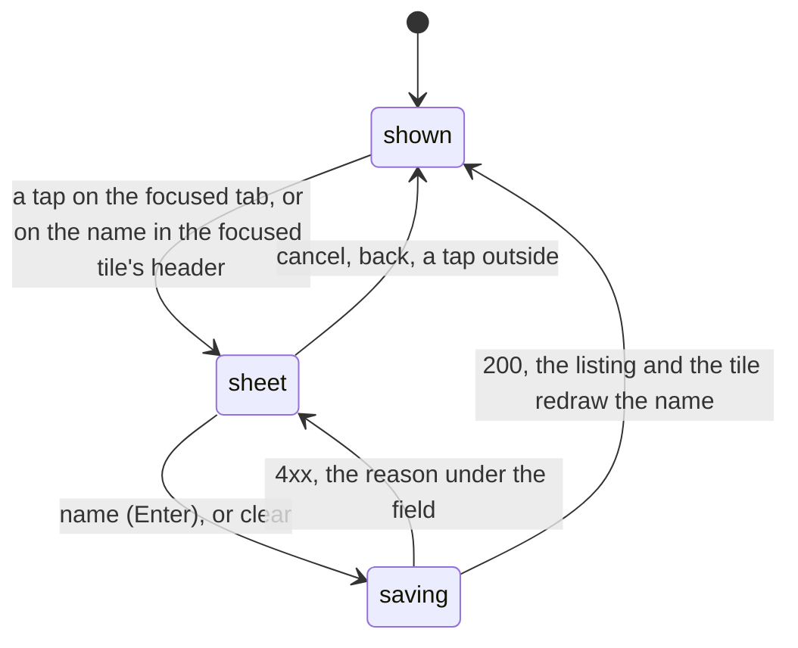

# Feature: the alias is the name, the folder in the header, a tap names a pane

> Status: written 2026-11-04 for
> [#68](https://github.com/notmarkopadjen/muxway-android/issues/68),
> parity with the core's PR 232 (`docs/plans/2026-11-03-pane-names.md`
> there, merged 2026-11-03); implemented the same day. The diff is the
> owner's to review in the pull request.

## 1. Goal

With several Claude sessions open the strip reads like copies of
whatever Claude last wrote into its title, and a pane without an agent
is only its command. The owner can name a pane from the web since PR
232; the phone still shows the alias nowhere but as `@alias` in the
place, and shows the folder a pane works in nowhere at all.

After this change, on the phone:

- a pane with an **alias goes by it first** on the tab, the tile
  header, the list row, the inbox, the add menu, a notification and the
  watch (every one of them names a pane through `Lens.describe`); what
  the program says about itself (Claude's codename, `vim · notes.md`)
  follows as the status, in italics;
- the tile header shows the **folder** the pane works in (the listing's
  `cwd`, every program, for a writer under a preview root) as its last
  segment in italics after the name, and the **name sheet** shows the
  whole path;
- a tap on the focused pane's tab, or on the name in its header, opens
  the **name sheet**: the program and its status, the address, the size
  and the mode, the folder's path, and for a writer on a host that
  names panes a field that takes a name (`a-z 0-9 -`, up to 32,
  slugged as typed as the web does it), *name*, *clear* and *cancel*;
- the header gets lighter the way the web's did: `· write` goes,
  `read-only` shows only when so.

Out of scope: the web's slow second click and `N` (no pointer, no
keyboard); the timing window that tells the web's rename click from a
double-click (the phone's tab has no double tap, and the header's
double tap stays the zoom); the folder on the tab or the list row (the
guideline keeps them as they are); naming from the watch.

## 2. Design

### One name: the alias

`Lens.describe` gains the web's rule: with an alias, the description's
name is the alias, its agent the one the program would have had, and
its status the agent's status (the codename) or, for any other
program, what the name was (`vim · notes.md`). `Lens.tab` puts the
alias first too. Nothing else changes: `Pane.name`, `Pane.tab`,
`PaneName`, `Board` (the watch's rows), the notifier and the add menu
all go through these two.

### The folder

`PaneName` takes an optional folder and draws it in italics, dimmer,
between the name and the status. The tile header passes the last
segment of `Pane.cwd` (`Lens.folder`); the tab, the list row and the
inbox pass none. The model's `cwdOf` already finds a pane's `cwd` in
the listing or the last read; it stops being a shell pane's alone.

### The name sheet



A `Dialog` as the session dialog is, over the view: the `Panel`'s title
is the pane's name, under it the program and its status, the place with
the size and the mode, the folder's path when the host gave one, then,
for a writable pane on a host whose `rename` is true, a `Field` whose
text is slugged as typed (`Lens.aliasOf`: lower case, a space or `_` to
`-`, anything else dropped, 32 at most) with the rule as its hint, the
refusal under it when the hub said no, and `cancel`, `clear` (when the
pane has an alias) and `name`. On a read-only pane or a host without
`rename` the sheet has no field and says why in one dim line, so it is
still the phone's tooltip.

The tab's tap: `show` focuses a tab; when the tab is the focused one
already the tap opens the sheet instead. The header's name: the tile's
header already takes taps (focus) and double taps (zoom) in one
gesture detector; the name gets its own with the same double tap and a
tap that opens the sheet when the tile is focused, else focuses it.

```mermaid
sequenceDiagram
    participant O as owner (phone)
    participant M as AppModel
    participant H as hub
    O->>O: tap on the focused tab
    O->>O: the sheet, "Fix Tests" typed, shown as fix-tests
    O->>M: rename(key, "fix-tests")
    M->>H: POST /v1/panes/alice-laptop/work/1.0/alias {"alias": "fix-tests"}
    H-->>M: 200 {"pane": {...}} or 400 / 403 / 404 / 409
    M->>M: the tile's pane is the answer's; the listing is asked again
    M->>H: GET /v1/hosts, GET /v1/panes
```

`AppModel.rename(key, alias)` posts, puts the answered pane into the
tile's state so the header and the tab change at once, refreshes the
listing, and keeps the refusal for the sheet. `Api.rename` checks the
alias against `[a-z0-9-]{0,32}` before it leaves the phone.
`Host.rename` comes from `hosts[].rename`; `ApiException` words
`bad_alias` and `alias_taken`.

### The header

The `· write` after the name goes; `· read-only` stays for a pane the
token cannot write. The size with fit on, the state, the choices, the
changes count, `_` and `×` are as they were.

## 3. Protocol and API changes

None to the protocol: the app uses `POST /v1/panes/{address}/alias`
with `{"alias": "review"}` (empty clears) as `docs/protocol/v1.md`
specifies it, and reads `rename` on `hosts[]` and `cwd` on every pane.
`docs/ARCHITECTURE.md` gets the row. A hub or host older than the
endpoint answers `404 not_found`; the sheet shows no field on a host
whose `rename` is absent.

## 4. Security analysis

- **Abuse.** A rename changes how a pane is addressed; a grant that
  names an alias follows it. The hub refuses a taken alias and a reader
  gets `403`, so a phone can do no more than its token's writer can do
  from the pane's shell already. The phone never renames on its own.
- **Grant.** The write grant and a writable pane, checked by the hub.
  The phone offers the field only where `mode` is `write` and the host
  says `rename`, and takes the hub's answer, not its own guess.
- **Input across the boundary.** The alias is slugged as typed and
  matched against `[a-z0-9-]{0,32}` in `Api.rename` before the request;
  the hub and the agent check it again. The address is percent-encoded
  as every pane request's is.
- **The folder.** `cwd` is a path on the host, sent only to a writer
  under a preview root. The header shows its last segment and the sheet
  the path; nothing is derived or guessed. The listing's `cwd` is
  already length-capped and stripped of control characters in `Json`.
- **Logging.** Nothing new is logged on the phone. The hub and the
  agent audit the rename with the actor, the pane and the names.
- **Dependencies.** None added.

## 5. Privacy check

The plan, the diff, the docs and the tests name `alice-laptop`,
`review`, `fix-tests`, `/home/alice/work`; the UI run uses the test
hub's synthetic panes. `scripts/prepush-check.sh` before the push.

## 6. Test plan

| # | Test | Kind | Expected |
|---|------|------|----------|
| 1 | `E2ETest s30`: rename with a read token, on a read-only pane with a write token, with `Review` and `a b` raw, with a name another pane of the host has | e2e-security | 403 `read_only`, 403 `read_only`, 400 `bad_alias` twice, 409 `alias_taken`; the aliases unchanged; `Api.rename` refuses `Review`, `a b` and 33 characters before any request |
| 2 | `E2ETest z99` (existing) | e2e-security | no token in any log of the run |
| 3 | `E2ETest f31`: `hosts[].rename` true; rename to `review`; the listing shows the alias; `GET /v1/panes/alice-laptop/@review` reads the pane; clear; a program that is no shell (`cat`) under a root keeps `cwd` for a writer | e2e | as said |
| 4 | `LensTest`: `describe`, `name`, `tab` with an alias on Claude, on `vim`, on a bare shell; `aliasOf` (`Fix Tests` → `fix-tests`, `a_b` → `a-b`, `ü` dropped, 40 characters cut to 32); `folder` | unit | alias first, the codename as status |
| 5 | `JsonTest`: `rename` on a host read when given, false when not | unit | as said |
| 6 | `FlowTest`: the focused tab tapped opens the name sheet with the folder's path; `Fix Tests` typed reads `fix-tests`; *name*; the tab and the header show `fix-tests`, the header the folder in italics; the sheet again, *clear*; the name goes back | UI (`name-sheet`, `named`, `name-cleared`) | assertions on the tab's text |
| 7 | the full suite, `MUXWAY_UI=0`, recorded | e2e | green, run issue filed |

This machine has no device, so the UI step is written and waits for the
owner's phone or the emulator, as the last plans' did.

## 7. Documentation

- The core's `docs/ui-guideline.md` §1.1 (folder row: the sheet is the
  phone's tooltip), §1.4 (header row) and §1.6 (*name the pane*,
  Android column): changed first, in a pull request to the core.
- `docs/features/pane-names.md`: new, the feature page.
- `docs/features/pane-view.md`: the strip and the header paragraphs,
  the name sheet; `docs/features/panes.md`: the row; `docs/features/lenses.md`: the naming paragraph.
- `docs/ARCHITECTURE.md`: the naming row and `rename` on hosts.

## 8. Implementation steps

1. `protocol`: `Lens.describe`/`tab` with the alias, `Lens.aliasOf`,
   `Lens.folder`; `Host.rename` and `Json.hosts`; `Api.rename`; the
   exception's words; unit tests.
2. `app`: `PaneName` with the folder; the header without `· write`;
   `AppModel.rename`; the name sheet; the tab's and the name's tap.
3. Docs: the feature page, pane-view, panes, lenses, the architecture
   table; the guideline in the core.
4. `FlowTest`: the name-sheet step.
5. `E2ETest`: s30 and f31. The version: 0.18.0 (46).
6. The e2e run, recorded; the pull request.

---

## Review (after implementation)

- [ ] Diff matches the plan, deviations explained here
- [ ] Security rules (AGENTS.md section 2) hold
- [ ] Privacy check passed: `scripts/prepush-check.sh` clean and diff read
- [ ] Docs and diagrams updated

## Test run

Link to the recorded run: result, commit, logs, screenshots.
