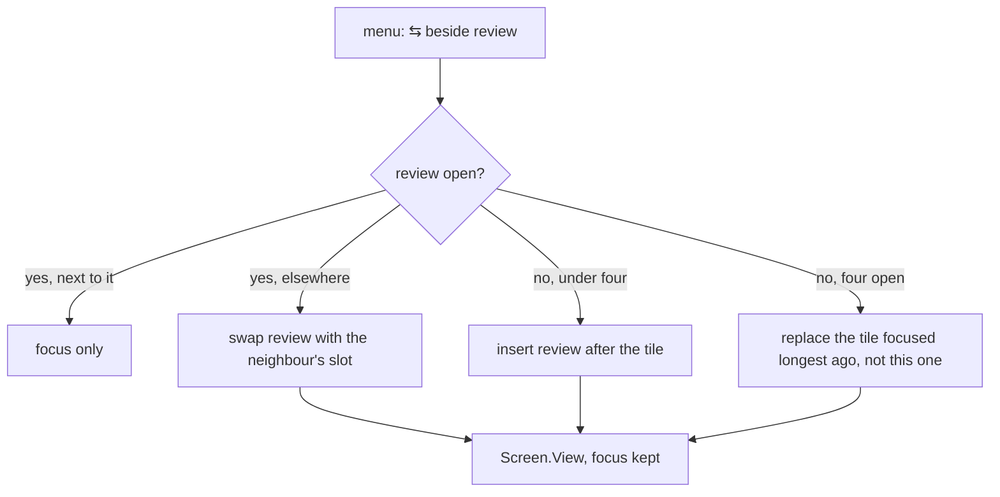
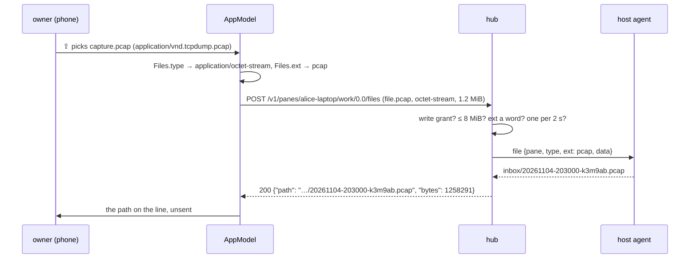

# Feature: the pane view's remaining rows, and files of any type

> Status: written 2026-11-04 for
> [#88](https://github.com/notmarkopadjen/muxway-android/issues/88) (the
> parity pass of 2026-11-04 over the core's `docs/ui-guideline.md` §1)
> and [#87](https://github.com/notmarkopadjen/muxway-android/issues/87)
> (parity with the core's any-file-type change, muxway#267, merged in
> muxway#270). Waits for the owner's approval.

## 1. Goal

The parity pass found the phone at 0.21.0 one change set short of the
guideline's §1, and the core's inbox takes any file since 2026-11-04
while the phone still refuses all but nine types. After this change, on
the phone:

- **Mail and talk.** *⇆ beside <partner>* in the pane menu (a tab or a
  tile's header held and let go in place) lays the pane the focused tile
  talks with beside it, as the web's `L` does: swapped next to it when
  open, opened there when not, in the place of the tile focused longest
  ago when four are open. The divider between two grouped tiles side by
  side carries the chain at its middle, in the talk hue. The messages
  sheet indents a reply under what it answers and wraps the text up to
  200 characters instead of two lines.
- **The pane view.** The tile header shows, after the word, the notice's
  text for a question or a permission. Closing the only pane of a
  session asks `end session <session> on <host>?`. Fit is per tile:
  `⤢` serves the focused tile, the others keep theirs. A parked row of
  the list shows what waits underneath, dimmed, after *later*, as the
  header and the inbox do. The alias is bold wherever it is the name. A
  link a program names itself (OSC 8) opens on a tap by its label and
  shows its address on a hold. *⬌ across the width* and *⬍ across the
  height* in a tile header's menu lay the focused tile across the whole
  view, as the web's `e` and `E` do.
- **Help and settings.** *help* in Settings opens the help sheet: every
  gesture of the list and the view, and what a hardware keyboard does.
  The reading cadence stays the *every* setting's (2 s and 4 s by
  default); the guideline records it as Android's own.
- **Files of any type.** `⇪`, a paste and a share take any file: a known
  type by its mime or its extension, anything else as bytes under the
  extension the name ends in, when that is one to eight lowercase letters
  or digits. The inbox link pattern follows. The file sheet shows what it
  can and offers `⤓` and *open* for the rest, as it does today.
- **Docs.** `pane-view.md` names every control of the top row; the README
  links every feature page.

Out of scope: the web's accent bar and tab dimming (web-only by the
guideline); the header's chain as a tap target (the guideline gives the
click to the web alone); the watch, which keeps its plain text; the
glasses and MIDP, which have their own issues.

## 2. Design

### Beside, across and the chain (`ViewScreen`, `PaneMenu`, `Tiles`, a new `Beside`)

`Beside.lay(open, at, partner, focusedAt, max = 4)` is the web's rule
as a pure function in the protocol module, so it is unit tested: with
the partner open and not next to `at`, the partner is swapped with the
neighbour's slot (`at + 1`, or `at - 1` at the end); not open with room,
it is inserted after `at`; with four open, it takes the place of the
tile other than `at` whose `focusedAt` is the oldest. The view keeps
`focusedAt` (a map of address to the time it was focused, kept across
its own changes like `Remembered`) and applies the result as a new
`Screen.View` with the focus kept on `at`. The menu lists one row per
partner the listing has (at most four, in the listing's order), named as
the tab names it, through `Groups` and `Keys.make(hub, address)` so two
hubs never mix; a partner the listing lacks is not a row. The row is
there for a tab's menu and a header's; the tab's row lays the partner
beside the tab's pane when that pane is open, else beside the focused
tile after opening the tab's pane there. The pane is woken as
`openBeside` wakes it.

*⬌ across the width* and *⬍ across the height* are rows of a tile
header's menu with two or more tiles: `Tiles.across(shape, leaf,
rootKey, horizontal, first)` with the root split's key, `first` by which
half of the view the tile's middle lies in, as the divider drop does. A
tile already across is not offered that way (its row is dim with
*already across*).

The chain: `Tree` learns which leaves are grouped (`groups`, the same
map the tiles and the strip take) and, for a divider whose two
neighbours are both leaves of one group, draws `⛓` at its middle in the
talk hue (the web's `mx-divider-chain`), the bar itself in the talk hue
dimmed as the tiles' edges are. A divider between a leaf and a split, or
between two groups, stays plain.

### The messages sheet (`MailSheet.kt`, `MessagesSheet`)

A row whose entry has `replyTo` above zero is indented one step under
the rows (the web's `data-reply`); the text is `Feed.excerpt(e)` cut at
200 characters with `…`, wrapping as it needs (`maxLines` goes).

### The header (`ViewScreen`, `Json`, `Models`)

- The notice: after the word, for `kind` `question` or `permission`,
  ` · <text>` in the header's ink, one line, cut with an ellipsis, taking
  the room the name leaves and no more, so the choices and `_ ×` keep
  theirs. The text is the listing's, already made printable by `Json`.
- `Pane.last` is read from the listing (`"last": true`, the only pane of
  its session, protocol v1). The close question becomes `end session
  <session> on <host>?` for it; the action is the same close.
- The alias in bold: `PaneName` sets the name's weight bold when
  `bold || pane.alias.isNotEmpty()`, so the tabs, the headers, the list,
  the inbox and the name sheet all show a named pane bold; the focus
  still has its thick border.
- The list row: after *later*, `· <glyph> <kind>` dimmed when an
  attention waits underneath, the same text the header draws.

### Fit per tile (`ViewScreen`)

`fit: Boolean` becomes `fitOff: Set<String>` (saved with the view, by
address): a tile's fit is on unless its address is in the set, every
writable tile opening with fit on as today. `⤢` toggles the focused
tile: a tap turns it on, or sends the size again when it is on; a hold
turns it off; its selected state follows the focused tile. The
one-window fit (the tiles are every pane of one window) is on while the
focused tile's fit is on, as the web has it (`fit[focused] ?? true`);
with it off the arrangement still goes to the host without a size. A
tile with fit off is drawn scaled or reflowed as today. Closing or
minimising a tile drops its entry.

### Links a program names (`Ansi`, `ViewScreen`)

`Ansi.Style` gets `href: String?`. `keep` keeps an OSC 8 sequence
(`ESC ] 8 ; <params> ; <address> BEL|ST`) beside the SGR ones; `rows`
reads it: an address opens a link on the spans that follow, an empty one
closes it. An address is taken only when it is `http` or `https`, at
most 2048 characters, without a control or space character (the web's
`linkTarget`); anything else leaves the label as text. The watch's tail
(`Wire`) asks `keep` without links, so its rows stay plain. `styled`
draws a span with `href` as a link (dotted underline in the span's own
colour, a `LinkAnnotation.Url`), the tap opens it in the browser and
sends nothing to the host, as a printed address does, and a hold on the
label shows the address as a toast (`model.told`, cut at 200
characters), before the block copy. `Ansi.hrefAt(row, col)` answers the
tap handler, beside `Links.at`.

### The help sheet (`HelpSheet.kt`, `ConnectScreen`)

*help* beside *save settings* opens a sheet over Settings: a table of the
actions and their gestures, in the guideline's §1.6 order, the Android
column as it stands: the list (tap, hold, `+ pane`, `+ session`, `⚑`,
`✉`), the strip (tap, drag, hold still, tab tapped on the focused pane),
the tiles (swipe, double tap, hold a header and drop, `▦` held, `⤢` tap
and hold, `_`, `×`), the body (tap, drag, long press on a block, a name
or a link, pinch), the line and the keys (`⌨`, `⇪`, `◉`, the key row,
Shift+Enter, Right, Ctrl+Right, back) and the hardware keyboard with the
setting on. Static text; the sheet scrolls; `×` or back closes.

### The cadence

The *every* setting stays at 2: the focused tile every 2 s, the rest 4 s.
A phone on a battery and a mobile radio should not poll every second by
default; the owner has the setting for a faster read. The guideline's
*reading* row gets Android's cadence beside the web's, as the list's
15 s already stands beside the web's 5 s; `pane-view.md` stops calling
2 s and 4 s the guideline's one and two.

### Files of any type (`Files`, `Attachments`, `Api`, `Links`, the manifest)

`Files.type(mime, name)` always answers: a known type by the mime or the
name's extension, else `application/octet-stream`. `Files.ext(name)` is
the name's extension lowercased when it matches `[a-z0-9]{1,8}`, else
null. The multipart part's `filename` is `file.<ext>` when `ext` is
there, `file` otherwise; the phone's own name travels no further. The
picker opens for `*/*`, the share target takes `*/*`, and the refusal
*not a type the host takes* goes. `Links` takes an inbox path with any
extension of one to eight lowercase letters or digits. The file sheet
already shows text, images and PDF and offers `⤓` and *open* for the
rest, which an unknown type now reaches through the hub's
`application/octet-stream`; nothing changes there. A hub older than the
change answers `415 unsupported`, shown as before.

### Docs

`pane-view.md`: the controls `▦` `⊡` `⤢` `abc` `⚑ n` `✉` `⚙`, the
menu's new rows, the chain, the notice text, the end-session question,
fit per tile, the program's links, the help sheet, the cadence; the
README's feature list adds `mail.md`, `share.md` and `shell-helper.md`.

## 3. Protocol and API changes

None to the protocol. Newly used by this client, v1 and compatible: the
listing's `last`; `POST /v1/panes/{address}/files` with any
`Content-Type` and a `filename` of `file.<ext>`, which a hub before
muxway#267 refuses with `415 unsupported` as it refuses every unknown
type today. `docs/ARCHITECTURE.md`'s files row says so.

## 4. Security analysis

- **A program's links.** A pane's program chooses both the label and the
  address: the label may read `https://bank.example.com` while the
  address is elsewhere, which is why the address shows on a hold before
  anything opens, as the web shows it on hover. The address is taken only
  as `http` or `https`, bounded at 2048 characters and free of control
  and space characters; `javascript:`, `file:`, `intent:` and the rest
  leave the label as text. A tap opens the system browser and sends
  nothing to the host, mouse mode or not. Nothing is fetched by the app.
- **Any file.** A write grant was always needed; whoever may write a
  pane may already run anything in it (the core's decision of
  2026-11-04). Of the phone's name for the file only an extension that
  matches `[a-z0-9]{1,8}` travels, so no slash, dot, space or shell
  character reaches a path; the hub and the agent check it again and
  fall back to `bin`. The bytes are capped at 8 MiB before any request.
  What comes back is the hub's: an unknown type as `octet-stream`, never
  sniffed, shown by the sheet as a download only.
- **Beside and across** ask the hub nothing: they rearrange the view
  from the listing the app holds, naming only panes the token reads;
  `wake` goes through the existing `later` call with its grant check.
- **The end-session question** changes words, not the action: the close
  is the same `POST`, the hub's grant and the host's `close` decide, and
  a wrong `last` from a hub misleads a sentence at worst.
- **The notice's text** is the listing's attention text, made printable
  by `Json` as the inbox's is, drawn in one line and cut; no markup.
- **Fit per tile** sends the same resize requests, one tile fewer at a
  time at most.
- **The help sheet** is static text.
- **Logging.** Nothing new is logged on the phone; the hub's audit line
  for a file names the extension, never the name or the content.
- **Dependencies.** None added.

## 5. Privacy check

The plan, the diff, the docs and the tests name `hub.example.com`,
`alice-laptop`, `work`, `review`, `alice` and made-up inbox names
(`20261104-203000-k3m9ab.pcap`), `https://example.com/...` for links.
The UI run uses the test hub's synthetic panes. `scripts/prepush-check.sh`
with the deny-list before the push.

## 6. Test plan

| # | Test | Kind | Expected |
|---|------|------|----------|
| 1 | `AnsiTest`: OSC 8 with `javascript:`, `file:`, `intent:`, an address of 2049 characters, one with a tab, one with a space; a label with no closing sequence; BEL and ST ends | unit (security) | the label stays text with no `href`; the valid ones carry it; `plain` shows the label alone |
| 2 | `FilesTest`: `ext` of `../../x.sh`, `x.`, `x.TAR.GZ`, `x.abcdefghi`, `x.p y`, `Makefile`; `type` of an unknown mime; the part's `filename` | unit (security) | null, null, `gz`, null, null, null; `application/octet-stream`; `file.pcap` or `file` |
| 3 | `E2ETest s38`: a raw multipart with `filename="../../etc/x.sh"` and `application/octet-stream`; one with `filename="x.ABC"`; a reader with any type | e2e-security | the path ends in `.bin` and lies under the inbox; `.abc`; `403 read_only` |
| 4 | `E2ETest f39`: `sendFile` of bytes called `capture.pcap` with an unknown mime and `.py` text; reading them back; the inbox link pattern finds both paths | e2e | 200 with paths ending `.pcap` and `.py`, `Links.findFiles` finds them, the bytes come back as `octet-stream` and the same |
| 5 | `E2ETest f40`: a session's only pane lists `last: true`, a pane with a sibling does not | e2e | as said |
| 6 | `BesideTest`: open and adjacent; open elsewhere; not open with room; four open, the oldest focus replaced, never `at` itself; a partner of another hub | unit | as said |
| 7 | `TilesTest`: `across` with the root key, width and height, first and last; a tile already across | unit | as said |
| 8 | `LinksTest`: inbox paths with `.pcap`, `.py`, `.abcdefgh`, not `.abcdefghi`, not `.Py` | unit | as said |
| 9 | `JsonTest`: `last` read and absent; `FeedTest`: a reply's `replyTo` | unit | as said |
| 10 | `FlowTest`: two grouped tiles show the chain on the divider; the header menu's *⇆ beside* lays the partner next to the focused tile; `⤢` held turns one tile's fit off and the other keeps its size; Settings → *help* shows the sheet (`help-sheet`, `beside`, `fit-per-tile`) | UI | assertions on the texts and the fit state |
| 11 | the full suite, `MUXWAY_UI=0`, recorded | e2e | green, run issue filed |

This machine has no device, so the UI step is written and waits for the
owner's phone or the emulator.

## 7. Documentation

- The core's `docs/ui-guideline.md`, on the console's `parity-docs`
  branch (rows asked of the console by mail): §1.4 *reading*, Android's
  cadence (the *every* setting, 2 s and 4 s by default); §1.6 *lay the
  pane the focused tile talks with beside it*, Android: *⇆ beside
  <partner>* in the pane menu; *lay the focused tile across the whole
  view*, Android: *⬌ across the width* and *⬍ across the height* in a
  tile header's menu; *help*, Android: *help* in Settings; §1.4 *tiles*:
  the divider's chain is no longer web-only.
- Here: `pane-view.md` (above), `panes.md` (the parked row),
  `mail.md` (the messages sheet's reply indent and wrap),
  `attachments.md` (any type, the extension rule), `connect.md`
  (*help*), `docs/ARCHITECTURE.md` (the files row, `last`),
  `docs/testing.md` (the unit suites), the README.

## 8. Implementation steps

1. `protocol`: `Ansi` OSC 8; `Files` any type; `Links` any extension;
   `Pane.last` in `Json`; `Beside`; unit tests. Version 0.22.0 (53).
2. `app`: the file picker and share target for `*/*`, `Attachments`
   without the type refusal; the file sheet unchanged.
3. `app`: the header's notice text, the end-session question, the alias
   bold, the list's parked row, the messages sheet.
4. `app`: fit per tile.
5. `app`: beside and across in the menu, the chain on the divider, the
   link spans and the hold.
6. `app`: the help sheet from Settings.
7. Docs, the `FlowTest` steps, `E2ETest` s38, f39, f40.
8. The e2e run, recorded; the pull request.

---

## Review (after implementation)

- [ ] Diff matches the plan, deviations explained here
- [ ] Security rules (AGENTS.md section 2) hold
- [ ] Privacy check passed: `scripts/prepush-check.sh` clean and diff read
- [ ] Docs and diagrams updated

## Test run

Link to the recorded run: result, commit, logs, screenshots.
