# Feature: the desk, the view every client shares

> Status: written 2026-11-07 for
> [#98](https://github.com/notmarkopadjen/muxway-android/issues/98),
> parity with the core's PR 305 (`docs/plans/2026-11-05-desk.md`,
> `docs/features/desk.md` and `docs/protocol/v1.md` there, `GET` and
> `PUT /v1/desk` and the `desk` event, merged 2026-11-06 at `f64d383`).
> Written and implemented the same day on the branch of
> `2026-11-07-own-pane.md` and `2026-11-07-pane-chords.md`; the owner
> was away, so the diff is the owner's to review in the pull request,
> which is not merged until then.

## 1. Goal

The hub keeps the **desk**: the view the owner's clients share. Which
panes are open as tiles, the focused one, the arrangement (`row`,
`column`, `grid`, `main-left`, `main-top`, or `custom` with a tree and
weights), the minimised panes, the tab order, or the window the window
view shows; `updated`, `by` and `rev`, the hub's count of writes, by
which clients order desks. The web client writes it half a second after
a change, opens it when started on the list and from a `desk` row at the
top of the list, and follows another client's `desk` event within a
second, the focus excepted. Pick up the phone and the panes the browser
had open should be there, laid out as they were; lay a pane beside
another on the phone and the browser should follow.

After this change the phone **reads** each hub's desk with its listing
and on its `desk` event, **opens** it from a `desk` row at the top of
the list (one per hub) and when the app starts on the list after being
closed in a view, **writes** it half a second after a change of the
tiles, the focus, the arrangement, the splits' shares or the minimised
row, and **follows** another client's desk within a second, the focus
excepted: the focus is restored on opening only, so typing on the
browser never moves the phone's focus. A desk older than the phone's
own last write is ignored. The phone has no window view: a window desk
opens the window's panes as tiles, four at most, in the window's order
with the desk's focused pane focused, and the phone writes nothing
until the person changes something.

Out of scope: the tab order (`order`; the phone's strip has no owner's
order, so it writes none and applies none), a window view, and a desk
across hubs: a desk is one hub's, and the phone writes to the focused
tile's hub the view's panes on that hub (the arrangement and the tree
only while every tile is on it, since a tree over panes another hub
holds would name leaves the hub cannot check). The core's `<hub>~<address>`
form for another hub's pane is not written: the phone's ids for its
hubs mean nothing to another client.

## 2. Design

### The protocol layer

`Desk` (protocol module): `view`, `panes`, `focused`, `arrangement`,
`tree` (a `WindowLayout.Node`, the web's `{kind: h|v, key, children}`
with a number for a leaf, `h` the side-by-side split), `weights`,
`minimised`, `order`, `window`, `updated`, `by`, `rev`. `Json.desk`
reads one defensively: addresses by the protocol's grammar, up to four
panes, sixteen minimised, `focused` among the panes or empty, an
arrangement of the six or empty, a tree whose leaves are the panes'
indexes, each once, and whose keys are 1 to 16 characters, else no tree
and no `custom`; weights of 2 to 4 shares each strictly between 0 and 1
under keys of the same bound, else none; `by` printable and bounded;
`rev` and `updated` at least 0. `Json.deskBody` writes one without
`updated`, `by` and `rev`. `Desks.same` compares two by what they say
(`Desks.body`), `Desks.panesOf` gives a panes desk's tiles, `Desks.words`
the row's text (`desk · 2 panes · row · 1 minimised · by web`, `desk ·
the window alice-laptop/work/0`, `desk · empty`). `Api.desk(etag)` is
`GET /v1/desk` with `If-None-Match`, null on `304`; `Api.putDesk` is
`PUT /v1/desk` and answers the desk as stored.

### The model

Per connection: `desk` (the last read, a snapshot state the list and
the view watch), its `ETag`, `deskKnown` (what the hub has, as last
read or answered to a write: the phone writes nothing the hub already
has and applies nothing it already shows), `deskRev` (the revision of
the phone's own last write), `deskWritable` (false after a `read_only`
refusal, so a read-only token stops asking). The desk is fetched with
every listing (`refreshList`) and at once on a `desk` event of the long
poll. `writeDesk(hub, desk)` keeps the newest desk pending and sends it
500 ms after the last change, unless it is the known one or the one the
view opened from (the **baseline**, so opening a desk writes nothing
back); the hub's answer becomes the known desk and `deskRev`. A refusal
is not kept: `read_only` turns writing off for the connection, anything
else is tried again at the next change. No write while the listing
shows no writable pane of the hub (a read-only token has none).

`openDesk(hub)`: the desk's tiles and minimised panes become the view's
keys (the hub's panes only), with an **opening** the view takes once:
the arrangement, the tree and the weights (as a closed tile's `carried`
arrangement travels today), the minimised row and the focus. A window
desk opens the window's panes from the listing, four at most, the
focused one focused, as the zoom from a lone pane does. A desk without
panes opens nothing.

Start: the store keeps `last_place`, `view` when a view opens and `list`
when the list does. An app started on the list after being closed in a
view opens the first hub's desk that holds panes once the desks have
been read, and stays on the list when none does.

### The view

`ViewScreen` builds `mine`, this view as a desk, from its state: the
focused tile's hub, that hub's tiles as `panes`, the focused tile, the
arrangement's word (`Layout.word`), the tree and the weights when the
arrangement is custom and every tile is on the hub, the minimised panes
of the hub; it hands it to `writeDesk` whenever it changes. The first
`mine` after an opening is the baseline. It follows the hub's desk
(`deskOf(hub)`): one the hub already has, or equal to `mine`, or older
than the phone's own last write, is nothing; the same tiles under
another arrangement set the arrangement, the tree, the weights and the
minimised row; other tiles open through `openDesk`, the focus staying
where it is (the opening carries no focus then).

```mermaid
sequenceDiagram
    participant W as web
    participant H as hub
    participant P as phone
    W->>H: PUT /v1/desk {panes: [a, b], arrangement: row, focused: b}
    H-->>P: GET /v1/events: {kind: desk, text: "12"}
    P->>H: GET /v1/desk (If-None-Match)
    H-->>P: 200 {desk: ..., rev: 12}
    P->>P: rev 12 ≥ own last write; not known; not mine: open [a, b] as a row
    Note over P: the owner drags a split on the phone
    P->>P: mine changes; 500 ms
    P->>H: PUT /v1/desk {panes: [a, b], arrangement: custom, tree, weights, focused: a}
    H-->>P: 200 {desk: ..., rev: 13}; known = rev 13
    H-->>W: desk event
```

```mermaid
stateDiagram-v2
    [*] --> List: started, last place list
    [*] --> Opening: started, last place view, a desk with panes read
    List --> Opening: the desk row tapped
    Opening --> View: the view takes the opening; mine is the baseline
    View --> View: a change, 500 ms, PUT; another client's desk, newer, applied (focus kept)
    View --> List: back; last place list
```



## 3. Protocol and API changes

None to the protocol. Newly used by this client, v1 and compatible:
`GET /v1/desk` with `If-None-Match`, `PUT /v1/desk`, the `desk` event.
A hub older than the desk answers `404` to the read: the row is not
shown and nothing is written. `docs/ARCHITECTURE.md` gets the row.

## 4. Security analysis

- **Abuse.** A desk moves the owner's other views: whoever may write
  it may already type into a pane. The hub takes a write from a write
  grant only, checks every address against the writer's read grants
  (`not_yours`), caps the body at 8 KiB and the rate at a burst of five
  then one a second per principal, and audits the view and the count,
  never the panes' names. The phone writes only what the person did in
  the view, debounced, and stops on `read_only`. A hostile client with
  a write grant can make the phone open any pane the phone's token may
  read, which the phone could open anyway, and nothing else: the desk
  names panes, never content or input.
- **Input across the boundary.** The desk is text from the hub, read
  defensively field by field: addresses by the grammar and bounded in
  number, the focus among the panes, the arrangement from the six, the
  tree's shape, leaves and keys checked, weights in range, `by`
  cleaned and bounded, anything odd dropped (a desk without a tree is
  the preset's). Addresses are matched against the phone's keys and
  never typed, sent as input or used as paths.
- **Logging.** Nothing new on the phone. The end-to-end run's secret
  search covers the hub's and the agent's logs as before.
- **Dependencies.** None added.

## 5. Privacy check

The plan, the diff, the docs and the tests name `alice-laptop`, `work`,
`web` and `phone`. `scripts/prepush-check.sh` before the push.

## 6. Test plan

| # | Test | Kind | Expected |
|---|------|------|----------|
| 1 | `E2ETest s43`: a read-only token reads the desk and is refused writing it (`403 read_only`); a token with one pane's grants writing a desk naming another pane is refused (`403 not_yours`), and reads the full token's desk with that pane and the tree left out; five panes, a pane twice, a bad address, a wrong tree and a weight of two are `400`; nothing refused landed | e2e-security | as said |
| 2 | `E2ETest f43`: the desk is written and read back with `by`, `updated` and `rev`; a read with the `ETag` is `304` (null); the `desk` event reaches the long poll with no pane; a second write has a higher `rev`; a window desk round-trips | e2e | as said |
| 3 | `ApiTest`: `desk` asks with `If-None-Match` and answers null on `304`; `putDesk` sends the body without `updated`, `by` and `rev`; a hostile answer (a fifth pane, an address with a space, a tree of one leaf for two panes, a weight of 2, a key of 40 characters, a `by` with a control character) comes through cleaned or dropped as §2 says | unit (security) | as said |
| 4 | `DeskTest`: `Desks.same` over equal and unequal desks, `panesOf`, `words`; the tree round-trips through JSON (`h` and `v`, nested, keys), and the leaves' check | unit | as said |
| 5 | `FlowTest`: two tiles open; back to the list after a second: the desk row says `desk · 2 panes · column`; a tap opens both tiles again; a desk with one pane written through the hub by the test moves the open view to that pane within two seconds; the app restarted on the list after a view opens the desk | UI (`desk-row`, `desk-opened`, `desk-followed`) | assertions on texts and tags |
| 6 | the full suite, `MUXWAY_UI=0`, recorded once for the three plans of the branch | e2e | green, run issue filed |

This machine has no device, so the UI step is written and compiled and
waits for the owner's phone or the emulator.

## 7. Documentation

- `docs/features/desk.md`, new: what the phone shows, writes and
  follows, and the security notes; linked from `README.md`'s feature
  list, `docs/features/panes.md` (the row) and `docs/features/pane-view.md`.
- `docs/ARCHITECTURE.md`: the desk row of the protocol table, the
  screens diagram (`Panes --> View: the desk row`).
- `docs/testing.md`: the unit suite's `Desk` entry.
- The core's `docs/ui-guideline.md` §1.1 `desk` row and
  `docs/features/desk.md`, Android column, say *parity to follow*: the
  owner's guideline branch takes them; the core is not edited from here.

## 8. Implementation steps

1. `protocol`: `Desk`, `Desks`, `Json.desk` and `deskBody`, `Api.desk`
   and `putDesk`; `DeskTest`, the `ApiTest` cases.
2. `app`: the connection's desk, `fetchDesk`, `writeDesk`, `openDesk`,
   the opening, the baseline, `last_place`; the list's row; the view's
   `mine`, the opening taken, the follow; the help row.
3. `E2ETest s43`, `f43`; `FlowTest`.
4. Docs.

---

## Review (after implementation)

- [x] Diff matches the plan. Deviations, found in the review: a desk
  followed for the same tiles becomes the baseline too (with the view's
  own focus), so the other client's change is not answered with a write
  of the phone's focus; the start opens the desk only while no link's
  pane is pending and within the first twenty seconds, and a link's pane
  opens before the desk is read; the tree reader is bounded at the hub's
  depth of eight, so a nest in a hostile answer cannot run the phone
  out of stack (`DeskTest` covers it); the desk row sits under the hub's
  line with several hubs, at the top with one. The UI steps reset the
  last place to the list before each test, since the preference
  survives a test that ended in a view.
- [x] Security rules (AGENTS.md section 2) hold: the hub checks the write grant, every address against the writer's read grants, the body and the rate; the phone writes only what the person did in the view, debounced, never to a read-only token or after `read_only`, and reads a desk field by field, dropping what is odd; addresses are matched against the phone's own keys and never typed, sent or used as paths.
- [x] Privacy check passed: the secret scan and the deny-list grep over
  the branch's commits are clean, and the diff read; the tests name
  `alice-laptop`, `work`, `own`, `phone` and `web`.
- [x] Docs and diagrams updated: the new `docs/features/desk.md`, the README's list, the pane list and pane view pages, the architecture table's row and the screens diagram, the testing page, the plan's two diagrams; the core's guideline and desk page are the owner's branch to take.

## Test run

The full suite without the UI run, 349 tests, 0 failed, at `8e73653`
against the core's `9207eca` (https://github.com/notmarkopadjen/muxway-android/issues/99, `20261107-110642-8e73653`); the
secret search found nothing in 196 logs. The UI steps wait for a
device: this machine has no `adb` and no emulator, so `ui-skipped.txt`
says so and the pull request does too. The run is the one recorded for
the three plans of the branch.
