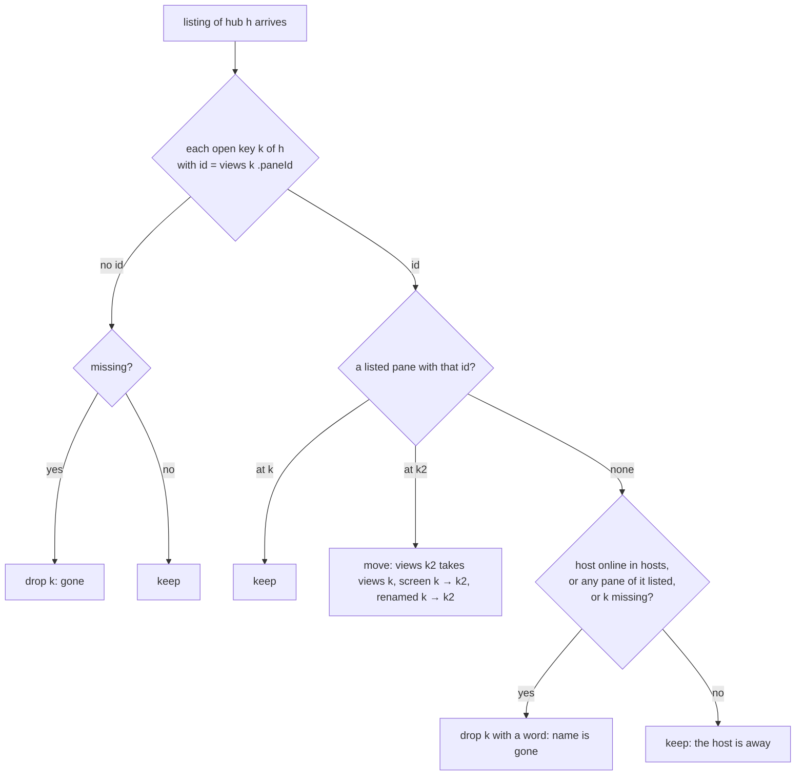

# Feature: a tile shows its own pane or nothing

> Status: written 2026-11-07 for
> [#97](https://github.com/notmarkopadjen/muxway-android/issues/97),
> parity with the core's PR 303 (`docs/plans/2026-11-05-fit-shrink-warmup-chords.md`
> there, `docs/ui-guideline.md` §1.4, the *tiles* cell), merged
> 2026-11-05 at `f3102cc`. Written and implemented the same day; the
> owner was away, so the diff is the owner's to review in the pull
> request, which is not merged until then.

## 1. Goal

An address is a position (`work/1.1`), and tmux renumbers panes when
one of their window closes: the pane at `work/1.2` becomes `work/1.1`.
A tile of the phone's pane view is a `PaneState` kept by its key, the
hub and the address, and every read of it takes whatever pane the hub
answers at that address. So when the pane at `work/1.0` exits, the tile
that showed it reads the next pane along and draws **another pane's
screen** in the box, header, name and all, for as long as the view
stays; the last pane of the window answers `404` and its tile closes,
the right word for the wrong tile. A tile reopened at an address that
another pane has since moved to shows the kept content of the old pane
for a moment, too. Both are a leak of one pane's text into another's
tile, however brief, and the guideline says they never happen: a tile
shows its own pane or nothing.

After this change a tile knows its pane by the host's **id**
(`pane_id` of the listing, learnt when the tile opens, or from its
first read when the listing had no entry yet), draws no frame of any
other pane, **follows** its pane to its new address when the host
renumbers it (the view's addresses change, the focus, the arrangement
and the minimised row stay), and **closes with a word** when the pane is
gone, no other tile changing pane. While a tile has nothing of its own
to draw it shows a short **CRT warm-up** in the theme's ink, the web's:
a bright line across the middle of the box that opens into it with a
bloom and settles through scanlines, 600 ms, the first frame coming up
under it; blank with effects off; never a borrowed screen, never a
spinner.

Out of scope: the chords (#96) and the desk (#98), the next two plans;
the watch, which reads by address through the phone and shows a tail,
not a tile (its rows carry no id; the phone's listing moves do not
reach it, as before); the web's second-stale correction of an
unconfirmed identity (the phone learns an identity from the listing it
opened the pane from, which is the same listing the person tapped).

## 2. Design

### The identity

`PaneState` gains `paneId`, the pane's id on its host; with the key
(hub and address) that names one pane. It is set:

- when a view opens or changes its addresses (`AppModel.setView`, the
  one place that now assigns `Screen.View`): from the listing the app
  holds, `panes.first { it.key == key }.paneId`. A state kept from
  before whose `paneId` names another pane than the listing's at that
  address is dropped first, so the tile starts empty: never a kept
  frame of another pane. A key the listing lacks (a pane just made, a
  link to a pane not yet listed) keeps an empty id until its first read;
- by `create` (a split, a new session), from the answer's pane, before
  the view opens;
- by the first read (`pollOnce`) when it is still empty.

`pollOnce` compares the answer's `pane_id` with the state's: a
**stranger** (another id at the address) is not taken, content, pane,
tag and time alike, the state's `error` stays as it was, and the pane's
hub is listed again at once (throttled to one asking per two seconds
per hub, since every tile of the window reads), because the listing
says where this tile's pane went. A `404` on a tile with an identity
marks the state **missing** and lists the hub too, instead of dropping
the tile at once: the pane may have moved. A `404` on a tile without an
identity drops it as today (nothing was ever known about it).

### The reconciliation

Every successful listing of a hub (`refreshList`) runs
`Follow.reconcile` (a pure function in the protocol module, unit-tested)
over the open view's keys of that hub:



- **Move.** The state travels to the new key (`PaneState.take`, as a
  resize's `follow` does today, which stays and now sets no identity
  the listing did not), `lastKind` goes with it, and the screen's
  addresses are mapped in place so the focus index and the arrangement
  (kept by count) do not change. `AppModel.renamed` (old key → new key,
  a snapshot state map) tells the view: `ViewScreen` maps its minimised
  keys and its fit-off set through it in the effect that watches the
  addresses, so a minimised pane that moved stays minimised and a tile
  with fit off keeps it off.
- **Gone.** `drop(key)` as today, and the word: `told = "<label> is
  gone"` (the pane's alias or `session/window.pane`), shown in the
  view's status area and, when the last tile left, on the pane list,
  which gains the same line.
- The host's absence (offline, or its agent's panes not in the listing
  because the agent is reconnecting) keeps the tile with its error, as
  today: a gone pane is one whose host is there without it.

### The warm-up

`PaneState.read` becomes a snapshot state (`hasOwn`: a frame of its own
has been drawn at least once). In `PaneTile`'s box, over the rows,
`Warmup(hasOwn, ink)`: a `Canvas` the size of the box. While `hasOwn`
is false it holds the lit line: a two-pixel band across the middle in
the ink with a glow. When `hasOwn` turns true an `Animatable` runs 0 → 1
over 600 ms (the web's `mx-warmup`): the band opens to the box's height
by 30 % with the alpha from 1 to 0.9, the fill is the ink at 55 % and 25
% in alternating 2 px rows (the scanlines), the alpha falls to 0.45 by
60 % and to 0 at 100 %, and the composable leaves. With the *effects*
setting off nothing is drawn: the box is blank until the frame. The
rows are composed underneath from the first frame on, so the frame
comes up through the bloom. Tagged `warmup` for the UI test, with
`warm` as a semantics state (`1` while nothing of its own, `0` while
the frame comes up).

```mermaid
sequenceDiagram
    participant V as ViewScreen
    participant M as AppModel
    participant H as hub
    V->>M: setView([work/0.0, work/0.1]); ids %3, %4 from the listing
    loop every 2 s per tile
        M->>H: GET /v1/panes/alice-laptop/work/0.1
        H-->>M: pane %4, content
        M->>M: own: content shown, hasOwn
    end
    Note over H: the pane %3 exits; tmux renumbers %4 to work/0.0
    M->>H: GET /v1/panes/alice-laptop/work/0.0
    H-->>M: pane %4
    M->>M: a stranger for the tile of %3: nothing taken; list the hub
    M->>H: GET /v1/panes/alice-laptop/work/0.1
    H-->>M: 404 not_found
    M->>M: the tile of %4 is missing; list the hub
    M->>H: GET /v1/hosts, GET /v1/panes
    H-->>M: %4 at work/0.0
    M->>M: reconcile: %3 gone (host listed), %4 moved work/0.1 → work/0.0
    M-->>V: View([work/0.0]) with %4's state; told "shell is gone"
```

## 3. Protocol and API changes

None to the protocol. Newly relied on by this client, v1 and compatible:
the listing's `pane_id`, already read, is cleaned and bounded by `Json`
(printable, 16 characters at most, the grammar `%<digits>` or empty) as
every other field is, and the `pane_id` of a read's pane is compared to
the tile's. `docs/ARCHITECTURE.md`'s *hosts and panes* row names the
id's part.

## 4. Security analysis

- **Abuse.** Nothing new reaches the hub or the host: the reads, the
  listings and the drops are the ones made today, one listing more
  after a stranger or a `404`, throttled per hub. A hostile hub can
  already answer any pane at any address; now a tile keeps to the pane
  it opened and shows nothing from an answer that names another, so
  such a hub moves or closes tiles and feeds none of them another
  pane's text.
- **Input across the boundary.** `pane_id` is text from the hub, used
  only as an opaque name compared for equality and never typed, sent
  or shown; it is cleaned of control characters and bounded, and an id
  outside the grammar is empty, which makes a tile that never learns
  one, read as before. The word told names the pane by its alias or
  address, both already shown everywhere.
- **Logging.** Nothing new is logged on the phone. The end-to-end run's
  secret search covers the hub's and the agent's logs as before.
- **Dependencies.** None added.

## 5. Privacy check

The plan, the diff, the docs and the tests name `hub.example.com`,
`alice-laptop`, `work`, `alice` and ids like `%3`. The end-to-end test
makes its panes in the throwaway tmux server; the UI step makes its own
session on the test hub. The screenshots show the test environment
only. `scripts/prepush-check.sh` before the push.

## 6. Test plan

| # | Test | Kind | Expected |
|---|------|------|----------|
| 1 | `ApiTest`: a listing whose `pane_id` carries control characters, is over 16 characters or is not `%<digits>` comes through as an empty id; a sane one as itself | unit (security) | as said |
| 2 | `FollowTest`: `Follow.reconcile` with the listing moving a pane (moved), losing it with the host online (gone), losing it with the host offline and unlisted (kept), a key without an identity kept unless missing, two tiles of one window where one moves into the other's old address (the first gone, the second moved, in one pass), the hub part of keys respected | unit | as said |
| 3 | `FollowTest`: `Follow.own` says a read is the tile's when the ids match, or when the tile has none yet; a stranger otherwise | unit | as said |
| 4 | `E2ETest f42`: two panes of one window exposed; both read, ids noted; the first killed on tmux; the hub lists the second's id at the first's address, a read at the old address is `404`, a read at the first's address names the second's id, which `Follow.own` refuses for the first tile and `Follow.reconcile` over the new listing moves the second tile and drops the first | e2e | as said |
| 5 | `FlowTest`: `+ session` makes a session of its own, `+ pane` splits it; `echo second` typed into the second tile; `exit` into the first; the first tile goes with `is gone` in the status area, the second keeps `second` on its screen under the first's old address, and one tile remains; the warm-up node is there when a tile opens and gone within two seconds | UI (`own-pane-split`, `own-pane-moved`) | assertions on tags and texts |
| 6 | the full suite, `MUXWAY_UI=0`, recorded once for this plan, the chords (#96) and the desk (#98), which share the branch and the pull request at the owner's asking | e2e | green, run issue filed |

This machine has no device and no `adb`, so the UI step (5) is written
and compiled (`:app:assembleDebugAndroidTest`) and waits for the
owner's phone or the emulator; the run record says so.

## 7. Documentation

- `docs/features/pane-view.md`: a paragraph on the tile's identity,
  the follow, the word and the warm-up, in the layout list and under
  *A pane that exits on its host*.
- `docs/ARCHITECTURE.md`: the id in the *hosts and panes* row.
- `docs/testing.md`: the unit suite's `Follow` entry.
- The core's `docs/ui-guideline.md` §1.4 *tiles* cell says *Android,
  glasses, MIDP: parity to follow*: the Android part is done by this
  change; the core repository is not edited from here, the owner's
  guideline branch takes it.

## 8. Implementation steps

1. `protocol`: `Follow` (own, reconcile) and `FollowTest`; `Json`'s
   id bound and its `ApiTest` case.
2. `app`: `PaneState.paneId`, `hasOwn`, `missing`; `AppModel.setView`,
   the stranger and the `404` in `pollOnce`, `reconcile` after a
   listing, `renamed`, the word; `ViewScreen` maps its minimised and
   fit-off keys; `Warmup`; the list shows `told`; version 0.23.0 (55).
3. `E2ETest f42`; `FlowTest` steps.
4. Docs.
5. The e2e run, recorded, and the pull request: one for the three parity plans of the day.

---

## Review (after implementation)

- [x] Diff matches the plan. Deviations: the moves the view carries its
  minimised row and fit-off set through are `AppModel.moved` with a
  count `moves` (the plan said `renamed`), and the resize's own `follow`
  reports its moves the same way, so a minimised pane moved by a layout
  stays minimised too; the id's grammar is bounded at fifteen digits
  (`%` and up to 15 digits, sixteen characters), since a listing's id is
  bounded like every field; the three parity plans of the day share one
  branch, one pull request and one recorded run, at the owner's asking.
- [x] Security rules (AGENTS.md section 2) hold: nothing new reaches the hub or the host, the one listing more after a stranger or a `404` is throttled per hub, `pane_id` is an opaque name compared for equality, cleaned and bounded, and a tile keeps to the pane it opened whatever a hub answers at its address.
- [x] Privacy check passed: the secret scan and the deny-list grep over
  the branch's commits are clean, and the diff read; the tests name
  `alice-laptop`, `work`, `own`, `phone` and `web`.
- [x] Docs and diagrams updated: the pane view page (the tile's identity, the follow, the word, the warm-up, the exit paragraph), the architecture table's two rows, the testing page, the plan's two diagrams; the core's guideline is the owner's branch to take.

## Test run

The full suite without the UI run, 349 tests, 0 failed, at `8e73653`
against the core's `9207eca` (https://github.com/notmarkopadjen/muxway-android/issues/99, `20261107-110642-8e73653`); the
secret search found nothing in 196 logs. The UI steps wait for a
device: this machine has no `adb` and no emulator, so `ui-skipped.txt`
says so and the pull request does too. The run is the one recorded for
the three plans of the branch.
