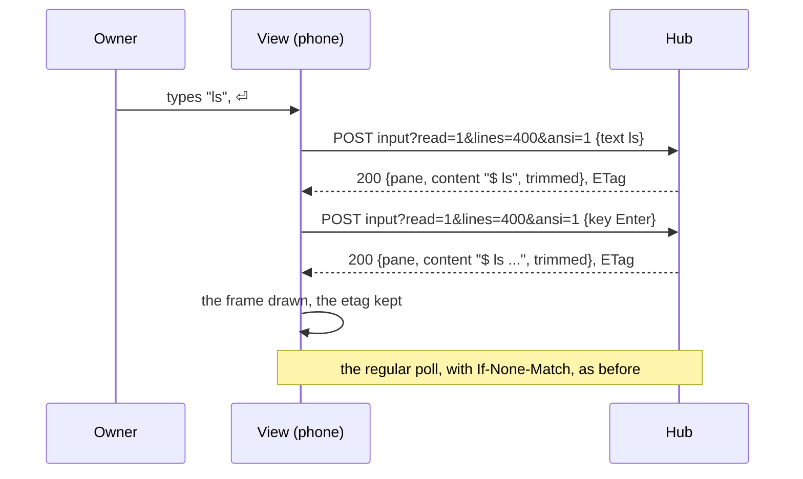

# Feature: a key's echo rides on the input's answer

> Status: written 2026-11-09 for
> [#107](https://github.com/notmarkopadjen/muxway-android/issues/107),
> parity with the core's #327 (`docs/plans/2026-11-09-echo-on-input.md`
> there; `docs/protocol/v1.md`, the input endpoint; `docs/ui-guideline.md`
> §1.4, the *reading* row), merged and deployed. Written and implemented
> on the owner's instruction in the console; the owner reviews the diff
> in the pull request and merges.

## 1. Goal

What the phone types shows two round trips after the send: the input
goes, and when it is answered the view reads the pane again
(`AppModel.send` then `pollOnce`). On a phone network a round trip is
long, so a typed line sits in the field's history for a moment before
the pane shows it. The core now answers an input with the pane's
screen when asked (`?read=1&lines=N&ansi=1`: `200` with the read's
body, `ETag` and `Muxway-Pane`, taken 30 ms after the keys landed;
`204` from an older hub).

After this change text, keys and `Enter` sent from the pane view ask
for the screen with the view's own `lines` and colours, and a `200`
answer is the view's next frame at once: content, trimmed rows, the
pane and the `ETag` for the next conditional read, the pane's identity
checked as on a read. The read that followed the send goes. A `204`
keeps today's read; the regular poll goes on unchanged either way. A
mouse input stays as it is: a click's effect is the program's to draw
and the next poll shows it.

Out of scope: the watch (it types through the phone's bridge, which
sends without `lines` and reads on its own), local echo, and the
direct-typing ghost's shadow, which follows the screen whatever brought
it.

## 2. Design

`Api.type` and `Api.key` take `lines`; with it they post to
`panes/{address}/input?read=1&lines=<lines>&ansi=1` and answer the
frame (`Json.read`, the same parser as a read's) on `200`, null on
`204`; without it they post as today and answer null. `lines` is
checked as the hub checks it (1 to 2000) before anything leaves.

`AppModel.send` takes an action that answers the frame it got, if any:
a frame is taken as `pollOnce` takes one (the pane-id check, the pane,
the change mark, content, trimmed, etag, the clock), through one shared
`take`; no frame means the read as before. `type` with `Enter` sends
the text and then `Enter`, both asking, and takes `Enter`'s frame, the
later one; the text's own frame is let go, since the line is one
round trip behind it anyway. `key` takes the key's frame. `mouse` and
`answer` answer no frame and read as before.

## 3. Protocol and API changes

None of this repository's own: it uses `?read=1`, `lines` and `ansi`
on `POST /v1/panes/{address}/input` as `docs/protocol/v1.md` defines
them. `docs/ARCHITECTURE.md` says so in the typing row.

## 4. Security analysis

- Nothing new crosses a boundary: the same input body, the same read
  body back, parsed by the same `Json.read` with its caps (2 MiB,
  control characters stripped, the etag kept printable and bounded).
- The pane-id check on the answer stands: a frame that names another
  pane at the address is not taken, as on a read.
- A `200` on an input needs the read grant as well as the write grant,
  which the hub enforces; the client asks and takes what it is given.
- No new request: one input replaces an input and a read.
- Nothing logged, no dependency.

## 5. Privacy check

Tests use the test hub's `alice-laptop` and `echo ride`; nothing of
the owner's appears.

## 6. Test plan

| # | Test | Kind | Expected |
|---|------|------|----------|
| 1 | A read-only token's type is `403` as before, with or without the screen asked (existing `s03`) | e2e-security | unchanged |
| 2 | A `200` body with control characters and a bad `ETag` on an input is cleaned as a read's is (`Json.read`, `etagOf`; existing `controlCharactersInContentAreRemoved`, `anEtagTheHubCannotHaveMeantIsDropped`) | unit | unchanged |
| 3 | `Api.type`/`key` with `lines`: the request carries `?read=1&lines=N&ansi=1` and the body; `200` gives the frame with content, trimmed, pane and the `ETag`; `204` gives null; without `lines` no query; `lines` out of range never leaves | unit (`ApiTest`) | as stated |
| 4 | e2e: typing with `lines` answers the screen that shows the text, and the relay saw exactly one request, the input, no read between; `Enter` the same, the output following on the next read | e2e | as stated |
| 5 | The existing typing flows (`f08`, `f08b`, `f09`, the keys of `f23`) keep passing | e2e | unchanged |

## 7. Documentation

`docs/features/pane-view.md` (the type and send bullets),
`docs/ARCHITECTURE.md` (the typing row).

## 8. Implementation steps

1. `Api.type`, `Api.key`, the shared `input`; `ApiTest`.
2. `AppModel.send` with the frame, `take` shared with `pollOnce`; the
   four callers.
3. The e2e flow; docs; the run (UI skipped, no device); the pull request.

## Review (after implementation)

- [x] Diff matches the plan. Deviations: none. A frame that names
  another pane at the address falls back to the read, which asks the
  listing once more; harmless and the same word twice.
- [x] Security rules hold: the same input body, the same read parser
  with its caps, the pane-id check kept, one request where there were
  two; nothing logged.
- [x] Privacy check passed: the secret scan and the deny-list grep over
  the branch's commits are clean, the diff read; the tests name
  `alice-laptop` and `echo ride`.
- [x] Docs updated: the pane view page's send bullets, the architecture
  page's typing row.

## Test run

The full suite without the UI run (`MUXWAY_UI=0`; this machine has no
device), 366 tests, 0 failed, at `e8fe9ba` against the core's main at
`e347b0c` (which carries #327)
([#109](https://github.com/notmarkopadjen/muxway-android/issues/109),
`20261109-181229-e8fe9ba`); the secret search found nothing in 199
logs. `f08c` is in it: one request for the typed text, the input
asking for the screen, no read between, the screen showing the text.
